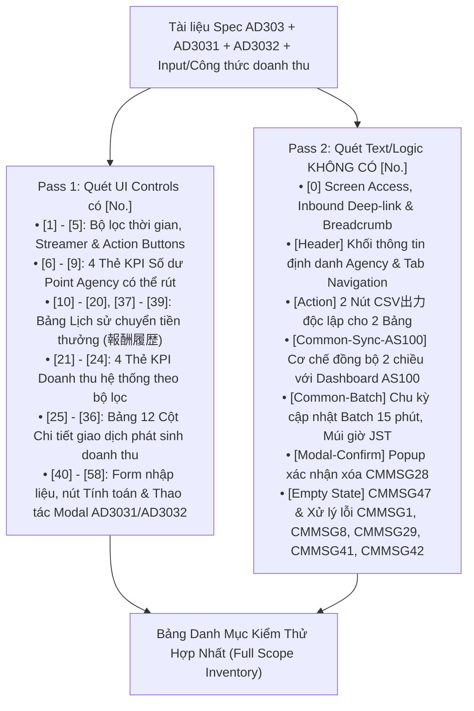
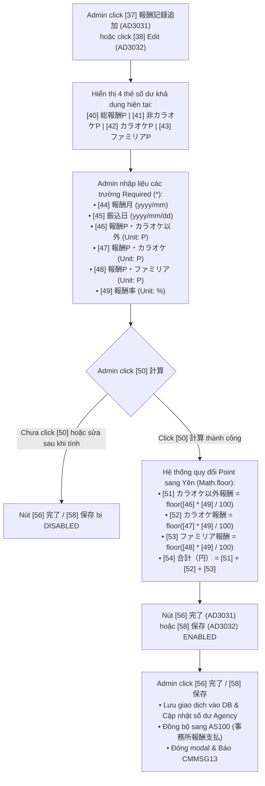
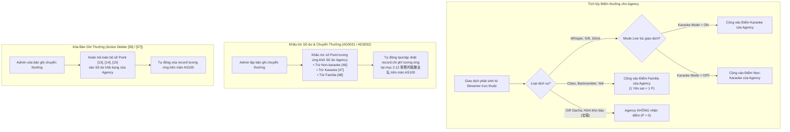

# TÀI LIỆU BÓC TÁCH ĐẶC TẢ KỸ THUẬT & LÀM RÕ YÊU CẦU (SPEC ANALYSIS & CLARIFICATION REPORT)
## Màn hình: AD303_Revenue Analysis (Phân Tích Doanh Thu & Quản Lý Thưởng Agency)
### Áp dụng: Quy chuẩn Trụ Cột 1 (Universal Spec Analysis & Clarification Rule - Rule 01)

---

## BẢNG THÔNG TIN TỔNG QUAN ĐẶC TẢ (SPECIFICATION METADATA)

| Thuộc tính | Chi tiết |
| :--- | :--- |
| **Mã màn hình** | `AD303` (kèm 2 modal con: `AD3031` và `AD3032`) |
| **Tên màn hình** | `AD303_Revenue Analysis` (事務所管理_事務所詳細_売上分析 - Phân tích doanh thu & quản lý trả thưởng Agency) |
| **Modal con trực thuộc** | • `AD3031_Create Agency Reward Record` (Tạo bản ghi chuyển tiền thưởng cho Agency) • `AD3032_Edit Agency Reward Record` (Chỉnh sửa bản ghi chuyển tiền thưởng cho Agency) |
| **Phân hệ / Module** | Quản trị Web Admin (`AA000` Master Admin Portal) / Phân hệ Quản lý Agency (`AD` Module - 事務所管理) |
| **Người tạo Spec (Created by)** | `Ly` |
| **Ngày tạo (Created Date)** | 02/11/2026 |
| **Nguồn Spec Google Sheets** | [Google Spreadsheet - Tab AD303 (gid=2071307331)](https://docs.google.com/spreadsheets/d/1pxox5GcjOXwKadMnzOa765ptG2huPJSxCiWsrH0_h7Y/edit?gid=2071307331#gid=2071307331) |
| **Nguồn Tham chiếu Nghiệp vụ** | • Tab `Input + Công thức doanh thu` (gid=974356085) • Tab `AS100` (gid=1263482685) - Dashboard doanh thu toàn hệ thống • Tab `CommonSpec` (gid=170791648) & `Common MSG` (gid=1080253487) |
| **Nguồn Thiết kế Figma** | • **AD303 Screen:** [Figma Node: AD303_Revenue Analysis (node-id=11205-14224)](https://www.figma.com/design/r5RjkwIfMhChaq83OsBkf8/Admin-Layout---Spec-PDF?node-id=11205-14224&t=mbSUOB2QPRctcTJ7-0) • **AD3031 Modal:** [Figma Node: AD3031_Create Agency Reward Record (node-id=11209-15126)](https://www.figma.com/design/r5RjkwIfMhChaq83OsBkf8/Admin-Layout---Spec-PDF?node-id=11209-15126&t=mbSUOB2QPRctcTJ7-0) • **AD3032 Modal:** [Figma Node: AD3032_Edit Agency Reward Record (node-id=11359-12514)](https://www.figma.com/design/r5RjkwIfMhChaq83OsBkf8/Admin-Layout---Spec-PDF?node-id=11359-12514&t=mbSUOB2QPRctcTJ7-0) |
| **Thư viện UI chuẩn** | Shadcn UI Data Table (`https://ui.shadcn.com/docs/components/data-table`) |
| **Luồng Điều hướng Vào (Inbound Flow)** | Từ danh sách Agency `AD100` $\rightarrow$ Chọn một Agency để vào `AD301` (Agency Info) / `AD302` (Streamer List) $\rightarrow$ Click chọn Tab `売上` (hoặc `売上分析`) để mở `AD303` |
| **Ngôn ngữ hiển thị chính (Primary Language)** | Tiếng Nhật (Japanese - JA) |

---

## I. KẾT QUẢ QUÉT ĐẶC TẢ 2 BƯỚC BẮT BUỘC (2-PASS SCANNING PROTOCOL)

---

### 1. Pass 1 - Danh Mục UI Controls Có Mã Số `[No.]` (Item [1] đến [58])

Toàn bộ các control có số thứ tự trong tài liệu Spec được bóc tách và phân loại thành 5 khối chức năng rành mạch:

#### A. Khối Bộ Lọc Tìm Kiếm & Thao Tác (Controls [1] - [5])
| No. | Tên Phần Tử (Value JP) | Loại UI Control | Giá Trị Mặc Định | Ràng Buộc & Chi Tiết Kỹ Thuật / Nghiệp Vụ (Details) |
| :---: | :--- | :--- | :--- | :--- |
| `[1]` | `期間` (Khoảng thời gian) | `label` + 2 `datepicker` | • Start Date: Ngày 01 tháng trước (JST) • End Date: Ngày cuối tháng trước 23:59:59 (JST) | • Định dạng hiển thị: `YYYY/MM/DD`. • Chặn chọn ngày ngược trên UI: `End Date` không được nhỏ hơn `Start Date` (Tuân thủ **CMR38**). • Phạm vi áp dụng: Lọc dữ liệu cả 2 bảng (Bảng 1: Lịch sử thưởng, Bảng 2: Chi tiết giao dịch) và khối 4 thẻ KPI doanh thu `[21]-[24]`. **Không áp dụng lọc cho 4 thẻ số dư `[6]-[9]`**. |
| `[2]` | Nhóm nút bấm lọc thời gian nhanh | `button` group (4 nút) | Chưa active nút nào (hoặc mặc định highlight ứng với tháng trước) | Gồm 4 nút bấm chọn nhanh thời gian: • `今日` (Hôm nay) • `今週` (Tuần này) • `今月` (Tháng này) • `先月` (Tháng trước) • *Ghi chú Spec:* Áp dụng cho cả 2 bảng + tổng quan doanh thu, không áp dụng cho khối số dư. |
| `[3]` | `全ライバー` (Lọc theo Streamer) | `pulldown` (Dropdown 1 lựa chọn) | `全ライバー` (Tất cả Streamer) | • Danh sách tùy chọn:   + `全ライバー` (Tất cả streamer)   + Danh sách các streamer trực thuộc Agency hiện tại. • Chọn 1 streamer để lọc danh sách. • Phạm vi áp dụng: Lọc Bảng chi tiết giao dịch `[25]-[36]` và các thẻ KPI doanh thu tương ứng. |
| `[4]` | `検索` (Tìm kiếm) | `button` (Primary) | Có thể click | Gửi request lên server để tìm kiếm/tải lại dữ liệu cả 2 bảng và tính toán lại các thẻ KPI doanh thu theo điều kiện lọc. |
| `[5]` | `クリア` (Làm mới/Reset) | `button` (Secondary) | Có thể click | Khôi phục toàn bộ điều kiện tìm kiếm về trạng thái mặc định ban đầu. |

---

#### B. Khối Thẻ Thống Kê Số Dư Point Agency Có Thể Rút (Controls [6] - [9])
> [!NOTE]
> Khối này phản ánh **Số Dư Điểm Thưởng Khả Dụng (Withdrawable Reward Points Balance)** hiện có của Agency tại thời điểm hiện tại. Số liệu này **độc lập hoàn toàn** với bộ lọc thời gian và bộ lọc streamer.

| No. | Tên Thẻ KPI (Value JP) | Loại UI | Ý Nghĩa Nghiệp Vụ & Nguồn Dữ Liệu |
| :---: | :--- | :--- | :--- |
| `[6]` | `報酬ポイント合計（P）：{amount}` | `label` (KPI Card) | **Tổng số dư Point mà Agency có thể rút:** Bằng tổng số dư: `[7] + [8] + [9]`. Được tích lũy từ các hoạt động tạo ra doanh thu/quà tặng của streamer trực thuộc agency (sau khi trừ đi các lần admin đã chuyển tiền). |
| `[7]` | `カラオケ以外ポイント（P)：{amount}` | `label` (KPI Card) | **Tổng số dư Point Non-Karaoke mà Agency có thể rút:** Tích lũy từ Whisper, Gift, 2shot phát sinh khi streamer **tắt** chế độ Karaoke (hoặc accept 2shot lúc tắt Karaoke). |
| `[8]` | `カラオケポイント（P）：{amount}` | `label` (KPI Card) | **Tổng số dư Point Karaoke mà Agency có thể rút:** Tích lũy từ Whisper, Gift, 2shot phát sinh khi streamer **bật** chế độ Karaoke (hoặc accept 2shot lúc bật Karaoke). |
| `[9]` | `ファミリア報酬P換算（P）：{amount}` | `label` (KPI Card) | **Tổng số dư Point Familia mà Agency có thể rút:** Quy đổi từ doanh thu các giao dịch Class, Mua Backnumber của các streamer thuộc agency theo tỷ lệ quy ước `1 Yên = 1 Point` (giá gốc streamer set), cộng với điểm Yell/Donate bằng GP. |

---

#### C. Khối Bảng 1: Lịch Sử Chuyển Tiền Thưởng Cho Agency (`報酬履歴`) & Thao Tác (Controls [10] - [20], [37] - [39])
> [!IMPORTANT]
> Danh sách các giao dịch Admin chuyển tiền thưởng cho Agency (do Admin tự tạo bản ghi qua modal `AD3031` hoặc chỉnh sửa qua `AD3032`). Mọi thao tác Create/Edit/Delete trên bảng này **bắt buộc phải được phản ánh đồng bộ 2 chiều lên Dashboard doanh thu toàn hệ thống `AS100`** (mục `2.12 事務所報酬支払`).

| No. | Tên Cột / Phần Tử (Value JP) | Loại UI Control | Định Dạng Dữ Liệu & Ràng Buộc Nghiệp Vụ |
| :---: | :--- | :--- | :--- |
| `[-]` | `報酬履歴` | `label` (Table Title) | Tiêu đề khối bảng lịch sử giao dịch chuyển tiền cho Agency. |
| `[-]` | `CSV出力` (Bảng 1) | `button` (Action) | Tải toàn bộ các dòng và cột trong bảng lịch sử thưởng thỏa mãn điều kiện lọc thành file CSV `{startdate}-{endate}.csv`. |
| `[37]` | `報酬記録追加` | `button` (Primary) | Nút bấm đặt phía trên bảng. Click để mở modal `AD3031` (Thêm bản ghi thưởng mới). |
| `[10]` | `振込日` | `label` (Column Header) | Thời gian Admin thực hiện chuyển tiền (nhập tại trường `振込日` ở modal `AD3031`/`AD3032`, định dạng `YYYY/MM/DD`). |
| `[11]` | `報酬月` | `label` (Column Header) | Tháng tính thưởng tương ứng do Admin nhập ở modal (`YYYY/MM`). |
| `[12]` | `報酬ポイント合計` | `label` (Column Header) | Tổng số Point đã được sử dụng trong giao dịch chuyển tiền này: `[12] = [13] + [14] + [15]`. |
| `[13]` | `報酬ポイント・カラオケ以外` | `label` (Column Header) | Số Point Non-karaoke đã khấu trừ trong giao dịch chuyển tiền này. |
| `[14]` | `報酬ポイント・カラオケ` | `label` (Column Header) | Số Point Karaoke đã khấu trừ trong giao dịch chuyển tiền này. |
| `[15]` | `報酬ポイント・ファミリア` | `label` (Column Header) | Số Point Familia đã khấu trừ trong giao dịch chuyển tiền này. |
| `[16]` | `報酬率` | `label` (Column Header) | Tỷ lệ % thưởng áp dụng do Admin nhập ở modal (Ví dụ: `10%`, `15.5%`). |
| `[17]` | `報酬額合計（円）` | `label` (Column Header) | Tổng số tiền Yên thực tế Admin chuyển cho Agency: `[17] = [18] + [19] + [20]`. Format phân cách hàng nghìn. |
| `[18]` | `報酬額（円）・カラオケ以外` | `label` (Column Header) | Tiền thưởng Non-karaoke quy đổi từ Point (`Math.floor([13] * [16] / 100)`). |
| `[19]` | `報酬額（円）・カラオケ` | `label` (Column Header) | Tiền thưởng Karaoke quy đổi từ Point (`Math.floor([14] * [16] / 100)`). |
| `[20]` | `報酬額（円）・ファミリア` | `label` (Column Header) | Tiền thưởng Familia quy đổi từ Point (`Math.floor([15] * [16] / 100)`). |
| `[38]` | Icon / Button Sửa | `button` (Row Action) | Đặt ở từng dòng. Click để mở modal `AD3032` (Chỉnh sửa bản ghi chuyển tiền thưởng). |
| `[39]` | Icon / Button Xóa | `button` (Row Action) | Đặt ở từng dòng. Click để mở popup xác nhận xóa với nội dung **`CMMSG28`** (`本当に進みますか？`). Nếu xác nhận, xóa bản ghi, hoàn trả lại số Point đã khấu trừ vào số dư Agency và đồng bộ xóa trên màn `AS100`. |

---

#### D. Khối Bảng 2: Thống Kê KPI Doanh Thu & Bảng Chi Tiết Giao Dịch (Controls [21] - [36])

##### 1. Khối 4 Thẻ KPI Doanh Thu Hệ Thống Theo Bộ Lọc (Controls [21] - [24])
> [!NOTE]
> Phản ánh tổng doanh thu phát sinh từ tất cả các streamer trực thuộc Agency này theo khoảng thời gian và streamer được chọn. **Nguyên tắc:** Chỉ các giao dịch sử dụng Point (P) hoặc thanh toán tiền mặt/Store mới được tính vào doanh thu hệ thống. Tiêu bằng Gift Point (GP) không tính vào doanh thu.

| No. | Tên Thẻ KPI (Value JP) | Loại UI | Công Thức & Ý Nghĩa Nghiệp Vụ |
| :---: | :--- | :--- | :--- |
| `[21]` | `合計売上（円）：{amount}` | `label` (KPI Card) | **Tổng doanh thu hệ thống:** Bằng `[22] + [23] + [24]`. |
| `[22]` | `カラオケ配信売上（円）：{amount}` | `label` (KPI Card) | **Tổng doanh thu Livestream Karaoke:** Doanh thu phát sinh khi streamer đang bật mode Karaoke. |
| `[23]` | `カラオケ配信以外売上（円）：{amount}` | `label` (KPI Card) | **Tổng doanh thu Non-Karaoke:** Doanh thu phát sinh khi streamer tắt mode Karaoke. |
| `[24]` | `ファミリア売上（円）：{amount}` | `label` (KPI Card) | **Tổng doanh thu Familia:** Doanh thu từ User đăng ký tham gia Class hoặc Mua Backnumber của streamer. |

##### 2. Khối Bảng Chi Tiết Giao Dịch Phát Sinh Doanh Thu - 12 Cột (Controls [25] - [36])
| No. | Tên Cột (Value JP) | Loại Control | Định Dạng Dữ Liệu & Quy Tắc Hiển Thị |
| :---: | :--- | :--- | :--- |
| `[-]` | `CSV出力` (Bảng 2) | `button` (Action) | Tải toàn bộ các dòng và cột trong bảng chi tiết giao dịch thành file CSV `{startdate}-{endate}.csv`. |
| `[25]` | `開始時間` | `label` (Column Header) | • Giao dịch livestream: Thời gian bắt đầu livestream (`YYYY/MM/DD HH:mm:ss`). • Giao dịch familia: Thời điểm xảy ra giao dịch (`YYYY/MM/DD HH:mm:ss`). • **Sắp xếp mặc định:** Mới $\rightarrow$ Cũ (DESC). |
| `[26]` | `終了時間` | `label` (Column Header) | • Giao dịch livestream: Thời gian kết thúc livestream (`YYYY/MM/DD HH:mm:ss`). • Giao dịch familia: Hiển thị gạch ngang `ー`. • **Sắp xếp:** Hỗ trợ toggle 2 chiều (Mới $\rightarrow$ Cũ, Cũ $\rightarrow$ Mới). |
| `[27]` | `利用者` (Người dùng) | `label` / Link | • Format: `{username} ({userID})`. • **Tương tác:** Click vào sẽ mở màn hình chi tiết người dùng `AE200` tương ứng trong tab mới. |
| `[28]` | `ライバー` (Streamer) | `label` / Link | • Format: `{username} ({userID})` của streamer trực thuộc agency. • **Tương tác:** Click vào sẽ mở màn hình chi tiết user `AE200` tương ứng trong tab mới. |
| `[29]` | `カテゴリー` | `label` (Cell Data) | Loại hình của streamer tại thời điểm giao dịch (VD: `Vライバー`, `リアルライバー`...). |
| `[30]` | `配信状態` | `label` (Cell Data) | • Giao dịch trong livestream: `通常` (Stream thường), `2ショット` (Stream 2shot), `ファミリア限定` (Stream familia). • Giao dịch ngoài livestream: Hiển thị `ー`. |
| `[31]` | `サービス` | `label` (Cell Data) | Tên loại dịch vụ/giao dịch: `ウィスパー`, `ギフト`, `ギフトガチャ`, `2ショットチケット消費`, `宝箱`, `クラス参加`, `バックナンバー購入`, `エール`. |
| `[32]` | `元ソース` | `label` / Link | • Giao dịch trong livestream: Hiển thị `Stream ID`. Click vào sẽ chuyển hướng sang màn hình xem archive stream tương ứng `AG500`. • Giao dịch không trong livestream: Hiển thị `ー`. |
| `[33]` | `GP/P` | `label` (Cell Data) | • Số Point hoặc Gift Point sử dụng trong giao dịch:   + Nếu dùng Point: `{amount} P`   + Nếu dùng Gift Point: `{amount} GP` • Giao dịch không dùng P/GP (ví dụ tiền mặt/Store): Hiển thị `ー`. |
| `[34]` | `カラオケ配信以外売上（円）` | `label` (Cell Data) | • Số tiền Yên doanh thu thường (non-karaoke, non-familia). • Nếu không phải doanh thu non-karaoke: Hiển thị `ー`. |
| `[35]` | `カラオケ配信売上（円）` | `label` (Cell Data) | • Số tiền Yên doanh thu karaoke. • Nếu không phải doanh thu karaoke: Hiển thị `ー`. |
| `[36]` | `ファミリア売上（円）` | `label` (Cell Data) | • Số tiền Yên doanh thu familia. • Nếu không phải doanh thu familia: Hiển thị `ー`. |

---

#### E. Khối Modal Thêm / Chỉnh Sửa Bản Ghi Thưởng Agency (`AD3031` / `AD3032`) (Controls [40] - [58])

| No. | Tên Trường / Control (Value JP) | Loại UI Control | Bắt Buộc | Ràng Buộc Kỹ Thuật, Cận Biên & Mã Lỗi Chi Tiết |
| :---: | :--- | :--- | :---: | :--- |
| `[40]` | `報酬ポイント合計（P）` | `label` (Modal Card) | - | Tổng số dư P hiện tại Agency có thể rút (`[41] + [42] + [43]`). |
| `[41]` | `カラオケ以外ポイント（P）` | `label` (Modal Card) | - | Số dư P Non-karaoke hiện tại Agency có thể rút. |
| `[42]` | `カラオケポイント（P）` | `label` (Modal Card) | - | Số dư P Karaoke hiện tại Agency có thể rút. |
| `[43]` | `ファミリア報酬P換算（P）` | `label` (Modal Card) | - | Số dư P Familia hiện tại Agency có thể rút. |
| `[44]` | `報酬月` | `label` + `datepicker` | **YES** | Datepicker chọn tháng tính thưởng theo format `YYYY/MM`. Để trống báo lỗi **`CMMSG29`**. |
| `[45]` | `振込日` | `label` + `datepicker` | **YES** | Datepicker chọn ngày chuyển tiền theo format `YYYY/MM/DD`. Để trống báo lỗi **`CMMSG29`**. |
| `[46]` | `報酬ポイント・カラオケ以外` | `label` + `input(textbox)` + `P` | **YES** | • Chỉ cho phép nhập số nguyên. • Default: `10`. Để trống báo lỗi **`CMMSG29`**. • Min: `0` (Nhỏ hơn 0 báo **`CMMSG41`**). • **Max limit:**   + **Màn Create (AD3031):** $\le$ Số dư P non-karaoke đang sở hữu (`[41]`). Vượt quá báo **`CMMSG42`**.   + **Màn Edit (AD3032):** $\le$ Số dư hiện tại + Số P non-karaoke của chính record đang edit. Vượt quá báo **`CMMSG42`**. • Thành công báo **`CMMSG13`**. |
| `[47]` | `報酬ポイント・カラオケ` | `label` + `input(textbox)` + `P` | **YES** | • Chỉ cho phép nhập số nguyên. • Default: `10`. Để trống báo lỗi **`CMMSG29`**. • Min: `0` (Nhỏ hơn 0 báo **`CMMSG41`**). • **Max limit:**   + **Màn Create (AD3031):** $\le$ Số dư P karaoke đang sở hữu (`[42]`). Vượt quá báo **`CMMSG42`**.   + **Màn Edit (AD3032):** $\le$ Số dư hiện tại + Số P karaoke của chính record đang edit. Vượt quá báo **`CMMSG42`**. • Thành công báo **`CMMSG13`**. |
| `[48]` | `報酬ポイント・ファミリア` | `label` + `input(textbox)` + `P` | **YES** | • Chỉ cho phép nhập số nguyên. • Default: `10`. Để trống báo lỗi **`CMMSG29`**. • Min: `0` (Nhỏ hơn 0 báo **`CMMSG41`**). • **Max limit:**   + **Màn Create (AD3031):** $\le$ Số dư P familia đang sở hữu (`[43]`). Vượt quá báo **`CMMSG42`**.   + **Màn Edit (AD3032):** $\le$ Số dư hiện tại + Số P familia của chính record đang edit. Vượt quá báo **`CMMSG42`**. • Thành công báo **`CMMSG13`**. |
| `[49]` | `報酬率` | `label` + `input(textbox)` + `%` | **YES** | • Cho phép nhập số nguyên hoặc số thập phân. • Default: `10`. Để trống báo lỗi **`CMMSG29`**. • Min: `0` (Nhỏ hơn 0 báo **`CMMSG41`**). • Max: `100` (Lớn hơn 100 báo **`CMMSG42`**). • Thành công báo **`CMMSG13`**. |
| `[-]` | `報酬額` | `label` (CMR03) | - | Label tiêu đề khối kết quả quy đổi (Tuân thủ **CMR03**). |
| `[50]` | `計算` (Tính toán) | `button` (Action) | - | • Click để quy đổi số P đã nhập ở `[46]`, `[47]`, `[48]` sang số Yên tương ứng theo tỷ lệ `[49]`. • **Quy tắc làm tròn:** Nếu kết quả là số thập phân $\rightarrow$ **Làm tròn xuống (`Math.floor`)**. • **Điều kiện tiên quyết:** Bắt buộc phải click `計算` thành công thì các nút hoàn tất mới được enable. |
| `[51]` | `カラオケ以外報酬（円）：` | `label` (Result Display) | - | Tiền thưởng Non-karaoke dự kiến = `Math.floor([46] * [49] / 100)`. Format phân cách hàng nghìn. |
| `[52]` | `カラオケ報酬（円）：` | `label` (Result Display) | - | Tiền thưởng Karaoke dự kiến = `Math.floor([47] * [49] / 100)`. Format phân cách hàng nghìn. |
| `[53]` | `ファミリア報酬（円）：` | `label` (Result Display) | - | Tiền thưởng Familia dự kiến = `Math.floor([48] * [49] / 100)`. Format phân cách hàng nghìn. |
| `[54]` | `合計（円）：` | `label` (Result Display) | - | Tổng số tiền thưởng Admin sẽ chuyển cho Agency = `[51] + [52] + [53]`. |
| `[55]` | `キャンセル` | `button` (Secondary) | - | Hủy bỏ thao tác, đóng modal và không lưu bất kỳ thay đổi nào. |
| `[56]` | `完了` (Hoàn tất tạo mới) | `button` (Primary) | - | • **Áp dụng:** Màn hình `AD3031`. • **Điều kiện Enable:** Bắt buộc nhập đúng/đủ tất cả các field required VÀ đã click button `計算` thành công. • **Hành động:** Tạo record chuyển thưởng, khấu trừ số dư của Agency, **phản ánh đồng bộ sang màn `AS100`**, đóng modal. |
| `[57]` | `削除` (Xóa bản ghi) | `button` (Danger) | - | • **Áp dụng:** Màn hình `AD3032`. • Click mở popup xác nhận xóa với thông báo **`CMMSG28`**. • Xác nhận: Xóa record, hoàn lại điểm cho số dư của Agency, **phản ánh xóa tương ứng trên màn `AS100`**, đóng modal. |
| `[58]` | `保存` (Lưu chỉnh sửa) | `button` (Primary) | - | • **Áp dụng:** Màn hình `AD3032`. • **Điều kiện Enable:** Bắt buộc nhập đúng/đủ các field required VÀ đã click button `計算` thành công. • **Hành động:** Lưu cập nhật, điều chỉnh lại số dư Point của Agency theo chênh lệch, **phản ánh cập nhật lên màn `AS100`**, đóng modal. |

---

### 2. Pass 2 - Quét Các Phần Tử & Logic KHÔNG CÓ `[No.]` (Chống Bỏ Sót Logic)

| Mã Định Danh Chuẩn Hóa | Tên Phần Tử / Khối Logic | Loại | Mô Tả Chi Tiết Theo Spec & Common Rules |
| :--- | :--- | :--- | :--- |
| **`[0] Screen Access & Lifecycle`** | Khởi tạo màn hình, Deep-link & Breadcrumb | System Flow | • Đường dẫn Breadcrumb: `＞ 事務所管理 ＞ 事務所詳細` (chuyển qua tab `売上` hoặc `売上分析`). • Nhận tham số định danh Agency qua URL (Path param `/admin/agencies/{agency_id}/revenue` hoặc query `?agency_id={id}`). • F5 Reload giữ nguyên bộ lọc và tab hiện tại. • Nút Back / Breadcrumb quay về danh sách Agency `AD100` hoặc trang chi tiết `AD301`. |
| **`[Header-Agency-Profile]`** | Thông tin tóm tắt Agency | `label` / Display | Hiển thị thông tin định danh của Agency đang xem (Tên Agency, ID Agency, Logo Agency) ở đầu trang để Admin xác định chính xác đối tượng. |
| **`[Table1-Header-Actions]`** | Header Bảng 1: Lịch sử thưởng | UI Layout | Bao gồm tiêu đề `報酬履歴`, nút `報酬記録追加` (Item [37]) và nút `CSV出力` (Bảng 1). |
| **`[Table1-CSV]`** | Nút xuất CSV Bảng 1 | `button` (Action) | Text hiển thị: `CSV出力`. Click để xuất toàn bộ các dòng của bảng Lịch sử chuyển tiền thưởng thỏa mãn bộ lọc thành file CSV `{startdate}-{endate}.csv`. |
| **`[Table1-Pagination]`** | Phân trang Bảng 1 | `navigation` | Phân trang độc lập cho Bảng 1, hỗ trợ chọn trang và số bản ghi/trang. |
| **`[Table2-Header-Actions]`** | Header Bảng 2: Chi tiết giao dịch | UI Layout | Bao gồm tiêu đề `各取引の詳細`, khối 4 thẻ KPI doanh thu và nút `CSV出力` (Bảng 2). |
| **`[Table2-CSV]`** | Nút xuất CSV Bảng 2 | `button` (Action) | Text hiển thị: `CSV出力`. Click để xuất toàn bộ các dòng của bảng Chi tiết giao dịch thỏa mãn bộ lọc thành file CSV `{startdate}-{endate}.csv`. |
| **`[Table2-Pagination]`** | Phân trang Bảng 2 | `navigation` | Phân trang độc lập cho Bảng 2 (Tuân thủ Shadcn Data Table), hỗ trợ phân trang chuẩn 10 rows/page. |
| **`[Common-Sync-AS100]`** | Đồng bộ 2 chiều với Dashboard Doanh Thu | Logic Nghiệp Vụ | Căn cứ mục `2.12 事務所報酬支払`: Mọi thao tác Thêm (`[56]`), Sửa (`[58]`), Xóa (`[39]`, `[57]`) bản ghi chuyển tiền thưởng cho Agency trên `AD303` **bắt buộc phải tự động tạo / cập nhật / xóa bản ghi chi phí tương ứng trên Dashboard doanh thu toàn hệ thống `AS100`**. |
| **`[Common-Balance-Rule]`** | Tính chất Độc Lập của Khối Số Dư Point | Logic Nghiệp Vụ | Khối 4 thẻ số dư Point `[6] - [9]` phản ánh **số dư khả dụng hiện tại** của Agency. Bộ lọc ngày `[1]`, các nút quick filter `[2]` và bộ lọc streamer `[3]` **tuyệt đối không làm thay đổi số liệu của khối số dư `[6] - [9]`**. |
| **`[Common-Batch] Business Rules`** | Chu kỳ cập nhật dữ liệu qua Batch Job | Logic Nghiệp Vụ | Dữ liệu doanh thu từ livestream và điểm thưởng Agency được tổng kết định kỳ qua batch worker **15 phút/lần**. Giao dịch livestream đang diễn ra chưa được kết toán vào bảng cho đến khi stream kết thúc. |
| **`[Common-Timezone] Business Rules`** | Quy chuẩn Múi giờ hệ thống | Logic Nghiệp Vụ | Mọi thao tác lọc ngày, hiển thị `振込日`, `報酬月`, `開始時間`, `終了時間` đều chuẩn hóa theo múi giờ Nhật Bản **JST (UTC+9)**. |
| **`[39-Modal] / [57-Modal]`** | Popup xác nhận xóa bản ghi thưởng | `modal` (Confirm) | Hiển thị popup xác nhận với mã thông báo **`CMMSG28`**: `本当に進みますか？` kèm 2 nút Xác nhận (OK/削除) và Hủy bỏ (キャンセル). |
| **`[Empty State]`** | Trạng thái không có dữ liệu tìm kiếm | `display` | Khi không có bản ghi nào trong Bảng 1 hoặc Bảng 2, hiển thị thông báo **`CMMSG47`**: `一致する検索結果はありません。`. |
| **`[Error Handling]`** | Xử lý lỗi hệ thống & mạng | `feedback` | • Lỗi kết nối mạng: Báo **`CMMSG8`** (`ネットワークエラー。接続を確認してください。`). • Lỗi máy chủ 500: Báo **`CMMSG1`** (`予期しないサーバーエラーが発生しました。`). • Hết hạn phiên đăng nhập: Báo **`CMMSG10`** và điều hướng về trang Login. |

---

## II. ĐỐI CHIẾU THIẾT KẾ 1:1 (DESIGN EXTRACTION & CROSS-CHECK)

- **Figma AD303:** [Figma Node: AD303_Revenue Analysis (node-id=11205-14224)](https://www.figma.com/design/r5RjkwIfMhChaq83OsBkf8/Admin-Layout---Spec-PDF?node-id=11205-14224&t=mbSUOB2QPRctcTJ7-0)
- **Figma AD3031:** [Figma Node: AD3031_Create Agency Reward Record (node-id=11209-15126)](https://www.figma.com/design/r5RjkwIfMhChaq83OsBkf8/Admin-Layout---Spec-PDF?node-id=11209-15126&t=mbSUOB2QPRctcTJ7-0)
- **Figma AD3032:** [Figma Node: AD3032_Edit Agency Reward Record (node-id=11359-12514)](https://www.figma.com/design/r5RjkwIfMhChaq83OsBkf8/Admin-Layout---Spec-PDF?node-id=11359-12514&t=mbSUOB2QPRctcTJ7-0)

### Bảng Đối Chiếu Text Từng Control (Strict Text Matching):

| Vị Trí / Control | Chuỗi Text Trong Spec | Chuỗi Text Trên Figma | Trạng Thái Đối Chiếu | Ghi Chú & Sai Lệch Phát Hiện |
| :--- | :--- | :--- | :---: | :--- |
| **Breadcrumbs** | `＞ 事務所管理 ＞ 事務所詳細` | `＞ 事務所管理 ＞ 事務所詳細` | `[Matched]` | Hiển thị cấu trúc đường dẫn rõ ràng ở đầu trang. |
| **Tab Navigation** | Tab `売上` (hoặc `売上分析`) | Tab `売上` nằm cạnh Tab `詳細` (AD301) & `ライバー一覧` (AD302) | `[Matched]` | Chuyển đổi tab mượt mà trong ngữ cảnh xem Agency Detail. |
| **Bộ lọc Ngày [1]** | `期間` (Start date ~ End date) | `期間` kèm 2 datepicker | `[Matched]` | Placeholder / format hiển thị `yyyy/mm/dd`. |
| **Nút Quick Filter [2]** | `今日`, `今週`, `今月`, `先月` | 4 nút bấm chọn nhanh thời gian | `[Matched]` | Không có nút `昨日` (Hôm qua) như ở màn `AE800`/`AS100`. |
| **Dropdown Streamer [3]** | `全ライバー` | `全ライバー` (Select dropdown) | `[Matched]` | Giá trị mặc định hiển thị đúng. |
| **Nút Tìm kiếm & Reset [4, 5]** | `検索`, `クリア` | `検索` (Primary), `クリア` (Secondary) | `[Matched]` | Vị trí đặt cạnh dropdown Streamer. |
| **4 Thẻ Số Dư Point [6 - 9]** | `報酬ポイント合計（P）`, `カラオケ以外ポイント（P）`... | Khối thẻ Card hiển thị số dư | `[Matched]` | Số liệu căn phải, có nhãn đơn vị `P`. |
| **Tiêu đề Bảng 1** | `報酬履歴` | `報酬履歴` | `[Matched]` | Tiêu đề khối lịch sử Admin chuyển tiền. |
| **Nút Thêm bản ghi [37]** | `報酬記録追加` | `報酬記録追加` | `[Matched]` | Nút màu xanh (Primary) đặt cạnh tiêu đề bảng 1. |
| **Nút Xuất CSV Bảng 1 & 2** | `CSV出力` | `CSV出力` | `[Discrepancy - Q8]` | Cả 2 bảng đều có nút `CSV出力` với cùng tên file tải về `{startdate}-{endate}.csv` $\rightarrow$ Cần phân biệt tên file để tránh bị ghi đè! |
| **11 Cột Bảng 1 [10 - 20]** | Header No. [10] đến [20] | Table Data Grid (Lịch sử thưởng) | `[Matched]` | Các cột tiền thưởng có định dạng phân cách hàng nghìn. |
| **Cột Thao tác Bảng 1 [38, 39]** | Icon Sửa / Icon Xóa | Cột Action (Edit / Delete icons) | `[Matched]` | Icon bút chì mở AD3032, icon thùng rác mở popup CMMSG28. |
| **4 Thẻ KPI Doanh Thu [21 - 24]** | `合計売上（円）`, `カラオケ配信売上（円）`... | Khối thẻ Card tổng quan doanh thu | `[Matched]` | Đơn vị tiền tệ `円` căn lề rõ ràng. |
| **12 Cột Bảng 2 [25 - 36]** | Header No. [25] đến [36] | Table Data Grid (Chi tiết giao dịch) | `[Matched]` | Cột [25] có icon sort DESC mặc định, cột [26] sort toggle; Cột [27], [28], [32] dạng link màu xanh. |
| **Modal Header AD3031** | `報酬記録追加` | `報酬記録追加` | `[Matched]` | Tiêu đề modal thêm bản ghi. |
| **Modal Header AD3032** | `報酬記録編集` (Edit) | `報酬記録編集` | `[Matched]` | Tiêu đề modal chỉnh sửa bản ghi. |
| **4 Thẻ Số Dư trong Modal [40-43]** | `報酬ポイント合計（P）`... | Thẻ hiển thị số dư khả dụng | `[Matched]` | Dùng làm hạn mức Max để validate ô nhập Point. |
| **Form Fields Modal [44 - 49]** | `報酬月`, `振込日`, `報酬P...`, `報酬率` | Input fields kèm đơn vị `P`, `%` | `[Matched]` | Các nhãn có dấu hoa thị `*` biểu thị bắt buộc (Required). |
| **Khối Tính Toán Modal [50 - 54]** | `報酬額`, `計算`, các nhãn kết quả | Nút `計算` và khối kết quả quy đổi | `[Matched]` | Nút `完了` / `保存` bị disable cho đến khi click `計算`. |
| **Nút Action Modal [55 - 58]** | `キャンセル`, `完了`, `削除`, `保存` | Footer buttons của modal | `[Matched]` | `AD3031` gồm Cancel/Hoàn tất; `AD3032` gồm Cancel/Xóa/Lưu. |

---

## III. MA TRẬN LOGIC NGHIỆP VỤ CỐT LÕI (BUSINESS LOGIC MATRIX - TIER 2)

### 1. Nhóm 1: Điều Kiện Tiên Quyết & Phân Quyền (Precondition & RBAC)
- **Quyền hạn truy cập & thao tác (RBAC):**
  - Màn hình này thuộc phân hệ Master Admin (`AA000`).
  - **Master Admin (`マスター`):** Có toàn quyền xem dữ liệu, tạo mới bản ghi (`AD3031`), chỉnh sửa (`AD3032`), xóa bản ghi thưởng (`[39]`, `[57]`) và xuất CSV.
  - **Quản trị viên thông thường (`管理者`):** Có quyền xem và xuất CSV; quyền tạo/sửa/xóa cần được làm rõ phân cấp (xem mục Q&A `Q9`).
  - **Nhân viên giám sát (`監視員` - Monitor):** Không được phép thao tác tiền tệ, bị chặn hoặc chỉ được cấp quyền xem hạn chế.
- **Bối cảnh đối tượng (Precondition):**
  - Màn hình gắn liền với một Agency cụ thể (`agency_id`).
  - Dữ liệu phản ánh toàn bộ các giao dịch phát sinh từ danh sách streamer đang trực thuộc Agency này tại thời điểm diễn ra giao dịch.

---

### 2. Nhóm 2: Ràng Buộc Dữ Liệu & Cận Biên (Validation & Boundaries)

#### A. Ràng buộc Bộ lọc Thời gian (CMR38):
- `Start Date` $\le$ `End Date`. Trên giao diện phải chặn chọn ngày ngược (khóa các ngày nhỏ hơn Start Date trên lịch của End Date).
- Định dạng bắt buộc: `YYYY/MM/DD`.

#### B. Ràng buộc Form Nhập Liệu Modal (`AD3031` / `AD3032`):
- **Các trường bắt buộc (Required):** `[44] 報酬月`, `[45] 振込日`, `[46] P non-karaoke`, `[47] P karaoke`, `[48] P familia`, `[49] Tỷ lệ %`. Để trống bất kỳ trường nào $\rightarrow$ Báo lỗi **`CMMSG29`** (`{Field}は空欄にできません。`).
- **Ràng buộc định dạng & kiểu dữ liệu:**
  - Ô nhập Point (`[46]`, `[47]`, `[48]`): Chỉ cho phép nhập số nguyên dương (Chặn ký tự chữ và số âm).
  - Ô nhập Tỷ lệ thưởng (`[49]`): Cho phép nhập số nguyên hoặc số thập phân.
- **Ràng buộc Cận Biên & Giới Hạn (Boundaries & Error Codes):**
  - **Giá trị tối thiểu (Min):** Cả 4 ô nhập nếu $< 0$ $\rightarrow$ Báo lỗi **`CMMSG41`** (`{Field}は0以上の値を入力してください。`).
  - **Giá trị tối đa của Tỷ lệ thưởng (`[49]`):** $> 100\%$ $\rightarrow$ Báo lỗi **`CMMSG42`** (`報酬率は100以下の値を入力してください。`).
  - **Giá trị tối đa của Ô nhập Point (`[46]`, `[47]`, `[48]`):**
    - *Ở màn Thêm mới (`AD3031`):* Giá trị nhập $\le$ Số dư Point tương ứng của Agency đang sở hữu (`[41]`, `[42]`, `[43]`). Nếu vượt quá $\rightarrow$ Báo lỗi **`CMMSG42`** (`{Field}は{max}以下の値を入力してください。`).
    - *Ở màn Chỉnh sửa (`AD3032`):* Giá trị nhập $\le$ `Số dư hiện tại + Số Point của chính record đang chỉnh sửa`. Nếu vượt quá $\rightarrow$ Báo lỗi **`CMMSG42`**.

---

### 3. Nhóm 3: Biến Đổi Trạng Thái & Công Thức Tính Toán (State Change & Calculations)

#### A. Công Thức Quy Đổi Thưởng Tại Modal (Nút `計算`):
Khi Admin click nút `計算` `[50]`, hệ thống tính toán chuyển đổi số Point sang số tiền Yên theo công thức:
1. `カラオケ以外報酬（円） [51]` = $\lfloor \text{Point Non-karaoke [46]} \times \frac{\text{Tỷ lệ [49]}}{100} \rfloor$
2. `カラオケ報酬（円） [52]` = $\lfloor \text{Point Karaoke [47]} \times \frac{\text{Tỷ lệ [49]}}{100} \rfloor$
3. `ファミリア報酬（円） [53]` = $\lfloor \text{Point Familia [48]} \times \frac{\text{Tỷ lệ [49]}}{100} \rfloor$
4. `合計報酬額（円） [54]` = `[51] + [52] + [53]`
> [!IMPORTANT]
> Quy tắc làm tròn: Bắt buộc áp dụng hàm làm tròn xuống số nguyên gần nhất (`Math.floor`). Không lấy số thập phân đối với tiền Yên.

#### B. Cơ Chế Tích Lũy Điểm Cho Agency Từ Streamer Trực Thuộc:
Căn cứ bảng ánh xạ tại tab `Input + Công thức doanh thu`:
- **Whisper, Gift, Tiêu vé 2shot:** Điểm Agency nhận được = $100\%$ số Point hoặc GP viewer đã sử dụng. Phân bổ vào Karaoke hoặc Non-karaoke tùy theo mode stream lúc phát sinh.
- **Class tham gia, Mua Backnumber:** Điểm Agency nhận được = Giá gốc streamer setup quy đổi theo tỷ lệ `1 Yên = 1 Point` (không bị trừ $30\%$ như streamer tự do).
- **Yell / Donate:** Điểm Agency nhận được = $100\%$ số GP viewer gửi.
- **Gift Gacha, Hòm kho báu (宝箱):** Streamer và Agency **không** nhận điểm thưởng (Điểm = `-`).

#### C. Quy Trình Đồng Bộ Giữa AD303 và Dashboard Toàn Hệ Thống AS100:
- Khi Admin tạo mới bản ghi chuyển thưởng thành công (`AD3031` - Nút `[56]`): Tự động chèn 1 bản ghi chi phí loại `事務所報酬` vào bảng kê chi phí `2.12 事務所報酬支払` trên `AS100`.
- Khi Admin chỉnh sửa bản ghi (`AD3032` - Nút `[58]`): Cập nhật lại số tiền tương ứng trên `AS100`.
- Khi Admin xóa bản ghi (`[39]` hoặc `[57]`): Xóa bản ghi tương ứng trên `AS100` và hoàn trả số Point đã trừ về số dư khả dụng của Agency.

---

### 4. Nhóm 4: Phản Hồi Hệ Thống & Mã Lỗi (System Feedback & Error Codes)

| Mã Thông Báo / Lỗi | Nội Dung Tiếng Nhật (JA) | Nội Dung Tiếng Anh (EN) | Ngữ Cảnh Kích Hoạt Trên AD303 / AD3031 / AD3032 |
| :--- | :--- | :--- | :--- |
| **`CMMSG13`** | 正常に更新されました。 | Updated successfully. | Hiển thị Toast khi tạo mới (`[56]`) hoặc lưu chỉnh sửa (`[58]`) bản ghi thưởng thành công. |
| **`CMMSG14`** | 正常に削除されました。 | Deleted successfully. | Hiển thị Toast khi xóa thành công bản ghi chuyển tiền thưởng (`[39]`, `[57]`). |
| **`CMMSG28`** | 本当に進みますか？ | Are you sure you want to proceed? | Nội dung Modal Confirm xác nhận trước khi thực hiện xóa bản ghi thưởng. |
| **`CMMSG29`** | {Field}は空欄にできません。 | {Field} cannot be empty. | Khi để trống bất kỳ trường bắt buộc nào trong modal (`[44]`, `[45]`, `[46]`, `[47]`, `[48]`, `[49]`). |
| **`CMMSG41`** | {Field}は{min}以上の値を入力してください。 | Please enter a value of {min} or higher for {Field}. | Khi nhập số Point hoặc Tỷ lệ thưởng $< 0$. |
| **`CMMSG42`** | {Field}は{max}以下の値を入力してください。 | Please enter a value of {max} or less for {Field}. | • Khi nhập Tỷ lệ thưởng $> 100\%$. • Khi nhập số Point vượt quá số dư khả dụng của Agency. |
| **`CMMSG47`** | 一致する検索結果はありません。 | No corresponding results found. | Hiển thị giữa bảng khi kết quả tìm kiếm Bảng 1 hoặc Bảng 2 trả về 0 bản ghi. |
| **`CMR38-ERR`** | 開始日は終了日より前でなければなりません。 | The start date must be earlier than the end date. | Khi nhập thủ công Start Date lớn hơn End Date ở bộ lọc `[1]`. |
| **`CMMSG1`** | 予期しないサーバーエラーが発生しました。 | An unexpected server error occurred. | Lỗi máy chủ 500 khi gọi bất kỳ API tải dữ liệu hoặc xử lý giao dịch. |
| **`CMMSG8`** | ネットワークエラー。接続を確認してください。 | Network error. Please check your connection. | Mất kết nối Internet khi đang thao tác tìm kiếm hoặc submit form modal. |

---

## IV. BÓC TÁCH DANH MỤC API & XÁC ĐỊNH PHẠM VI (API SCOPE IDENTIFICATION)

Do mục `4. List API` trong tài liệu Spec đang để trống, căn cứ theo cấu trúc kiến trúc Admin API của dự án (`https://api-admin-dev.surrealdolls.com/api/v1/docs#/`), danh mục API được bóc tách như sau:

### 1. Danh Mục API Trực Thuộc Phạm Vi Kiểm Thử (In-Scope APIs):
| STT | Phương Thức | Endpoint Dự Kiến | Chức Năng Phục Vụ Trên AD303 |
| :---: | :---: | :--- | :--- |
| 1 | `GET` | `/api/v1/admin/agencies/{agency_id}/reward-balance` | Lấy 4 thẻ số dư Point khả dụng của Agency (`[6] - [9]` và `[40] - [43]`). |
| 2 | `GET` | `/api/v1/admin/agencies/{agency_id}/streamers` | Lấy danh sách streamer trực thuộc agency đổ vào dropdown filter `[3]`. |
| 3 | `GET` | `/api/v1/admin/agencies/{agency_id}/revenues/summary` | Lấy số liệu 4 thẻ KPI doanh thu hệ thống (`[21] - [24]`) theo điều kiện lọc thời gian và streamer. |
| 4 | `GET` | `/api/v1/admin/agencies/{agency_id}/reward-records` | Lấy danh sách lịch sử Admin chuyển tiền thưởng cho Agency (Bảng 1: `[10] - [20]`) có phân trang và sắp xếp. |
| 5 | `POST` | `/api/v1/admin/agencies/{agency_id}/reward-records` | Tạo mới bản ghi chuyển tiền thưởng cho Agency từ modal `AD3031` (Item `[56]`). |
| 6 | `GET` | `/api/v1/admin/agencies/{agency_id}/reward-records/{record_id}` | Lấy thông tin chi tiết một bản ghi thưởng để đổ vào form edit của modal `AD3032`. |
| 7 | `PUT` | `/api/v1/admin/agencies/{agency_id}/reward-records/{record_id}` | Lưu cập nhật bản ghi chuyển tiền thưởng từ modal `AD3032` (Item `[58]`). |
| 8 | `DELETE` | `/api/v1/admin/agencies/{agency_id}/reward-records/{record_id}` | Xóa bản ghi chuyển tiền thưởng (Item `[39]` trên bảng hoặc `[57]` trong modal). |
| 9 | `GET` | `/api/v1/admin/agencies/{agency_id}/transactions` | Lấy danh sách chi tiết các giao dịch phát sinh doanh thu từ streamer (Bảng 2: `[25] - [36]`) có phân trang và sắp xếp. |
| 10 | `GET` / `POST` | `/api/v1/admin/agencies/{agency_id}/reward-records/export-csv` | Xuất file CSV danh sách lịch sử chuyển tiền thưởng (Bảng 1). |
| 11 | `GET` / `POST` | `/api/v1/admin/agencies/{agency_id}/transactions/export-csv` | Xuất file CSV danh sách chi tiết giao dịch phát sinh doanh thu (Bảng 2). |

### 2. Danh Mục API Nằm Ngoài Phạm Vi Kiểm Thử Trực Tiếp (Out-of-Scope APIs):
| STT | Endpoint / Tác Vụ | Phân Hệ Phụ Trách | Lý Do Out-of-Scope Đối Với AD303 |
| :---: | :--- | :--- | :--- |
| 1 | `GET /api/v1/admin/agency/{agency_id}` | Màn hình `AD301` | Lấy thông tin cơ bản agency (logo, tên, địa chỉ liên hệ). |
| 2 | `GET /api/v1/admin/user/{user_id}` | Màn hình `AE200` | Điều hướng khi click link User ID / Streamer ID tại cột `[27]`, `[28]`. |
| 3 | `GET /api/v1/admin/streams/{stream_id}` | Màn hình `AG500` | Điều hướng khi click link Stream ID tại cột `[32]`. |
| 4 | `GET /api/v1/admin/dashboard/sales` | Màn hình `AS100` | Màn hình tổng quan doanh thu toàn hệ thống tiếp nhận dữ liệu đồng bộ. |

---

## V. BẢNG CÂU HỎI LÀM RÕ ĐẶC TẢ TRỰC QUAN (Q&A CLARIFICATION MATRIX)

Áp dụng vai trò **Senior QA**, bóc tách toàn diện các điểm còn mơ hồ, thiếu chi tiết hoặc mâu thuẫn trong tài liệu Spec thành các câu hỏi trực quan có cấu trúc **Option A / Option B** kèm **Giả định tạm thời (Assumption)** để đội ngũ kiểm thử có thể tiến hành thiết kế Test Case ngay:

| No. | Control / Logic [No. Spec] | Vấn Đề Chưa Rõ Trong Spec | Câu Hỏi Làm Rõ Nghiệp Vụ | Phương Án Đề Xuất (Option A / Option B) | Giả Định Tạm Thời Khi Viết Test Case | Trạng Thái |
| :---: | :--- | :--- | :--- | :--- | :--- | :--- | :---: |
| **`Q1`** | `[3] Pulldown 全ライバー` | Spec ghi Item [3] lọc danh sách theo Streamer, nhưng trên màn hình có 2 Bảng riêng biệt (Bảng 1: Lịch sử chuyển tiền cho Agency; Bảng 2: Chi tiết giao dịch). | Bộ lọc Streamer (`[3] 全ライバー`) có áp dụng lọc cho Bảng 1 (`報酬履歴`) không, hay chỉ áp dụng cho Bảng 2 và các thẻ KPI doanh thu? | **Option A:** Bộ lọc Streamer **chỉ áp dụng cho Bảng 2** (`Chi tiết giao dịch`) và 4 thẻ KPI doanh thu `[21]-[24]`. Bảng 1 (`報酬履歴`) là lịch sử chuyển tiền cho toàn bộ Agency nên không bị lọc theo Streamer. **Option B:** Bộ lọc áp dụng cho cả Bảng 1 (chỉ hiện các giao dịch liên quan đến streamer được chọn - không khả thi về mặt nghiệp vụ do chuyển tiền theo cấp Agency). | Tạm giả định theo **Option A** (Dropdown Streamer chỉ lọc Bảng 2 và KPI doanh thu, không lọc Bảng 1 lịch sử thưởng Agency). | `Pending` |
| **`Q2`** | `[2] Quick Filter Buttons` | Chưa làm rõ hành vi khi click các nút chọn nhanh (`今日`, `先月`...): Chỉ điền ngày hay tự động Search ngay? Nút `先月` có highlight mặc định khi mở màn hình không? | Khi click vào nút chọn nhanh thời gian, hệ thống chỉ điền ngày vào Datepicker hay tự động kích hoạt tìm kiếm ngay? Nút `先月` có được highlight mặc định theo giá trị mặc định của Datepicker không? | **Option A:** Click nút chọn nhanh sẽ tự động điền ngày vào Datepicker, highlight nút đó và tự động kích hoạt tìm kiếm ngay lập tức. Khi vào trang, nút `先月` mặc định ở trạng thái Active (Highlight). **Option B:** Chỉ điền ngày vào Datepicker, người dùng bắt buộc phải bấm nút `検索` `[4]` thì mới thực hiện tìm kiếm; không có trạng thái highlight nút. | Tạm giả định theo **Option A** (Tự động điền ngày + Kích hoạt tìm kiếm + Highlight nút đang chọn theo chuẩn UX hiện đại). | `Pending` |
| **`Q3`** | `[5] Nút クリア (Reset)` | Spec chỉ ghi "Reset điều kiện search" mà không mô tả cụ thể trạng thái bộ lọc sau reset và việc tự động tải lại dữ liệu. | Nút `クリア` sẽ xóa trắng bộ lọc hay khôi phục về các giá trị mặc định ban đầu của Spec, và có tự động gọi Search lại dữ liệu mặc định không? | **Option A:** Khôi phục tất cả bộ lọc về giá trị mặc định ban đầu (Start Date = ngày 1 tháng trước, End Date = ngày cuối tháng trước, Dropdown = `全ライバー`) và tự động tải lại dữ liệu. **Option B:** Xóa trắng toàn bộ các ô nhập (Datepicker trống, Dropdown trống) và không tự động tải lại bảng cho đến khi người dùng bấm `検索`. | Tạm giả định theo **Option A** (Khôi phục toàn bộ giá trị mặc định của Spec và tự động refresh lại dữ liệu cả 2 bảng). | `Pending` |
| **`Q4`** | `[50] & [56], [58] Nút 計算 & Hoàn tất/Lưu` | Spec ghi nút `完了` bị disable nếu chưa click `計算`. Chưa rõ trạng thái nếu Admin sửa lại giá trị ở các ô nhập sau khi đã bấm `計算`. | Nếu Admin bấm nút `計算` `[50]`, sau đó quay lại chỉnh sửa số Point (`[46]-[48]`) hoặc Tỷ lệ % (`[49]`) thì nút `完了` `[56]` / `保存` `[58]` có tự động bị disable trở lại không? | **Option A:** Ngay khi bất kỳ ô nhập liệu nào bị thay đổi sau khi đã bấm `計算`, hệ thống lập tức xóa kết quả quy đổi cũ và tự động vô hiệu hóa (Disable) lại nút `完了` / `保存`, bắt buộc Admin phải bấm `計算` lại. **Option B:** Vẫn giữ nguyên trạng thái Enable của nút `完了` / `保存` và tự động tính toán lại ngầm khi submit form. | Tạm giả định theo **Option A** (Xóa kết quả cũ và Disable nút `完了`/`保存` khi có bất kỳ thay đổi nào ở ô nhập, bắt buộc bấm `計算` lại để đảm bảo tính toàn vẹn). | `Pending` |
| **`Q5`** | `[46] - [48] Max limit ở màn Edit (AD3032)` | Spec ghi: "ở màn edit: max =< bằng số dư hiện tại + số P của chính record đang edit". Chưa rõ trường hợp số dư hiện tại bị âm do hệ thống hoặc do các giao dịch khác. | Trong màn Edit (`AD3032`), nếu số dư hiện tại của Agency nhỏ hơn số Point đã rút của record cũ (do đã bị trừ ở các giao dịch khác), hạn mức tối đa cho phép sửa là bao nhiêu? | **Option A:** Hạn mức tối đa được phép nhập = `Math.max(0, Số dư hiện tại + Số P của record cũ)`. **Option B:** Không cho phép sửa nếu số dư hiện tại không đủ để hoàn bù. | Tạm giả định theo **Option A** (Áp dụng công thức `Số dư hiện tại + Số P của chính record đang edit`). | `Pending` |
| **`Q6`** | `[-] Nút CSV出力 (Cả 2 bảng)` | Cả 2 nút `CSV出力` ở Bảng 1 và Bảng 2 đều có quy tắc tên file tải về là `{startdate}-{endate}.csv`, dễ gây trùng lặp tên file khi tải cả hai. | Định dạng tên file CSV của Bảng 1 (Lịch sử thưởng) và Bảng 2 (Chi tiết giao dịch) nên phân biệt thế nào để tránh người dùng bị ghi đè file? | **Option A:** Phân biệt rõ bằng tiền tố màn hình và loại bảng: Bảng 1 là `AD303_RewardHistory_{startdate}-{enddate}.csv`, Bảng 2 là `AD303_Transactions_{startdate}-{enddate}.csv` (với định dạng ngày `YYYYMMDD`). **Option B:** Giữ nguyên tên file `{startdate}-{endate}.csv` như Spec mô tả thuần túy. | Tạm giả định theo **Option A** (Thêm tiền tố phân biệt rõ tên bảng trong file CSV để tránh ghi đè file của người dùng). | `Pending` |
| **`Q7`** | `[Pagination] Phân trang` | Spec chưa định nghĩa số dòng trên một trang (Page Size) cho Bảng 1 (`報酬履歴`) và Bảng 2 (`Chi tiết giao dịch`). | Số bản ghi hiển thị trên một trang (Pagination Page Size) của Bảng 1 và Bảng 2 là bao nhiêu? Có cho phép người dùng tùy chọn số bản ghi/trang không? | **Option A:** Mặc định cố định **10 bản ghi/trang** cho cả 2 bảng theo chuẩn Shadcn UI Data Table của dự án, kèm dropdown chọn hiển thị 10, 20, 50 dòng/trang. **Option B:** Mặc định 20 bản ghi/trang cố định không cho chọn. | Tạm giả định theo **Option A** (Mặc định 10 rows/page, có dropdown chọn 10/20/50 theo chuẩn Shadcn Data Table). | `Pending` |
| **`Q8`** | `[Common] Đồng bộ với AS100` | Spec ghi thao tác Create/Edit/Delete trên Bảng 1 cần phản ánh lên AS100. Chưa rõ ngày hạch toán trên AS100 lấy theo `振込日` hay `報酬月`. | Khi đồng bộ bản ghi chi phí thưởng Agency sang Dashboard `AS100`, ngày ghi nhận giao dịch trên `AS100` sẽ lấy theo `振込日` (Ngày chuyển tiền thực tế) hay ngày đầu/cuối của `報酬月` (Tháng tính thưởng)? | **Option A:** Lấy theo **`振込日`** (Ngày chuyển tiền thực tế) vì đây là thời điểm dòng tiền thực tế rời khỏi hệ thống, phục vụ chính xác cho báo cáo dòng tiền theo ngày. **Option B:** Lấy theo ngày cuối cùng của `報酬月` (Tháng tính thưởng). | Tạm giả định theo **Option A** (Hạch toán dòng tiền chi phí trên `AS100` theo `振込日` - Ngày chuyển tiền thực tế). | `Pending` |
| **`Q9`** | `[Common] Phân quyền RBAC` | Spec chưa quy định rõ cấp bậc tài khoản Admin nào được phép mở modal và bấm Thêm / Sửa / Xóa tiền thưởng Agency. | Tài khoản Quản trị viên (`管理者`) và Nhân viên giám sát (`監視員`) có được phép tạo mới, chỉnh sửa hoặc xóa bản ghi thưởng Agency không? | **Option A:** Thao tác tạo/sửa/xóa tiền tệ nhạy cảm (`AD3031`, `AD3032`, nút Xóa `[39]`) **chỉ dành riêng cho Master Admin (`マスター`)**. Tài khoản Quản trị viên (`管理者`) và Giám sát (`監視員`) chỉ có quyền xem (Read-only), nút Thêm và icon Sửa/Xóa bị ẩn/disabled. **Option B:** Cả Master Admin và Quản trị viên đều có toàn quyền thao tác. | Tạm giả định theo **Option A** (Chỉ Master Admin mới có quyền Thêm/Sửa/Xóa tiền thưởng Agency; các role khác ở chế độ Read-only). | `Pending` |
| **`Q10`** | `[Common] Múi giờ & Định dạng số` | Quy tắc làm tròn số lẻ và định dạng hiển thị cho các giá trị tiền Yên và Point trên toàn màn hình. | Tất cả các giá trị tiền Yên và Point trên màn hình có bắt buộc làm tròn xuống số nguyên và có dấu phẩy phân cách hàng nghìn không? | **Option A:** Toàn bộ giá trị tiền Yên (`円`) và Point (`P`, `GP`) đều làm tròn xuống số nguyên gần nhất (`Math.floor`) và format dấu phẩy `,` phân cách hàng nghìn (ví dụ: `1,000 P`, `150,000 円`). Không bao giờ hiển thị số lẻ thập phân. **Option B:** Tiền Yên làm tròn số nguyên, tỷ lệ thưởng cho phép hiển thị số lẻ thập phân (ví dụ: `10.5%`). | Tạm giả định theo **Option A** (Làm tròn số nguyên xuống `Math.floor` cho tiền Yên và Point, tỷ lệ % cho phép thập phân). | `Pending` |

---

## VI. BỘ TIÊU CHÍ NGHIỆM THU ĐẦU RA CỦA TRỤ CỘT 1 (ACCEPTANCE GATES)

| STT | Tiêu Chí Kiểm Tra (Acceptance Criteria) | Trạng Thái | Minh Chứng & Kết Quả Đạt Được |
| :---: | :--- | :---: | :--- |
| 1 | **Phủ 100% các mục có số `[No.]` trong Spec** | **ĐẠT (PASSED)** | Bóc tách toàn diện từ `[1]` đến `[58]`, bao gồm: 5 control bộ lọc, 4 thẻ số dư Point, 11 cột + 3 nút thao tác Bảng 1, 4 thẻ KPI doanh thu + 12 cột Bảng 2, 4 thẻ số dư modal, 6 trường form modal, nút `計算`, 4 nhãn kết quả quy đổi và 4 nút submit modal. |
| 2 | **Phủ đầy đủ các mục không có số No.** | **ĐẠT (PASSED)** | Chuẩn hóa mã định danh cho: `[0] Screen Access & Lifecycle`, `[Header-Agency-Profile]`, `[Table1-CSV]`, `[Table2-CSV]`, `[Table1-Pagination]`, `[Table2-Pagination]`, `[Common-Sync-AS100]`, `[Common-Balance-Rule]`, `[Common-Batch]`, `[Common-Timezone]`, `[Empty State]` và `[Error Handling]`. |
| 3 | **Đối chiếu 1:1 văn bản giữa Spec và Design (Strict Text Matching)** | **ĐẠT (PASSED)** | Đối chiếu 1:1 cả 3 thiết kế Figma (`AD303`, `AD3031`, `AD3032`), phát hiện vấn đề trùng tên file xuất CSV giữa 2 bảng (`Q6`). |
| 4 | **Ma trận Logic Nghiệp vụ Cốt lõi (Tier 2 Matrix)** | **ĐẠT (PASSED)** | Tích hợp trọn vẹn tài liệu `Input + Công thức doanh thu`, làm rõ cơ chế tích lũy điểm thưởng của Agency từ streamer trực thuộc, logic độc lập của khối số dư, và quy trình đồng bộ 2 chiều với Dashboard `AS100`. |
| 5 | **Bảng Q&A có cấu trúc Option A / Option B kèm Giả định tạm thời** | **ĐẠT (PASSED)** | Thiết lập 10 câu hỏi then chốt (`Q1` - `Q10`), mỗi câu đều có đủ Option A, Option B, Giả định phục vụ viết Test Case ngay và trạng thái `Pending`. |
| 6 | **Tuân thủ quy chuẩn lưu trữ thư mục đầu ra** | **ĐẠT (PASSED)** | Lưu đúng đường dẫn quy chuẩn `Q&A/AD303_Q&A.md`, tuyệt đối không lưu tự do ở thư mục gốc dự án. |
