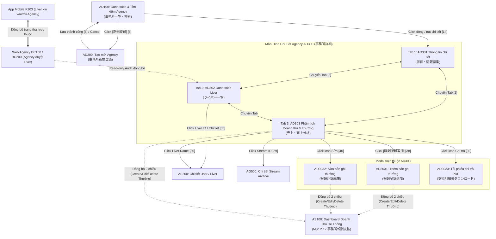
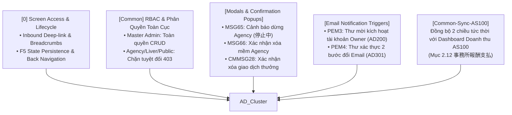

# TÀI LIỆU BÓC TÁCH ĐẶC TẢ KỸ THUẬT & PHÂN TÍCH YÊU CẦU KIỂM THỬ (SPEC ANALYSIS & CLARIFICATION REPORT)
## Cụm Màn Hình: AD_Agency Management (Phân Hệ Quản Lý Agency / 事務所管理 - Master Admin Portal)
### Áp dụng: Quy chuẩn Trụ Cột 1 (`Universal_Rules/01_core_spec_analysis_rule.md`) & Master Policy (`GEMINI.md`)

---

## BẢNG THÔNG TIN TỔNG QUAN ĐẶC TẢ CỤM MÀN HÌNH AD (SPECIFICATION METADATA)

| Thuộc tính | Chi tiết |
| :--- | :--- |
| **Cụm phân hệ (Cluster/Module)** | **AD Module - Quản lý Agency (事務所管理)** trực thuộc Web Master Admin (`AA000`) |
| **Môi trường Web** | `Master Admin Portal` (Dev: `https://admin-dev.surrealdolls.com/sign-in/`, STG: `https://admin-stg.surrealdolls.com/sign-in`) |
| **Tài khoản kiểm thử** | `Admin`: `admin@admin.com` \| `!Ch4ng3Th1sP4ssW0rd!` (HTTP Basic Auth: `suriaru` \| `suriaru`) |
| **Tài liệu Spec nguồn (SRS)** | [Google Spreadsheet SRS Tổng](https://docs.google.com/spreadsheets/d/1pxox5GcjOXwKadMnzOa765ptG2huPJSxCiWsrH0_h7Y/edit?gid=741302995#gid=741302995) |
| **Danh sách Sheet Spec cụm AD** | • **AD100 (gid=1636466169):** `AD100_Agency List / Search` (Danh sách & Tìm kiếm Agency) • **AD200 (gid=2093029291):** `AD200_Register Agency` (Tạo mới Agency) • **AD301 (gid=406207487):** `AD301_Agency Information` (Chi tiết & Chỉnh sửa thông tin Agency) • **AD302 (gid=1019623612):** `AD302 Agency Manage - Agency Streamer List` (Danh sách Liver trực thuộc Agency) • **AD303 (gid=2071307331):** `AD303_Revenue Analysis` (Phân tích Doanh thu & Quản lý Thưởng Agency kèm modal `AD3031`, `AD3032`, `AD3033`) |
| **Nguồn Tham chiếu Nghiệp vụ** | • Tab `CommonSpec` (gid=170791648) & `Common MSG` (gid=1080253487) & `MSG` (gid=1862733901) • Tab `Input + Công thức doanh thu` (gid=974356085) & Tab `AS100` (gid=1263482685) |
| **Nguồn Thiết kế & Prototype** | • **AD100:** [Figma AD100 (node-id=907-3689)](https://www.figma.com/design/r5RjkwIfMhChaq83OsBkf8/Admin-Layout---Spec-PDF?node-id=907-3689&t=CHjpqKXsbfmyHBR7-4) • **AD200:** [Figma AD200 (node-id=907-3040)](https://www.figma.com/design/r5RjkwIfMhChaq83OsBkf8/Admin-Layout---Spec-PDF?node-id=907-3040&t=CHjpqKXsbfmyHBR7-4) • **AD301:** [Figma AD301 (node-id=911-4648)](https://www.figma.com/design/r5RjkwIfMhChaq83OsBkf8/Admin-Layout---Spec-PDF?node-id=911-4648&t=CHjpqKXsbfmyHBR7-4) • **AD302:** [HTML Prototype AD302](https://drive.google.com/file/d/1t0kIlpEA6fvxcj9x6VPkhgzrEHSEAos6/view?usp=drive_link) & [Frontend HTML AD302](https://drive.google.com/file/d/1lC68FExTLfbKGZS1ZuH4bIiyMFguPK5j/view?usp=drive_link) • **AD303:** [Figma AD303 (node-id=11205-14224)](https://www.figma.com/design/r5RjkwIfMhChaq83OsBkf8/Admin-Layout---Spec-PDF?node-id=11205-14224&t=mbSUOB2QPRctcTJ7-0) • **AD3031:** [Figma AD3031 (node-id=11209-15126)](https://www.figma.com/design/r5RjkwIfMhChaq83OsBkf8/Admin-Layout---Spec-PDF?node-id=11209-15126&t=mbSUOB2QPRctcTJ7-0) • **AD3032:** [Figma AD3032 (node-id=11359-12514)](https://www.figma.com/design/r5RjkwIfMhChaq83OsBkf8/Admin-Layout---Spec-PDF?node-id=11359-12514&t=mbSUOB2QPRctcTJ7-0) • **AD3033:** [Figma AD3033 (node-id=11519-11957)](https://www.figma.com/design/r5RjkwIfMhChaq83OsBkf8/Admin-Layout---Spec-PDF?node-id=11519-11957&t=Y0zvbMqmXmpYlXyf-0) • **AD303 HTML Prototype:** [Drive HTML AD303](https://drive.google.com/file/d/1IlzRpN7njYIcEiivPIdrVs2veYwhS6gV/view?usp=drive_link) |
| **Ngôn ngữ hiển thị chính** | Tiếng Nhật (`JA`) |

---

## KIẾN TRÚC PHÂN HỆ VÀ QUAN HỆ ĐIỀU HƯỚNG LIÊN MÀN HÌNH (CLUSTER ARCHITECTURE)

---

## I. KẾT QUẢ QUÉT ĐẶC TẢ 2 BƯỚC BẮT BUỘC (2-PASS SCANNING PROTOCOL)

### 1. Pass 1 - Bóc Tách Chi Tiết Toàn Bộ UI Controls Có `[No.]` Từng Màn Hình

#### A. Màn hình AD100 (`AD100_Agency List / Search`)
| No. | Tên phần tử (Value JP) | Loại UI Control | Placeholder / Giá trị mặc định | Chi tiết ràng buộc kỹ thuật & Nghiệp vụ (SRS & CR) |
| :---: | :--- | :--- | :--- | :--- |
| `[1]` | Layout Bảng danh sách | Data Table | - | Hiển thị danh sách Agency theo thiết kế Figma `907-3689`. |
| `[2]` | `事務所名・事務所ID` | Textbox Input | `事務所名・事務所ID` | • Nhập từ khóa tìm kiếm theo chuẩn **CMR02**. • Tìm kiếm đúng 1 phần: Tên agency (`name`). • Tìm kiếm chính xác: Agency ID (`code` / `agency_code`) và System ID (`id`). • Sắp xếp mặc định danh sách: Theo ngày cập nhật mới nhất $\rightarrow$ cũ nhất. |
| `[3]` | `ステータス` (Filter) | Pulldown Select | `全て` (Default) | • Danh sách lựa chọn:   + `全て` (Tất cả)   + `利用中` (Đang hoạt động)   + `停止中` (Tạm dừng) • Chọn 1 giá trị để lọc danh sách. |
| `[4]` | `検索` | Button (Primary) | `検索` | Gửi request tìm kiếm với các tham số `q`, `status`, `page`, `items_per_page`. |
| `[4]` | `クリア` | Button (Secondary) | `クリア` | Xóa từ khóa, reset dropdown status về `全て`, tải lại danh sách mặc định. |
| `[5]` | `新規登録` | Button (Action) | `新規登録` | Điều hướng sang màn hình tạo mới Agency `AD200`. |
| `[6]` | `ID` | Table Column | - | System ID do cơ sở dữ liệu tự sinh (`id`). |
| `[7]` | `事務所ID` | Table Column | - | Mã Agency định danh do Admin thiết lập (`agency_code`). |
| `[8]` | `事務所名` | Table Column | - | Tên Agency kèm ảnh Logo đại diện. |
| `[9]` | `連絡先 オーナー名` | Table Column | - | Tên người đại diện liên hệ của Agency (`contact_name`). |
| `[10]` | `ライバー数` | Table Column | - | **CR 06/11/2025:** Tổng số user trực thuộc Agency (`member_count`). • Chỉ gồm các user đã được accept vào Agency (status `所属済み`). • Bao gồm cả user active và inactive. • KHÔNG bao gồm user đã bị xóa hoặc đã rời Agency (`退所済み`). • Click vào số lượng để điều hướng sang màn danh sách Liver `AD302`. |
| `[10]` | `ポイント売上` | Table Column | - | **CR 06/11/2025:** Tổng số Point mà các Liver trực thuộc kiếm được qua: • Livestream: Gift + 2shot + Whisper (quy đổi Point/GiftPoint). • Familia: Donate/Yell từ member. |
| `[10]` | `ファミリア売上` | Table Column | - | **CR 06/11/2025:** Doanh thu Yên thực tế từ các gói Familia của các Liver trực thuộc: • Đăng ký Class (Yên) mua trên App + Web. • Mua gói Backnumber (Yên) mua trên App + Web. |
| `[10]` | `売上合計` | Table Column | - | **CR 06/11/2025:** Tổng doanh thu = `ポイント売上` + `ファミリア売上`. |
| `[11]` | `ステータス` | Table Column | - | Trạng thái Agency: `利用中` (Active) hoặc `停止中` (Inactive). |
| `[12]` | `作成日` | Table Column | - | Định dạng `YYYY/MM/DD`. Hỗ trợ sắp xếp Sort mới $\rightarrow$ cũ, cũ $\rightarrow$ mới. |
| `[13]` | `変更日` | Table Column | - | Định dạng `YYYY/MM/DD`. Hỗ trợ sắp xếp Sort mới $\rightarrow$ cũ, cũ $\rightarrow$ mới. |
| `[14]` | Nút Chi tiết / Click dòng | Row Action Button | - | Điều hướng sang màn hình chi tiết Agency `AD301`. |
| `[14]` | Nút Xóa | Row Action Button | - | **CR 13/08/2026 (QUAN TRỌNG):** ĐÃ BỎ nút xóa trên từng dòng tại AD100. Hành động xóa chỉ được thực hiện bên trong trang chi tiết `AD301` sau khi xác nhận popup `MSG66`. |

---

#### B. Màn hình AD200 (`AD200_Register Agency`)
| No. | Tên phần tử (Value JP) | Loại UI Control | Placeholder | Ràng buộc Validate & Nghiệp vụ (SRS & CR) |
| :---: | :--- | :--- | :--- | :--- |
| `[1]` | Side Bar UI | Navigation | - | Thanh điều hướng chung của Master Admin. |
| `[2]` | `事務所名` | Textbox Input (Required ◯) | `事務所名を入力してください` | • Độ dài: Min 1, Max 20 ký tự. • Cho phép ký tự đặc biệt. • **CR 15/10/2026:** Bắt buộc duy nhất toàn hệ thống. Nếu trùng tên với Agency khác $\rightarrow$ Báo lỗi `CMMSG57` (`事務所名は既に存在しています。`). |
| `[3]` | `事務所ID` | Textbox Input (Required ◯) | `IDを入力してください` | • Mã ID do Admin tự định nghĩa (để Liver nhập xin gia nhập tại K203). • Độ dài: Min 3, Max 20 ký tự. • Chỉ cho phép chữ cái Latin và chữ số (không ký tự đặc biệt) $\rightarrow$ Vi phạm báo `CMMSG55` (`半角英字（a-z）と数字（0-9）のみ入力してください。`). • Bắt buộc duy nhất toàn hệ thống $\rightarrow$ Trùng ID báo `MSG15` (`このIDは登録済みです。`). • Trùng login ID/email $\rightarrow$ Báo `MSG145` (`このメールアドレスまたはIDは登録済みです。`). |
| `[4]` | `事務所ロゴ` | File Upload (Required ◯) | - | • Tuân thủ chuẩn upload ảnh **CMR50**. • Định dạng cho phép: PNG, JPG/JPEG, SVG, WebP $\rightarrow$ Sai định dạng báo `CMMSG43`. • Dung lượng tối đa: 5MB $\rightarrow$ Quá dung lượng báo `CMMSG45`. • **CR 15/10/2026:** Bắt buộc. Khi mở màn hình để sẵn Logo mặc định = Logo hệ thống; Master Admin có thể upload thay thế. Chỉ lưu ảnh lên server khi bấm Lưu thành công. |
| `[5]` | `連絡先 オーナー名` | Textbox Input (Required ◯) | `連絡先の名前を入力してください` | Tên người đại diện quản lý Agency. Min 1, Max 20 ký tự. |
| `[6]` | `電話番号` | Textbox Input (Required ◯) | `電話番号を入力してください` | Số điện thoại người đại diện. Min 5, Max 20 ký tự. Nhập tự do theo chuẩn **CMR04**. |
| `[7]` | `メールアドレス` | Textbox Input (Required ◯) | `メールアドレスを入力してください` | • Email dùng đăng nhập cổng Agency Admin (`BA100`). • Độ dài: Min 3, Max 254 ký tự. • Định dạng chuẩn email `a@b.c` theo **CMR42**. • Bắt buộc chưa từng đăng ký trên hệ thống $\rightarrow$ Trùng email báo `MSG14` (`このメールアドレスは登録済みです。`). • Gửi email mời `PEM3` từ `noreply@surrealdolls.com`. |
| `[8]` | `キャンセル` | Button (Secondary) | `キャンセル` | Tuân thủ **CMR26**. Hủy thao tác, quay về `AD100` (hiển thị popup cảnh báo mất dữ liệu nếu đã nhập form). |
| `[8]` | `登録` | Button (Primary) | `登録` | • Tuân thủ **CMR15** (chống double-click/debounce). • Kiểm tra toàn bộ trường bắt buộc; nếu hợp lệ $\rightarrow$ Tạo Agency và tài khoản Agency Owner. • **CR 21/10/2026 (GMO Sec-12 / #12839):** BE tự sinh mật khẩu tạm thời 12 ký tự thỏa mãn CMR43 (không hiển thị ra UI, không gửi trong mail). Gửi link kích hoạt đặt mật khẩu `BA1003` qua mail `PEM3` với thời hạn 30 ngày (**CMR68**). |

---

#### C. Màn hình AD301 (`AD301_Agency Information`)
| No. | Tên phần tử (Value JP) | Loại UI Control | Placeholder | Ràng buộc Validate & Nghiệp vụ (SRS & CR) |
| :---: | :--- | :--- | :--- | :--- |
| `[2]` | `詳細` / `ライバー` / `売上` | Tab Navigation | - | Chuẩn **CMR20** gồm 3 tab: `詳細` (AD301 - Mặc định), `ライバー` (AD302), `売上` (AD303). |
| `[3]` | `事務所名` | Textbox Input (Required ◯) | - | Min 1, Max 20 ký tự. **CR 15/10/2026:** Trùng tên với Agency khác (trừ chính nó) $\rightarrow$ Báo `CMMSG57`. |
| `[4]` | `事務所ID` | Textbox Input (Required ◯) | - | Min 3, Max 20 ký tự. Chữ Latin & số. Trùng Agency khác $\rightarrow$ Báo `MSG15`. |
| `[5]` | `事務所ロゴ` | File Upload (Required ◯) | - | Chuẩn **CMR50**. Max 5MB. PNG/JPG/SVG/WebP. **CR 15/10/2026:** Nếu Agency cũ chưa có logo $\rightarrow$ Hiện logo hệ thống. |
| `[6]` | `連絡先 オーナー名` | Textbox Input (Required ◯) | - | Min 1, Max 20 ký tự. |
| `[7]` | `電話番号` | Textbox Input (Required ◯) | - | Min 5, Max 20 ký tự, nhập tự do theo **CMR04**. |
| `[8]` | `メールアドレス` | Textbox Input (Required ◯) | - | • Min 3, Max 254 ký tự, regex CMR42. Trùng tài khoản khác $\rightarrow$ Báo `MSG14`. • **CR 19/10/2026 (Xác thực 2 bước đổi Email):** Bấm Lưu với email mới $\rightarrow$ Các trường khác lưu ngay; Email CHƯA đổi ngay. Gửi mail `PEM4` chứa link xác thực 7 ngày. Cạnh ô hiện nhãn `「認証待ち：{新メールアドレス}」`. Trước khi xác thực, Owner vẫn đăng nhập bằng email cũ. Nếu quá 7 ngày không xác thực $\rightarrow$ Hết hạn, nhãn biến mất. Nếu nhập lại email cũ $\rightarrow$ Hủy yêu cầu xác thực. |
| `[9]` | `ログインパスワードリセット` | Group Control & Button | `リセット` | • Bấm `[リセット]` $\rightarrow$ Mở ô textbox nhập mật khẩu mới. • **CR 21/10/2026 (GMO Sec-12 / #12839, #13285):** Nhập mật khẩu theo **CMR43** ($\ge 8$ ký tự, gồm cả chữ hoa, chữ thường, số, ký tự đặc biệt) $\rightarrow$ Sai format báo `MSG13`. • Kiểm tra trùng: CẤM trùng mật khẩu hiện tại hoặc 2 mật khẩu gần nhất của Owner $\rightarrow$ Trùng báo `MSG261` (`過去2回以内に使用したパスワードは再利用できません。`). • Lưu thành công: Tính lại hạn 30 ngày (**CMR68**), BE lập tức **thu hồi token/đăng xuất cưỡng chế** mọi phiên làm việc hiện tại của Owner. |
| `[10]` | `ステータス` | Radio Group | `利用中` (Default) | • Gồm 2 radio: `利用中` (Active) và `停止中` (Inactive). • Khi chọn `停止中` và bấm Lưu $\rightarrow$ Bắt buộc hiển thị popup cảnh báo **`MSG65`** (`利用を停止すると事務所に関連するユーザーも引き続き利用できます、よろしいですか。`). • Khi bị Inactive: Agency hiển thị xám (grey out) trên AD100 nhưng vẫn click xem/sửa được. Toàn bộ Liver trực thuộc chuyển thành tự do, các đơn xin vào bị từ chối, tài khoản Admin Agency không thể đăng nhập. |
| `[11]` | `キャンセル` | Button (Secondary) | `キャンセル` | Chuẩn **CMR26**. Hủy thay đổi, hoàn nguyên dữ liệu ban đầu. |
| `[11]` | `保存` | Button (Primary) | `保存` | Chuẩn **CMR15**. Lưu cập nhật Agency (kích hoạt luồng PEM4 nếu đổi email, thu hồi phiên nếu đổi mật khẩu). |
| `[11]` | `削除` | Button (Danger) | `削除` | Click hiển thị popup xác nhận xóa **`MSG66`** (`削除すると事務所に関連するユーザーも引き続き利用できます、よろしいですか。`). Nếu xác nhận $\rightarrow$ Xóa mềm Agency, giải phóng toàn bộ Liver thành user tự do, xóa mềm tài khoản Agency Admin, điều hướng về `AD100`. |

---

#### D. Màn hình AD302 (`AD302 Agency Manage - Agency Streamer List`)
| No. | Tên phần tử (Value JP) | Loại UI Control | Placeholder / Giá trị | Chi tiết ràng buộc kỹ thuật & Nghiệp vụ |
| :---: | :--- | :--- | :--- | :--- |
| `[0]` | `ライバー一覧` | Tab Item | - | Tab thứ 2 của màn hình chi tiết Agency `AD300`. |
| `[1]` | Tìm kiếm | Textbox Input | `ライバー名・ID` | Nhập keyword theo **CMR02**: Tìm kiếm đúng 1 phần theo username, tìm kiếm chính xác theo User System ID. |
| `[2]` | `全ステータス` | Pulldown Select | `全ステータス` (Default) | Lọc theo trạng thái tài khoản User: `全ステータス`, `利用中` (1), `停止中` (2), `退会済み` (3). |
| `[3]` | `全ての所属状態` | Pulldown Select | `全ての所属状態` (Default) | Lọc theo quan hệ trực thuộc Agency: `全ての所属状態`, `申請中` (3), `所属済み` (1), `退所申請中` (5), `退所済み` (6). |
| `[4]` | `全て` (Loại Liver) | Pulldown Select | `全て` (Default) | Lọc theo loại Liver: `全て`, `Vライバー` (1), `2.5次元V` (2). |
| `[5]` | `クリア` | Button (Secondary) | `クリア` | Khôi phục toàn bộ bộ lọc về mặc định. |
| `[6]` | `検索` | Button (Primary) | `検索` | Thực hiện tìm kiếm theo các điều kiện lọc. |
| `[7]` | Nút Mở rộng / Thu gọn | Toggle Button | `»` / `«` | Ẩn/hiện 2 nhóm cột chi tiết (Mặc định: Ẩn): • Nhóm 1: `2ショット ~ エール` (cột 16-19). • Nhóm 2: `通常配信時間 ~ OBS時間` (cột 23-28). |
| `[8]` | `ID` | Table Column | - | User System ID (hỗ trợ sắp xếp tăng/giảm). |
| `[9]` | `ライバー名` | Table Column | - | Tên hiển thị của Liver (`username`). |
| `[10]` | `ライバー種類` | Table Column | - | Loại hình Liver: `Vライバー` hoặc `2.5次元V`. |
| `[11]` | `フォロー` | Table Column | - | Tổng số người mà Liver đang theo dõi (Sort tăng/giảm). |
| `[12]` | `フォロワー` | Table Column | - | Tổng số fan đang theo dõi Liver (Sort tăng/giảm). |
| `[13]` | `ファミリアメンバー` | Table Column | - | Tổng số thành viên trong Familia của Liver (Sort tăng/giảm). |
| `[14]` | `いいね数` | Table Column | - | Tổng lượt like nhận được (Sort tăng/giảm). |
| `[15]` | `ポイント売上` | Table Column | - | **CR 13/10/2026:** Doanh thu Point tích lũy toàn thời gian (All-time) = Cột [16] + [17] + [18] + [19]. **Không cộng điểm Gift Gacha**. Hỗ trợ sort tăng/giảm. |
| `[16]` | `2ショット` | Table Column | - | Doanh thu quy đổi từ vé 2Shot đã dùng trong livestream (Thuộc Nhóm 1). |
| `[17]` | `ギフト` | Table Column | - | Doanh thu từ Gift thường và Gift cao cấp (Thuộc Nhóm 1). |
| `[18]` | `ウィスパー` | Table Column | - | Doanh thu thu được từ tin nhắn Whisper trong live (Thuộc Nhóm 1). |
| `[19]` | `エール` | Table Column | - | Doanh thu thu được từ Yell / Donate GP (Thuộc Nhóm 1). |
| `[20]` | `ファミリア売上` | Table Column | - | Doanh thu Yên all-time từ gói tham gia Class và mua Backnumber. Sort tăng/giảm. |
| `[21]` | `合計売上` | Table Column | - | Tổng doanh thu All-time = `ポイント売上` [15] + `ファミリア売上` [20]. |
| `[22]` | `合計配信時間` | Table Column | - | Tổng thời lượng livestream (định dạng `hh:mm:ss`, sortable). |
| `[23]` | `通常配信時間` | Table Column | - | Thời lượng live Thường (Thuộc Nhóm 2). |
| `[24]` | `2ショット時間` | Table Column | - | Thời lượng live 2Shot 1-1 (Thuộc Nhóm 2). |
| `[25]` | `ファミ限時間` | Table Column | - | Thời lượng live dành riêng cho thành viên Familia (Thuộc Nhóm 2). |
| `[26]` | `カラオケ時間` | Table Column | - | Thời lượng live bật tính năng Karaoke (Thuộc Nhóm 2). |
| `[27]` | `BC時間` | Table Column | - | Thời lượng live Broadcast (Thuộc Nhóm 2). |
| `[28]` | `OBS時間` | Table Column | - | Thời lượng live qua phần mềm OBS (Thuộc Nhóm 2). |
| `[29]` | `ステータス` | Table Column | - | Trạng thái User: `利用中`, `停止中`, `退会済み`. |
| `[30]` | `事務所ステータス` | Table Column | - | Trạng thái Agency: `申請中`, `所属済み`, `退所申請中`, `退所済み`. Trạng thái `却下` (Bị từ chối) KHÔNG hiển thị ở bảng này. • **CR 11/11/2026:** Nếu Liver không live suốt 1 tuần (`一週間未配信`) và được Agency khác duyệt gia nhập $\rightarrow$ Tự động cưỡng chế rời khỏi Agency hiện tại (`強制退所`) và chuyển sang `退所済み`. |
| `[31]` | `配信権限` | Table Column | - | Quyền livestream: `あり` (Có) hoặc `なし` (Không). Mặc định khi tạo là `あり`. |
| `[32]` | `加入日時` | Table Column | - | Ngày giờ gia nhập Agency (`YYYY/MM/DD HH:mm`, sortable). |
| `[33]` | `詳細` | Action Button | - | Click điều hướng sang màn hình quản lý chi tiết User `AE200`. |

---

#### E. Màn hình AD303 (`AD303_Revenue Analysis`) & Các Modal Trực Thuộc
| No. | Tên phần tử (Value JP) | Loại UI Control | Giá trị mặc định / Logic hiển thị | Chi tiết ràng buộc kỹ thuật & Nghiệp vụ (SRS & CR) |
| :---: | :--- | :--- | :--- | :--- |
| `[1]` | Bộ lọc ngày | 2 Datepickers | Start: Ngày 1 tháng trước (JST) End: Ngày cuối tháng trước 23:59:59 (JST) | Format `YYYY/MM/DD`. Chặn chọn ngày ngược trên UI theo **CMR38** (`End Date < Start Date`). Áp dụng cho 2 bảng và khối KPI doanh thu, **không áp dụng cho khối số dư**. |
| `[2]` | Lọc thời gian nhanh | 4 Nút bấm | `今日`, `今週`, `今月`, `先月` | Click để điền nhanh Start/End Date tương ứng. |
| `[3]` | `全ライバー` (Lọc Liver) | Pulldown Select | `全ライバー` (All) | Lọc bảng chi tiết giao dịch Bảng 2 và các thẻ KPI doanh thu theo Liver được chọn. |
| `[4]` | `検索` | Button | - | Gửi request tìm kiếm dữ liệu. |
| `[5]` | `クリア` | Button | - | Reset bộ lọc thời gian và Streamer về mặc định. |
| `[6]` | `報酬ポイント合計（P）` | KPI Card | `{amount}` | **Tổng số dư Point Agency có thể rút:** Bằng tổng số dư `[7] + [8] + [9]`. Số dư tích lũy hiện tại (không phụ thuộc bộ lọc thời gian). |
| `[7]` | `カラオケ以外ポイント（P）`| KPI Card | `{amount}` | Tổng số dư Point Non-Karaoke khả dụng có thể rút. |
| `[8]` | `カラオケポイント（P）` | KPI Card | `{amount}` | Tổng số dư Point Karaoke khả dụng có thể rút. |
| `[9]` | `ファミリア報酬P換算（P）`| KPI Card | `{amount}` | Tổng số dư Point Familia khả dụng có thể rút (Quy đổi 1 Yên = 1 Point + GP Yell). |
| `[-]` | `報酬履歴` | Table Title | - | Tiêu đề Bảng 1: Lịch sử các lần Admin chuyển tiền thưởng cho Agency. |
| `[10]` | `振込日` | Table Column | - | Ngày Admin chuyển tiền thực tế (`YYYY/MM/DD`). |
| `[11]` | `報酬月` | Table Column | - | Tháng tính thưởng tương ứng (`YYYY/MM`). |
| `[12]` | `報酬ポイント合計` | Table Column | - | Tổng số Point khấu trừ trong đợt chuyển tiền: `[12] = [13] + [14] + [15]`. |
| `[13]` | `報酬ポイント・カラオケ以外`| Table Column | - | Số Point Non-Karaoke sử dụng trong đợt thưởng. |
| `[14]` | `報酬ポイント・カラオケ` | Table Column | - | Số Point Karaoke sử dụng trong đợt thưởng. |
| `[15]` | `報酬ポイント・ファミリア` | Table Column | - | Số Point Familia sử dụng trong đợt thưởng. |
| `[16]` | `報酬率` | Table Column | - | Tỷ lệ % thưởng do Admin áp dụng (Ví dụ: `10%`). |
| `[17]` | `報酬額合計（円）` | Table Column | - | Tổng tiền Yên thực nhận: `[17] = [18] + [19] + [20]`. Format phân cách hàng nghìn. |
| `[18]` | `報酬額（円）・カラオケ以外`| Table Column | - | Tiền thưởng Non-Karaoke = `Math.floor([13] * [16] / 100)`. |
| `[19]` | `報酬額（円）・カラオケ` | Table Column | - | Tiền thưởng Karaoke = `Math.floor([14] * [16] / 100)`. |
| `[20]` | `報酬額（円）・ファミリア` | Table Column | - | Tiền thưởng Familia = `Math.floor([15] * [16] / 100)`. |
| `[37]` | `CSV出力` (Bảng 1) | Button | - | Xuất dữ liệu Bảng 1 thành file CSV `{startdate}-{endate}.csv`. |
| `[38]` | `報酬記録追加` | Button (Primary) | - | Mở Modal `AD3031` (Thêm bản ghi thưởng mới). |
| `[39]` | Nút Tải phiếu chi trả | Row Action Button | - | Mở Modal `AD3033` (Xem và tải phiếu thanh toán `支払明細書` dạng PDF). |
| `[40]` | Nút Sửa bản ghi | Row Action Button | - | Mở Modal `AD3032` (Chỉnh sửa bản ghi thưởng). |
| `[41]` | Nút Xóa bản ghi | Row Action Button | - | Mở popup xác nhận `CMMSG28` (`本当に進みますか？`). Nếu xác nhận $\rightarrow$ Xóa bản ghi, hoàn trả Point đã khấu trừ vào số dư Agency và xóa đồng bộ trên `AS100`. |
| `[21]` | `合計売上（円）` | KPI Card | `{amount}` | Tổng doanh thu hệ thống theo bộ lọc: `[21] = [22] + [23] + [24]`. |
| `[22]` | `カラオケ配信売上（円）` | KPI Card | `{amount}` | Doanh thu từ các buổi live Karaoke trong kỳ lọc. |
| `[23]` | `カラオケ配信以外売上（円）`| KPI Card | `{amount}` | Doanh thu từ các buổi live Thường trong kỳ lọc. |
| `[24]` | `ファミリア売上（円）` | KPI Card | `{amount}` | Doanh thu từ phí tham gia Class và mua Backnumber trong kỳ lọc. |
| `[25]` | `開始時間` | Table Column | - | Thời gian bắt đầu live hoặc thời điểm giao dịch Familia (Sort mặc định desc). |
| `[26]` | `終了時間` | Table Column | - | Thời gian kết thúc live (giao dịch Familia hiển thị `ー`). |
| `[27]` | `配信時間` | Table Column | - | Thời lượng live (giao dịch Familia hiển thị `ー`). |
| `[28]` | `配信タイトル` | Table Column | - | Tiêu đề buổi live (giao dịch Familia hiển thị `ー`). |
| `[29]` | `配信ID` | Table Column | - | Stream ID. Click điều hướng sang màn `AG500` Stream Archive (Familia hiện `ー`). |
| `[30]` | `ライバー名` | Table Column | - | Tên Streamer phát sinh giao dịch. Click điều hướng sang `AE200`. |
| `[31]` | `配信種類` | Table Column | - | Loại live (通常, 2ショット, カラオケ, ファミ限, BC, OBS; Familia hiện `ー`). |
| `[32]` | `売上合計（円）` | Table Column | - | Tổng doanh thu của giao dịch = `[33] + [34] + [35]`. |
| `[33]` | `カラオケ配信売上（円）` | Table Column | - | Doanh thu phát sinh trong phiên Karaoke. |
| `[34]` | `カラオケ以外配信売上（円）`| Table Column | - | Doanh thu phát sinh trong phiên Non-Karaoke. |
| `[35]` | `ファミリア売上（円）` | Table Column | - | Doanh thu từ Class / Backnumber (giao dịch live hiện `ー`). |
| `[36]` | `内訳` | Table Column | - | Chi tiết số tiền/point theo từng loại (Whisper, Gift, 2shot, Yell, Class...). |
| `[42]` | `CSV出力` (Bảng 2) | Button | - | Xuất dữ liệu Bảng chi tiết giao dịch thành file CSV `{startdate}-{endate}.csv`. |

---

#### F. Bóc Tách Các Modal Con Thuộc AD303 (`AD3031`, `AD3032`, `AD3033`)
| No. | Modal | Tên phần tử (Value JP) | Loại UI Control | Chi tiết ràng buộc kỹ thuật & Nghiệp vụ |
| :---: | :---: | :--- | :--- | :--- |
| `[43]-[46]` | AD3031/32 | Thẻ số dư tham chiếu | Label Text | Hiển thị 4 số dư Point khả dụng hiện có của Agency để Admin đối chiếu khi nhập liệu. |
| `[47]` | AD3031/32 | `報酬月` | Datepicker (Required) | Định dạng `YYYY/MM`. Tháng tính tiền thưởng. |
| `[48]` | AD3031/32 | `振込日` | Datepicker (Required) | Định dạng `YYYY/MM/DD`. Ngày Admin chuyển khoản cho Agency. |
| `[49]` | AD3031/32 | `報酬ポイント・カラオケ以外` | Textbox (Required) | • Chỉ nhập số nguyên dương (**CMMSG54**). • Min: 0 (nhỏ hơn 0 báo `CMMSG41`). • Max: $\le$ Số dư Point Non-Karaoke hiện có (nếu lớn hơn báo `CMMSG42`). Tại màn Edit AD3032: Max $\le$ Số dư hiện tại + Số Point của chính bản ghi đang sửa. • Để trống báo `CMMSG29`. Giá trị khởi tạo: 10. |
| `[50]` | AD3031/32 | `報酬ポイント・カラオケ` | Textbox (Required) | Tương tự item [49], áp dụng cho số dư Point Karaoke. |
| `[51]` | AD3031/32 | `報酬ポイント・ファミリア` | Textbox (Required) | Tương tự item [49], áp dụng cho số dư Point Familia. |
| `[52]` | AD3031/32 | `報酬率` | Textbox (Required) | • Nhập số nguyên hoặc số thập phân. Min: 0 (`CMMSG41`), Max: 100 (`CMMSG42`). • Để trống báo `CMMSG29`. Giá trị khởi tạo: 10 (tương ứng 10%). |
| `[53]` | AD3031/32 | `計算` | Button (Primary) | **Bắt buộc bấm nút Tính toán** để quy đổi số Point sang Yên theo công thức `Math.floor(Point * Tỷ lệ / 100)`. Nếu chưa bấm nút này thì nút `完了` / `保存` bị khóa (Disabled). |
| `[54]-[57]` | AD3031/32 | Khối kết quả quy đổi Yên | Label Text | Hiển thị chi tiết tiền thưởng Non-Karaoke, Karaoke, Familia và Tổng tiền Yên sau khi bấm `計算`. |
| `[58]` | AD3031/32 | `キャンセル` | Button | Đóng modal, hủy bỏ thay đổi. |
| `[59]` | AD3031 | `完了` | Button (Submit) | Tạo bản ghi thưởng mới, trừ số Point tương ứng khỏi số dư Agency, đồng bộ lên `AS100`. |
| `[60]` | AD3032 | `削除` | Button (Danger) | Xóa bản ghi thưởng đang chọn sau khi confirm `CMMSG28`, hoàn lại Point, đồng bộ xóa trên `AS100`. |
| `[61]` | AD3032 | `保存` | Button (Submit) | Lưu cập nhật bản ghi thưởng, điều chỉnh chênh lệch số Point vào số dư Agency, đồng bộ sửa trên `AS100`. |
| `[62]` | AD3033 | `法人` / `個人` | Radio Group (Required) | • Loại hình tổ chức của Agency: `法人` (Pháp nhân - Mặc định) hoặc `個人` (Cá nhân). • Thay đổi lựa chọn sẽ kích hoạt tính toán và hiển thị lại số tiền thuế thời gian thực (Real-time). |
| `[63]` | AD3033 | `明細書番号` | Label Text | Mã định danh ID của giao dịch chuyển tiền. |
| `[64]` | AD3033 | `支払日` | Label Text | Định dạng `{year}年{month}月{date}日` lấy từ ngày chuyển tiền `振込日` [48]. |
| `[65]` | AD3033 | `支払い金額` | Label Text (Highlight) | Số tiền thực chi cho Agency: `支払い金額 = 合計 [73] - 源泉徴収額 [74]`. Định dạng `￥{amount}`. |
| `[66]` | AD3033 | `事務所名` | Label Text | Tên Agency thụ hưởng. |
| `[67]` | AD3033 | `オーナー名` | Label Text | Tên người đại diện Agency. |
| `[68]` | AD3033 | `事務所ID` | Label Text | Mã định danh Agency. |
| `[69]` | AD3033 | `支払元` | Label Text | Đơn vị chi trả (Cố định): `サリアル合同会社` (Surreal LLC). |
| `[70]-[73]` | AD3033 | Chi tiết các khoản thưởng | Label Text | Hiển thị tiền thưởng Non-Karaoke, Karaoke, Familia và `合計` (Tổng cộng tiền thưởng). |
| `[74]` | AD3033 | `源泉徴収額` | Label Text | **Tiền thuế khấu trừ tại nguồn (Withholding Tax):** • Nếu chọn `法人`: Thuế = `0 円`. • Nếu chọn `個人`:   + Nếu Tổng tiền thưởng [73] $< 1,000,000$ Yên: `Thuế = Math.floor(Tổng tiền thưởng * 10.21%)`   + Nếu Tổng tiền thưởng [73] $\ge 1,000,000$ Yên: `Thuế = Math.floor((Tổng tiền thưởng - 1,000,000) * 20.42% + 102,100)` |
| `[75]` | AD3033 | `キャンセル` | Button | Đóng modal chi trả. |
| `[76]` | AD3033 | `ダウンロード` | Button (Primary) | Xuất và tải phiếu chi trả định dạng PDF theo chuẩn tên file: `ID-{agencyID}_{tháng tương ứng}_支払明細書.pdf`. |

---

### 2. Pass 2 - Quét Toàn Bộ Phần Text & Logic Nghiệp Vụ Không Có `[No.]`

1. **`[0] Screen Access & Lifecycle` (Luồng khởi tạo & Điều hướng):**
   - **Đường dẫn Breadcrumbs chuẩn:**
     + `AD100`: `＞ 事務所管理`
     + `AD200`: `＞ 事務所管理 ＞ 事務所新規登録`
     + `AD301 / AD302 / AD303`: `＞ 事務所管理 ＞ 事務所詳細`
   - **Inbound Deep-link:** Cụm màn hình chi tiết `AD301`, `AD302`, `AD303` nhận tham số `agency_id` từ URL (Path parameter: `/admin/agencies/{agency_id}/...`). Nếu truy cập trực tiếp URL thiếu `agency_id` hoặc truyền ID không tồn tại $\rightarrow$ Hệ thống redirect về danh sách `AD100` kèm thông báo lỗi `CMMSG3` (Resource not found).
   - **F5 Reload & Tab State:** Reload trình duyệt tại tab nào phải giữ nguyên tab đó (`詳細`, `ライバー一覧`, `売上`) cùng các tham số bộ lọc và phân trang hiện tại.

2. **`[Common] Business Rules & RBAC` (Phân quyền & Ranh giới):**
   - Cụm màn hình `AD` chỉ dành riêng cho tài khoản quản trị hệ thống **Master Admin**.
   - Tài khoản Agency Admin hoặc User/Liver khi cố tình truy cập vào URL phân hệ này qua thanh địa chỉ phải bị chặn lập tức bằng mã lỗi **`403 Forbidden`** (`CMMSG5`: `この操作を行う権限がありません。`).

3. **`[Modal-Confirm] Popups Xác Nhận & Cảnh Báo Nguy Hiểm`:**
   - **`MSG65` (Tại AD301):** Hiển thị khi chuyển trạng thái Agency từ `利用中` sang `停止中`:
     > 「利用を停止すると事務所に関連するユーザーも引き続き利用できます、よろしいですか。」
   - **`MSG66` (Tại AD301):** Hiển thị khi Admin bấm nút Xóa Agency:
     > 「削除すると事務所に関連するユーザーも引き続き利用できます、よろしいですか。」
   - **`CMMSG28` (Tại AD303 & AD3032):** Hiển thị khi Admin bấm icon Xóa hoặc nút Xóa bản ghi thưởng:
     > 「本当に進みますか？」

4. **`[Email Flow] Luồng Kích Hoạt & Xác Thực Email`:**
   - **Thư mời `PEM3` (Tạo mới AD200):** Sau khi Master tạo Agency thành công, hệ thống gửi email `PEM3` chứa link tạo mật khẩu màn `BA1003` tới `contact_email`. Thời hạn kích hoạt link là 30 ngày (**CMR68**).
   - **Xác thực đổi Email `PEM4` (Sửa AD301 - CR 19/10/2026):** Khi đổi email, hệ thống gửi `PEM4` tới email mới. Hạn 7 ngày, dùng 1 lần. Ô nhập liệu hiển thị nhãn `「認証待ち：{新メールアドレス}」`. Trong thời gian chờ, tài khoản vẫn dùng email cũ để đăng nhập.

5. **`[-] Common Controls (Phân Trang & Xuất File CSV)`:**
   - **Phân trang (Pagination):** Tuân thủ **CMR01/CMR23**. Cung cấp chọn số bản ghi mỗi trang (10, 20, 50, 100), điều hướng First/Previous/Next/Last, tổng số bản ghi và tổng số trang.
   - **Xuất CSV (CSV Export):** Tuân thủ chuẩn định dạng UTF-8 with BOM để tránh lỗi hiển thị tiếng Nhật trong Microsoft Excel. Tên file theo cấu trúc quy định trong Spec: `{startdate}-{endate}.csv`.

6. **`[Empty State] Trạng Thái Dữ Liệu Rỗng`:**
   - Khi tìm kiếm hoặc mở danh sách không có bản ghi nào thỏa mãn, hiển thị thông báo chuẩn **`CMMSG47`** (`一致する検索結果はありません。`).

---

## II. ĐỐI CHIẾU THIẾT KẾ 1:1 (DESIGN EXTRACTION & CROSS-CHECK)

Toàn bộ các chuỗi ký tự trên giao diện Spec đã được đối chiếu 1:1 với nguồn thiết kế Figma và HTML Prototype:

| Màn hình | Thuộc tính / Control | Giá trị trên Spec (SRS Sheet) | Giá trị trên Thiết kế (Figma / Prototype) | Trạng thái đối chiếu | Đánh giá & Xử lý sai lệch |
| :---: | :--- | :--- | :--- | :---: | :--- |
| **AD100** | Placeholder tìm kiếm `[2]` | `事務所名・事務所ID` | `事務所名・事務所ID` | **Khớp 100%** | Chuẩn hóa theo spec. |
| **AD100** | Nút Xóa trên từng dòng `[14]` | Đã ghi chú bỏ (CR 13/08/2026) | Trên Figma cũ vẫn còn icon Thùng rác | **Lệch Spec - Design** | **Ưu tiên theo Spec CR mới:** Đã bỏ nút xóa trên AD100. Ghi nhận `Q2`. |
| **AD200** | Nút Submit `[8]` | `登録` | `登録` | **Khớp 100%** | Đúng nút bấm tạo mới. |
| **AD200** | Gợi ý dung lượng logo `[4]` | `最大ファイルサイズ：5MB` | `最大ファイルサイズ：5MB` | **Khớp 100%** | Đã ghi nhận trong UI form. |
| **AD301** | Tab navigation `[2]` | `詳細`, `ライバー`, `売上` | `詳細`, `ライバー一覧`, `売上分析` | **Chênh lệch ngữ nghĩa nhỏ** | Đặt bí danh tương đương, link đúng tab. Ghi nhận `Q8`. |
| **AD301** | Nhãn chờ xác thực email `[8]` | `「認証待ち：{新メールアドレス}」` | Thiết kế CR 19/10/2026 | **Khớp 100%** | Bổ sung theo CR mới. |
| **AD302** | Toggle button `[7]` | `»` / `«` | Nút mũi tên mở rộng 2 nhóm cột | **Khớp 100%** | Kiểm tra mở rộng nhóm cột 1 và nhóm 2. |
| **AD303** | Modal tải phiếu chi trả | `AD3033_Payment Statement Download` | Node Figma `11519-11957` | **Khớp 100%** | Đã bóc tách đủ 15 controls từ 62 đến 76. |
| **AD303** | Công thức tính thuế `[74]` | `法人 = 0; 個人 = 10.21% / 20.42%` | Khớp bảng tính thuế thu nhập cá nhân Nhật | **Khớp 100%** | Chuẩn hóa làm tròn xuống `Math.floor`. |

---

## III. BÓC TÁCH MA TRẬN LOGIC NGHIỆP VỤ CỐT LÕI (BUSINESS LOGIC MATRIX - TIER 2)

### 1. Nhóm Điều Kiện Tiên Quyết & Phân Quyền (Precondition & RBAC)
- **Role Phân quyền:** Phân hệ `AD` chỉ mở cho tài khoản Master Admin đã xác thực qua HTTP Basic Auth (`suriaru` / `suriaru`) và đăng nhập portal Admin thành công (`admin@admin.com`).
- **Phân tách ranh giới dữ liệu:** Agency Admin (`BA100`) chỉ có thể quản lý Liver và thông tin thuộc Agency của mình qua portal riêng (`https://admin-dev.surrealdolls.com/sign-in/agency`); tuyệt đối không thể xem hoặc chỉnh sửa dữ liệu của Agency khác.
- **Tiền đề dữ liệu khi kiểm thử (Data Seeding):**
  + Cần có ít nhất 1 Agency ở trạng thái `利用中` và 1 Agency ở trạng thái `停止中`.
  + Cần có Agency chứa Liver với đầy đủ các trạng thái (`申請中`, `所属済み`, `退所申請中`, `退所済み`).
  + Cần có dữ liệu doanh thu mẫu (Gift, 2shot, Whisper, Yell, Class, Backnumber) và số dư Point để thực hiện tạo bản ghi thưởng trên `AD303`.

### 2. Nhóm Ràng Buộc Dữ Liệu & Cận Biên (Validation & Boundaries)
| Trường dữ liệu | Min | Max | Định dạng / Loại ký tự | Thông báo lỗi tương ứng |
| :--- | :---: | :---: | :--- | :--- |
| **Tên Agency (`事務所名`)** | 1 | 20 | Ký tự tự do (cho phép ký tự đặc biệt). Bắt buộc duy nhất. | Trống: `CMMSG29` Quá dài: `CMMSG49` Trùng tên: `CMMSG57` |
| **Mã Agency (`事務所ID`)** | 3 | 20 | Chữ cái Latin và chữ số (a-z, A-Z, 0-9). Không ký tự đặc biệt. Duy nhất. | Trống: `CMMSG29` Sai ký tự: `CMMSG55` Trùng ID: `MSG15` Trùng login: `MSG145` |
| **Logo Agency (`事務所ロゴ`)** | - | 5MB | PNG, JPG/JPEG, SVG, WebP. Bắt buộc có logo. | Sai định dạng: `CMMSG43` Quá dung lượng: `CMMSG45` |
| **Tên đại diện (`オーナー名`)** | 1 | 20 | Ký tự tự do. Bắt buộc. | Trống: `CMMSG29` Quá dài: `CMMSG49` |
| **Số điện thoại (`電話番号`)** | 5 | 20 | Chuỗi số điện thoại tự do theo CMR04. | Trống: `CMMSG29` Quá ngắn: `CMMSG52` Quá dài: `CMMSG49` |
| **Email liên hệ (`メールアドレス`)** | 3 | 254 | Chuẩn regex email `a@b.c`. Bắt buộc duy nhất. | Trống: `CMMSG29` Sai format: `CMR42` Trùng email: `MSG14` |
| **Mật khẩu reset Owner** | 8 | - | Đủ 4 nhóm: Chữ hoa, Chữ thường, Chữ số, Ký hiệu đặc biệt. | Sai quy tắc: `MSG13` Trùng 2 lần trước: `MSG261` |
| **Khoảng thời gian (`期間`)** | - | - | Format `YYYY/MM/DD`. Start Date $\le$ End Date. | Chọn ngược: Bị chặn trên datepicker (**CMR38**) |
| **Point thưởng rút (`AD3031`)** | 0 | Số dư hiện có | Số nguyên dương. Không được vượt quá số dư Point khả dụng. | Âm: `CMMSG41` Vượt số dư: `CMMSG42` Trống: `CMMSG29` |
| **Tỷ lệ thưởng (`報酬率`)** | 0 | 100 | Số nguyên hoặc số thập phân. Đơn vị `%`. | $<0$: `CMMSG41` $>100$: `CMMSG42` Trống: `CMMSG29` |

### 3. Nhóm Biến Đổi Trạng Thái & Tính Toán (State Change & Calculations)
- **Công thức tính Doanh thu Agency (AD100, AD302, AD303):**
  $$\text{Doanh thu Point (ポイント売上)} = \text{Gift} + \text{2Shot} + \text{Whisper} + \text{Yell}$$
  *(Lưu ý CR 13/10/2026: Không cộng điểm từ Gift Gacha)*
  $$\text{Doanh thu Familia (ファミリア売上)} = \text{Tiền tham gia Class} + \text{Tiền mua Backnumber}$$
  $$\text{Tổng doanh thu (売上合計)} = \text{Doanh thu Point} + \text{Doanh thu Familia}$$
- **Công thức quy đổi Tiền thưởng chuyển khoản cho Agency (AD3031 / AD3032):**
  $$\text{Tiền thưởng Non-Karaoke (円)} = \lfloor \text{Point Non-Karaoke} \times \frac{\text{Tỷ lệ thưởng}}{100} \rfloor$$
  $$\text{Tiền thưởng Karaoke (円)} = \lfloor \text{Point Karaoke} \times \frac{\text{Tỷ lệ thưởng}}{100} \rfloor$$
  $$\text{Tiền thưởng Familia (円)} = \lfloor \text{Point Familia} \times \frac{\text{Tỷ lệ thưởng}}{100} \rfloor$$
  $$\text{Tổng tiền thưởng (合計円)} = \text{Thưởng Non-Karaoke} + \text{Thưởng Karaoke} + \text{Thưởng Familia}$$
- **Công thức tính Thuế thu nhập khấu trừ tại nguồn trên Phiếu chi trả (AD3033):**
  - **Trường hợp Agency là Pháp nhân (`法人`):**
    $$\text{Thuế (源泉徴収額)} = 0 \text{ 円}$$
    $$\text{Số tiền thực nhận (支払い金額)} = \text{Tổng tiền thưởng (合計)}$$
  - **Trường hợp Agency là Cá nhân (`個人`):**
    + Nếu $\text{Tổng tiền thưởng} < 1,000,000$ Yên:
      $$\text{Thuế} = \lfloor \text{Tổng tiền thưởng} \times 10.21\% \rfloor$$
    + Nếu $\text{Tổng tiền thưởng} \ge 1,000,000$ Yên:
      $$\text{Thuế} = \lfloor (\text{Tổng tiền thưởng} - 1,000,000) \times 20.42\% + 102,100 \rfloor$$
    $$\text{Số tiền thực nhận (支払い金額)} = \text{Tổng tiền thưởng} - \text{Thuế}$$
- **Biến động số dư Point Agency:**
  + Khi tạo bản ghi thưởng hoàn tất trên `AD3031` $\rightarrow$ Số dư Point tương ứng của Agency lập tức bị trừ đi.
  + Khi chỉnh sửa trên `AD3032` $\rightarrow$ Hoàn trả Point cũ, trừ Point mới, số dư cập nhật theo mức chênh lệch.
  + Khi xóa bản ghi trên `AD303` / `AD3032` $\rightarrow$ Hoàn trả 100% số Point đã trừ về lại số dư khả dụng của Agency.
- **Đồng bộ hóa 2 chiều với Dashboard Doanh thu toàn hệ thống `AS100`:**
  + Mọi thao tác Thêm / Sửa / Xóa bản ghi thưởng trên `AD303` bắt buộc phải tự động phản ánh tức thời vào chỉ số `2.12 事務所報酬支払` trên màn `AS100`.

### 4. Nhóm Phản Hồi Hệ Thống & Mã Thông Báo (System Feedback & Error Codes)
- `CMMSG12`: `正常に作成されました。` (Tạo mới Agency hoặc bản ghi thưởng thành công).
- `CMMSG13`: `正常に更新されました。` (Cập nhật thông tin Agency hoặc bản ghi thưởng thành công).
- `CMMSG14`: `正常に削除されました。` (Xóa Agency hoặc bản ghi thưởng thành công).
- `CMMSG28`: `本当に進みますか？` (Popup xác nhận xóa bản ghi thưởng).
- `MSG65`: `利用を停止すると事務所に関連するユーザーも引き続き利用できます、よろしいですか。` (Cảnh báo vô hiệu hóa Agency).
- `MSG66`: `削除すると事務所に関連するユーザーも引き続き利用できます、よろしいですか。` (Cảnh báo xóa Agency).
- `MSG13`: `パスワードは8文字以上で、英大文字・小文字・数字・記号をそれぞれ1文字以上含めてください。` (Sai định dạng mật khẩu).
- `MSG14`: `このメールアドレスは登録済みです。` (Email đã tồn tại).
- `MSG15`: `このIDは登録済みです。` (Agency ID đã tồn tại).
- `MSG145`: `このメールアドレスまたはIDは登録済みです。` (Trùng Email hoặc ID).
- `MSG261`: `過去2回以内に使用したパスワードは再利用できません。` (Trùng mật khẩu cũ).
- `CMMSG47`: `一致する検索結果はありません。` (Không tìm thấy kết quả tìm kiếm).

---

## IV. BÓC TÁCH DANH MỤC API & XÁC ĐỊNH PHẠM VI (API SCOPE IDENTIFICATION)

| No. | API Endpoint | Phương thức | Màn hình gọi | In-Scope / Out-of-Scope | Mục đích & Chi tiết nghiệp vụ |
| :---: | :--- | :---: | :---: | :---: | :--- |
| **API-1** | `/agency/` | `POST` | AD100 | **In-Scope** | Lấy danh sách Agency phân trang kèm bộ lọc từ khóa (`q`), trạng thái (`status`), sắp xếp (`sort_query`). |
| **API-2** | `/agency/create/` | `POST` | AD200 | **In-Scope** | Tạo mới Agency và sinh tài khoản Owner, kích hoạt luồng gửi mail `PEM3`. |
| **API-3** | `/agency/{agency_id}/` | `GET` | AD301 | **In-Scope** | Lấy chi tiết thông tin Agency theo ID để đổ lên form cập nhật. |
| **API-4** | `/agency/{agency_id}/` | `PATCH` | AD301 | **In-Scope** | Cập nhật thông tin Agency (xử lý đổi email xác thực `PEM4`, đổi status, reset password). |
| **API-5** | `/agency/{agency_id}/` | `DELETE` | AD301 | **In-Scope** | Xóa mềm Agency, giải phóng các Liver trực thuộc thành tự do, xóa tài khoản Agency Admin. |
| **API-6** | `/agency/list/{agency_id}` | `GET` | AD302 | **In-Scope** | Lấy danh sách Liver trực thuộc Agency kèm thống kê doanh thu và thời lượng live. |
| **API-7** | `/agency/{agency_id}/revenue/` | `GET` | AD303 | **In-Scope** | Lấy số dư Point khả dụng, danh sách lịch sử chuyển thưởng (Bảng 1) và chi tiết giao dịch (Bảng 2). |
| **API-8** | `/agency/{agency_id}/reward/` | `POST` | AD3031 | **In-Scope** | Tạo bản ghi chuyển tiền thưởng cho Agency, trừ Point số dư, đồng bộ lên `AS100`. |
| **API-9** | `/agency/{agency_id}/reward/{reward_id}/` | `PATCH` | AD3032 | **In-Scope** | Cập nhật bản ghi thưởng, điều chỉnh số dư Point, đồng bộ sửa trên `AS100`. |
| **API-10**| `/agency/{agency_id}/reward/{reward_id}/` | `DELETE` | AD303 / AD3032 | **In-Scope** | Xóa bản ghi thưởng, hoàn trả 100% Point về số dư, đồng bộ xóa trên `AS100`. |
| **API-11**| `/agency/{agency_id}/statement/{reward_id}/pdf` | `GET` | AD3033 | **In-Scope** | Xuất và tải phiếu chi trả PDF (`支払明細書`) tính thuế theo loại hình `法人`/`個人`. |
| **API-12**| `/user/{user_id}` | `DELETE` | AD302 | **Out-of-Scope** | Xóa user (Spec AD302 ghi rõ không cung cấp tính năng xóa user tại màn này). |
| **API-13**| `/stream-archive/{stream_id}` | `GET` | AD303 | **Out-of-Scope** | API của phân hệ Archive AG500 (chỉ điều hướng sang trang chi tiết). |

---

## V. BẢNG CÂU HỎI Q&A CLARIFICATION TRỰC QUAN (OPTION A / OPTION B)

| No. | Control / Logic [No. Spec] | Vấn đề chưa rõ trong Spec | Câu hỏi làm rõ | Phương án đề xuất | Giả định tạm thời khi viết TC | Trạng thái |
| :---: | :--- | :--- | :--- | :--- | :--- | :---: |
| `Q1` | `[AD100-14]` Nút Xóa trên danh sách Agency | Spec có dòng ghi chú CR 13/08/2026: "bỏ button xoá trên AD100", nhưng cột No.14 vẫn liệt kê action xóa kèm modal confirm MSG66. | Nút Xóa có còn hiển thị trên bảng AD100 hay đã được chuyển hoàn toàn vào trang chi tiết AD301? | **Option A:** Ẩn hoàn toàn nút Xóa trên AD100; chỉ cho phép xóa bên trong trang chi tiết AD301. **Option B:** Giữ nút Xóa ở cả 2 màn hình nhưng đều bật popup confirm MSG66. | **Tạm giả định theo Option A** (Tuân thủ CR 13/08/2026: Bỏ nút xóa trên AD100, chỉ xóa tại AD301). | `Pending` |
| `Q2` | `[AD301-4]` Chỉnh sửa `事務所ID` | Spec AD301 item 4 để loại control là `input(textbox)` cho phép sửa Agency ID kèm validate unique MSG15. Tuy nhiên Liver trên App nhập ID này để xin gia nhập. | Hệ thống có thực sự cho phép đổi `事務所ID` sau khi Agency đã hoạt động và có Liver trực thuộc hay không? | **Option A:** Cho phép sửa tự do; sau khi đổi, Liver mới dùng ID mới, Liver cũ giữ nguyên quan hệ. **Option B:** Khóa chỉ đọc (Read-only / Disabled) ô `事務所ID` tại AD301 để tránh đứt gãy dữ liệu tích hợp. | **Tạm giả định theo Option A** (Làm theo đúng UI Spec: Cho phép sửa kèm validate unique `MSG15`). | `Pending` |
| `Q3` | `[AD301-8]` Xác thực đổi Email (CR 19/10/2026) | Khi đang có yêu cầu đổi email chờ xác thực (`認証待ち：{新メールアドレス}`), nếu Admin nhập lại đúng email hiện tại và bấm Lưu thì yêu cầu mới được xử lý thế nào? | Hệ thống sẽ hủy yêu cầu xác thực đang chờ hay báo lỗi trùng email? | **Option A:** Tự động hủy yêu cầu xác thực đang chờ, xóa nhãn `認証待ち`, giữ nguyên email hiện tại. **Option B:** Báo lỗi `MSG14` ("Email đã đăng ký") và không cho phép lưu. | **Tạm giả định theo Option A** (Tuân thủ ghi chú CR: Nhập lại đúng email hiện tại $\rightarrow$ Hủy yêu cầu, nhãn biến mất). | `Pending` |
| `Q4` | `[AD301-9]` Reset mật khẩu Owner | Khi Master Admin reset mật khẩu cho Owner qua AD301, hệ thống thu hồi mọi token đăng nhập. Có email thông báo nào được gửi tới Owner không? | Owner làm thế nào để biết mật khẩu mới nếu Master Admin không chủ động báo ngoài luồng? | **Option A:** Hệ thống không gửi mail; Master Admin phải tự thông báo mật khẩu mới cho Agency Owner qua kênh liên lạc nội bộ. **Option B:** Hệ thống tự động gửi email thông báo mật khẩu đã bị reset (hoặc gửi link đặt lại mật khẩu mới). | **Tạm giả định theo Option A** (Theo chốt của BA Uyên ngày 22/10: "master tự báo 事務所"). | `Pending` |
| `Q5` | `[AD302-30]` Liver bị từ chối (`却下`) | Spec AD302 ghi: `却下 → không hiển thị ở đây`. Nếu Liver từng bị Agency từ chối trong quá khứ thì dòng của Liver đó biến mất khỏi AD302. | Nếu Liver đó sau này gửi đơn xin tham gia lại và được duyệt, AD302 sẽ hiển thị thông tin như thế nào? | **Option A:** Hiển thị 1 bản ghi duy nhất với trạng thái hiện tại (`所属済み`), tính all-time doanh thu và thời lượng live. **Option B:** Hiển thị từng lượt gia nhập theo lịch sử. | **Tạm giả định theo Option A** (Mỗi Liver chỉ có tối đa 1 dòng trên AD302 phản ánh trạng thái mới nhất). | `Pending` |
| `Q6` | `[AD303-41]` Xóa bản ghi thưởng | Khi Admin xóa một bản ghi thưởng đã tạo (qua AD303 hoặc AD3032), số Point đã khấu trừ trước đó được hoàn trả thế nào? | Số Point hoàn trả được cộng lại vào số dư hiện tại của Agency ngay lập tức hay chuyển vào trạng thái treo? | **Option A:** Cộng hoàn trả 100% ngay lập tức vào từng loại số dư tương ứng (Non-karaoke, Karaoke, Familia) và cập nhật thẻ KPI. **Option B:** Giữ nguyên số dư, chỉ đánh dấu trạng thái bản ghi thưởng là đã hủy. | **Tạm giả định theo Option A** (Hoàn trả ngay lập tức vào số dư Point khả dụng của Agency và đồng bộ xóa trên AS100). | `Pending` |
| `Q7` | `[AD3033-74]` Làm tròn thuế cá nhân | Thuế thu nhập cá nhân tính bằng công thức nhân tỷ lệ `10.21%` hoặc `20.42%` thường ra số lẻ thập phân. | Quy tắc làm tròn số tiền thuế `源泉徴収額` áp dụng chuẩn làm tròn nào? | **Option A:** Làm tròn xuống số nguyên gần nhất (`Math.floor`). **Option B:** Làm tròn số học thông thường (`Math.round`). | **Tạm giả định theo Option A** (Tuân thủ best practice thuế Nhật Bản: Làm tròn xuống `Math.floor`). | `Pending` |
| `Q8` | `[AD301 / AD302]` Tên gọi Tab thứ 2 và thứ 3 | Spec AD301 gọi tab là `ライバー`, `売上`; Figma và AD302 gọi là `ライバー一覧`, `売上分析`. | Chuỗi text hiển thị trên thanh tab định hướng thống nhất dùng từ ngữ nào? | **Option A:** Sử dụng chuỗi đầy đủ theo Figma: `詳細`, `ライバー一覧`, `売上分析`. **Option B:** Sử dụng chuỗi ngắn theo Spec AD301: `詳細`, `ライバー`, `売上`. | **Tạm giả định theo Option A** (Ưu tiên theo thiết kế Figma trực quan: `詳細`, `ライバー一覧`, `売上分析`). | `Pending` |

---

## VI. BỘ TIÊU CHÍ NGHIỆM THU ĐẦU RA CỦA TRỤ CỘT 1 (ACCEPTANCE GATES)

- [x] **Gate 1 - Phủ 100% UI Controls có số `[No.]`:**
  - `AD100`: Phủ đủ 14 controls ([1] - [14]).
  - `AD200`: Phủ đủ 8 nhóm controls ([1] - [8]).
  - `AD301`: Phủ đủ 11 nhóm controls ([2] - [11]).
  - `AD302`: Phủ đủ 34 controls ([0] - [33]).
  - `AD303`: Phủ đủ 76 controls ([1] - [76]) bao gồm cả 3 modal con `AD3031`, `AD3032`, `AD3033`.
- [x] **Gate 2 - Phủ đầy đủ các mục không có số No. (Pass 2):**
  - Đã bóc tách `[0] Screen Access & Lifecycle`, `[Common] Business Rules & RBAC`, Breadcrumbs, Inbound Deep-link.
  - Đã nạp đầy đủ chuỗi thông báo từ bộ ba `CommonSpec`, `Common MSG`, `MSG`.
  - Đã phủ luồng email kích hoạt `PEM3` và luồng đổi email xác thực 2 bước `PEM4`.
  - Đã phân tích cơ chế đồng bộ 2 chiều với Dashboard `AS100` (mục `2.12 事務所報酬支払`).
- [x] **Gate 3 - Đối chiếu Thiết kế 1:1:**
  - Đã quét và liên kết đầy đủ link Figma, HTML Prototype và tài liệu liên quan cho cả 5 màn hình.
  - Đã phát hiện và xử lý sự khác biệt giữa Spec và Design (Nút xóa AD100, Tên tab AD301).
- [x] **Gate 4 - Bảng Q&A Clarification Chuẩn Hóa:**
  - Thiết lập đầy đủ 8 câu hỏi Q&A trọng điểm (`Q1` đến `Q8`) kèm Option A, Option B và giả định tạm thời phục vụ viết Test Case ngay lập tức.
- [x] **Gate 5 - Quy chuẩn Lưu Trữ:**
  - File được lưu trữ đúng quy chuẩn tại `Q&A/AD_Agency_Management_Cluster_Q&A.md`.
