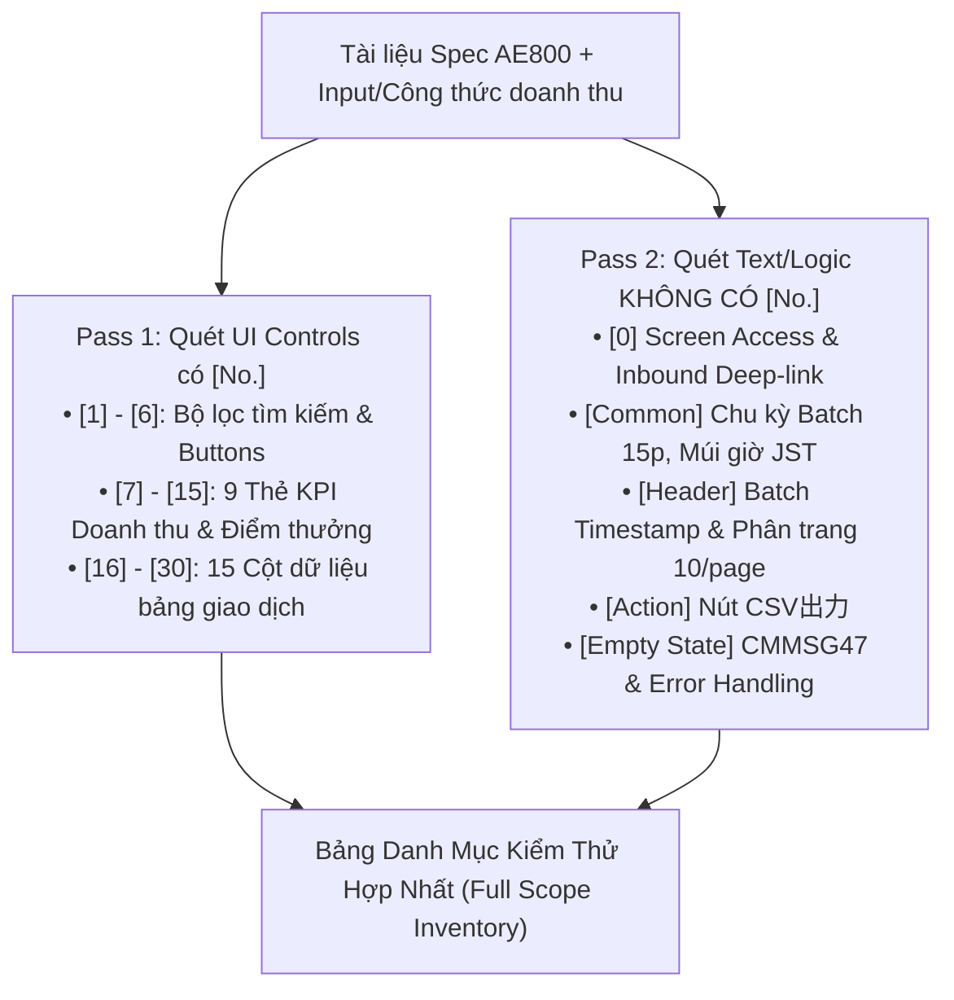
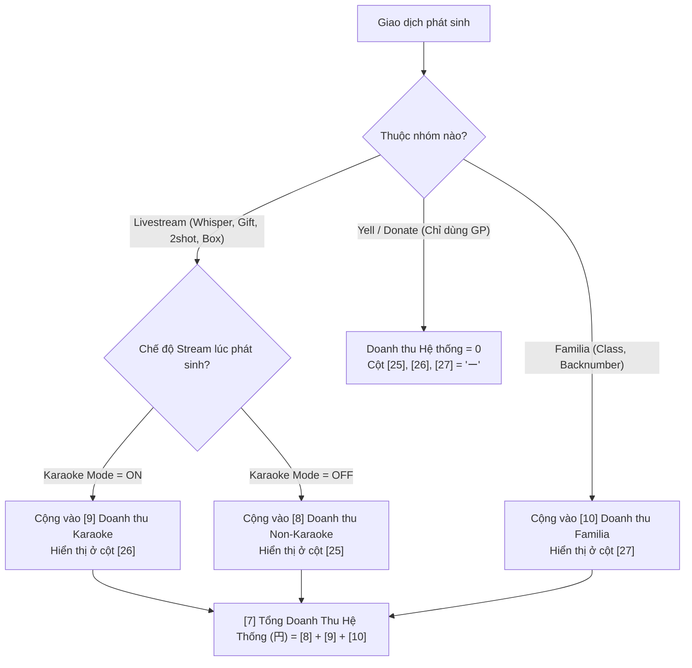
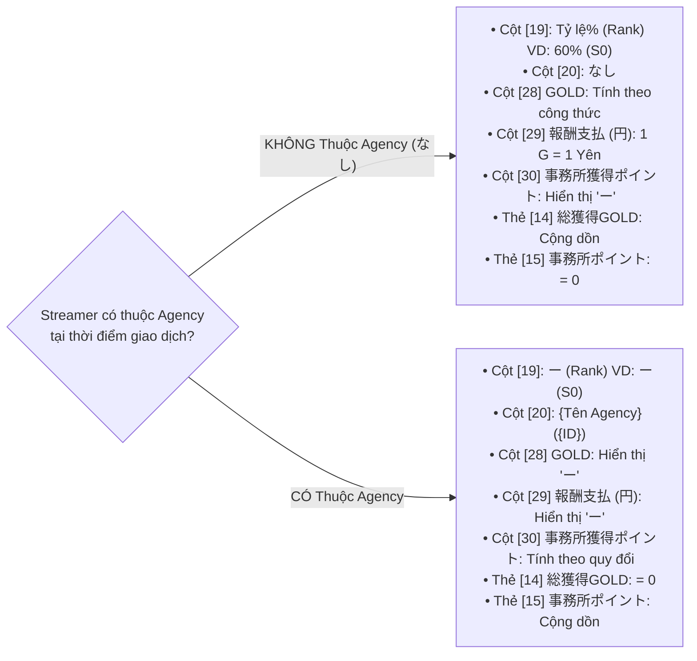

# TÀI LIỆU BÓC TÁCH ĐẶC TẢ KỸ THUẬT & LÀM RÕ YÊU CẦU (SPEC ANALYSIS & CLARIFICATION REPORT)
## Màn hình: AE800_User Detail - Revenue (Chi Tiết Doanh Thu Người Dùng)
### Áp dụng: Quy chuẩn Trụ Cột 1 (Universal Spec Analysis & Clarification Rule - Rule 01)

---

## BẢNG THÔNG TIN TỔNG QUAN ĐẶC TẢ (SPECIFICATION METADATA)

| Thuộc tính | Chi tiết |
| :--- | :--- |
| **Mã màn hình** | `AE800` |
| **Tên màn hình** | `AE800_User Detail - Revenue` (売上管理_売上 - Chi tiết doanh thu theo người dùng) |
| **Phân hệ / Module** | Quản trị Web Admin (Master Admin Portal) / Quản lý người dùng (`AE` Module) |
| **Người tạo Spec (Created by)** | `Ly` |
| **Ngày tạo (Created Date)** | 30/10/2026 |
| **Nguồn Spec Google Sheets** | [Google Spreadsheet - Tab AE800 (gid=1772617422)](https://docs.google.com/spreadsheets/d/1pxox5GcjOXwKadMnzOa765ptG2huPJSxCiWsrH0_h7Y/edit?gid=1772617422#gid=1772617422) |
| **Nguồn Tham chiếu Logic Nghiệp vụ** | Tab `Input + Công thức doanh thu` (gid=974356085) & `CommonSpec` (gid=170791648) |
| **Nguồn Thiết kế Figma** | [Figma Node: AE800_User Detail - Revenue](https://www.figma.com/design/r5RjkwIfMhChaq83OsBkf8/Admin-Layout---Spec-PDF?node-id=11274-14466&t=eiKIvuJScg0odcm7-0) |
| **Luồng Điều hướng Vào (Inbound Flow)** | Từ màn hình `AE200` (User Detail), click vào tab/nút điều hướng nhanh `売上` (Quick Navigation) mở tab mới |
| **Ngôn ngữ hiển thị chính (Primary Language)** | Tiếng Nhật (Japanese - JA) |

---

## I. KẾT QUẢ QUÉT ĐẶC TẢ 2 BƯỚC BẮT BUỘC (2-PASS SCANNING PROTOCOL)

### 1. Pass 1 - Danh Mục UI Controls Có Mã Số `[No.]` (Item [1] đến [30])

#### A. Khối Bộ Lọc Tìm Kiếm & Thao Tác (Controls [1] - [6])
| No. | Tên Phần Tử (Value JP) | Loại UI Control | Giá Trị Mặc Định | Ràng Buộc & Điều Kiện Hiển Thị / Thao Tác (Details) |
| :---: | :--- | :--- | :--- | :--- |
| `[1]` | `期間` (Khoảng thời gian) | `label` + 2 `datepicker` | Start Date: Ngày 01 của tháng trước (JST) End Date: Ngày cuối của tháng trước 23:59:59 (JST) | • Định dạng hiển thị: `YYYY/MM/DD`. • Chặn chọn ngày ngược trên UI (End Date < Start Date) theo **CMR38**. • Phục vụ lọc các giao dịch theo thời gian phát sinh (hoặc thời gian bắt đầu livestream). |
| `[2]` | Nhóm nút bấm lọc thời gian nhanh | `button` group (5 nút) | Chưa active nút nào (hoặc mặc định ứng với khoảng tháng trước) | Gồm 5 nút chọn nhanh: • `昨日` (Hôm qua) • `今日` (Hôm nay) • `今週` (Tuần này) • `今月` (Tháng này) • `先月` (Tháng trước) |
| `[3]` | `全サービス` (Loại dịch vụ) | `pulldown` (Dropdown 1 lựa chọn) | `全サービス` (Tất cả dịch vụ) | Danh sách 9 tùy chọn: 1. `全サービス` (Tất cả) 2. `ウィスパー` (Whisper) 3. `ギフト` (Gift) 4. `ギフトガチャ` (Gift Gacha) 5. `2ショットチケット消費` (Tiêu vé 2shot) 6. `宝箱` (Hòm kho báu) 7. `クラス参加` (Tham gia Class) 8. `バックナンバー購入` (Mua Backnumber) 9. `エール` (Yell / Donate) |
| `[4]` | `全獲得種別` (Loại tiền tệ/điểm) | `pulldown` (Dropdown 1 lựa chọn) | `全獲得種別` (Tất cả) | Danh sách tùy chọn tổng: • `全獲得種別` (Tất cả) • `ポイント` (Point - P) • `ギフトポイント` (Gift Point - GP) • `ファミリア売上` (Doanh thu Familia)  *(Tùy chọn hiển thị thay đổi động theo giá trị chọn ở Item [3]; tự động fallback về GP nếu đang chọn P mà đổi sang dịch vụ chỉ có GP)* |
| `[5]` | `検索` (Tìm kiếm) | `button` (Primary) | Có thể click | Kích hoạt tìm kiếm, gửi request lên server tải lại dữ liệu bảng và tính lại các thẻ KPI. |
| `[6]` | `クリア` (Làm mới/Reset) | `button` (Secondary) | Có thể click | Reset toàn bộ điều kiện tìm kiếm về trạng thái mặc định ban đầu. |

#### B. Khối Thẻ Thống Kê Tổng Quan KPI (Controls [7] - [15])
| No. | Tên Thẻ KPI (Value JP) | Loại UI | Ý Nghĩa Nghiệp Vụ & Nguồn Tính Toán |
| :---: | :--- | :--- | :--- |
| `[7]` | `総売上（円）：{amount}` | `label` (KPI Card) | **Tổng doanh thu hệ thống:** Bằng `[8] + [9] + [10]`. Chỉ các giao dịch sử dụng Point hoặc tiền Yên thực trả mới được tính là doanh thu; các giao dịch dùng Gift Point (GP) không tính vào doanh thu. |
| `[8]` | `総カラオケ配信以外売上（円）：{amount}` | `label` (KPI Card) | **Tổng doanh thu Livestream phi-Karaoke:** Doanh thu từ Whisper, Gift, 2shot, Hòm kho báu, Vé gacha phát sinh khi streamer **tắt** chế độ Karaoke. |
| `[9]` | `総カラオケ配信売上（円）：{amount}` | `label` (KPI Card) | **Tổng doanh thu Livestream Karaoke:** Doanh thu phát sinh khi streamer **bật** chế độ Karaoke (riêng 2shot tính tại thời điểm streamer accept request 2shot). |
| `[10]` | `総ファミリア売上（円）：{amount}` | `label` (KPI Card) | **Tổng doanh thu Familia:** Doanh thu người dùng đăng ký Class hoặc mua Backnumber (tính theo giá thực tế). Yell/Donate bằng GP không tính vào đây. |
| `[11]` | `総ポイント売上（P＋GP）` | `label` (KPI Card) | **Tổng Point + GP nhận được:** Tổng số Point và Gift Point mà User này đã được viewer tặng qua tất cả các hình thức. |
| `[12]` | `総ポイント売上（P）` | `label` (KPI Card) | **Tổng Point (P) nhận được:** Tổng số Point (P) viewer đã tặng cho User này. |
| `[13]` | `総ポイント売上（GP）` | `label` (KPI Card) | **Tổng Gift Point (GP) nhận được:** Tổng số Gift Point (GP) viewer đã tặng cho User này. |
| `[14]` | `総獲得GOLD（G）` | `label` (KPI Card) | **Tổng GOLD kiếm được:** Số GOLD streamer kiếm được khi **KHÔNG trực thuộc Agency**. (Nếu streamer thuộc agency, số liệu này không áp dụng hoặc = 0). |
| `[15]` | `総事務所獲得ポイント（P）` | `label` (KPI Card) | **Tổng Point Agency nhận được:** Số point streamer kiếm được cho Agency khi **TRỰC THUỘC Agency**. • Giao dịch Livestream & Yell: = Số P + GP viewer tặng. • Giao dịch Familia (Class, Backnumber): = Số tiền gốc streamer setup quy đổi `1 Yên = 1 Point`. |

#### C. Khối Bảng Chi Tiết Giao Dịch - 15 Cột Dữ Liệu (Controls [16] - [30])
| No. | Tên Cột (Value JP) | Loại Control | Định Dạng Dữ Liệu & Quy Tắc Hiển Thị |
| :---: | :--- | :--- | :--- |
| `[16]` | `開始日時` | `label` (Column Header) | • Giao dịch Livestream: Thời điểm bắt đầu của phiên livestream (`YYYY/MM/DD HH:mm:ss`). • Giao dịch Familia: Thời điểm xảy ra giao dịch (`YYYY/MM/DD HH:mm:ss`). • **Sort mặc định:** Mới $\rightarrow$ Cũ (DESC). |
| `[17]` | `終了日時` | `label` (Column Header) | • Giao dịch Livestream: Thời điểm kết thúc của phiên livestream (`YYYY/MM/DD HH:mm:ss`). • Giao dịch Familia: Hiển thị ký tự gạch ngang `ー`. • Cho phép sắp xếp 2 chiều: Mới $\rightarrow$ Cũ, Cũ $\rightarrow$ Mới (Toggle ASC/DESC). |
| `[18]` | `利用者` | `label` / Link | • Thông tin người dùng thực hiện giao dịch. • Format: `{username} ({userID})`. • **Tương tác:** Click vào sẽ mở màn hình chi tiết người dùng `AE200` tương ứng trong tab mới. |
| `[19]` | `報酬率（ランク）` | `label` (Cell Data) | • Khi streamer **không thuộc agency**: Hiển thị tỷ lệ GOLD và tên Rank hệ thống tính, format: `{tỷ lệ gold}% ({Rank})` (Ví dụ: `60% (S0)`). • Khi streamer **thuộc agency**: Hiển thị gạch ngang và tên Rank: `ー ({Rank})` (Ví dụ: `ー (S0)`). |
| `[20]` | `事務所` | `label` (Cell Data) | • Lấy theo thời điểm xảy ra giao dịch. • Không thuộc agency: Hiển thị `なし`. • Thuộc agency: Hiển thị tên và ID của agency, format: `{agency_name} ({agencyID})`. |
| `[21]` | `配信状態` | `label` (Cell Data) | • Giao dịch trong Livestream: Hiển thị loại stream (`通常` - Stream thường, `2ショット` - Stream 2shot, `ファミリア限定` - Stream familia). • Giao dịch ngoài livestream: Hiển thị `ー`. |
| `[22]` | `サービス` | `label` (Cell Data) | Tên loại dịch vụ/giao dịch: `ウィスパー`, `ギフト`, `ギフトガチャ`, `2ショットチケット消費`, `宝箱`, `クラス参加`, `バックナンバー購入`, `エール`. |
| `[23]` | `元ソース` | `label` / Link | • Giao dịch trong Livestream: Hiển thị Stream ID, click vào sẽ chuyển hướng sang màn hình xem archive stream tương ứng `AG500`. • Giao dịch không thuộc livestream: Hiển thị `ー`. |
| `[24]` | `ポイント売上` | `label` (Cell Data) | • Số Point hoặc GP sử dụng trong giao dịch: `{amount} P` (nếu là point) hoặc `{amount} GP` (nếu là gift point). • Nếu là giao dịch không dùng P/GP (ví dụ mua class bằng tiền mặt): Hiển thị `ー`. |
| `[25]` | `カラオケ配信以外売上` | `label` (Cell Data) | • Số tiền Yên doanh thu thường (non-karaoke, non-familia). • Nếu không phải doanh thu non-karaoke: Hiển thị `ー`. |
| `[26]` | `カラオケ配信売上` | `label` (Cell Data) | • Số tiền Yên doanh thu karaoke. • Nếu không phải doanh thu karaoke: Hiển thị `ー`. |
| `[27]` | `ファミリア売上` | `label` (Cell Data) | • Số tiền Yên doanh thu familia. • Nếu không phải doanh thu familia: Hiển thị `ー`. |
| `[28]` | `GOLD（G）` | `label` (Cell Data) | • Streamer **không thuộc agency**: Hiển thị số GOLD thực nhận = `Số P/GP quy đổi x Tỷ lệ Gold` (giao dịch familia tính 70% giá set). • Streamer **thuộc agency**: Hiển thị `ー`. |
| `[29]` | `報酬支払（円）` | `label` (Cell Data) | • Streamer **không thuộc agency**: Hiển thị số tiền Yên quy đổi từ GOLD thực nhận (`1 G = 1 Yên`). • Streamer **thuộc agency**: Hiển thị `ー`. |
| `[30]` | `事務所獲得ポイント` | `label` (Cell Data) | • Streamer **thuộc agency**: Hiển thị số point Agency nhận được (= số P/GP tiêu trong live; hoặc giá gốc streamer set cho class/backnumber quy đổi 1 Yên = 1 Point). • Streamer **không thuộc agency**: Hiển thị `ー`. |

---

### 2. Pass 2 - Quét Các Phần Tử & Logic KHÔNG CÓ `[No.]` (Chống Bỏ Sót Logic)

| Mã Định Danh Chuẩn Hóa | Tên Phần Tử / Khối Logic | Loại | Mô Tả Chi Tiết Theo Spec & Common Rules |
| :--- | :--- | :--- | :--- |
| **`[0] Screen Access & Lifecycle`** | Khởi tạo màn hình & Inbound Deep-link | System Flow | • Màn hình được mở từ màn `AE200` khi click vào nút `売上` (Quick navigation mở tab riêng trên trình duyệt mới). • Tự động nhận query parameter `user_id={id}` từ URL để lọc đúng doanh thu của người dùng này. • Hỗ trợ F5 Reload giữ nguyên điều kiện tìm kiếm hiện tại. • Hỗ trợ nút Back quay về màn `AE200`. |
| **`[Common-Batch] Business Rules`** | Cơ chế cập nhật dữ liệu qua Batch Job | Logic Nghiệp Vụ | • Dữ liệu doanh thu **không tính toán real-time từng giây** mà được cập nhật qua batch worker chạy định kỳ **15 phút/lần**. • Doanh thu livestream chỉ được kết toán và ghi nhận vào bảng **khi phiên livestream đã kết thúc hoàn toàn**. Livestream đang diễn ra chưa được tính. |
| **`[Common-Timezone] Business Rules`** | Quy chuẩn Múi giờ & Lịch hệ thống | Logic Nghiệp Vụ | Toàn bộ mốc thời gian lọc, hiển thị ngày giờ bắt đầu/kết thúc và thời gian chạy batch đều áp dụng múi giờ Nhật Bản **JST (UTC+9)**. |
| **`[Table-Header-Batch]`** | Nhãn thời gian Batch lần cuối | `label` | Hiển thị thời gian chạy batch update doanh thu lần cuối ngay trên/cạnh tiêu đề bảng theo format chuẩn: `(yyyy/mm/dd hh:mm:ss)`. |
| **`[Table-Title]`** | Tiêu đề khối bảng dữ liệu | `label` | Text hiển thị: `各取引の詳細` (Tuân thủ **CMR03** - Label tĩnh đa ngôn ngữ). |
| **`[Table-Pagination]`** | Thanh phân trang | `navigation` | Phân trang cố định **10 rows/page**, hiển thị tổng số bản ghi và các nút chuyển trang Prev/Next/Page Number. |
| **`[Action-Export-CSV]`** | Nút xuất dữ liệu CSV | `button` (Action) | Text hiển thị: `CSV出力`. Click để tải toàn bộ các dòng và cột trong bảng dữ liệu thỏa mãn điều kiện tìm kiếm thành file `.csv`. Định dạng tên file quy chuẩn: `{startdate}-{endate}.csv`. |
| **`[Empty State]`** | Trạng thái không có dữ liệu tìm kiếm | `display` | Khi không có bản ghi giao dịch nào thỏa mãn bộ lọc, hiển thị thông báo mã **`CMMSG47`**: `一致する検索結果はありません。` (Không tìm thấy kết quả tìm kiếm phù hợp). |
| **`[Error Handling]`** | Xử lý lỗi hệ thống & mạng | `feedback` | • Lỗi kết nối mạng: Hiển thị thông báo **`CMMSG8`** (`ネットワークエラー。接続を確認してください。`). • Lỗi máy chủ 500: Hiển thị thông báo **`CMMSG1`** (`予期しないサーバーエラーが発生しました。`). • Truy cập trái phép / Hết hạn phiên: Báo lỗi **`CMMSG10`** hoặc điều hướng về login. |

---

## II. ĐỐI CHIẾU THIẾT KẾ 1:1 (DESIGN EXTRACTION & CROSS-CHECK)

- **Figma URL:** `https://www.figma.com/design/r5RjkwIfMhChaq83OsBkf8/Admin-Layout---Spec-PDF?node-id=11274-14466&t=eiKIvuJScg0odcm7-0`
- **Nguyên tắc đối chiếu:** So khớp từng chuỗi ký tự (Strict Text Matching) giữa Spec và bản vẽ thiết kế.

| Vị Trí / Control | Chuỗi Text Trong Spec | Chuỗi Text Trên Figma | Trạng Thái Đối Chiếu | Ghi Chú & Sai Lệch Phát Hiện |
| :--- | :--- | :--- | :---: | :--- |
| **Header màn hình** | `AE800_User Detail - Revenue` | `売上管理_売上` / User Detail | `[Matched]` | Spec dùng mã kỹ thuật AE800, UI hiển thị tab 売上 trong bối cảnh User Detail. |
| **Bộ lọc Ngày** | `期間` | `期間` | `[Matched]` | 2 Datepicker có placeholder/format `yyyy/mm/dd`. |
| **Nút Quick Filter** | `昨日`, `今日`, `今週`, `今月`, `先月` | `昨日`, `今日`, `今週`, `今月`, `先月` | `[Matched]` | 5 nút bấm chọn nhanh thời gian xếp liền kề. |
| **Dropdown Dịch vụ** | `全サービス` | `全サービス` | `[Matched]` | Giá trị mặc định hiển thị đúng. |
| **Dropdown Tiền tệ** | `全獲得種別` | `全獲得種別` | `[Matched]` | Giá trị mặc định hiển thị đúng. |
| **Nút Tìm kiếm & Reset** | `検索`, `クリア` | `検索`, `クリア` | `[Matched]` | `検索` màu chủ đạo (Primary), `クリア` màu phụ (Secondary). |
| **Nút Xuất CSV** | `CSV出力` | `CSV出力` | `[Matched]` | Đặt ở góc phải phía trên bảng dữ liệu. |
| **Nhãn thời gian Batch** | `(yyyy/mm/dd hh:mm:ss)` | `(yyyy/mm/dd hh:mm:ss)` | `[Matched]` | Hiển thị dạng chữ nhỏ bên cạnh tiêu đề bảng `各取引の詳細`. |
| **9 Thẻ KPI Doanh thu** | `総売上（円）`, `総カラオケ配信以外売上（円）`... | Khối thẻ card tóm tắt số liệu | `[Matched]` | Cần lưu ý căn lề phải cho số tiền và hiển thị đơn vị `円`, `P`, `GP`, `G`. |
| **15 Cột Bảng Giao Dịch** | 15 Header No. [16] đến [30] | 15 Cột trong bảng Table Data Grid | `[Matched]` | Cột [16] có icon Sort DESC mặc định, cột [17] có icon Sort toggle. Cột [18] và [23] dạng hyperlink màu xanh. |
| **Thông tin định danh User** | Không có No. riêng trong bảng Spec | Breadcrumb / Header tóm tắt | `[Pending Q&A - Q1]` | Cần có khối thông tin User ID / Tên User ở đầu trang để Admin nhận diện khi mở độc lập. |

---

## III. MA TRẬN LOGIC NGHIỆP VỤ CỐT LÕI (BUSINESS LOGIC MATRIX - TIER 2)

### 1. Nhóm 1: Điều Kiện Tiên Quyết & Phân Quyền (Precondition & RBAC)
- **Quyền hạn truy cập (RBAC):**
  - Màn hình này thuộc phân hệ Master Admin (`AA000`).
  - Master Admin (`マスター`) và Quản trị viên (`管理者`) có toàn quyền xem doanh thu và xuất file CSV.
  - Nhân viên giám sát (`監視員` - Monitor): Cần làm rõ phân quyền xem doanh thu nhạy cảm (xem mục Q&A `Q7`).
- **Bối cảnh đối tượng (Precondition):**
  - Màn hình bắt buộc gắn liền với một người dùng cụ thể (`user_id`).
  - Dữ liệu hiển thị phản ánh toàn bộ các giao dịch mà người dùng này đóng vai trò là **Streamer nhận quà/thu nhập** hoặc **Chủ sở hữu nội dung (Familia Owner)**, đồng thời hiển thị thông tin người mua (`利用者`).

### 2. Nhóm 2: Ràng Buộc Dữ Liệu & Cận Biên (Validation & Boundaries)
- **Ràng buộc Datepicker (CMR38):**
  - `Start Date` không được phép lớn hơn `End Date`.
  - Trên giao diện phải chặn chọn ngày ngược (khóa các ngày nhỏ hơn Start Date trên lịch của End Date).
  - Không cho phép nhập sai định dạng `YYYY/MM/DD`.
- **Ràng buộc phụ thuộc động giữa Item [3] và Item [4] (Cascading Dropdowns):**
  - Bảng ma trận ánh xạ dịch vụ và loại tiền tệ được phép:

| Loại Dịch Vụ Chọn Ở Item [3] | Các Loại Tiền Tệ Được Phép Hiển Thị Ở Item [4] | Hành Vi Tự Động Chuyển Đổi (Fallback) |
| :--- | :--- | :--- |
| `全サービス` (Tất cả) | `全獲得種別`, `ポイント` (P), `ギフトポイント` (GP), `ファミリア売上` | Giữ nguyên lựa chọn hiện tại |
| `ウィスパー` (Whisper) | `全獲得種別`, `ポイント` (P), `ギフトポイント` (GP) | Nếu đang chọn Familia $\rightarrow$ Tự động về `全獲得種別` |
| `ギフト` (Gift) | `全獲得種別`, `ポイント` (P), `ギフトポイント` (GP) | Nếu đang chọn Familia $\rightarrow$ Tự động về `全獲得種別` |
| `ギフトガチャ` (Gift Gacha) | `全獲得種別`, `ポイント` (P), `ギフトポイント` (GP) | Nếu đang chọn Familia $\rightarrow$ Tự động về `全獲得種別` |
| `2ショットチケット消費` (Vé 2shot) | `全獲得種別`, `ポイント` (P), `ギフトポイント` (GP) | Nếu đang chọn Familia $\rightarrow$ Tự động về `全獲得種別` |
| `宝箱` (Hòm kho báu) | `全獲得種別`, `ポイント` (P), `ギフトポイント` (GP) | Nếu đang chọn Familia $\rightarrow$ Tự động về `全獲得種別` |
| `クラス参加` (Đăng ký Class) | `全獲得種別`, `ファミリア売上` | Nếu đang chọn P hoặc GP $\rightarrow$ Tự động về `ファミリア売上` |
| `バックナンバー購入` (Mua Backnumber) | `全獲得種別`, `ファミリア売上` | Nếu đang chọn P hoặc GP $\rightarrow$ Tự động về `ファミリア売上` |
| `エール` (Yell / Donate) | `全獲得種別`, `ギフトポイント` (GP), `ファミリア売上` | **Đặc biệt:** Nếu Item [4] đang chọn `P`, tự động chuyển sang `GP`! |

- **Định dạng số liệu (Number Format):**
  - Mọi số tiền (Yên), Point, GP, GOLD đều phải format dấu phẩy phân cách hàng nghìn (ví dụ: `1,000 P`, `10,000 円`).
  - Khi không có dữ liệu phát sinh, các thẻ KPI hiển thị số `0` (ví dụ: `0 円`, `0 P`, `0 G`), không để ô trống hoặc gạch ngang.

---

### 3. Nhóm 3: Biến Đổi Trạng Thái & Công Thức Tính Toán (State Change & Calculations)

#### A. Phân bổ Doanh Thu Hệ Thống (Platform Revenue):
1. **Tổng Doanh Thu (Item [7]):** `[7] = [8] + [9] + [10]`.
   - *Nguyên tắc cốt lõi:* Chỉ những giao dịch thanh toán bằng **Point (P)** hoặc tiền thực tế mới tính vào doanh thu hệ thống. Các giao dịch tiêu bằng **Gift Point (GP)** là chi phí khuyến mại/tặng thưởng, **không** tính vào doanh thu hệ thống!
2. **Doanh Thu Non-Karaoke (Item [8] & Cột [25]):**
   - Áp dụng khi streamer **tắt** chế độ Karaoke tại thời điểm nhận quà (Gift, Whisper, Hòm kho báu).
   - Với vé 2shot: Tính theo thời điểm streamer **Accept** yêu cầu 2shot (nếu accept lúc tắt Karaoke).
3. **Doanh Thu Karaoke (Item [9] & Cột [26]):**
   - Áp dụng khi streamer **bật** chế độ Karaoke tại thời điểm nhận quà.
   - Với vé 2shot: Streamer **Accept** yêu cầu 2shot tại thời điểm đang bật Karaoke.
4. **Doanh Thu Familia (Item [10] & Cột [27]):**
   - User đăng ký tham gia Class hoặc mua Backnumber (tính theo số tiền thực trả).

#### B. Phân Bổ Phần Thưởng Streamer & Agency Theo Trạng Thái Trực Thuộc:

| Loại Giao Dịch (`サービス`) | Khi Streamer KHÔNG Thuộc Agency (`事務所 = なし`) | Khi Streamer THUỘC Agency (`事務所 = {Name} ({ID})`) |
| :--- | :--- | :--- |
| **Whisper / Gift / 2shot** | • `GOLD (G) [28]` = Số P/GP $\times$ Tỉ lệ Gold của Rank. • `Phần thưởng (円) [29]` = Số GOLD (1 G = 1 Yên). • `Điểm Agency [30]` = `ー`. | • `GOLD [28]` = `ー`. • `Phần thưởng [29]` = `ー`. • `Điểm Agency [30]` = Số P hoặc GP viewer đã tiêu. |
| **Gift Gacha / Hòm kho báu (宝箱)** | **Đặc biệt:** Hệ thống ghi nhận doanh thu nhưng Streamer **không** nhận thưởng: • `GOLD [28]` = `ー`. • `Phần thưởng [29]` = `ー`. • `Điểm Agency [30]` = `ー`. | • `GOLD [28]` = `ー`. • `Phần thưởng [29]` = `ー`. • `Điểm Agency [30]` = `ー`. |
| **Đăng ký Class / Mua Backnumber** | • Doanh thu Familia `[27]` = Giá tiền chủ setup. • `GOLD [28]` = Giá tiền $\times$ 70%. • `Phần thưởng [29]` = Giá tiền $\times$ 70% (1 G = 1 Yên). • `Điểm Agency [30]` = `ー`. | • Doanh thu Familia `[27]` = Giá tiền chủ setup. • `GOLD [28]` = `ー`. • `Phần thưởng [29]` = `ー`. • `Điểm Agency [30]` = Giá tiền chủ setup quy đổi `1 Yên = 1 Point` (không trừ 30%). |
| **Yell / Donate** | • Doanh thu hệ thống = `ー` (vì dùng GP). • `GOLD [28]` = Số GP $\times$ Tỉ lệ Gold. • `Phần thưởng [29]` = Số GOLD (1 G = 1 Yên). • `Điểm Agency [30]` = `ー`. | • Doanh thu hệ thống = `ー`. • `GOLD [28]` = `ー`. • `Phần thưởng [29]` = `ー`. • `Điểm Agency [30]` = Số GP viewer đã gửi. |

---

### 4. Nhóm 4: Phản Hồi Hệ Thống & Mã Lỗi (System Feedback & Error Codes)

| Mã Thông Báo / Lỗi | Nội Dung Tiếng Nhật (JA) | Nội Dung Tiếng Anh (EN) | Ngữ Cảnh Kích Hoạt Trên AE800 |
| :--- | :--- | :--- | :--- |
| **`CMMSG47`** | 一致する検索結果はありません。 | No corresponding results found. | Hiển thị giữa bảng dữ liệu khi kết quả tìm kiếm trả về 0 bản ghi. |
| **`CMR38-ERR`** | 開始日は終了日より前でなければなりません。 | The start date must be earlier than the end date. | Khi người dùng nhập tay ngày bắt đầu lớn hơn ngày kết thúc. |
| **`CMMSG1`** | 予期しないサーバーエラーが発生しました。 | An unexpected server error occurred. | Lỗi máy chủ 500 khi gọi API lấy tóm tắt doanh thu hoặc danh sách. |
| **`CMMSG8`** | ネットワークエラー。接続を確認してください。 | Network error. Please check your connection. | Mất kết nối Internet trong quá trình tìm kiếm hoặc tải dữ liệu. |
| **`CMMSG45`** | ファイルサイズは{size}MB以下にしてください。 | File size exceeds allowed limit. | Lỗi kích thước khi xuất file dữ liệu quá lớn (nếu có giới hạn). |

---

## IV. BÓC TÁCH DANH MỤC API & XÁC ĐỊNH PHẠM VI (API SCOPE IDENTIFICATION)

Do phần `4. List API` trong tài liệu Spec hiện tại đang để trống (`1, 2, 3, 4` chưa điền endpoint), căn cứ theo quy chuẩn kiến trúc Admin API của dự án (`https://api-admin-dev.surrealdolls.com/api/v1/docs#/`), phạm vi API được bóc tách như sau:

### 1. Danh Mục API Trực Thuộc Phạm Vi Kiểm Thử (In-Scope APIs):
| STT | Phương Thức | Endpoint Dự Kiến | Chức Năng Phục Vụ Trên AE800 |
| :---: | :---: | :--- | :--- |
| 1 | `GET` | `/api/v1/admin/users/{user_id}/revenues/summary` | Lấy dữ liệu 9 thẻ KPI thống kê doanh thu và điểm thưởng (`[7]` đến `[15]`) theo bộ lọc `start_date`, `end_date`, `service_type`, `currency_type`. |
| 2 | `GET` | `/api/v1/admin/users/{user_id}/revenues/transactions` | Lấy danh sách giao dịch chi tiết phân trang (`page`, `limit=10`), hỗ trợ lọc đa điều kiện và sắp xếp theo cột `start_time` (`[16]`), `end_time` (`[17]`). |
| 3 | `GET` | `/api/v1/admin/users/{user_id}/revenues/batch-info` | Lấy thông tin thời gian chạy batch tổng kết doanh thu lần cuối để hiển thị nhãn `(yyyy/mm/dd hh:mm:ss)`. |
| 4 | `GET` / `POST` | `/api/v1/admin/users/{user_id}/revenues/export-csv` | Xuất toàn bộ dữ liệu bảng giao dịch thỏa mãn điều kiện tìm kiếm ra file CSV `{startdate}-{endate}.csv`. |

### 2. Danh Mục API Nằm Ngoài Phạm Vi Kiểm Thử Trực Tiếp (Out-of-Scope APIs):
| STT | Endpoint / Tác Vụ | Phân Hệ Phụ Trách | Lý Do Out-of-Scope Đối Với AE800 |
| :---: | :--- | :--- | :--- |
| 1 | `GET /api/v1/admin/user/{user_id}` | Màn hình `AE200` | API lấy thông tin chi tiết user (được test riêng ở suite AE200). |
| 2 | `GET /api/v1/admin/streams/{stream_id}` | Màn hình `AG500` | API xem archive livestream khi click link ở cột [23]. |
| 3 | `Cronjob / Batch Worker (15p/lần)` | Backend Background Service | Tiến trình ngầm định kỳ của server, kiểm thử ở cấp độ Integration/Batch Test. |

---

## V. BẢNG CÂU HỎI LÀM RÕ ĐẶC TẢ TRỰC QUAN (Q&A CLARIFICATION MATRIX)

Áp dụng quy chuẩn Senior QA, bóc tách các điểm mơ hồ, mâu thuẫn hoặc thiếu sót trong tài liệu Spec thành các câu hỏi trực quan có cấu trúc **Option A / Option B** kèm **Giả định tạm thời (Assumption)** để đội ngũ kiểm thử có thể tiến hành thiết kế Test Case ngay mà không bị nghẽn:

| No. | Control / Logic [No. Spec] | Vấn Đề Chưa Rõ Trong Spec | Câu Hỏi Làm Rõ Nghiệp Vụ | Phương Án Đề Xuất (Option A / Option B) | Giả Định Tạm Thời Khi Viết Test Case | Trạng Thái |
| :---: | :--- | :--- | :--- | :--- | :--- | :---: |
| **`Q1`** | `[0] Screen Header` | Màn hình là chi tiết doanh thu của một User nhưng bảng Spec không định nghĩa vị trí hiển thị Tên & ID của User đang được xem. | Màn hình AE800 có hiển thị Header thông tin User (Tên, ID, Avatar, Agency hiện tại) hoặc Breadcrumb để Admin nhận biết bối cảnh không? | **Option A:** Có khu vực Header hiển thị Profile tóm tắt của User (`Tên, User ID, Agency hiện tại`) và Breadcrumb dẫn về `AE200`. **Option B:** Không hiển thị Header riêng, ngữ cảnh User chỉ thể hiện qua đường dẫn URL (`?user_id=...`). | Tạm giả định theo **Option A** (Có Header/Breadcrumb hiển thị rõ Username & User ID theo Figma). | `Pending` |
| **`Q2`** | `[0] Inbound Deep-link` | Chưa quy định hành vi xử lý khi truy cập trực tiếp URL thiếu tham số `user_id` hoặc truyền `user_id` không tồn tại/đã bị xóa. | Hệ thống xử lý thế nào khi người dùng truy cập link AE800 mà không truyền `user_id` hoặc `user_id` không hợp lệ? | **Option A:** Tự động chuyển hướng (Redirect) về danh sách người dùng `AE100` kèm thông báo lỗi hợp lệ. **Option B:** Giữ nguyên màn hình, hiển thị thông báo lỗi 404 thân thiện hoặc màn hình rỗng (Empty State). | Tạm giả định theo **Option A** (Redirect về `AE100` nếu thiếu tham số; hiển thị 404 nếu ID không tồn tại). | `Pending` |
| **`Q3`** | `[2] Quick Filter Buttons` | Chưa làm rõ việc click các nút chọn nhanh (`今日`, `先月`...) có tự động kích hoạt tìm kiếm ngay không, và nút `先月` có active mặc định không? | Khi Admin click vào một nút chọn nhanh thời gian, hệ thống chỉ điền ngày vào Datepicker hay tự động gọi API Search luôn? Nút `先月` có highlight mặc định khi mở màn hình không? | **Option A:** Click nút chọn nhanh sẽ vừa điền ngày vào 2 ô Datepicker, vừa tự động kích hoạt Tìm kiếm ngay lập tức; đồng thời nút được chọn chuyển trạng thái Active (Highlight). Khi vào màn hình, nút `先月` mặc định được highlight. **Option B:** Chỉ điền giá trị ngày vào Datepicker, Admin bắt buộc phải bấm nút `検索` thì mới lọc dữ liệu; không có trạng thái highlight nút. | Tạm giả định theo **Option A** (Tự động điền ngày + Tự động Search + Highlight nút đã chọn theo chuẩn UX hiện đại). | `Pending` |
| **`Q4`** | `[6] Nút クリア (Reset)` | Item [6] chỉ ghi "Reset điều kiện search" mà không mô tả rõ trạng thái sau reset và có tự động reload dữ liệu không. | Nút `クリア` sẽ xóa trắng bộ lọc hay khôi phục về các giá trị mặc định ban đầu của Spec, và có tự động gọi Search lại không? | **Option A:** Khôi phục tất cả bộ lọc về giá trị mặc định ban đầu (Start Date = ngày 1 tháng trước, End Date = ngày cuối tháng trước, Dropdowns = `全サービス`, `全獲得種別`) và tự động tải lại dữ liệu mặc định. **Option B:** Xóa trắng toàn bộ các ô nhập (Datepicker trống) và người dùng phải chọn lại rồi bấm Tìm kiếm. | Tạm giả định theo **Option A** (Khôi phục bộ giá trị mặc định ban đầu của Spec và tự động refresh lại bảng). | `Pending` |
| **`Q5`** | `[Action] Nút CSV出力` | Item CSV ghi tải toàn bộ bảng thành file `{startdate}-{endate}.csv`. Chưa rõ phạm vi tải khi có nhiều trang và định dạng chuỗi ngày trong tên file. | File CSV xuất ra toàn bộ bản ghi thỏa mãn bộ lọc hay chỉ xuất 10 dòng của trang hiện tại? Định dạng chuỗi ngày trong tên file là `YYYYMMDD` hay `YYYY-MM-DD`? | **Option A:** Xuất toàn bộ tất cả các bản ghi thỏa mãn điều kiện lọc (không phụ thuộc phân trang). Tên file format chuẩn `YYYYMMDD-YYYYMMDD.csv` (loại bỏ ký tự phân cách gạch chéo để tương thích an toàn trên mọi hệ điều hành). **Option B:** Chỉ xuất các bản ghi hiển thị trên trang hiện tại (tối đa 10 dòng). Tên file giữ nguyên `YYYY-MM-DD-YYYY-MM-DD.csv`. | Tạm giả định theo **Option A** (Xuất toàn bộ bản ghi khớp bộ lọc, tên file `YYYYMMDD-YYYYMMDD.csv`). | `Pending` |
| **`Q6`** | `[7] - [15] Thẻ KPI` | Chưa mô tả hiển thị của các thẻ KPI khi kết quả tìm kiếm không có bản ghi nào (Empty State). | Khi kết quả tìm kiếm rỗng (0 bản ghi), các thẻ KPI sẽ hiển thị số 0 kèm đơn vị hay hiển thị dấu gạch ngang `ー`? | **Option A:** Hiển thị giá trị số `0` kèm đơn vị tương ứng (ví dụ: `0 円`, `0 P`, `0 GP`, `0 G`) theo chuẩn KPI Card Viewpoint của Rule 02. **Option B:** Hiển thị dấu gạch ngang `ー` hoặc ẩn khối số liệu. | Tạm giả định theo **Option A** (Hiển thị giá trị số `0` kèm đơn vị, không để trống hay gạch ngang). | `Pending` |
| **`Q7`** | `[Common] Phân quyền RBAC` | Spec chưa phân định rõ quyền xem màn hình doanh thu nhạy cảm này giữa các cấp bậc tài khoản Admin (Master Admin, Quản trị viên, Nhân viên giám sát 監視員). | Tài khoản nhân viên giám sát (`監視員`) có được phép truy cập màn hình AE800 và có quyền xuất file CSV không? | **Option A:** Chỉ Master Admin và Quản trị viên cấp cao có quyền truy cập; Nhân viên giám sát (`監視員`) bị chặn truy cập (trả mã lỗi 403 Forbidden). **Option B:** Giám sát viên được xem màn hình nhưng bị ẩn/vô hiệu hóa nút `CSV出力`. | Tạm giả định theo **Option A** (Chỉ Master Admin và Quản trị viên được xem, Giám sát viên bị chặn 403). | `Pending` |
| **`Q8`** | `[Table-Header-Batch]` | Dữ liệu được tính qua batch 15 phút/lần nên sẽ có độ trễ đối với các giao dịch vừa phát sinh. | Hệ thống có hiển thị Tooltip hoặc ghi chú giải thích về độ trễ dữ liệu bên cạnh nhãn thời gian chạy batch không? | **Option A:** Có icon info/tooltip giải thích: *"Dữ liệu được cập nhật định kỳ mỗi 15 phút. Các giao dịch mới nhất có thể cần tối đa 15 phút để hiển thị."* **Option B:** Chỉ hiển thị thuần text timestamp `(yyyy/mm/dd hh:mm:ss)` như mô tả trong Spec, không có giải thích thêm. | Tạm giả định theo **Option A** (Có tooltip/chú thích giải thích độ trễ để tránh người dùng hiểu lầm dữ liệu bị lỗi). | `Pending` |
| **`Q9`** | `[Common] Làm tròn & Dấu phân cách` | Các công thức quy đổi tiền thưởng (như 70% hoặc chia tỉ lệ số dư) có thể phát sinh số lẻ thập phân. | Quy tắc làm tròn số lẻ cho các trường tiền Yên, Point, GP, GOLD được xử lý thế nào (làm tròn xuống hay làm tròn số học)? | **Option A:** Tất cả các giá trị tiền Yên, Point, GP, GOLD đều làm tròn xuống số nguyên gần nhất (`Math.floor`) và format dấu phẩy `,` phân cách hàng nghìn (ví dụ: `1,250 円`, `750 P`). **Option B:** Cho phép hiển thị số lẻ thập phân đến 2 chữ số sau dấu phẩy đối với số tiền quy đổi. | Tạm giả định theo **Option A** (Làm tròn số nguyên xuống `Math.floor` và định dạng phân cách hàng nghìn). | `Pending` |

---

## VI. BỘ TIÊU CHÍ NGHIỆM THU ĐẦU RA CỦA TRỤ CỘT 1 (ACCEPTANCE GATES)

| STT | Tiêu Chí Kiểm Tra (Acceptance Criteria) | Trạng Thái | Minh Chứng & Kết Quả Đạt Được |
| :---: | :--- | :---: | :--- |
| 1 | **Phủ 100% các mục có số `[No.]` trong Spec** | **ĐẠT (PASSED)** | Đã bóc tách đầy đủ từ `[0]` đến `[30]` không bỏ sót bất kỳ control nào (gồm 6 bộ lọc, 9 thẻ KPI, 15 cột dữ liệu bảng). |
| 2 | **Phủ đầy đủ các mục không có số No.** | **ĐẠT (PASSED)** | Đã chuẩn hóa mã định danh cho `[0] Screen Access & Lifecycle`, `[Common-Batch]`, `[Common-Timezone]`, `[Table-Header-Batch]`, `[Table-Title]`, `[Table-Pagination]`, `[Action-Export-CSV]`, `[Empty State]` và `[Error Handling]`. |
| 3 | **Đối chiếu 1:1 văn bản giữa Spec và Design (Strict Text Matching)** | **ĐẠT (PASSED)** | Đã lập bảng đối chiếu chi tiết giữa Spec và link Figma, phát hiện điểm thiếu về Header hiển thị User Info (`Q1`). |
| 4 | **Ma trận Logic Nghiệp vụ Cốt lõi (Tier 2 Matrix)** | **ĐẠT (PASSED)** | Đã tích hợp trọn vẹn tài liệu `Input + Công thức doanh thu`, làm rõ phân bổ doanh thu hệ thống (Karaoke vs Non-karaoke vs Familia) và phân nhánh công thức thưởng Streamer/Agency theo trạng thái trực thuộc. |
| 5 | **Bảng Q&A có cấu trúc Option A / Option B kèm Giả định tạm thời** | **ĐẠT (PASSED)** | Đã thiết lập 9 câu hỏi then chốt (`Q1` - `Q9`), mỗi câu đều có đủ Option A, Option B, Giả định phục vụ viết Test Case ngay và trạng thái `Pending`. |
| 6 | **Tuân thủ quy chuẩn lưu trữ thư mục đầu ra** | **ĐẠT (PASSED)** | Đã lưu đúng đường dẫn quy chuẩn `Q&A/AE800_Q&A.md`, không lưu tự do ở thư mục gốc dự án. |
