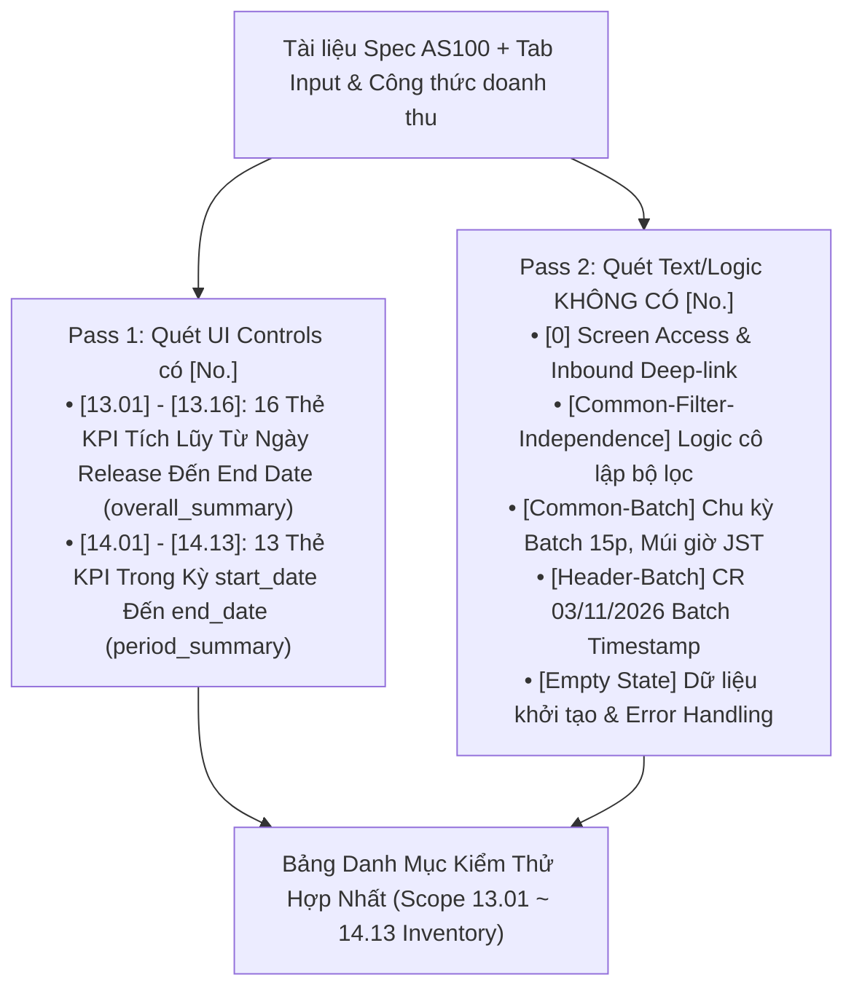
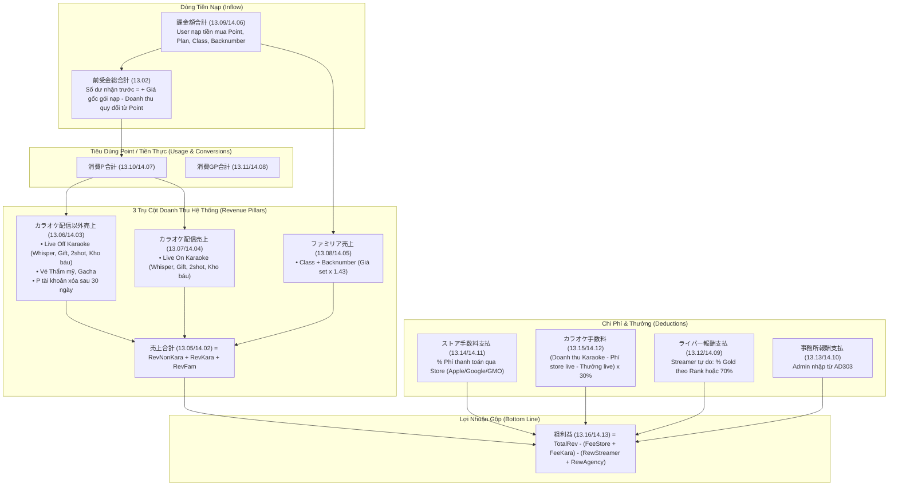

# TÀI LIỆU BÓC TÁCH ĐẶC TẢ KỸ THUẬT & LÀM RÕ YÊU CẦU (SPEC ANALYSIS & CLARIFICATION REPORT)
## Màn hình: AS100 - Sale Analysis Dashboard (Bảng Điều Khiển Phân Tích Doanh Thu Tổng Hợp)
### Phạm vi phân tích: Các mục tổng quan KPI Doanh thu từ [13.01] đến [14.13]
### Áp dụng: Trụ Cột 1 (Universal Spec Analysis & Clarification Rule - Rule 01)

---

## BẢNG THÔNG TIN TỔNG QUAN ĐẶC TẢ (SPECIFICATION METADATA)

| Thuộc tính | Chi tiết |
| :--- | :--- |
| **Mã màn hình** | `AS100` |
| **Tên màn hình** | `AS100_Sale analysis dashboard` (売上管理_売上 - Bảng điều khiển phân tích doanh thu toàn hệ thống) |
| **Phân hệ / Module** | Quản trị Web Admin (Master Admin Portal) / Quản trị Doanh thu (`AS` Module) |
| **Người tạo Spec (Created by)** | `Ly` |
| **Ngày tạo (Created Date)** | 02/10/2026 (Cập nhật gần nhất: 03/11/2026) |
| **Nguồn Spec Google Sheets** | [Google Spreadsheet - Tab AS100 (gid=1263482685)](https://docs.google.com/spreadsheets/d/1pxox5GcjOXwKadMnzOa765ptG2huPJSxCiWsrH0_h7Y/edit?gid=1263482685#gid=1263482685) |
| **Nguồn Tham chiếu Logic Nghiệp vụ** | Tab `Input + Công thức doanh thu` (gid=974356085), `CommonSpec` (gid=170791648), `Common MSG` (gid=1080253487) |
| **Nguồn Thiết kế Figma** | [Figma Node: AS100_Sale analysis dashboard](https://www.figma.com/design/r5RjkwIfMhChaq83OsBkf8/Admin-Layout---Spec-PDF?node-id=10210-13756&t=RGRYEMvEhz0TzLfo-0) |
| **Frontend Standalone Spec** | [Google Drive File Preview](https://drive.google.com/file/d/1Pfd1-UajcCWGYJWzj8NNtbQAcwosoDDq/view?usp=drive_link) |
| **Luồng Điều hướng Vào (Inbound Flow)** | Menu Sidebar: `売上管理` $\rightarrow$ `売上` hoặc từ màn hình `AE200` (User Detail tab `売上`) chuyển sang |
| **Ngôn ngữ hiển thị chính (Primary Language)** | Tiếng Nhật (Japanese - JA) |

---

## I. KẾT QUẢ QUÉT ĐẶC TẢ 2 BƯỚC BẮT BUỘC (2-PASS SCANNING PROTOCOL)



---

### 1. Pass 1 - Danh Mục UI Controls Có Mã Số `[No.]` (Phạm vi từ [13.01] đến [14.13])

Khu vực này bao gồm **29 UI Controls dạng Label / Thẻ KPI Thống Kê**, chia thành 2 khối độc lập:
- **Khối 13:** Tổng quan lũy kế từ ngày Release hệ thống đến `End Date` (Item `[5]`).
- **Khối 14:** Tổng quan luồng phát sinh trong khoảng thời gian lọc từ `Start Date` (Item `[4]`) đến `End Date` (Item `[5]`).

#### A. Khối 13: Thống Kê Tích Lũy Toàn Hệ Thống Từ Khi Phát Hành (Release ~ End Date)
> *Đặc thù nghiệp vụ:* Khối 13 bao gồm cả các chỉ số lưu lượng (Flow) và các chỉ số tồn quỹ / công nợ tồn đọng (Stock/Balance) như Tiền nhận trước (`前受金`), Point tồn (`未消費P`), Gift Point tồn (`未消費GP`).

| No. | Tên Thẻ / Label (Value JP) | Loại UI | Giá Trị Mặc Định | Ràng Buộc & Điều Kiện Hiển Thị (Details) | Mapping Request Data | Mapping Response Data |
| :---: | :--- | :--- | :--- | :--- | :--- | :--- |
| `[13.01]` | `集計期間：リリース 〜 {yyyy/mm/dd}` | `label` | `リリース 〜 {Hôm nay}` | • Hiển thị phạm vi thời gian tính toán từ lúc release đến ngày kết thúc.<br>• Biến `{yyyy/mm/dd}` lấy từ `end_date` chọn ở bộ lọc Item `[5]`.<br>• Dữ liệu các thẻ 13.02 ~ 13.16 chỉ tính theo `end_date`, **hoàn toàn không bị ảnh hưởng** bởi các bộ lọc khác (Item 2, 3, 7~10). | `1.end_date` | `1.snapshot.reporting_started_at` |
| `[13.02]` | `前受金総合計（円）：{amount}` | `label` | `0 円` | **Tổng số dư nhận trước của hệ thống:**<br>• Cộng giá gốc khi user mua point/plan (Group D).<br>• Trừ doanh thu quy đổi khi user tiêu point hoặc xoá tài khoản sau 30 ngày.<br>• Khi mua vé chưa sử dụng: Không trừ. | `-` | `1.overall_summary.prepaid_yen.value` |
| `[13.03]` | `未消費P合計（P）：{amount}` | `label` | `0 P` | **Tổng số Point chưa sử dụng trong hệ thống:**<br>• Cộng khi mua point/plan hoặc đổi từ GOLD.<br>• Trừ khi user sử dụng point hoặc xóa tài khoản sau 30 ngày.<br>• Mua vé chưa sử dụng: Không trừ. | `-` | `1.overall_summary.unconsumed_point.value` |
| `[13.04]` | `未消費GP合計（GP）：{amount}` | `label` | `0 GP` | **Tổng số Gift Point chưa sử dụng trong hệ thống:**<br>• Cộng khi user nhận GP (gói plan chia theo ngày).<br>• Trừ khi user sử dụng GP hoặc xóa tài khoản sau 30 ngày.<br>• Mua vé chưa sử dụng: Không trừ. | `-` | `1.overall_summary.unconsumed_gift_point.value` |
| `[13.05]` | `売上合計（円）：{amount}` | `label` | `0 円` | **Tổng doanh thu của hệ thống:**<br>• Công thức = `13.06 + 13.07 + 13.08`.<br>• Chỉ các giao dịch sử dụng Point hoặc tiền Yên thực tế mới tính doanh thu (Giao dịch dùng GP không tính). | `-` | `1.overall_summary.total_revenue.value` |
| `[13.06]` | `カラオケ配信以外売上（円）：{amount}` | `label` | `0 円` | **Tổng doanh thu phi-Karaoke:**<br>• Doanh thu livestream khi OFF mode karaoke.<br>• 2shot accept khi OFF karaoke.<br>• Gửi hòm kho báu khi OFF karaoke.<br>• Tiêu vé thẩm mỹ/gacha.<br>• Point chưa dùng sau 30 ngày xóa tài khoản. | `-` | `1.overall_summary.non_karaoke_revenue.value` |
| `[13.07]` | `カラオケ配信売上（円）：{amount}` | `label` | `0 円` | **Tổng doanh thu Karaoke:**<br>• Giao dịch gift/whisper/2shot/hòm kho báu phát sinh khi streamer **bật (ON)** mode karaoke. | `-` | `1.overall_summary.karaoke_revenue.value` |
| `[13.08]` | `ファミリア売上（円）：{amount}` | `label` | `0 円` | **Tổng doanh thu Familia:**<br>• Đăng ký class và mua backnumber (`giá chủ set x 1.43`).<br>• Yell/donate bằng GP không tính vào doanh thu. | `-` | `1.overall_summary.familia_revenue.value` |
| `[13.09]` | `課金額合計（円）：{amount}` | `label` | `0 円` | **Tổng tiền nạp vào hệ thống:**<br>• Tổng số tiền người dùng thực trả qua cổng thanh toán (mua point, mua plan, đăng ký class, mua backnumber). | `-` | `1.overall_summary.charged_amount.value` |
| `[13.10]` | `消費P合計（P）：{amount}` | `label` | `0 P` | **Tổng số Point đã tiêu thụ:**<br>• Tổng Point đã sử dụng trong Group A, B và point tồn của tài khoản bị xoá sau 30 ngày.<br>• Vé chưa dùng không tính. | `-` | `1.overall_summary.consumed_point.value` |
| `[13.11]` | `消費GP合計（GP）：{amount}` | `label` | `0 GP` | **Tổng số Gift Point đã tiêu thụ:**<br>• Tổng GP đã dùng trong Group A, B, gửi donate (Yell) và tài khoản xóa sau 30 ngày. | `-` | `1.overall_summary.consumed_gift_point.value` |
| `[13.12]` | `ライバー報酬支払（円）：{amount}` | `label` | `0 円` | **Tổng chi trả thưởng cho Streamer tự do:**<br>• Chỉ tính streamer **không thuộc agency**.<br>• Giao dịch Group A (trừ hòm kho báu & gift gacha): Tính theo rank & tỷ lệ GOLD tại thời điểm phát sinh.<br>• Group C: Class/backnumber tính 70%, donate tính 70%. | `-` | `1.overall_summary.streamer_reward.value` |
| `[13.13]` | `事務所報酬支払（円）：{amount}` | `label` | `0 円` | **Tổng chi trả thưởng cho Agency:**<br>• Tổng tiền ghi nhận từ các record do Admin tạo thủ công tại màn hình `AD303`. | `-` | `1.overall_summary.agency_reward.value` |
| `[13.14]` | `ストア手数料支払（円）：{amount}` | `label` | `0 円` | **Tổng phí nền tảng Store:**<br>• Tổng phí thanh toán trả cho GMO, Apple, Google tính theo % trên số tiền thực trả của giao dịch nạp/mua qua store. | `-` | `1.overall_summary.store_fee.value` |
| `[13.15]` | `カラオケ手数料（円）：{amount}` | `label` | `0 円` | **Tổng phí bản quyền Karaoke:**<br>• Công thức: `(Doanh thu karaoke - Phí store karaoke - Tiền thưởng karaoke) x 30%`. | `-` | `1.overall_summary.karaoke_fee.value` |
| `[13.16]` | `粗利益（円）：{amount}` | `label` | `0 円` | **Lợi nhuận gộp toàn hệ thống:**<br>• Công thức = `Doanh thu (13.05) - Tổng chi phí (13.14 + 13.15) - Tổng thưởng (13.12 + 13.13)`. | `-` | `1.overall_summary.gross_profit.value` |

---

#### B. Khối 14: Thống Kê Trong Khoảng Điều Kiện Lọc (Start Date ~ End Date)
> *Đặc thù nghiệp vụ:* Khối 14 chỉ đo lường lưu lượng phát sinh trong kỳ lọc (Flow metrics). Do đó, **không có** 3 chỉ số tồn tích lũy (`前受金総合計`, `未消費P合計`, `未消費GP合計`).

| No. | Tên Thẻ / Label (Value JP) | Loại UI | Giá Trị Mặc Định | Ràng Buộc & Điều Kiện Hiển Thị (Details) | Mapping Request Data | Mapping Response Data |
| :---: | :--- | :--- | :--- | :--- | :--- | :--- |
| `[14.01]` | `条件内期間：{yyyy/mm/dd} 〜 {yyyy/mm/dd}` | `label` | `{Start Date} 〜 {End Date}` | • Hiển thị khoảng thời gian lọc đã chọn.<br>• Biến `{yyyy/mm/dd}` lấy từ `start_date` (Item `[4]`) và `end_date` (Item `[5]`).<br>• Dữ liệu các thẻ 14.02 ~ 14.13 chỉ tính theo khoảng này, **hoàn toàn không bị ảnh hưởng** bởi bộ lọc đối tượng (Item 2, 3, 7~10). | `1.start_date`<br>`1.end_date` | `-` |
| `[14.02]` | `売上合計（円）：{amount}` | `label` | `0 円` | **Doanh thu hệ thống trong kỳ:** Bằng `14.03 + 14.04 + 14.05` phát sinh trong khoảng thời gian điều kiện. | `-` | `1.period_summary.total_revenue.value` |
| `[14.03]` | `カラオケ配信以外売上（円）：{amount}` | `label` | `0 円` | **Doanh thu phi-Karaoke trong kỳ:** Giao dịch livestream non-karaoke, vé thẩm mỹ/gacha và tài khoản xóa sau 30 ngày rơi vào khoảng điều kiện. | `-` | `1.period_summary.non_karaoke_revenue.value` |
| `[14.04]` | `カラオケ配信売上（円）：{amount}` | `label` | `0 円` | **Doanh thu Karaoke trong kỳ:** Giao dịch livestream bật mode karaoke kết thúc trong khoảng điều kiện. | `-` | `1.period_summary.karaoke_revenue.value` |
| `[14.05]` | `ファミリア売上（円）：{amount}` | `label` | `0 円` | **Doanh thu Familia trong kỳ:** Giao dịch đăng ký class/mua backnumber phát sinh trong khoảng điều kiện. | `-` | `1.period_summary.familia_revenue.value` |
| `[14.06]` | `課金額合計（円）：{amount}` | `label` | `0 円` | **Tổng tiền nạp trong kỳ:** Tổng tiền user thực trả qua cổng thanh toán trong khoảng điều kiện. | `-` | `1.period_summary.charged_amount.value` |
| `[14.07]` | `消費P合計（P）：{amount}` | `label` | `0 P` | **Tổng Point tiêu thụ trong kỳ:** Tổng số Point đã tiêu dùng trong khoảng điều kiện. | `-` | `1.period_summary.consumed_point.value` |
| `[14.08]` | `消費GP合計（GP）：{amount}` | `label` | `0 GP` | **Tổng Gift Point tiêu thụ trong kỳ:** Tổng số GP đã sử dụng (bao gồm Donate Yell) trong khoảng điều kiện. | `-` | `1.period_summary.consumed_gift_point.value` |
| `[14.09]` | `ライバー報酬支払（円）：{amount}` | `label` | `0 円` | **Tiền thưởng Streamer tự do trong kỳ:** Tổng thưởng trả cho streamer không thuộc agency trong khoảng điều kiện. | `-` | `1.period_summary.streamer_reward.value` |
| `[14.10]` | `事務所報酬支払（円）：{amount}` | `label` | `0 円` | **Tiền thưởng Agency trong kỳ:** Các khoản thưởng agency có ngày hiệu lực/chốt sổ rơi vào khoảng điều kiện. | `-` | `1.period_summary.agency_reward.value` |
| `[14.11]` | `ストア手数料支払（円）：{amount}` | `label` | `0 円` | **Phí store nền tảng trong kỳ:** Tổng phí trả cho GMO/Apple/Google phát sinh trong khoảng điều kiện. | `-` | `1.period_summary.store_fee.value` |
| `[14.12]` | `カラオケ手数料（円）：{amount}` | `label` | `0 円` | **Phí bản quyền Karaoke trong kỳ:** Phí karaoke tính toán trên doanh thu karaoke của kỳ lọc theo công thức 30%. | `-` | `1.period_summary.karaoke_fee.value` |
| `[14.13]` | `粗利益（円）：{amount}` | `label` | `0 円` | **Lợi nhuận gộp trong kỳ:** Bằng `14.02 - (14.11 + 14.12) - (14.09 + 14.10)` trong kỳ lọc. | `-` | `1.period_summary.gross_profit.value` |

---

### 2. Pass 2 - Quét Toàn Bộ Logic & Text KHÔNG CÓ `[No.]` (Chống Bỏ Sót Logic Ẩn)

| Mã Định Danh | Tên Thành Phần / Khối Logic | Phân Loại | Chi Tiết Quy Tắc Kỹ Thuật & Nghiệp Vụ |
| :--- | :--- | :--- | :--- |
| **`[0] Screen Access & Lifecycle`** | Khởi tạo trang & Tải dữ liệu ban đầu | System Flow | • Màn hình tải ban đầu tự động thiết lập `Start Date` = Ngày 01 tháng trước (JST) và `End Date` = Ngày cuối tháng trước `23:59:59` (JST).<br>• Gọi API 1 `GET /sales-dashboard` với `page=1`, tải đồng thời dữ liệu khối `overall_summary` (13), `period_summary` (14) và bảng giao dịch.<br>• Khi F5 reload trang: Giữ nguyên khoảng ngày đã chọn và phân trang hiện tại. |
| **`[Common-Filter-Independence]`** | Quy tắc độc lập của các khối KPI Overview | Business Rules | • **Nguyên tắc vàng:** Cả khối 13 và khối 14 **KHÔNG BỊ ẢNH HƯỞNG** bởi các bộ lọc chi tiết ở thanh tìm kiếm (Item `[2]` User, Item `[3]` Streamer, Item `[7]` Category streamer, Item `[8]` Service Type, Item `[9]` Stream Type, Item `[10]` Currency Type).<br>• Khối 13 **chỉ phụ thuộc** vào `End Date` (Item `[5]`).<br>• Khối 14 **chỉ phụ thuộc** vào cặp `Start Date` và `End Date` (Item `[4]` & `[5]`).<br>• Nhập text tìm kiếm user/streamer hoặc chọn loại dịch vụ thì số liệu trên các thẻ 13 và 14 **vẫn giữ nguyên**, chỉ có bảng chi tiết `各取引の詳細` bên dưới thay đổi. |
| **`[Common-Batch] Business Rules`** | Cơ chế cập nhật dữ liệu qua Batch Job | System Architecture | • Số liệu doanh thu không tính toán trực tiếp real-time từng giây để tránh quá tải DB, mà được tính toán và lưu snapshot qua **Batch Worker chạy định kỳ 15 phút/lần**.<br>• Doanh thu của các buổi livestream chỉ được ghi nhận vào hệ thống **sau khi buổi livestream đã kết thúc hoàn toàn** (Livestream đang diễn ra chưa được kết toán vào 13 và 14). |
| **`[Header-Batch-Timestamp]`** | Nhãn thời gian cập nhật Batch lần cuối | UI Display | • Theo yêu cầu bổ sung **CR 03/11/2026**: Phía trên khu vực KPI hiển thị nhãn thời gian batch hoàn thành gần nhất theo định dạng chuẩn: `(yyyy/mm/dd hh:mm:ss)`. |
| **`[Common-Timezone]`** | Chuẩn hóa Múi giờ Hệ thống | System Rules | • Toàn bộ mốc thời gian lọc, thời điểm chốt sổ, thời gian batch và ngày hiển thị `{yyyy/mm/dd}` đều tuân thủ múi giờ chuẩn Nhật Bản **JST (UTC+9)**. |
| **`[Data-Formatting]`** | Quy chuẩn hiển thị số liệu tiền tệ / điểm | UI Display | • Áp dụng **CMR03**: Toàn bộ biến `{amount}` trên các thẻ phải được định dạng có dấu phẩy phân cách hàng nghìn (ví dụ: `1,000,000`).<br>• Hiển thị đúng đơn vị đi kèm: `（円）` cho tiền Yên, `（P）` cho Point, `（GP）` cho Gift Point. |
| **`[Empty State]`** | Trạng thái hệ thống mới / Chưa có phát sinh | UI Display | • Khi hệ thống mới chạy chưa có giao dịch nào thỏa mãn mốc thời gian: Các thẻ tiền tệ hiển thị `0 円`, các thẻ điểm hiển thị `0 P`, `0 GP`, tuyệt đối không để trống hoặc hiển thị `null`/`NaN`. |
| **`[Error Handling]`** | Xử lý sự cố mạng & máy chủ | Feedback | • Mất kết nối mạng: Báo lỗi **`CMMSG8`** (`ネットワークエラー。接続を確認してください。`).<br>• Lỗi máy chủ 500: Báo lỗi **`CMMSG1`** (`予期しないサーバーエラーが発生しました。`).<br>• Hết hạn phiên đăng nhập: Điều hướng về màn hình đăng nhập Admin. |

---

## II. ĐỐI CHIẾU THIẾT KẾ 1:1 (DESIGN EXTRACTION & CROSS-CHECK)

- **Figma URL:** [Admin Layout - Spec PDF (Node 10210-13756)](https://www.figma.com/design/r5RjkwIfMhChaq83OsBkf8/Admin-Layout---Spec-PDF?node-id=10210-13756&t=RGRYEMvEhz0TzLfo-0)
- **Frontend Standalone:** [Standalone Drive Preview](https://drive.google.com/file/d/1Pfd1-UajcCWGYJWzj8NNtbQAcwosoDDq/view?usp=drive_link)
- **Phương pháp đối chiếu:** So khớp chặt chẽ từng ký tự (Strict Text Matching) giữa nhãn trong Spec và bản vẽ Figma.

| Mục No. | Chuỗi Ký Tự Trong Spec | Chuỗi Ký Tự Trên Figma / Prototype | Đánh Giá Khớp Nối | Ghi Chú Chi Tiết & Bất Thường |
| :---: | :--- | :--- | :---: | :--- |
| `[Header]` | `CR03/11/2026: (yyyy/mm/dd hh:mm:ss)` | `(yyyy/mm/dd hh:mm:ss)` | `[Matched]` | Hiển thị chữ màu xám nhạt (Muted text) nằm góc trên bên phải khối Overview. |
| `[13.01]` | `集計期間：リリース 〜 {yyyy/mm/dd}` | `集計期間：リリース 〜 2026/09/30` | `[Matched]` | Chữ "リリース" giữ nguyên text tĩnh, ngày kết thúc render động từ datepicker Item 5. |
| `[13.02]` | `前受金総合計（円）：{amount}` | `前受金総合計（円）：1,234,567` | `[Matched]` | Số tiền căn lề phải, font số tabular có dấu phẩy ngăn cách hàng nghìn. |
| `[13.03]` | `未消費P合計（P）：{amount}` | `未消費P合計（P）：500,000` | `[Matched]` | Thẻ thể hiện công nợ Point đang lưu hành. |
| `[13.04]` | `未消費GP合計（GP）：{amount}` | `未消費GP合計（GP）：200,000` | `[Matched]` | Thẻ thể hiện công nợ Gift Point đang lưu hành. |
| `[13.05]` | `売上合計（円）：{amount}` | `売上合計（円）：10,000,000` | `[Matched]` | Thẻ KPI nổi bật (Primary Highlight). |
| `[13.06]` | `カラオケ配信以外売上（円）：{amount}` | `カラオケ配信以外売上（円）：6,000,000` | `[Matched]` | Doanh thu Livestream thường + non-live. |
| `[13.07]` | `カラオケ配信売上（円）：{amount}` | `カラオケ配信売上（円）：3,000,000` | `[Matched]` | Doanh thu stream bật mode karaoke. |
| `[13.08]` | `ファミリア売上（円）：{amount}` | `ファミリア売上（円）：1,000,000` | `[Matched]` | Doanh thu Class + Backnumber. |
| `[13.09]` | `課金額合計（円）：{amount}` | `課金額合計（円）：12,000,000` | `[Matched]` | Tổng tiền nạp từ user. |
| `[13.10]` | `消費P合計（P）：{amount}` | `消費P合計（P）：8,000,000` | `[Matched]` | Thẻ thống kê tiêu Point. |
| `[13.11]` | `消費GP合計（GP）：{amount}` | `消費GP合計（GP）：1,500,000` | `[Matched]` | Thẻ thống kê tiêu GP. |
| `[13.12]` | `ライバー報酬支払（円）：{amount}` | `ライバー報酬支払（円）：3,500,000` | `[Matched]` | Tiền trả streamer tự do. |
| `[13.13]` | `事務所報酬支払（円）：{amount}` | `事務所報酬支払（円）：1,500,000` | `[Matched]` | Tiền trả agency từ AD303. |
| `[13.14]` | `ストア手数料支払（円）：{amount}` | `ストア手数料支払（円）：1,800,000` | `[Matched]` | Phí GMO/Apple/Google. |
| `[13.15]` | `カラオケ手数料（円）：{amount}` | `カラオケ手数料（円）：450,000` | `[Matched]` | Phí bản quyền 30%. |
| `[13.16]` | `粗利益（円）：{amount}` | `粗利益（円）：2,750,000` | `[Matched]` | Lợi nhuận sau khi trừ toàn bộ phí và thưởng. |
| `[14.01]` | `条件内期間：{yyyy/mm/dd} 〜 {yyyy/mm/dd}` | `条件内期間：2026/09/01 〜 2026/09/30` | `[Matched]` | Hiển thị đúng dải `Start Date ~ End Date`. |
| `[14.02]~[14.13]` | Các thẻ tương ứng từ Doanh thu đến Lợi nhuận | Các thẻ thống kê khối Period | `[Matched]` | Cấu trúc nhãn và đơn vị tiền/điểm đồng nhất với khối 13. |

---

## III. BÓC TÁCH MA TRẬN LOGIC NGHIỆP VỤ CỐT LÕI (BUSINESS LOGIC MATRIX - TIER 2)

### 1. Nhóm 1: Điều Kiện Tiên Quyết & Phân Quyền (Precondition & RBAC)
- **Quyền hạn vai trò (Role-Based Access Control):**
  - Màn hình `AS100` chứa thông tin tài chính nhạy cảm toàn hệ thống (Doanh thu, Phí Store, Phí bản quyền, Lợi nhuận gộp).
  - Chỉ tài khoản có quyền **Master Admin (`マスター`)** hoặc **Admin Quản lý tài chính (`管理者`)** mới được phép xem toàn bộ các khối chỉ số này.
  - Các role vận hành cấp thấp hơn (Operator, Supporter) nếu không có quyền tài chính sẽ bị chặn truy cập hoặc ẩn các thẻ liên quan đến chi phí, hoa hồng và lợi nhuận (`13.12 ~ 13.16` và `14.09 ~ 14.13`).
- **Phạm vi dữ liệu:** Dữ liệu mang tính chất **Toàn Cục (System-wide)**, tổng hợp từ toàn bộ người dùng, streamer và agency trong hệ thống.

---

### 2. Nhóm 2: Ràng Buộc Dữ Liệu & Cận Biên (Validation & Boundaries)
- **Ràng buộc thời gian (CMR38):**
  - `start_date` $\le$ `end_date`. Trên giao diện phải chặn chọn ngày ngược (khóa lịch).
  - Định dạng ngày: `YYYY/MM/DD`.
  - Múi giờ xử lý: Mọi mốc thời gian đều tính theo **JST (UTC+9)**. Khi gửi API, `start_date` tính từ `00:00:00` và `end_date` tính đến `23:59:59` của ngày được chọn.
- **Ràng buộc giá trị số học:**
  - Tiền nạp (`課金額合計`), Point/GP (`未消費`, `消費`), Doanh thu (`売上合計`): Luôn $\ge 0$.
  - Lợi nhuận gộp (`粗利益` - 13.16 & 14.13): Về lý thuyết toán học **có thể mang giá trị âm** nếu tổng chi phí và thưởng vượt quá doanh thu thực nhận.

---

### 3. Nhóm 3: Biến Đổi Trạng Thái & Công Thức Tính Toán Chi Tiết (State Change & Detailed Calculations)

Toàn bộ công thức được trích xuất trực tiếp từ tab nghiệp vụ chuẩn `Input + Công thức doanh thu`:



#### Chi Tiết Từng Công Thức Nghiệp Vụ:

1. **Công thức Doanh thu theo giao dịch tiêu Point (Group A & Group B):**
   $$\text{Doanh thu} = \frac{\text{Số P user đã sử dụng}}{\text{Số P user sở hữu trước khi sử dụng}} \times \text{Số dư tiền nhận trước (前受金) của user}$$
   *Ví dụ:* User nạp 20,000 Yên được 2,000 P (tiền nhận trước ban đầu = 20,000 Yên). User gửi Gift trị giá 500 P:
   $$\text{Doanh thu phát sinh} = \frac{500}{2,000} \times 20,000 = 5,000\text{ Yên}$$
   $\rightarrow$ Sau giao dịch, số dư tiền nhận trước của user còn lại $20,000 - 5,000 = 15,000\text{ Yên}$ và số P còn lại là $1,500\text{ P}$.

2. **Công thức Doanh thu Familia (Group C):**
   $$\text{Doanh thu Familia} = \text{Giá Class / Backnumber chủ set} \times 1.43$$
   *(1.43 là hệ số quy đổi ra số tiền thực tế phía user phải trả qua Store).*
   *Lưu ý:* Gửi Yell / Donate chỉ dùng GP nên **không** tính vào doanh thu.

3. **Công thức Doanh thu từ tài khoản bị xóa (Group E - 退会放棄):**
   - Sau đúng 30 ngày kể từ ngày user xóa tài khoản:
   $$\text{Doanh thu} = \text{Số P còn dư quy đổi sang Yên (theo công thức Group A/B)} + \text{Số G còn dư quy đổi trực tiếp (1G = 1 Yên)}$$

4. **Công thức Phí Store (`ストア手数料支払` - 13.14 & 14.11):**
   $$\text{Phí Store} = \sum (\text{Số tiền nạp thực tế của từng giao dịch qua Store} \times \text{Tỷ lệ \% phí của Platform tương ứng})$$
   *(Tỷ lệ % của Apple, Google, GMO được cấu hình tại màn hình AS100/AS101).*

5. **Công thức Phí Karaoke (`カラオケ手数料` - 13.15 & 14.12):**
   $$\text{Phí Karaoke} = \Big(\text{Doanh thu Karaoke} - \text{Phí Store phần Karaoke} - \text{Tiền thưởng phần Karaoke}\Big) \times 30\%$$
   *Trong đó:*
   $$\text{Phí Store phần Karaoke} = \left(\frac{\text{Tổng P tiêu trong Stream Karaoke}}{\text{Tổng P mua qua Store}}\right) \times \text{Tổng phí Store}$$
   $$\text{Tiền thưởng phần Karaoke} = \text{Thưởng streamer tự do} + \text{Thưởng agency phát sinh trong phiên Karaoke}$$

6. **Công thức Lợi Nhuận Gộp (`粗利益` - 13.16 & 14.13):**
   $$\text{粗利益} = \text{売上合計} - (\text{ストア手数料支払} + \text{カラオケ手数料}) - (\text{ライバー報酬支払} + \text{事務所報酬支払})$$

---

### 4. Nhóm 4: Phản Hồi Hệ Thống & Mã Lỗi (System Feedback & Error Codes)
- **Khi API trả dữ liệu thành công:** Trả về HTTP 200 OK kèm 2 object `overall_summary` và `period_summary`.
- **Trường hợp không có phát sinh giao dịch:**
  - Thẻ hiển thị số `0` với đơn vị tương ứng (ví dụ: `0 円`, `0 P`, `0 GP`).
  - Bảng giao dịch bên dưới hiển thị thông báo **`CMMSG47`**: `一致する検索結果はありません。`.
- **Lỗi tham số ngày không hợp lệ:** Trả về lỗi Validation mã **`CMMSG41`** hoặc **`CMMSG42`**.
- **Lỗi hệ thống:** Trả về HTTP 500 kèm mã **`CMMSG1`** (`予期しないサーバーエラーが発生しました。`).

---

## IV. BÓC TÁCH DANH MỤC API & XÁC ĐỊNH PHẠM VI (API SCOPE IDENTIFICATION)

### 1. Danh Mục API Liên Quan Trực Tiếp (In-Scope)
- **API phục vụ trực tiếp cho Item 13.01 ~ 14.13:**
  - **Endpoint:** `GET /sales-dashboard`
  - **Swagger Reference:** [Sales Dashboard Admin API](https://api-admin-dev.surrealdolls.com/docs#/Sales%20Dashboard)
  - **Phương thức:** `GET`
  - **Tham số gửi lên (Query Parameters):**
    - `start_date` (string, format `YYYY-MM-DD`, múi giờ JST): Phục vụ tính `period_summary` (14.01 ~ 14.13).
    - `end_date` (string, format `YYYY-MM-DD`, múi giờ JST): Phục vụ tính cả `overall_summary` (13.01 ~ 13.16) và `period_summary`.
    - `snapshot_token` (string, optional): Token neo giữ trạng thái dữ liệu khi phân trang.
  - **Cấu trúc Dữ liệu Trả về (Response Payload):**
    ```json
    {
      "snapshot": {
        "reporting_started_at": "2026-01-01T00:00:00+09:00",
        "token": "snap_xyz123"
      },
      "overall_summary": {
        "prepaid_yen": { "value": 1234567, "currency": "JPY" },
        "unconsumed_point": { "value": 500000, "unit": "P" },
        "unconsumed_gift_point": { "value": 200000, "unit": "GP" },
        "total_revenue": { "value": 10000000, "currency": "JPY" },
        "non_karaoke_revenue": { "value": 6000000, "currency": "JPY" },
        "karaoke_revenue": { "value": 3000000, "currency": "JPY" },
        "familia_revenue": { "value": 1000000, "currency": "JPY" },
        "charged_amount": { "value": 12000000, "currency": "JPY" },
        "consumed_point": { "value": 8000000, "unit": "P" },
        "consumed_gift_point": { "value": 1500000, "unit": "GP" },
        "streamer_reward": { "value": 3500000, "currency": "JPY" },
        "agency_reward": { "value": 1500000, "currency": "JPY" },
        "store_fee": { "value": 1800000, "currency": "JPY" },
        "karaoke_fee": { "value": 450000, "currency": "JPY" },
        "gross_profit": { "value": 2750000, "currency": "JPY" }
      },
      "period_summary": {
        "total_revenue": { "value": 1000000, "currency": "JPY" },
        "non_karaoke_revenue": { "value": 600000, "currency": "JPY" },
        "karaoke_revenue": { "value": 300000, "currency": "JPY" },
        "familia_revenue": { "value": 100000, "currency": "JPY" },
        "charged_amount": { "value": 1200000, "currency": "JPY" },
        "consumed_point": { "value": 800000, "unit": "P" },
        "consumed_gift_point": { "value": 150000, "unit": "GP" },
        "streamer_reward": { "value": 350000, "currency": "JPY" },
        "agency_reward": { "value": 150000, "currency": "JPY" },
        "store_fee": { "value": 180000, "currency": "JPY" },
        "karaoke_fee": { "value": 45000, "currency": "JPY" },
        "gross_profit": { "value": 275000, "currency": "JPY" }
      }
    }
    ```

### 2. Danh Mục Out-of-Scope (Bỏ qua trong phạm vi phân tích này)
- API 2: `GET /sales-dashboard/store-fees` (Lấy danh sách % phí store).
- API 3: `PUT /sales-dashboard/store-fees/{platform}` (Cập nhật % phí store).
- API 4: `GET /sales-dashboard/store-transactions` (Danh sách giao dịch nạp store).
- API 5: `PUT /sales-dashboard/store-transactions/fees` (Sửa hàng loạt phí giao dịch - modal AS101).
- API 6: `GET /sales-dashboard/export.csv` (Xuất file CSV danh sách giao dịch).

---

## V. QUY CHUẨN LẬP BẢNG Q&A CLARIFICATION TRỰC QUAN (OPTION A / OPTION B)

Dưới đây là bảng câu hỏi làm rõ các góc khuất kỹ thuật, trường hợp biên và điểm chưa rõ ràng trong Spec cho các mục từ 13.01 đến 14.13:

| No. | Control / Logic [No. Spec] | Vấn đề chưa rõ trong Spec | Câu hỏi làm rõ gửi BA / Dev / Khách hàng | Phương án đề xuất (Options) | Giả định tạm thời khi thiết kế TC | Trạng thái |
| :---: | :--- | :--- | :--- | :--- | :--- | :---: |
| `Q1` | `[13.01] Header Khoảng thời gian Release` | Spec ghi text `集計期間：リリース 〜 {yyyy/mm/dd}` nhưng không nói rõ từ `リリース` có được thay bằng ngày Release thực tế của hệ thống không. | Từ khóa "リリース" trên giao diện hiển thị dạng chuỗi tĩnh hay hiển thị mốc ngày cụ thể lấy từ `snapshot.reporting_started_at`? | **Option A:** Giữ nguyên chữ tĩnh "リリース" như đúng text Spec và Figma (`集計期間：リリース 〜 2026/09/30`).<br>**Option B:** Thay thế bằng ngày cụ thể dạng `集計期間：2026/01/01 〜 2026/09/30`. | Tạm giả định theo **Option A** (Giữ chữ tĩnh "リリース" theo đúng Figma). | `Pending` |
| `Q2` | `[13.01 & 14.01] Mốc giờ kết thúc End Date` | Datepicker trên UI chỉ cho chọn ngày (`YYYY/MM/DD`). Cần làm rõ mốc thời gian chốt số của `End Date`. | Mốc tính dữ liệu của `End Date` là đến `23:59:59` của ngày đó hay `00:00:00` ngày hôm sau? | **Option A:** Tính chính xác đến hết `23:59:59` của ngày kết thúc (JST).<br>**Option B:** Tính đến thời điểm hiện tại nếu ngày kết thúc trùng với hôm nay. | Tạm giả định theo **Option A** (Đến hết `23:59:59` theo định nghĩa ở Item 4). | `Pending` |
| `Q3` | `[13.16 & 14.13] Lợi nhuận gộp âm` | Công thức Lợi nhuận gộp = Doanh thu - Chi phí - Thưởng. Nếu chi phí và thưởng lớn hơn doanh thu thì lợi nhuận âm. | Khi `粗利益` âm, UI hiển thị định dạng như thế nào? Có đổi màu đỏ cảnh báo hay không? | **Option A:** Hiển thị số âm bình thường kèm dấu trừ: `-1,500 円` (màu chữ tiêu chuẩn).<br>**Option B:** Hiển thị số âm và bôi đỏ nổi bật (Red text alert) để quản trị viên dễ nhận biết rủi ro tài chính. | Tạm giả định theo **Option A** (Hiển thị `-1,500 円` theo format `{amount} 円`, tuân thủ CMR03). | `Pending` |
| `Q4` | `[13.14, 13.15, 14.11, 14.12] Quy tắc làm tròn số lẻ` | Phí karaoke (30%) và phí store tính theo % có thể phát sinh số thập phân lẻ. Spec chưa nêu quy tắc làm tròn tiền Yên. | Khi tiền Yên phát sinh số lẻ thập phân thì hệ thống làm tròn theo quy tắc nào? | **Option A:** Làm tròn xuống (Floor / Truncate) lấy số nguyên Yên (chuẩn kế toán Nhật Bản 切り捨て).<br>**Option B:** Làm tròn số học thông thường (Round half-up 四捨五入). | Tạm giả định theo **Option A** (Làm tròn xuống Floor về số nguyên Yên). | `Pending` |
| `Q5` | `[13.02] Số dư nhận trước (前受金)` | Khi user nạp 10,000 Yên qua Apple Store, Apple giữ lại 30% phí nền tảng, tiền về hệ thống thực tế là 7,000 Yên. | Số dư nhận trước `前受金総合計` ghi nhận theo giá niêm yết ban đầu (Gross: 10,000 Yên) hay giá thực nhận sau trừ phí (Net: 7,000 Yên)? | **Option A:** Ghi nhận đủ 100% giá gốc gói nạp (Gross = 10,000 Yên); phí store được theo dõi riêng ở thẻ Phí Store.<br>**Option B:** Ghi nhận theo số tiền thực thu (Net = 7,000 Yên). | Tạm giả định theo **Option A** (Ghi nhận Gross theo định nghĩa tab Input Doanh thu). | `Pending` |
| `Q6` | `[13.06 & 14.03] Thời điểm hạch toán tài khoản bị xóa` | Khi user bấm xóa tài khoản, sau 30 ngày Point dư mới chuyển thành doanh thu hệ thống (`退会放棄`). | Trong `period_summary` (14.03), mốc thời gian giao dịch được ghi nhận là ngày user bấm xóa hay ngày tròn 30 ngày? | **Option A:** Ghi nhận vào ngày tròn 30 ngày (thời điểm hệ thống thực tế sinh ra giao dịch doanh thu).<br>**Option B:** Ghi nhận hồi tố về ngày user bấm xác nhận xóa tài khoản. | Tạm giả định theo **Option A** (Ghi nhận tại ngày tròn 30 ngày khi batch chuyển đổi chạy). | `Pending` |
| `Q7` | `[13.13 & 14.10] Kỳ ghi nhận thưởng Agency` | Admin tạo record thưởng agency tại màn `AD303` với tháng dạng `yyyy/mm`, hệ thống lưu sort key `yyyy/mm/99 00:00`. | Nếu chọn khoảng lọc giữa tháng (VD: `2026/10/01 ~ 2026/10/15`), giao dịch thưởng agency của tháng 10 có được cộng vào `14.10` không? | **Option A:** Không được cộng, vì sort key là ngày 99 (cuối tháng) nên chỉ được cộng khi khoảng lọc bao phủ hết ngày cuối tháng.<br>**Option B:** Được cộng dựa theo ngày thực tế admin tạo record (`振込日`). | Tạm giả định theo **Option A** (Chỉ tính khi khoảng lọc bao phủ mốc kết sổ cuối tháng của record). | `Pending` |
| `Q8` | `[13.02~13.16 & 14.02~14.13] Hiển thị giá trị 0` | Trường hợp một chỉ số chưa có phát sinh dữ liệu (bằng 0), quy chuẩn hiển thị là gì? | Thẻ sẽ hiển thị số `0 円` / `0 P` hay hiển thị ký tự gạch ngang `ー`? | **Option A:** Luôn hiển thị số `0` kèm đơn vị: `0 円`, `0 P`, `0 GP`.<br>**Option B:** Hiển thị ký hiệu `ー` như các ô dữ liệu trống trong bảng. | Tạm giả định theo **Option A** (Thẻ KPI luôn hiển thị số `0` kèm đơn vị để phân biệt với trạng thái không áp dụng). | `Pending` |

---

## VI. BỘ TIÊU CHÍ NGHIỆM THU ĐẦU RA (ACCEPTANCE GATES)

- [x] **Tiêu chí 1:** Đã quét và phân tích 100% các mục có số `[No.]` từ `13.01` đến `14.13` (Gồm 16 thẻ khối Overall và 13 thẻ khối Period).
- [x] **Tiêu chí 2:** Đã phủ đầy đủ các mục không có số No. (`[0] Screen Access`, `[Common-Filter-Independence]`, `[Common-Batch]`, `[Header-Batch-Timestamp]`, `[Empty State]`).
- [x] **Tiêu chí 3:** Đã đối chiếu 1:1 các chuỗi text, định dạng tiền tệ/điểm giữa Spec và bản vẽ Figma Node 10210-13756.
- [x] **Tiêu chí 4:** Bảng Q&A Clarification thiết lập đầy đủ 8 câu hỏi cốt lõi, có đủ Option A / Option B kèm giả định tạm thời phục vụ viết Test Case ngay lập tức.
