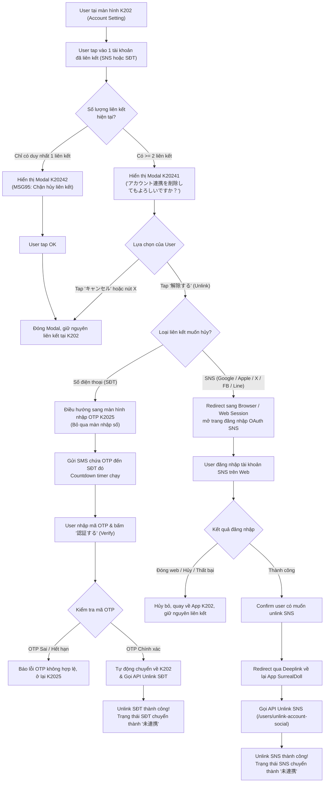

# TÀI LIỆU BÓC TÁCH ĐẶC TẢ KỸ THUẬT & LÀM RÕ YÊU CẦU (SPEC ANALYSIS & CLARIFICATION REPORT)
## Màn hình: K20241_Account Setting_SNS Un-connect (CR アカウント解除のセキュリティ強化)
### Task Backlog: [SURREALDOLLS-14315](https://issoh.backlog.com/view/SURREALDOLLS-14315) - Test STG iOS/Android (4h)
### Áp dụng: Quy chuẩn Trụ Cột 1 (Universal Spec Analysis & Clarification Rule - Rule 01)

---

## BẢNG THÔNG TIN TỔNG QUAN ĐẶC TẢ (SPECIFICATION METADATA)

| Thuộc tính | Chi tiết |
| :--- | :--- |
| **Mã task Backlog** | `SURREALDOLLS-14315` |
| **Tiêu đề task** | `[TEST][K20241] CR アカウント解除のセキュリティ強化 - Gỡ liên kết SĐT/SNS phải xác thực lại - Test STG iOS/Android (4h)` |
| **Mã màn hình chính** | `K20241` (Modal xác nhận hủy liên kết SNS / Số điện thoại) |
| **Các màn hình liên quan** | • `K202_Account Setting` (Màn hình cài đặt tài khoản - hiển thị danh sách SNS & SĐT) • `K20242_Account Setting_SNS can not Un-connect` (Modal chặn hủy khi chỉ còn 1 liên kết - MSG95) • `K2025_Account Setting - Phone setting` (Màn hình xác thực mã OTP SĐT) |
| **Môi trường & Nền tảng** | STG (Staging) - Mobile App iOS & Android |
| **Thời lượng kiểm thử dự kiến** | 4.0 giờ (4h) |
| **Người tạo Spec (Created by)** | `LyLTK` |
| **Nguồn Spec Google Sheets** | [Google Spreadsheet - Tab K20241 (gid=1654674821)](https://docs.google.com/spreadsheets/d/1pxox5GcjOXwKadMnzOa765ptG2huPJSxCiWsrH0_h7Y/edit?gid=1654674821#gid=1654674821) |
| **Nguồn Tham chiếu Liên quan** | • Tab `K202` (gid=668117086) - Account Setting • Tab `K20242` (gid=765301066) - SNS cannot Un-connect • Tab `K2025` (gid=425384199) - Phone setting & OTP verification • Tab `MSG` (dòng MSG95 - gid=1862733901) |
| **Nguồn Thiết kế Figma** | [Figma Node: K20241 (node-id=7765-16286)](https://www.figma.com/design/XO0QfOdbQF0fQYhCFINsoF/%E3%82%B5%E3%83%AA%E3%82%A2%E3%83%AB%E7%94%BB%E9%9D%A2%E3%83%87%E3%82%B6%E3%82%A4%E3%83%B3?node-id=7765-16286&t=hnn2TEyTi5XDUWOB-4) |
| **Ngôn ngữ hiển thị** | Tiếng Nhật (Japanese - JA) và Tiếng Anh (English - EN) |

---

## I. MỤC TIÊU & BỐI CẢNH CỦA CHANGE REQUEST (CR)

### 1. Vấn đề của luồng cũ (Trước CR):
- Trước đây, khi người dùng vào `K202`, bấm vào tài khoản SNS hoặc Số điện thoại đã liên kết, modal `K20241` chỉ hiển thị thông báo xác nhận đơn giản ("Would you like to unlink your account?").
- Khi nhấn nút "Unlink" (`解除する`), app lập tức gọi API hủy liên kết mà **hoàn toàn không yêu cầu xác thực lại**.
- **Rủi ro bảo mật:** Bất kỳ ai cầm điện thoại đang mở app hoặc chiếm được phiên đăng nhập đều có thể dễ dàng hủy liên kết mà chủ tài khoản không hề hay biết, dẫn đến nguy cơ mất tài khoản hoặc xung đột tài khoản nghiêm trọng.

### 2. Yêu cầu mới của CR (Tăng cường bảo mật xác thực chính chủ):
1. **Chặn gỡ liên kết cuối cùng (Zero-Orphan Protection):**
   - Nếu tài khoản chỉ đang liên kết duy nhất 1 phương thức (chỉ 1 SNS hoặc chỉ 1 SĐT): Tuyệt đối **KHÔNG CHO PHÉP UNLINK**.
   - Bấm vào sẽ bật modal cảnh báo `K20242` với nội dung thông báo `MSG95`.
2. **Bắt buộc tái xác thực chính chủ (Re-authentication Verification):**
   - Nếu tài khoản có từ 2 phương thức liên kết trở lên:
     * **Gỡ liên kết Số điện thoại:** Điều hướng sang màn hình nhập mã OTP của `K2025`. Hệ thống gửi SMS OTP tới chính SĐT đó -> Người dùng nhập đúng OTP và Verify thành công -> Mới tự động quay lại và thực hiện gỡ liên kết SĐT.
     * **Gỡ liên kết SNS (Google, Apple, X, Facebook, Line):** Redirect ra Web Browser (hoặc Web Auth Session) để người dùng đăng nhập vào đúng tài khoản SNS muốn hủy -> Đăng nhập thành công -> Xác nhận muốn unlink -> Redirect ngược lại App và thực hiện gỡ liên kết thành công.
3. **Tái sử dụng định danh (Account Recycling):**
   - Sau khi hủy liên kết thành công, tài khoản SNS hoặc SĐT đó được giải phóng và có thể dùng để đăng ký hoặc liên kết với tài khoản SurrealDoll khác.

---

## II. SƠ ĐỒ LUỒNG NGHIỆP VỤ (END-TO-END WORKFLOW)

---

## III. MA TRẬN LOGIC NGHIỆP VỤ CỐT LÕI (BUSINESS LOGIC MATRIX - TIER 2)

| Nhóm Logic | Chi tiết Quy tắc Nghiệp vụ (Business Rules) | Rủi ro & Điểm kiểm thử trọng yếu |
| :--- | :--- | :--- |
| **1. Điều kiện Tiên quyết & Phân quyền (Precondition & RBAC)** | • User đã đăng nhập thành công vào App. • Phải có ít nhất 1 phương thức đang ở trạng thái đã liên kết. • **Quy tắc chặn rỗng (Zero-Link Prevention):** Hệ thống không bao giờ cho phép tài khoản rơi vào trạng thái "0 liên kết" (vô thừa nhận). | • Kiểm tra User chỉ có 1 SĐT: Bấm vào phải ra `K20242` (MSG95). • Kiểm tra User chỉ có 1 SNS: Bấm vào phải ra `K20242` (MSG95). • Kiểm tra User có 1 SĐT + 1 SNS: Cho phép unlink 1 trong 2, sau khi unlink xong thì cái còn lại bị khóa không cho unlink tiếp. |
| **2. Ràng buộc Xác thực & Cận biên (Validation & Security)** | • **Đối với SĐT:** Mã OTP đúng độ dài (thường 4-6 số), có giới hạn thời gian (TTL ví dụ 60s), chặn spam bằng countdown resend OTP. • **Đối với SNS:** Tài khoản SNS đăng nhập trên browser **bắt buộc phải khớp chính xác** với tài khoản SNS đang liên kết trong app. | • Nhập sai OTP 1 lần, nhiều lần, nhập OTP hết hạn. • Bấm gửi lại OTP khi đếm ngược = 0. • Đăng nhập bằng một tài khoản SNS khác (Mismatch Account ID) trên web browser $\rightarrow$ Phải báo lỗi từ chối unlink, không được gỡ nhầm tài khoản! |
| **3. Biến đổi Trạng thái & Cơ chế Dữ liệu (State Changes)** | • Khi xác thực thành công: Gọi API `/users/unlink-account-social`. • Cập nhật ngay lập tức UI trên màn hình `K202`: Giá trị từ tên tài khoản/số điện thoại đổi thành text `未連携` (Not Linked). • Tài khoản SNS/SĐT vừa gỡ phải dùng được để đăng ký tài khoản mới hoặc liên kết vào tài khoản khác. | • Dữ liệu cache màn hình `K202` không được lưu trạng thái cũ. • Kiểm tra tính toàn vẹn tài khoản sau khi unlink (đăng xuất ra đăng nhập lại bằng phương thức còn lại vẫn hoạt động bình thường). |
| **4. Phản hồi Hệ thống & Thông báo (Feedback & Messages)** | • Modal `K20241`: "アカウント連携を削除してもよろしいですか？" (Would you like to unlink your account?). • Modal `K20242`: Báo thông báo `MSG95` ("連携がなくなってしまうため、解除できません..."). • Toast/Alert thông báo khi Unlink thành công hoặc thất bại. | • Kiểm tra đúng chuỗi đa ngôn ngữ (JA và EN) trên cả 2 nền tảng iOS & Android. • Kiểm tra các thông báo lỗi khi mất mạng hoặc timeout. |

---

## IV. BÓC TÁCH PHẠM VI API (API SCOPE)

### 1. Danh mục In-Scope (Bắt buộc kiểm tra):
1. `GET /users/get-list-provider/`: Lấy danh sách trạng thái các provider đã liên kết (`google.com`, `apple.com`, `facebook.com`, `twitter.com`, `line.me`, phone).
2. `POST /users/unlink-account-social`: API thực hiện gỡ liên kết với tham số provider ID và token/chứng thực sau khi re-auth.
3. API gửi OTP SĐT (Send OTP SMS): Kích hoạt gửi tin nhắn SMS chứa mã xác thực.
4. API xác thực OTP SĐT (Verify OTP): Kiểm tra mã OTP người dùng nhập vào.
5. Endpoints OAuth Callback / Deep-link Handlers: Xử lý chuyển hướng từ Browser quay về App qua custom URL scheme hoặc Universal/App Links.

### 2. Danh mục Out-of-Scope:
- Luồng liên kết mới tài khoản lần đầu (chỉ sử dụng như bước chuẩn bị Test Data Precondition).
- Chức năng Đăng xuất (`K2021`) và Xóa tài khoản (`K2022`).

---

## V. ĐẶC THÙ NỀN TẢNG & RỦI RO KỸ THUẬT (IOS VS ANDROID)

| Khía cạnh kỹ thuật | Nền tảng iOS | Nền tảng Android |
| :--- | :--- | :--- |
| **Xác thực Apple ID** | Thường qua `AuthenticationServices` / Sign in with Apple native (Face ID / Touch ID / Apple Passcode). Cần test cả tài khoản chọn "Hide My Email" (relay email). | Chạy qua Web OAuth trong Chrome / Custom Tabs. Cần test redirect URI về app Android. |
| **Cơ chế Redirect Browser** | Sử dụng `ASWebAuthenticationSession` hoặc Safari. Cần kiểm tra Universal Link callback về app mượt mà, không bị kẹt tab. | Sử dụng `Chrome Custom Tabs` hoặc External Browser. Cần kiểm tra App Links / Intent callback về đúng task stack của app. |
| **Hành vi Nút Back vật lý / Cử chỉ vuốt** | Vuốt mép trái (Edge swipe) trên iOS khi đang ở màn hình OTP hoặc web view. | Bấm nút Back cứng/cử chỉ Back của Android khi đang ở màn hình OTP hoặc đang ở browser SNS. |
| **Mất kết nối mạng giữa luồng** | Tắt Wifi/4G ngay tại màn hình Web SNS trước khi redirect về app. | Tắt mạng hoặc bật Chế độ máy bay (Airplane Mode) khi đang submit OTP hoặc redirect. |
| **Background / Kill App** | Kill app khi đang ở Browser đăng nhập SNS, sau đó mở lại app. | Bị Android OS thu hồi RAM (Process Death) khi mở browser ngoài, sau đó quay lại app. |

---

## VI. KẾ HOẠCH & PHÂN BỔ THỜI GIAN TEST STG (ESTIMATION: 4H)

| Giai đoạn | Thời lượng | Nội dung công việc chi tiết | Deliverables |
| :---: | :---: | :--- | :--- |
| **Giai đoạn 1** | **0.5h** (30m) | **Chuẩn bị Dữ liệu & Thiết bị Test (Test Setup):** • Cài đặt build STG mới nhất trên cả iOS và Android. • Chuẩn bị 3 bộ tài khoản test:   + Acc A: Chỉ có 1 liên kết (Test case chặn unlink `K20242`).   + Acc B: Có SĐT + Google + Apple + X (Test unlink SĐT).   + Acc C: Có Facebook + Line + Google (Test unlink SNS qua browser). | Tài khoản test sẵn sàng cho cả 2 thiết bị |
| **Giai đoạn 2** | **1.5h** (90m) | **Thực thi Kiểm thử trên STG iOS:** • Test chặn unlink 1 tài khoản (`K20242` - MSG95). • Test unlink SĐT qua OTP SMS `K2025` (hợp lệ, sai OTP, hết hạn, resend). • Test unlink từng loại SNS: Apple ID, Google, X, Facebook, Line. • Test các case ngoại lệ (Cancel, đóng browser, sai account SNS, mất mạng). | Kết quả test execution trên iOS |
| **Giai đoạn 3** | **1.5h** (90m) | **Thực thi Kiểm thử trên STG Android:** • Test chặn unlink 1 tài khoản (`K20242` - MSG95). • Test unlink SĐT qua OTP SMS. • Test unlink các loại SNS qua Chrome Custom Tabs / Browser ngoài. • Test phím Back cứng Android, kill app khi đang auth SNS, chuyển app. | Kết quả test execution trên Android |
| **Giai đoạn 4** | **0.5h** (30m) | **Tổng hợp Kết quả & Log Bug Backlog:** • Báo cáo độ phủ test case (Pass/Fail rate). • Tạo ticket bug (nếu có) trên Backlog kèm video, log và thông tin thiết bị chi tiết. • Cập nhật trạng thái task `SURREALDOLLS-14315`. | Bug report & Test Execution Report |

---

## VII. BẢNG CÂU HỎI LÀM RÕ ĐẶC TẢ Q&A (CLARIFICATION TABLE)

Tuân thủ nghiêm ngặt nguyên tắc **Option A / Option B** kèm **Giả định tạm thời (Assumption)**:

| No. | Control / Logic [No. Spec] | Vấn đề chưa rõ trong Spec | Câu hỏi làm rõ | Phương án đề xuất | Giả định tạm thời khi viết TC | Trạng thái |
| :---: | :--- | :--- | :--- | :--- | :--- | :---: |
| `Q1` | `K20241` [9.1] Unlink SNS | Xử lý thế nào nếu người dùng đăng nhập tài khoản SNS trên browser **khác với tài khoản SNS đang liên kết trong app**? | Khi redirect sang web SNS, nếu user đăng nhập bằng một tài khoản khác (ID không khớp với provider ID đã lưu), app sẽ xử lý ra sao? | **Option A:** Hệ thống đối chiếu ID tài khoản SNS, nếu không khớp thì báo lỗi "Tài khoản xác thực không trùng khớp, không thể hủy liên kết" và giữ nguyên liên kết. **Option B:** Cho phép hủy liên kết miễn là đăng nhập thành công tài khoản SNS bất kỳ của nền tảng đó. | **Tạm giả định theo Option A:** Bắt buộc phải trùng khớp ID của tài khoản đang liên kết mới cho phép hủy (đảm bảo tính toàn vẹn bảo mật). | `Pending` |
| `Q2` | `K20241` [9.1] Unlink SNS | Hành vi của App khi người dùng **đóng trình duyệt / tab OAuth** mà không hoàn tất xác thực rồi quay lại app? | Khi user đang ở browser xác thực SNS nhưng bấm đóng tab hoặc switch về lại app SurrealDoll thì app hiển thị trạng thái gì? | **Option A:** App nhận biết session bị hủy hoặc timeout, tắt loading spinner và hiển thị thông báo "Đã hủy thao tác xác thực", giữ nguyên trạng thái liên kết. **Option B:** App vẫn treo loading spinner cho tới khi user bấm nút Cancel hoặc timeout sau 60s. | **Tạm giả định theo Option A:** App đóng modal xác thực một cách mượt mà và thông báo hủy thao tác, không bị treo UI. | `Pending` |
| `Q3` | `K20241` [9.1] & `K2025` Unlink SĐT | Quy định về **giới hạn số lần gửi OTP (Rate limit) & số lần nhập sai tối đa** khi xác thực hủy SĐT? | Có giới hạn số lần gửi lại mã OTP SMS và số lần nhập sai OTP trước khi bị khóa tạm thời không? | **Option A:** Áp dụng chung quy tắc OTP của màn hình đăng ký `A1032`: Tối đa 5 lần gửi lại trong ngày, nhập sai quá 5 lần thì khóa chức năng xác thực SĐT trong 24 giờ. **Option B:** Không giới hạn số lần gửi và nhập sai OTP. | **Tạm giả định theo Option A:** Tuân thủ giới hạn bảo mật chống spam SMS giống màn `A1032`. | `Pending` |
| `Q4` | `K20241` [9.1] Confirm step | Spec ghi: `-> confirm user có muốn unlink -> redirect về lại app`. Bước confirm này hiển thị ở đâu? | Bước confirm xác nhận cuối cùng được thực hiện trên trang Web của OAuth hay sau khi redirect về App mới hiện popup confirm lần nữa? | **Option A:** Hiển thị trực tiếp trên giao diện Web xác thực (Consent Screen của OAuth hoặc Web page trung gian do SurrealDoll dựng). **Option B:** Sau khi Web xác thực thành công và redirect về App, App sẽ hiện một Dialog xác nhận lần cuối: "Xác thực thành công. Bạn có chắc chắn muốn hủy liên kết không?". | **Tạm giả định theo Option A:** Web OAuth / Web trung gian xử lý bước confirm trước khi redirect deep-link về app. | `Pending` |
| `Q5` | `K20241` [9.1] Apple ID trên iOS | Với Apple ID trên thiết bị iOS, luồng xác thực sử dụng Native Apple Auth hay bắt buộc mở Browser? | Do Apple cung cấp Native `ASAuthorizationAppleIDButton` và `ASWebAuthenticationSession`, luồng này trên iOS có dùng Face ID/Touch ID native không hay bật Safari? | **Option A:** Trên iOS ưu tiên gọi native Sign in with Apple modal (xác thực Face ID / Touch ID cực nhanh và bảo mật). **Option B:** Luôn mở Safari Web OAuth giống như Android. | **Tạm giả định theo Option A:** iOS sử dụng native Authentication sheet; Android mở web browser. | `Pending` |
