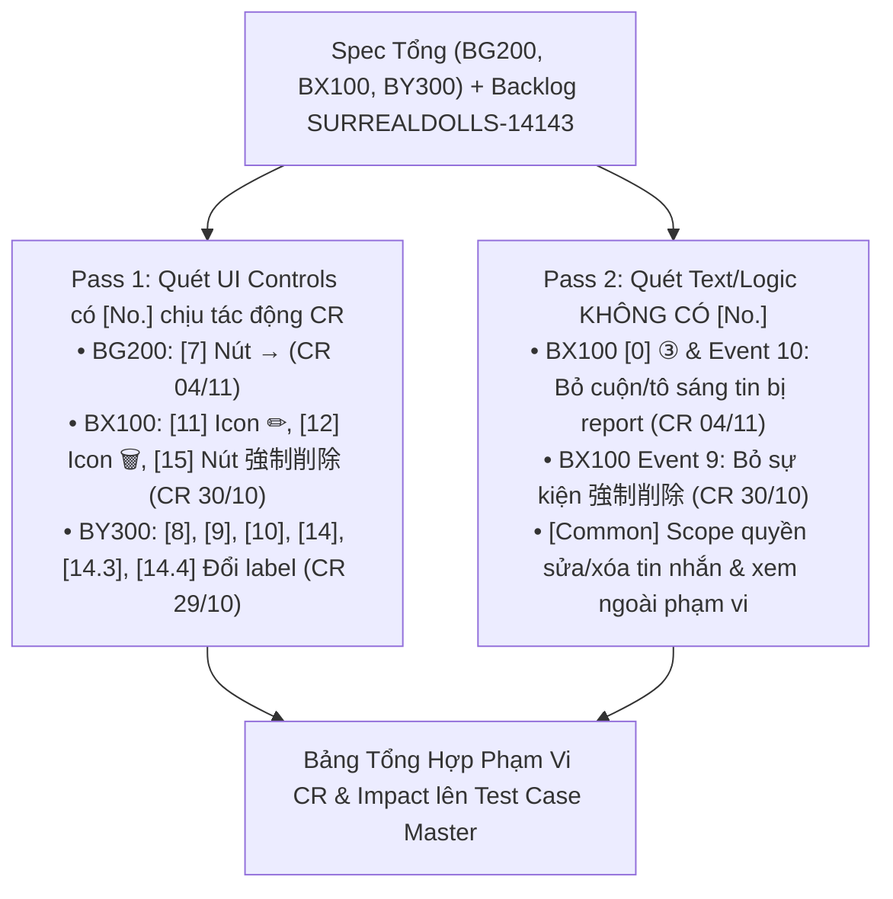

# TÀI LIỆU BÓC TÁCH ĐẶC TẢ KỸ THUẬT & LÀM RÕ YÊU CẦU (SPEC ANALYSIS & CLARIFICATION REPORT)
## Task: [SURREALDOLLS-14143](https://issoh.backlog.com/view/SURREALDOLLS-14143) - `[TEST] BG200 / BX100 / BY300 - Update testcase theo CR`
### Phạm vi phân tích: Toàn bộ Change Request (CR) trên 3 màn hình `BG200`, `BX100`, `BY300` & đối chiếu Test Case Master Agency
### Áp dụng: Trụ Cột 1 (`Universal_Rules/01_core_spec_analysis_rule.md`)

---

## BẢNG THÔNG TIN TỔNG QUAN ĐẶC TẢ (SPECIFICATION METADATA)

| Thuộc tính | Chi tiết |
| :--- | :--- |
| **Backlog Ticket** | `SURREALDOLLS-14143` ([Link Backlog](https://issoh.backlog.com/view/SURREALDOLLS-14143)) |
| **Ticket liên quan** | `SURREALDOLLS-13341` (CR 04/11/2026), `SURREALDOLLS-13338` (BG100+BG200 TC), `SURREALDOLLS-13362` (BX100/BY100/BY300 TC) |
| **Mã màn hình** | `BG200`, `BX100`, `BY300` |
| **Phân hệ / Module** | Quản trị Web Agency (`BG`: Report Management, `BX`: User Message, `BY`: Livestream Comment & BAN Management) |
| **Nguồn Spec Google Sheets** | • [Tab BG200 (gid=1225431187)](https://docs.google.com/spreadsheets/d/1pxox5GcjOXwKadMnzOa765ptG2huPJSxCiWsrH0_h7Y/edit?gid=1225431187#gid=1225431187) • [Tab BX100 (gid=1015260205)](https://docs.google.com/spreadsheets/d/1pxox5GcjOXwKadMnzOa765ptG2huPJSxCiWsrH0_h7Y/edit?gid=1015260205#gid=1015260205) • [Tab BY300 (gid=1015260207)](https://docs.google.com/spreadsheets/d/1pxox5GcjOXwKadMnzOa765ptG2huPJSxCiWsrH0_h7Y/edit?gid=1015260207#gid=1015260207) |
| **Test Case Master (Agency)** | [Google Spreadsheet - Agency TC Master](https://docs.google.com/spreadsheets/d/1342RUX4IBu9uzLRxLGRANE5MJ4gen7mTP4BRAFg8hLc/edit?gid=429088131#gid=429088131) (`BG200`: 84 TCs, `BX100`: 85 TCs, `BY300`: 65 TCs) |
| **HTML Prototype (trong Spec)** | • BG200: [Drive Link](https://drive.google.com/file/d/16EL5F-J_wQGGU6IJrnblGJsozKuIWAsG/view?usp=drive_link) • BX100: [Drive Link](https://drive.google.com/file/d/12zQnf-tff4nWoiIe631nTw8K42yxBe_o/view?usp=drive_link) • BY300: [Drive Link](https://drive.google.com/file/d/1nxffbpA3JzijhzAj6Y4QGRoYlUAcSjO3/view?usp=drive_link) |
| **Ngôn ngữ hiển thị chính** | Tiếng Nhật (`JA`) |

---

## I. KẾT QUẢ QUÉT ĐẶC TẢ 2 BƯỚC BẮT BUỘC (2-PASS SCANNING PROTOCOL)

### 1. Pass 1 - Danh Mục UI Controls Có Mã Số `[No.]` Bị Thay Đổi Theo CR

#### A. Màn hình `BG200` (Report Detail - 通報詳細)
| No. | Tên Control (Value JP) | Loại UI | Nội dung CR | Chi tiết thay đổi trong Spec |
| :---: | :--- | :--- | :--- | :--- |
| `[7]` | `→` (cạnh tag `メッセージ`) | `button` | **CR 04/11/2026** | **Trước CR:** Bấm `→` ở report loại `メッセージ` $\rightarrow$ mở `BX100`, mở sẵn liver, mở hội thoại, cuộn tới tin bị report và tô sáng. **Sau CR 04/11/2026:** Mở sẵn liver và hội thoại có tin bị report, **KHÔNG** cuộn tới / tô sáng tin bị report (`BX100 #0 ③`). |

#### B. Màn hình `BX100` (User Message - 利用者メッセージ)
| No. | Tên Control (Value JP) | Loại UI | Nội dung CR | Chi tiết thay đổi trong Spec |
| :---: | :--- | :--- | :--- | :--- |
| `[11]` | `(icon ✏)` | `icon` | **CR 30/10/2026** | **Trước CR:** Icon `✏` hiển thị dưới tin nhắn dạng text của bất kỳ ai trong hội thoại. **Sau CR 30/10/2026:** **Chỉ hiện** button edit ở tin do liver của agency gửi (chỉ tin dạng text); tin của người khác chỉ xem (không có icon `✏`). |
| `[12]` | `(icon 🗑)` | `icon` | **CR 30/10/2026** | **Trước CR:** Icon `🗑` hiển thị dưới tin nhắn của bất kỳ ai trong hội thoại. **Sau CR 30/10/2026:** **Chỉ hiện** button xóa dưới tin do liver của agency gửi; tin của người khác chỉ xem (không có icon `🗑`). |
| `[15]` | `強制削除` | `button` | **CR 30/10/2026** | **Trước CR:** Nút đỏ `強制削除` ở góc trên phải khung chat để xóa toàn bộ hội thoại. **Sau CR 30/10/2026:** **Bỏ button `強制削除`**. |

#### C. Màn hình `BY300` (List Ban - 配信コメント・BAN管理)
| No. | Label Cũ | Label Mới (**CR 29/10/2026**) | Loại UI | Ghi chú |
| :---: | :--- | :--- | :--- | :--- |
| `[8]` | `BANされた回数 ↕` | `コメントBANされた回数` (kèm `↕`) | `int` (cột bảng chính) | Đổi label cột số lần bị BAN chat. |
| `[9]` | `最初にBANされた日時 ↕` | `最初にコメントBANされた日時` (kèm `↕`) | `date-time` (cột bảng chính) | Đổi label cột thời gian BAN đầu tiên. |
| `[10]` | `最後にBANされた日時 ↕` | `最後にコメントBANされた日時` (kèm `↕`) | `date-time` (cột bảng chính) | Đổi label cột thời gian BAN gần nhất. |
| `[14]` | `BAN詳細` | `コメントBAN詳細` | `modal` (tiêu đề modal) | Đổi tiêu đề modal chi tiết lịch sử BAN chat. |
| `[14.3]` | `BANされた日時 ↕` | `コメントBANされた日時` (kèm `↕`) | `date-time` (cột trong modal) | Đổi label cột thời gian BAN trong modal. |
| `[14.4]` | `BANした管理者` | `コメントBANした管理者` | `text` (cột trong modal) | Đổi label cột người thực hiện BAN trong modal. |

---

### 2. Pass 2 - Danh Mục Text/Logic Không Có `[No.]` Bị Thay Đổi Theo CR

| Mã định danh | Màn hình | Nội dung CR & Chi tiết hành vi |
| :--- | :---: | :--- |
| `[0] ③` & `Event 10` | `BX100` | **CR 04/11/2026:** Khi điều hướng từ `BG200 #7` (report loại `メッセージ`) sang `BX100`: mở sẵn liver (như Event 2) và mở hội thoại có tin bị report, **KHÔNG** cuộn tới / tô sáng tin bị report. Lý do nghiệp vụ (`SURREALDOLLS-13341`): App chỉ hỗ trợ báo cáo cả hội thoại qua nút 設定, chưa chọn được tin nhắn cụ thể để nhảy tới. |
| `Event 9` | `BX100` | **CR 30/10/2026:** Bỏ Screen Event 9 (`強制削除`). |
| `[Common] Edit/Delete Scope` | `BX100` | **CR 30/10/2026:** Quyền sửa (`#11`) và xóa (`#12`) chỉ áp dụng trên tin nhắn do liver của agency gửi; tin nhắn của đối phương / thành viên ngoài agency ở trạng thái chỉ xem (Read-only). |
| `[Empty State] / [Permission]` | `BG200` / `BX100` | Giữ nguyên quy chuẩn cũ: Truy cập URL ngoài phạm vi `BG200` $\rightarrow$ `この通報を閲覧する権限がありません。` + `自事務所に所属するライバーに対する通報のみ閲覧できます。`; Truy cập URL hội thoại ngoài phạm vi `BX100` $\rightarrow$ `この会話を閲覧する権限がありません`. |

---

## II. ĐỐI CHIẾU THIẾT KẾ 1:1 (DESIGN CROSS-CHECK)

- **Nguồn thiết kế:** Các tab Spec đều đính kèm link HTML Prototype trên Google Drive (chưa có link Figma trực tiếp trong sheet Spec; Figma MCP chưa đăng nhập trong phiên làm việc hiện tại).
- **Đối chiếu 1:1 Text & Label giữa Spec và Test Case Master:**
  - `BY300`: Trên Spec đã cập nhật 6 label mới theo CR 29/10/2026 (`コメントBANされた回数`, `最初にコメントBANされた日時`, `最後にコメントBANされた日時`, `コメントBAN詳細`, `コメントBANされた日時`, `コメントBANした管理者`), nhưng Test Case Master (`1342RUX4IBu9uzLRxLGRANE5MJ4gen7mTP4BRAFg8hLc`) vẫn đang giữ toàn bộ 6 label cũ.
  - `BG200` & `BX100`: Test Case Master vẫn đang ghi nhận logic cũ trước CR 30/10 và CR 04/11 (còn `強制削除`, còn cuộn/tô sáng khi đi từ `BG200 #7`, chưa giới hạn `✏`/`🗑` chỉ cho tin của liver agency).

---

## III. MA TRẬN LOGIC NGHIỆP VỤ CỐT LÕI (BUSINESS LOGIC MATRIX - TIER 2)

| Nhóm Logic | Phạm vi kiểm tra theo CR |
| :--- | :--- |
| **1. Điều kiện Tiên quyết & Phân quyền (Precondition & RBAC)** | • `BG200 -> BX100`: Report loại `メッセージ` của liver thuộc agency $\rightarrow$ bấm `→` mở `BX100`. • `BX100 #11, #12`: Chỉ hiển thị `✏` (tin text) và `🗑` (mọi loại tin chưa xóa) dưới tin do **liver của agency** gửi; tin của user khác không có `✏`/`🗑`. Liver `退所済み` bị disable `✏`/`🗑`. • `BX100 #15`: Nút `強制削除` bị loại bỏ hoàn toàn trên UI Agency. |
| **2. Ràng buộc Dữ liệu & Cận biên (Validation & Boundaries)** | • `BX100 #0 ③`: Khi mở `BX100` từ `BG200 #7`, vẫn phải chọn đúng `liver` và mở đúng `hội thoại` chứa tin bị report, dù **không** cuộn/highlight tin nhắn cụ thể. • `BX100 #5, #13`: Tìm kiếm tin nhắn trong `BX100` (từ ô search) khi click kết quả **vẫn** cuộn tới và tô sáng bình thường (CR 04/11 chỉ bỏ cho luồng từ `BG200 #7`). |
| **3. Biến đổi Trạng thái & Tính toán (State Change & Calculations)** | • `BX100 #11, #12`: Sửa/xóa tin của liver thuộc agency vẫn đồng bộ real-time lên App (`編集済み` / `削除済み`), không xóa được cả hội thoại vì đã bỏ `#15`. • `BY300`: Logic tính toán số lần `コメントBANされた回数` (`#8`) và sort (`#8`, `#9`, `#10`, `#14.3`) không đổi, chỉ đổi label hiển thị. |
| **4. Phản hồi Hệ thống & Thông báo (System Feedback & Error Codes)** | • Giữ nguyên toast `メッセージを更新しました` (`#11`), `メッセージを削除しました` (`#12`), lỗi `メッセージは空欄にできません。`, `このメッセージは削除されたため、メッセージを編集できません。`. • `BY300`: Bấm `解除` vẫn chạy ngay không có modal confirm, không toast. |

---

## IV. DANH MỤC API & PHẠM VI (API SCOPE IDENTIFICATION)

| Màn hình | API / Nguồn dữ liệu | Phạm vi | Ghi chú |
| :--- | :--- | :---: | :--- |
| `BG200` | `GET /my-agency/reports/{report_id}` | **In-Scope** | Trả `report_type`, `parent_id`, `target_id`, `target_source` để điều hướng sang `BX100` đúng liver + hội thoại. |
| `BX100` | Firebase (theo Spec mục 4: như admin `AX100~AX300`, lọc theo agency) | **In-Scope** | Hỗ trợ đọc hội thoại, sửa/xóa tin của liver thuộc agency; không gọi action `強制削除`. |
| `BY300` | List BAN chat + `解除` (theo Spec mục 4: chưa ghi endpoint cụ thể trong Spec) | **In-Scope** | Chỉ kiểm tra hiển thị UI & hành vi list/modal/gỡ BAN trên Web Agency. |

---

## V. BẢNG ĐỐI CHIẾU TÁC ĐỘNG LÊN TEST CASE MASTER (IMPACT MATRIX)

Đối chiếu trực tiếp với Google Sheet [Test Case Master Agency](https://docs.google.com/spreadsheets/d/1342RUX4IBu9uzLRxLGRANE5MJ4gen7mTP4BRAFg8hLc/edit):

| Màn hình | TC ID bị ảnh hưởng | Hạng mục Spec | Hành động cần cập nhật theo CR |
| :--- | :--- | :--- | :--- |
| **BG200** | `[BG200-58]` | `[7]` Nút `→` loại `メッセージ` | **Sửa Expected (CR 04/11):** Bỏ yêu cầu *"cuộn tới tin nhắn bị báo cáo và highlight tô sáng tin nhắn đó"*; cập nhật thành mở `BX100`, mở sẵn liver và hội thoại có tin bị report, không cuộn/tô sáng. |
| **BX100** | `[BX100-58]` | `[11]` Icon `✏` | **Sửa/Bổ sung (CR 30/10):** Cập nhật điều kiện hiển thị: chỉ hiện icon `✏` dưới tin dạng text **do liver của agency gửi**; tin của người khác (dù là text) không hiển thị icon `✏`. |
| **BX100** | `[BX100-67]` | `[12]` Icon `🗑` | **Sửa/Bổ sung (CR 30/10):** Cập nhật điều kiện hiển thị: chỉ hiện icon `🗑` dưới tin **do liver của agency gửi**; tin của người khác không hiển thị icon `🗑`. |
| **BX100** | `[BX100-79]` ~ `[BX100-83]` | `[15]` Nút `強制削除` | **Loại bỏ / Deprecated (CR 30/10):** Bỏ 5 TCs kiểm tra hiển thị/modal/xóa của nút `強制削除` (hoặc chuyển thành 1 TC verify nút `強制削除` **không hiển thị** trên giao diện). |
| **BX100** | `[BX100-85]` | `[16]` / `[0] ③` Event 10 | **Sửa Expected (CR 04/11):** Bỏ yêu cầu *"cuộn đến đúng tin nhắn bị báo cáo và tô sáng (Highlight)"*; verify chỉ mở sẵn liver và hội thoại có tin bị report. |
| **BY300** | `[BY300-1]`, `[BY300-38]`~`[BY300-44]`, `[BY300-46]`, `[BY300-52]`, `[BY300-54]`, `[BY300-57]`, `[BY300-59]`, `[BY300-61]`~`[BY300-63]` | `[8]`, `[9]`, `[10]`, `[14]`, `[14.3]`, `[14.4]` | **Sửa Label (CR 29/10):** Thay 6 label cũ sang label mới (`コメントBANされた回数`, `最初にコメントBANされた日時`, `最後にコメントBANされた日時`, `コメントBAN詳細`, `コメントBANされた日時`, `コメントBANした管理者`). |

---

## VI. BẢNG Q&A CLARIFICATION (OPTION A / OPTION B)

| No. | Control / Logic `[No. Spec]` | Vấn đề chưa rõ trong Spec / Task | Câu hỏi làm rõ | Phương án đề xuất | Giả định tạm thời khi viết TC | Trạng thái |
| :---: | :--- | :--- | :--- | :--- | :--- | :---: |
| `Q1` | Scope Ticket `SURREALDOLLS-14143` | Title ghi `BG200 / BX100 / BY300 - Update testcase theo CR`, nhưng Description chỉ dẫn link CR 04/11 của `BG200 #7` và `BX100 #0 ③, event 10`. Trong khi Spec `BX100` còn CR 30/10 (`#11`, `#12`, `#15`) và `BY300` còn CR 29/10 (đổi 6 label) chưa được update trên TC Master. | Trong ticket `SURREALDOLLS-14143`, Tester có cần update luôn các CR cũ chưa đồng bộ của `BX100` (CR 30/10) và `BY300` (CR 29/10) không? | **Option A:** Update toàn bộ các CR còn thiếu trên cả 3 màn `BG200`, `BX100`, `BY300` cho khớp 100% với Spec hiện hành. **Option B:** Chỉ update CR 04/11 cho `BG200`/`BX100`. | Tạm giả định theo **Option A** (Update đủ cả 3 màn như Title ticket). | `Pending` |
| `Q2` | `BX100 #0 ③` / `BG200 #7` | CR 04/11 chỉ nêu *"mở sẵn liver và hội thoại có tin bị report, không cuộn tới / tô sáng tin bị report"*, chưa nêu rõ vị trí scroll mặc định khi mở hội thoại. | Khi đi từ `BG200 #7` sang `BX100`, khung chat `#10` sẽ mở ở vị trí nào của hội thoại? | **Option A:** Mở ở vị trí mặc định giống khi click chọn hội thoại từ `#7` (thường ở cuối hội thoại / tin mới nhất). **Option B:** Cuộn lên đầu hội thoại. | Tạm giả định theo **Option A** (vị trí mặc định khi mở hội thoại). | `Pending` |
| `Q3` | `BX100 #15` (`強制削除`) | CR 30/10 ghi *"Bỏ button 強制削除"*, hiện TC Master đang có 5 TC (`[BX100-79]` ~ `[BX100-83]`). | Khi cập nhật TC Master, nên xóa hẳn 5 TC này hay giữ ID và đánh dấu `Deprecated / N/A`? | **Option A:** Gộp thành 1 TC kiểm tra không hiển thị nút `強制削除` trên UI và đánh dấu `Deprecated` cho 4 TC còn lại để giữ nguyên ID trace. **Option B:** Xóa hẳn 5 dòng và đánh lại STT. | Tạm giả định theo **Option A** (giữ ổn định TC ID). | `Pending` |
| `Q4` | `BX100 #11, #12` (CR 30/10) | Spec ghi *"Chỉ hiện button edit/xóa ở tin do liver của agency gửi"*. Trường hợp group chat có 2 liver cùng thuộc 1 agency đang đăng nhập thì tin của liver kia (không phải liver đang chọn ở `#3`) có hiện `✏`/`🗑` không? | Quyền hiển thị `✏`/`🗑` xét theo **liver đang chọn ở cột `#3`** hay **mọi liver thuộc agency đang đăng nhập**? | **Option A:** Chỉ tin của liver đang chọn ở `#3` (các tin căn phải). **Option B:** Tin của bất kỳ liver nào thuộc agency đang đăng nhập (kể cả căn trái). | Tạm giả định theo **Option A** (tin của liver đang chọn ở `#3`, căn phải). | `Pending` |
| `Q5` | `BY300 #8, #9, #10, #14.3` | CR 29/10 đổi tên 6 label (thêm tiền tố `コメント`), nhưng không ghi rõ có giữ nguyên icon sort `↕` và behavior cũ hay không. | Sau khi đổi label sang `コメントBAN...`, các cột `#8, #9, #10, #14.3` có giữ nguyên icon sort `↕` và logic sort hiện tại không? | **Option A:** Chỉ đổi text label, giữ nguyên icon `↕` và toàn bộ logic sort. **Option B:** Thay đổi cả logic/icon sort. | Tạm giả định theo **Option A** (chỉ đổi label). | `Pending` |

---

## VII. KIỂM TRA NGHIỆM THU ĐẦU RA TRỤ CỘT 1 (ACCEPTANCE GATES)

1. [x] Đã phủ 100% các mục có số `[No.]` chịu tác động CR trên `BG200`, `BX100`, `BY300`.
2. [x] Đã phủ đầy đủ các mục không có số No. (`[0] ③`, `Event 9`, `Event 10`, `[Common] Edit/Delete Scope`, `[Permission]`).
3. [x] Đã đối chiếu 1:1 các label, button và hành vi giữa Spec tổng và Test Case Master Agency.
4. [x] Bảng Q&A có đủ Option A / Option B kèm giả định tạm thời cho mọi điểm chưa rõ.
