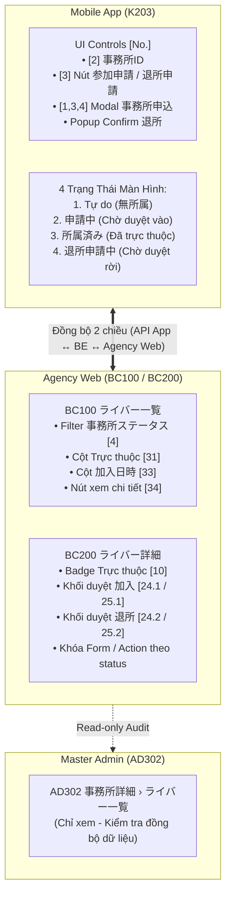
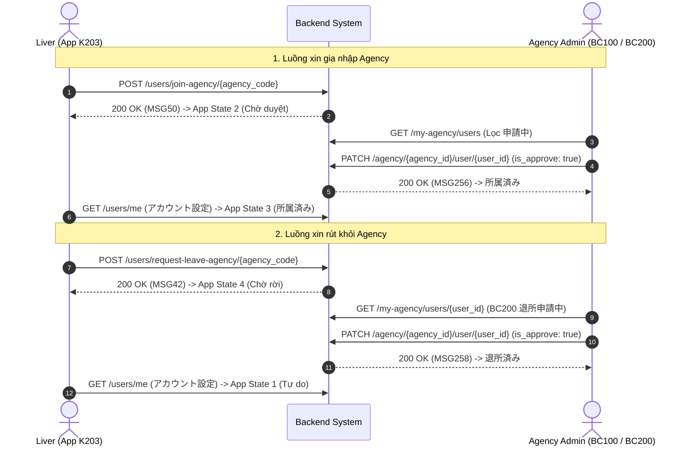
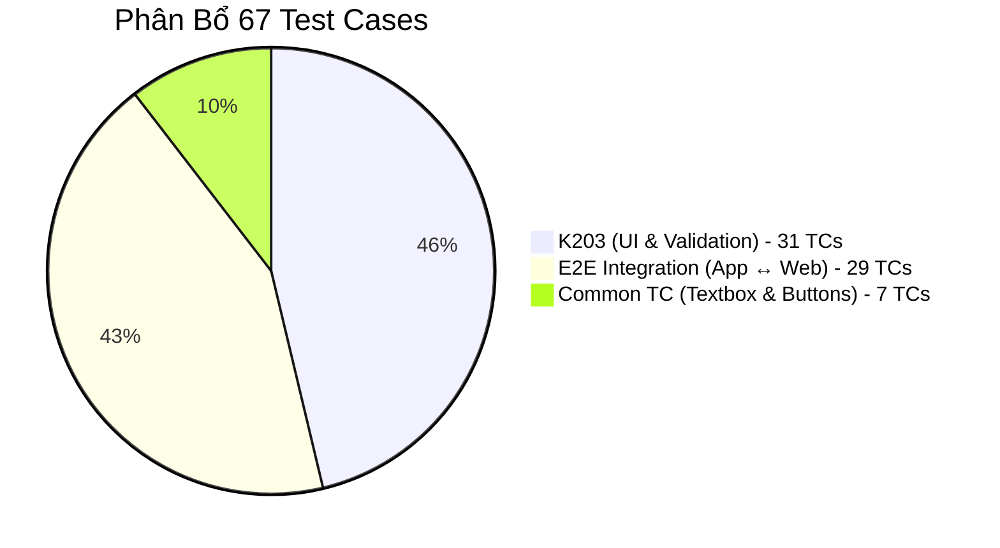

# TÀI LIỆU BÓC TÁCH ĐẶC TẢ KỸ THUẬT & PHÂN TÍCH NHIỆM VỤ KIỂM THỬ (SPEC ANALYSIS & QA REPORT)
## Task: [SURREALDOLLS-14230](https://issoh.backlog.com/view/SURREALDOLLS-14230) - `[TEST] K203 + BC100 + BC200 - Test tích hợp luồng liver và agency`
### Phạm vi kiểm thử: Tích hợp 2 đầu App Mobile (K203) ↔ Web Agency (BC100 / BC200) ↔ Web Master Admin (AD302)
### Áp dụng: Trụ Cột 1 (`Universal_Rules/01_core_spec_analysis_rule.md`)

---

## BẢNG THÔNG TIN TỔNG QUAN TÁC VỤ (TASK SPECIFICATION METADATA)

| Thuộc tính | Chi tiết |
| :--- | :--- |
| **Backlog Ticket** | [SURREALDOLLS-14230](https://issoh.backlog.com/view/SURREALDOLLS-14230) |
| **Tiêu đề Task** | `[TEST] K203 + BC100 + BC200 - Test tích hợp luồng liver và agency` |
| **Người tạo** | Mume_ウエン (Nov 09, 2026) |
| **Assignee hiện tại** | Mume_ガー（テスター） (Cập nhật bởi Mume_リー BA lúc 15:47 Nov 12, 2026) |
| **Thời hạn (Due Date)** | Nov 11, 2026 $\rightarrow$ **Nov 13, 2026** |
| **Màn hình liên quan** | • **K203 (Mobile App iOS / Android):** `Mypage › 設定 › アカウント設定 › Khối 事務所` (Đăng ký tham gia / Yêu cầu rời Agency) • **BC100 (Agency Web):** `ライバー管理 › ライバー一覧` (Danh sách Liver & trạng thái Agency) • **BC200 (Agency Web):** `ライバー詳細` (Chi tiết Liver & Phê duyệt/Từ chối 承認 / 却下) • **AD302 (Master Admin Web):** `事務所詳細 › ライバー一覧` (Chỉ xem - kiểm tra tính nhất quán dữ liệu) |
| **File Testcase chuyên biệt** | [Google Spreadsheet - K203+BC100+BC200 Testcase](https://docs.google.com/spreadsheets/d/1KRy9eMh0cYJ8e1g0bYS6HFhVHhIO16WOBTfcaFm6aH0/edit?gid=2005213262#gid=2005213262) (Tổng cộng 67 TCs) |
| **Tài liệu Spec nguồn (SRS)** | [Google Spreadsheet SRS Tổng](https://docs.google.com/spreadsheets/d/1pxox5GcjOXwKadMnzOa765ptG2huPJSxCiWsrH0_h7Y/edit?gid=741302995#gid=741302995) (Tabs: `K203`, `BC100`, `BC200`, `CommonSpec`, `Common MSG`, `MSG`) |
| **Thiết kế & Prototype** | • **K203:** Figma K202 (변경管理 No.182) • **BC100:** [HTML Prototype Drive](https://drive.google.com/file/d/1n7K-7HCX7X7VINjMEymBVxIqkYBAiSbR/view?usp=drive_link) & 外部設計書.pdf (SURREALDOLLS-13266) • **BC200:** [HTML Prototype Drive](https://drive.google.com/file/d/1ekzim46zseWqD0d-ssreKn0zkywCZ8Rk/view?usp=drive_link) & 外部設計書.pdf (SURREALDOLLS-13269) |
| **Ngôn ngữ hiển thị** | Tiếng Nhật (`JA`) |

---

## I. MỤC TIÊU VÀ BỐI CẢNH KIỂM THỬ (PROJECT CONTEXT & OBJECTIVE)

Hệ thống SurrealDoll vận hành mô hình quản lý Liver thông qua các công ty đại diện (Agency - 事務所). Luồng nghiệp vụ tích hợp giữa **Liver (trên App Mobile)** và **Quản trị viên Agency (trên Web Agency)** xoay quanh hai hành vi cốt lõi:
1. **Xin gia nhập Agency (参加申請 / 加入申請):**
   - Liver tự do tìm kiếm mã Agency (`事務所ID` / `agency_code`) và gửi yêu cầu đăng ký trên App.
   - Agency tiếp nhận đơn ở trạng thái `申請中` trên danh sách Liver (BC100) và phê duyệt (`承認`) hoặc từ chối (`却下`) tại màn hình chi tiết (BC200).
2. **Xin rút khỏi Agency (退所申請):**
   - Liver đang thuộc Agency chính thức (`所属済み`) gửi yêu cầu xin rời trên App.
   - Agency tiếp nhận đơn ở trạng thái `退所申請中` và phê duyệt (`承認` $\rightarrow$ chuyển sang `退所済み`) hoặc từ chối (`却下` $\rightarrow$ trở lại `所属済み`).

> [!IMPORTANT]
> **ĐIỂM NÓNG CẦN CHÚ Ý ĐẶC BIỆT (CR 11/11/2026 - CR 移籍 / 一週間未配信):**
> - **Thời điểm lập Test Sheet (09/11/2026):** Bộ Test Case 67 TCs được lập dựa trên Spec bản 29/10/2026. Ở bản này, nguyên tắc bất di bất dịch là **1 User tại 1 thời điểm chỉ thuộc hoặc chỉ được gửi đơn tới 1 Agency** (khi đang `所属済み` hoặc `退所申請中` thì nút `参加申請` bị ẩn hoàn toàn - kiểm soát bởi `K203-TC-025` và `AJL-E2E-TC-019`).
> - **Cập nhật Spec mới (11/11/2026):** BA Uyên đã cập nhật thêm Change Request (CR) vào tài liệu Spec SRS:
>   + Nếu Liver **có live trong vòng 1 tuần gần nhất**: Nút `参加申請` bị xám (Disabled). Muốn chuyển Agency phải xin rời Agency cũ trước (`退所申請` $\rightarrow$ Agency cũ duyệt `退所済み` $\rightarrow$ mới được xin Agency mới).
>   + Nếu Liver **không live suốt 1 tuần (一週間未配信)**: Nút `参加申請` ĐƯỢC PHÉP BẤM NGAY CẢ KHI ĐANG THUỘC AGENCY CŨ! Khi Agency mới `承認`, hệ thống sẽ **Tự động cưỡng chế rời (強制退所)** khỏi Agency cũ mà không cần Agency cũ phê duyệt!

---

## II. KẾT QUẢ QUÉT ĐẶC TẢ 2 BƯỚC BẮT BUỘC (2-PASS SCANNING PROTOCOL)

### 1. Pass 1 - Bóc tách Danh mục UI Controls có `[No.]`

#### A. Màn hình K203 (App Mobile - `アカウント設定 › 事務所`)
| Item No. | Tên phần tử | Loại UI Control | Giá trị mặc định / Logic hiển thị | Ghi chú & Ràng buộc Spec |
| :---: | :--- | :--- | :--- | :--- |
| `[1]` | `事務所` | Group Label | Luôn hiển thị ở màn `アカウント設定` | Hiển thị với mọi user (kể cả user chưa từng live - C7). |
| `[2]` | `事務所ID` | Label & Value Text | • State 1: Trống. • State 2, 3, 4: Hiển thị mã `agency_code`. | **⚠ Lệch Spec (Q2):** Spec 29/10 ghi hiện `agency.name`, nhưng chốt 08/09 (A1) là hiển thị `agency_code`. Bấm vào vùng ID không phát sinh action (C9). |
| `[3]` | `参加申請` | Button | State 1: Enable (màu cam). State 2: Ẩn (thay bằng text `参加申請（承認待ち）`). State 3: Ẩn (hoặc Enable theo CR 11/11 nếu 1 tuần không live). | Mở Modal `事務所申込`. |
| `[1]` (Modal) | `事務所申込` | Modal Dialog | Tiêu đề modal khi bấm `参加申請` | Có nút `✕` để đóng (giữ nguyên state cũ). |
| `[3]` (Modal) | `事務所ID` | Textbox Input | Để trống mặc định, placeholder | Nhập mã Agency muốn gia nhập. Không validate cứng format, không giới hạn độ dài ở FE. |
| `[4]` (Modal) | `申請する` | Button Submit | Enable sẵn khi mở modal (C2) | Validate tồn tại Agency ID trên DB. Nếu sai báo `CMMSG56`. Nếu đúng báo `MSG50`, đóng modal và chuyển sang State 2. |
| `[3]` (State 3) | `退所申請` | Button | Hiển thị ở State 3 | Bấm vào hiển thị Popup Confirm theo chuẩn CMR03. |
| `[-]` (Popup) | `退所申請してもよろしいですか？` | Confirm Modal | Nội dung popup cảnh báo | Gồm nút `退所申請する` (Submit) và `キャンセル` (Hủy đóng popup). |
| `[-]` (Submit) | `退所申請する` | Button Confirm | Nút bấm gửi yêu cầu rời | Gửi request lên BE, hiển thị Toast `MSG42`, chuyển sang State 4 (`退所申請（承認待ち）`). |

#### B. Màn hình BC100 (Agency Web - `ライバー一覧`)
| Item No. | Tên phần tử | Loại UI Control | Chi tiết & Logic nghiệp vụ |
| :---: | :--- | :--- | :--- |
| `[4]` | `事務所ステータス` (Filter) | Pulldown Select | Gồm: `全ての所属状態` (Default), `申請中` (3), `所属済み` (1), `退所申請中` (5), `退所済み` (6). |
| `[31]` | `事務所ステータス` (Column) | Badge | Hiển thị trạng thái của Liver đối với Agency hiện tại. Liver `退所済み` vẫn giữ nguyên 1 dòng trong bảng. |
| `[33]` | `加入日時` | Datetime Text | Định dạng `yyyy/mm/dd hh:mm` (CMR14A). **Là thời điểm Liver bấm gửi đơn trên App**, không phải thời điểm Agency duyệt (AJL-E2E-TC-026). |
| `[34]` | `詳細アイコン` / Click dòng | Action Button | Điều hướng sang `BC200` của Liver tương ứng. |

#### C. Màn hình BC200 (Agency Web - `ライバー詳細`)
| Item No. | Tên phần tử | Loại UI Control | Chi tiết & Logic phân quyền theo trạng thái |
| :---: | :--- | :--- | :--- |
| `[8]` | `ステータス` (利用中 / 停止中) | Segment Control | State `申請中` & `退所済み`: **Khóa (Disabled)**. Chỉ sửa khi `所属済み` hoặc `退所申請中`. |
| `[9]` | `配信権限` (あり / なし) | Segment Control | Khóa khi `申請中` & `退所済み`. Nếu Master hoặc Agency cũ đã khóa `なし` thì Agency hiện tại không được tự ý mở lại `あり`. |
| `[10]` | `事務所ステータス` | Badge Header | Hiển thị 1 trong 4 trạng thái (`申請中` / `所属済み` / `退所申請中` / `退所済み`). |
| `[23]` | Quick Navigation Buttons | Button Group | Khi `申請中`: Toàn bộ các nút Quick Nav (Bài viết, Tin nhắn, BAN...) bị **Disabled** (do chưa thuộc Agency). Khi `退所済み`: Vẫn xem được dữ liệu phát sinh trước thời điểm rời. |
| `[24]` | Khối & Nút `承認` | Action Button | • Hiện khi `申請中` (Modal 24.1 $\rightarrow$ Duyệt gia nhập $\rightarrow$ Toast `MSG256`). • Hiện khi `退所申請中` (Modal 24.2 $\rightarrow$ Duyệt rời $\rightarrow$ Toast `MSG258`, khóa toàn bộ form thành view-only). |
| `[25]` | Khối & Nút `却下` | Action Button | • Hiện khi `申請中` (Modal 25.1 $\rightarrow$ Từ chối gia nhập $\rightarrow$ Toast `MSG257`, liver biến khỏi danh sách BC100). • Hiện khi `退所申請中` (Modal 25.2 $\rightarrow$ Từ chối cho rời $\rightarrow$ Toast `MSG259`, liver trở lại `所属済み`). |
| `[27]` | `保存` | Button Submit | Lưu cấu hình item 8, 9, 28. Bị Disabled khi ở trạng thái `申請中` và `退所済み`. |

---

### 2. Pass 2 - Quét Logic Ẩn & Bộ Ba Sheet Dùng Chung (Common Rules & Messages)

1. **Bộ mã thông báo chuẩn (MSG / Common MSG) áp dụng:**
   - `MSG50`: `申請が完了しました。` (Đăng ký thành công - hiển thị trên App khi gửi đơn gia nhập).
   - `MSG42`: `退所申請が完了しました。` (Gửi yêu cầu rời thành công - hiển thị trên App).
   - `MSG254`: `このライバーを閲覧する権限がありません。` (Chặn mở URL chi tiết Liver thuộc Agency khác hoặc đã bị từ chối).
   - `MSG255`: `この申請はすでに処理されています。` (Trường hợp tranh chấp đồng thời: 2 admin cùng mở đơn duyệt/từ chối).
   - `MSG256`: `加入申請を承認しました` (Toast thành công khi Agency duyệt gia nhập).
   - `MSG257`: `加入申請を却下しました` (Toast khi Agency từ chối gia nhập).
   - `MSG258`: `退所申請を承認しました` (Toast khi Agency duyệt rời).
   - `MSG259`: `退所申請を却下しました` (Toast khi Agency từ chối rời).
   - `CMMSG56`: `該当するデータが見つかりませんでした。` (Báo lỗi khi nhập mã Agency không tồn tại, Agency đã xóa hoặc Agency bị Deactivate).
   - `CMMSG13`: `正常に更新されました。` (Lưu thông tin thành công trên Agency Web).

2. **Quy tắc vòng đời & Đồng bộ 2 đầu (State Lifecycle Mapping):**
   - **State 1 (User tự do):** App có nút `参加申請` $\longleftrightarrow$ Agency chưa có record nào (nếu xin lần đầu) hoặc có record ở trạng thái `退所済み` (nếu từng rời trước đó).
   - **State 2 (Chờ duyệt vào):** App hiện text `参加申請（承認待ち）` $\longleftrightarrow$ Agency BC100/BC200 hiện `申請中`.
   - **State 3 (Chính thức trực thuộc):** App hiện mã Agency + nút `退所申請` $\longleftrightarrow$ Agency BC100/BC200 hiện `所属済み`.
   - **State 4 (Chờ duyệt rời):** App hiện mã Agency + text `退所申請（承認待ち）` $\longleftrightarrow$ Agency BC100/BC200 hiện `退所申請中`.

---

## III. BÓC TÁCH MA TRẬN LOGIC NGHIỆP VỤ CỐT LÕI (CORE BUSINESS LOGIC MATRIX)

| Nhóm Logic | Phạm vi kiểm tra chi tiết | Trạng thái / Hành vi kỳ vọng |
| :--- | :--- | :--- |
| **1. Điều kiện Tiên quyết & Phân quyền (RBAC)** | • Agency A chỉ nhìn thấy và quản lý Liver gửi đơn vào Agency A. • Agency B cố tình dán URL truy cập Liver của Agency A $\rightarrow$ Chặn bằng `MSG254`. • Master Admin (AD302) xem được dữ liệu Liver của Agency A nhưng ở chế độ Read-only. | Chặn 403 / MSG254 trên FE và API BE. |
| **2. Ràng buộc Dữ liệu & Cận biên (Validation)** | • Nhập khoảng trắng toàn bộ, ký tự tiếng Nhật (Hiragana, Katakana, Kanji), Full-width, Emoji $\rightarrow$ Báo lỗi `CMMSG56`. • SQL Injection, XSS tags, chuỗi dài $\ge 256$ ký tự $\rightarrow$ Không crash, trả `CMMSG56`. • Agency bị ngưng hoạt động (Deactivate / Inactive) hoặc đã bị xóa $\rightarrow$ Coi như không tồn tại, báo `CMMSG56`. | Bảo vệ an toàn dữ liệu đầu vào. |
| **3. Biến đổi Trạng thái & Vòng đời (State Transitions)** | • **Luồng chuẩn:** State 1 $\xrightarrow{\text{Gửi 参加}}$ State 2 $\xrightarrow{\text{Agency 承認}}$ State 3 $\xrightarrow{\text{Gửi 退所}}$ State 4 $\xrightarrow{\text{Agency 承認}}$ State 1 (Agency giữ `退所済み`). • **Luồng từ chối (却下):** &nbsp;&nbsp;+ Ở State 2 (Xin vào) $\xrightarrow{\text{却下}}$ Về State 1, biến mất khỏi BC100 (được xin lại). &nbsp;&nbsp;+ Ở State 4 (Xin rời) $\xrightarrow{\text{却下}}$ Về State 3 (`所属済み`). • **Luồng tái gia nhập (退所済み xin lại):** &nbsp;&nbsp;+ Liver đã `退所済み` xin lại cùng Agency $\rightarrow$ Cập nhật ngay trên dòng cũ từ `退所済み` sang `申請中`. Nếu bị `却下` $\rightarrow$ Quay lại `退所済み`. | Chuyển đổi trạng thái chính xác trên cả 2 đầu App và Web. |
| **4. Đồng thời & Tranh chấp (Concurrency)** | • 2 Admin mở cùng 1 đơn: Admin 1 duyệt `承認`, Admin 2 bấm `却下` $\rightarrow$ Admin 2 nhận thông báo lỗi `MSG255` (`この申請はすでに処理されています。`) và màn hình reload lại. • Click Double/Triple nút `申請する` hoặc `退所申請する` $\rightarrow$ Chỉ gửi 1 request duy nhất (Debounce CMR15). | Chống Duplicate Request & Race condition. |

---

## IV. BÓC TÁCH DANH MỤC API & XÁC ĐỊNH PHẠM VI (API SCOPE)

### 1. In-Scope APIs (Trọng tâm kiểm thử)
- **Phía App Mobile:**
  - `POST /users/join-agency/{agency_code}`: Đăng ký xin gia nhập Agency.
  - `POST /users/request-leave-agency/{agency_code}`: Yêu cầu xin rời Agency.
  - `GET /users/me` (hoặc API lấy thông tin cấu hình tài khoản): Trả về `agency.agency_code`, `agency.status`.
- **Phía Web Agency:**
  - `GET /my-agency/users`: Danh sách Liver thuộc Agency (Hỗ trợ tìm kiếm, lọc theo `agency_member_status`, phân trang, sắp xếp).
  - `GET /my-agency/users/{user_id}`: Chi tiết thông tin Liver.
  - `PATCH /agency/{agency_id}/user/{user_id}` (hoặc API approve/reject): Phê duyệt hoặc từ chối đơn gia nhập / rời đi (`is_approve: true/false`).
  - `PUT /agency/{agency_id}/user/{user_id}`: Cập nhật cấu hình Liver (`status`, `can_livestream`, `category`).

### 2. Out-of-Scope / Deprecated APIs
- `POST /users/cancel-request-agency`: **ĐÃ BỎ (DEPRECATED)** theo chốt của BA Uyên ngày 08/09. Kiểm tra chặn 404/405 nếu dev cố tình gọi (`AJL-E2E-TC-024`).

---

## V. BẢNG ĐỐI CHIẾU LỆCH ĐẶC TẢ & BẢNG Q&A CLARIFICATION (CHỐT NGHIỆP VỤ)

### 1. Danh sách 3 điểm Lệch Spec ĐÃ CHỐT nhưng Spec cũ chưa kịp sửa (Dự kiến FAIL nếu dev làm theo Spec cũ):
1. **Lệch Q1 (Agency Deactivate):** Spec bản 29/10 ghi "Agency bị deactive: vẫn tìm được". Tuy nhiên chốt ngày 08/09 (C3) là: Agency bị deactive phải bị chặn và báo lỗi `CMMSG56`.
   $\rightarrow$ Viết testcase theo chốt: `K203-TC-018` và `AJL-E2E-TC-025`.
2. **Lệch Q2 (Hiển thị Agency ID vs Name):** Spec 29/10 ghi hiển thị `agency.name`. Chốt ngày 08/09 (A1) là: Hiển thị `agency_code` (ID).
   $\rightarrow$ Viết testcase theo chốt: `K203-TC-007`.
3. **Lệch Q3 (Hủy yêu cầu):** Spec 29/10 còn Event 4 "Hủy yêu cầu" và API `/users/cancel-request-agency`. Chốt ngày 08/09 là bỏ hoàn toàn chức năng tự hủy đơn.
   $\rightarrow$ Viết testcase kiểm tra không có chức năng này: `K203-TC-026` và `AJL-E2E-TC-024`.

---

### 2. Bảng Q&A Clarification Các Điểm Chờ Chốt & Change Request Mới (Option A / Option B)

| No. | Màn hình / Logic | Vấn đề trong Spec / Thực tế | Câu hỏi làm rõ | Phương án đề xuất | Giả định tạm thời khi thực thi TC | Trạng thái |
| :---: | :--- | :--- | :--- | :--- | :--- | :---: |
| `Q1` | `K203` | Spec 29/10 ghi Agency deactive vẫn tìm được, trái chốt 08/09. | Xác nhận quy chuẩn xử lý khi nhập Agency ID đã bị deactive? | **Option A:** Chặn và báo lỗi CMMSG56 (Theo chốt 08/09). **Option B:** Cho phép đăng ký (Theo spec cũ). | Giả định theo **Option A** (`CMMSG56`). | `Spec cần sửa` |
| `Q2` | `K203` | Spec 29/10 ghi hiện Agency Name ở State 3. | Hiển thị Agency ID hay Agency Name? | **Option A:** Hiển thị Agency ID (`agency_code`). **Option B:** Hiển thị Tên Agency (`agency.name`). | Giả định theo **Option A** (Hiển thị ID). | `Spec cần sửa` |
| `Q3` | `K203` | Spec còn Event 4 và API cancel request. | Có cho phép Liver tự hủy đơn đang chờ duyệt không? | **Option A:** Bỏ chức năng hủy đơn (Không có UI, xóa API). **Option B:** Cho phép tự hủy đơn. | Giả định theo **Option A** (Bỏ chức năng). | `Spec cần sửa` |
| `Q4` | `K203` | Chưa rõ thông báo lỗi cụ thể khi để trống hoặc nhập toàn khoảng trắng ở ô Agency ID. | Khi submit trống Agency ID hiển thị câu lỗi gì? | **Option A:** Báo lỗi validation bắt buộc nhập dưới ô. **Option B:** Báo `CMMSG56`. | Giả định: Có báo lỗi + không gửi đơn (`Pending`). | `Pending` |
| `Q5` | `K203` | Modal 事務所申込: bấm ra ngoài overlay có đóng modal không? Mở lại có reset input không? | Hành vi đóng modal và trạng thái form khi mở lại? | **Option A:** Bấm ra ngoài không đóng, mở lại reset trắng. **Option B:** Bấm overlay đóng modal, mở lại giữ input. | Kiểm tra theo standard modal component. | `Pending` |
| `Q6` | `K203` | App đang đứng tại màn `アカウント設定` mà Agency duyệt `承認`/`却下` thì có tự làm tươi dữ liệu không? | App có cơ chế realtime (Push/WebSocket/Polling) hay phải vào lại màn? | **Option A:** Không realtime, chỉ tải lại khi thoát ra vào lại. **Option B:** Tự cập nhật realtime qua push notification. | Giả định theo **Option A** (Thoát ra vào lại mới đổi). | `Pending` |
| `Q7` | `K203` | Liver có nhận được thông báo (Push/In-app) khi Agency phê duyệt hoặc từ chối đơn không? | Có gửi thông báo kết quả phê duyệt về App Liver không? | **Option A:** Không gửi thông báo (Theo chốt K203 C5 08/09). **Option B:** Có gửi Push Notification hoặc Message. | Tạm thời chưa viết testcase cho push notification. | `Pending` |
| `Q8` | `K203` | Mã Agency ID có phân biệt chữ hoa / chữ thường và có tự trim khoảng trắng đầu cuối không? | Xử lý case-sensitive và whitespace của Agency ID? | **Option A:** Case-insensitive, tự động trim khoảng trắng. **Option B:** Case-sensitive tuyệt đối. | Đề xuất Option A (Thân thiện người dùng). | `Pending` |
| `Q9` | `K203 / BC100` | Agency bị xóa / deactive trong lúc Liver đang ở trạng thái `申請中` hoặc `退所申請中`. | Hệ thống xử lý thế nào với các đơn đang treo của Agency bị xóa? | **Option A:** Hệ thống tự động chuyển đơn về State 1 (Tự do). **Option B:** Giữ nguyên trạng thái treo cho tới khi Admin xử lý. | Cần BA làm rõ. | `Pending` |
| `Q10` | `K203 / BC200` | Liver thực hiện đóng tài khoản (退会) khi đang có đơn `申請中` hoặc `退所申請中`. | Đơn trên Agency Web hiển thị ra sao khi Liver xóa tài khoản? | **Option A:** Đơn tự động hủy, trạng thái Liver đổi thành 退会済み. **Option B:** Vẫn giữ nguyên trạng thái đơn. | Cần BA làm rõ. | `Pending` |
| `Q11` | `K203` | **CR 11/11/2026: CR 移籍 (1 tuần không live được phép xin sang Agency khác)**. | Khi nào áp dụng CR 11/11 vào bộ Test Case Master? | **Option A:** Giữ nguyên 67 TCs cũ để nghiệm thu Phase 1 (Chặn chuyển Agency), sau đó bổ sung TC cho CR 11/11 ở Phase 2. **Option B:** Cập nhật ngay K203-TC-025 và AJL-E2E-TC-019 theo CR 11/11. | **Đề xuất Option A**: Test thông luồng cơ bản 67 TCs trước, sau đó log issue cập nhật CR 11/11 riêng. | `CR mới` |
| `Q12` | `K203 / BC200` | Liver bị Agency chuyển trạng thái sang `停止中` (Bị khóa tài khoản không đăng nhập được App). | Liver `停止中` có gửi đơn `退所申請` được không? | **Option A:** Chặn hoàn toàn vì không login được App. **Option B:** Có cổng riêng hoặc Admin hỗ trợ. | Giả định: Không đăng nhập được $\rightarrow$ Không gửi được đơn. | `Pending` |
| `Q13` | `BC100 / BC200` | Liver từng `退所済み` sau đó xin vào lại cùng Agency. | Cột `加入日時` hiển thị ngày xin lần đầu hay ngày xin mới nhất? | **Option A:** Cập nhật theo ngày gửi đơn mới nhất. **Option B:** Giữ nguyên ngày gia nhập ban đầu. | Đang chờ chốt; các TC hiện tại bỏ qua check cột này. | `Pending` |

---

## VI. CẤU TRÚC BỘ TEST CASE & DANH MỤC DATA SEEDING CẦN CHUẨN BỊ

### 1. Phân Bổ 67 Test Cases Chi Tiết (Theo File Test Master Của Task)

| Nhóm Kiểm Thử | Số lượng TC | Mã Test Case | Nội dung chính |
| :--- | :---: | :--- | :--- |
| **K203 - UI Items** | 10 | `K203-TC-001` $\sim$ `010` | Hiển thị khối Agency, nút 参加申請, nút 退所申請, modal và popup theo 4 trạng thái. |
| **K203 - Validation ID** | 13 | `K203-TC-011` $\sim$ `023` | Nhập ID đúng, sai, deactive, đã xóa, ký tự đặc biệt, XSS, khoảng trắng, độ dài lớn. |
| **K203 - Logic 1 Agency** | 3 | `K203-TC-024` $\sim$ `026` | Chặn gửi đơn thứ 2, kiểm tra không có nút hủy đơn ở State 2 và 4. |
| **K203 - Edge Cases App** | 5 | `K203-TC-027` $\sim$ `031` | Click liên tục (Debounce), mất mạng, xoay màn hình, chạy ngầm. |
| **E2E - Vòng đời chính** | 5 | `AJL-E2E-TC-001` $\sim$ `005` | Luồng thông suốt: 参加申請 $\rightarrow$ Agency 承認 $\rightarrow$ 退所申請 $\rightarrow$ Agency 承認. |
| **E2E - Xử lý Từ chối (却下)** | 4 | `AJL-E2E-TC-006` $\sim$ `009` | Agency từ chối gia nhập (lần đầu & xin lại) và từ chối cho rút. |
| **E2E - Xin vào lại cùng Agency** | 5 | `AJL-E2E-TC-010` $\sim$ `014` | Liver đã 退所済み xin vào lại: cập nhật cùng 1 dòng, duyệt/từ chối. |
| **E2E - Chuyển Agency A $\rightarrow$ B** | 3 | `AJL-E2E-TC-015` $\sim$ `017` | Rời A hoàn tất rồi mới xin vào B; phân quyền bảo mật giữa 2 Agency. |
| **E2E - Chặn lỗ hổng bảo mật API** | 8 | `AJL-E2E-TC-018` $\sim$ `025` | Bypass UI gọi trực tiếp API Join/Leave sai trạng thái, gọi API Cancel đã bỏ. |
| **E2E - Đồng thời & Thời điểm** | 4 | `AJL-E2E-TC-026` $\sim$ `029` | Kiểm tra 加入日時, 2 Admin cùng duyệt, App reload sau khi Web duyệt. |
| **Common TC - K203** | 7 | `CMN-TXT-01` $\sim$ `04`, `CMN-BTN-01` $\sim$ `03` | Validation Textbox, Debounce button, Back cứng Android, Dark Mode. |
| **TỔNG CỘNG** | **67** | | |

---

### 2. Danh Sách Dữ Liệu Kiểm Thử (Test Data Seeding Matrix) Cần Chuẩn Bị

Để thực thi đủ 67 TCs mà không bị nghẽn (Blocker), QA cần chuẩn bị danh mục tài khoản theo đúng ma trận sau:

| Loại Data | Mã Data | Mô tả trạng thái ban đầu | Mục đích sử dụng |
| :--- | :--- | :--- | :--- |
| **Agency** | `AG-A` | Agency A đang hoạt động (`利用中`) | Agency chính để test vòng đời gia nhập / rời đi. |
| | `AG-A2` | Tài khoản Admin thứ 2 của Agency A | Dùng để test tranh chấp đồng thời 2 admin cùng duyệt (`AJL-E2E-TC-028`). |
| | `AG-B` | Agency B đang hoạt động (`利用中`) | Dùng để test luồng chuyển Agency và bảo mật chéo dữ liệu. |
| | `AG-OFF` | Agency đã bị Master Admin chuyển sang `Deactivate` | Dùng để test validation không tìm thấy Agency (`CMMSG56`). |
| | `AG-DEL` | Agency đã bị xóa trên Master Admin | Dùng để test validation Agency không tồn tại. |
| | `A-MST` | Tài khoản Master Admin (`admin@admin.com`) | Đăng nhập AD302 để đối chiếu đồng bộ dữ liệu. |
| **Liver (App)** | `U-N` | User thông thường, chưa từng Livestream | Kiểm tra khối Agency vẫn hiển thị với mọi user (`K203-TC-001`). |
| | `LV-J1` | User tự do (State 1), chưa từng có đơn | Dùng nhiều lần cho cụm test Validation ID (không gửi đơn hợp lệ). |
| | `LV-P1`, `LV-P2`| User đang ở trạng thái `申請中` Agency A | Dùng để test UI State 2 và chặn gọi API join lần 2. |
| | `LV-M1`, `LV-M2`| User đang ở trạng thái `所属済み` Agency A | Dùng để test gửi đơn `退所申請` và chặn join Agency khác. |
| | `LV-L1`, `LV-L2`| User đang ở trạng thái `退所申請中` Agency A | Dùng để test UI State 4 và chặn gọi API leave lần 2. |
| | `LV-E1` | User tự do (State 1) | Tài khoản test chạy chuỗi E2E thông suốt từ TC-001 đến TC-004. |
| | `LV-E2` $\sim$ `E12`| Tài khoản chuẩn bị riêng theo từng Precondition | Dùng cho các case từ chối, xin lại, đồng thời và tranh chấp dữ liệu. |

---

## VII. ĐÁNH GIÁ RỦI RO & KHUYẾN NGHỊ CHO TESTER KHI THỰC THI (ACTION PLAN)

1. **Rủi ro lệch Spec (Spec Discrepancy Risk):**
   - Cần chú ý 3 testcase `K203-TC-007` (Agency ID), `K203-TC-018` (Deactive agency), `K203-TC-026` (Bỏ API cancel) và `AJL-E2E-TC-024 / 025`. Nếu Developer phát triển bám sát theo tài liệu Spec cũ 29/10 thay vì tài liệu chốt 08/09 thì các case này sẽ bị **FAIL**. Khi test phát hiện lỗi, tester cần trích dẫn Biên bản chốt 08/09 của BA Uyên khi log bug.
2. **Xử lý Change Request mới (CR 11/11/2026):**
   - Spec SRS vừa được cập nhật tính năng cho phép Liver không live 1 tuần được phép chuyển Agency. Tuy nhiên, phạm vi ticket `SURREALDOLLS-14230` được tạo ngày 09/11 nhằm nghiệm thu bộ 67 TCs nền tảng.
   - **Khuyến nghị:** Tester tiến hành thực thi Round 1 theo đúng 67 TCs đã thiết kế trong Sheet. Đồng thời tạo bảng ghi nhận riêng cho CR 11/11 để báo cáo cho BA Uyên và PM nắm tiến độ.
3. **Quy chuẩn ghi nhận kết quả (Guardrails Rule):**
   - Tuyệt đối tuân thủ nguyên tắc **No Execution, No Pass** và **No Evidence, No Report**: Mọi case Pass/Fail phải được thực hiện trên môi trường App Mobile thực tế và Web Live (`admin-dev.surrealdolls.com`), chụp ảnh bằng chứng lưu vào `evidence/` theo đúng mã định danh trước khi ghi nhận vào Sheet kết quả.

---

## VIII. CÁC ĐIỂM CHỐT VÀ LÀM RÕ ĐẶC TẢ TỪ PM / BA (CONFIRMED SPEC UPDATES)

### 1. Màn hình BC200 - Nút キャンセル (Item 26) - Ca `[BC200-96]`
- **Ngày xác nhận:** 2026/11/13
- **Bên xác nhận:** PM / BA
- **Nội dung làm rõ:**
  - Trong tài liệu 外部設計 ban đầu có ghi chú: *"Bỏ thay đổi chưa lưu, về BC100 (外部設計 không có modal xác nhận)"*.
  - **Quy chuẩn chốt thực tế (Official Confirmed Spec):** Khi người dùng chỉnh sửa dữ liệu form trên BC200 (Dirty State) mà nhấn button `キャンセル`, hệ thống **bắt buộc hiển thị modal xác nhận** `本当に進みますか？` kèm 2 nút lựa chọn:
    - `いいえ`: Đóng modal, ở lại màn hình BC200 và giữ nguyên các thay đổi chưa lưu.
    - `はい`: Bỏ qua các thay đổi chưa lưu và điều hướng quay trở về danh sách liver `BC100`.
- **Cập nhật Test Case & Bug Report:**
  - Test case `[BC200-96]` được cập nhật Expected Result theo đúng quy chuẩn có modal xác nhận này.
  - Kết quả kiểm thử thực tế trên live Dev: **PASS**.
  - Đã rút `[BC200-96]` ra khỏi danh sách lỗi `BC200_bugs.md`.
