# TÀI LIỆU BÓC TÁCH ĐẶC TẢ KỸ THUẬT & PHÂN TÍCH NHIỆM VỤ KIỂM THỬ (SPEC ANALYSIS & QA REPORT)
## Task: SURREALDOLLS-14231 - TEST [FE] Admin web ＋ Agency web 事務所: Xử lý rule mật khẩu mới ＋ Đổi mật khẩu
### Căn cứ kỹ thuật: BE SURREALDOLLS-12839 | FE SURREALDOLLS-13285 | CMR43 | CMR68 | GMO Sec-12
### Áp dụng: Trụ Cột 1 (Universal Spec Analysis & Clarification Rule - Rule 01)

---

## BẢNG THÔNG TIN TỔNG QUAN TÁC VỤ (TASK SPECIFICATION METADATA)

| Thuộc tính | Chi tiết |
| :--- | :--- |
| **Mã Task Kiểm Thử** | `SURREALDOLLS-14231` |
| **Tiêu đề Task** | `TEST - [FE] - Admin web ＋ Agency web 事務所：xử lý rule mật khẩu mới (báo hết hạn khi đăng nhập, validate khi đặt mật khẩu) ＋ thêm chức năng đổi mật khẩu — theo BE 12839` |
| **Task Backend gốc** | `SURREALDOLLS-12839` (Hoàn thành triển khai API và Rule nghiệp vụ mật khẩu) |
| **Task Frontend dev** | `SURREALDOLLS-13285` (Triển khai giao diện Admin Web & Agency Web) |
| **Hệ thống áp dụng** | • **Master Admin Web (マスター管理画面):** `https://admin-dev.surrealdolls.com/sign-in/` • **Agency Web (事務所管理画面):** `https://admin-dev.surrealdolls.com/sign-in/agency` |
| **Các màn hình tác động** | • **Admin Web:** `AA000` (Login), `AB001` - `AB003` (Reset Password), `AA003` (Change Password Modal), `AD301` (Admin Reset) • **Agency Web:** `BA100` (Login), `BA1001` - `BA1003` (Reset Password), `BA200` (Change Password Modal) |
| **Tài liệu Spec nguồn** | [Google Spreadsheet SRS](https://docs.google.com/spreadsheets/d/1pxox5GcjOXwKadMnzOa765ptG2huPJSxCiWsrH0_h7Y/edit?gid=741302995#gid=741302995) (Tabs: `AA000`, `AA003`, `AB000`, `BA100`, `BA200`, `CommonSpec`, `Common MSG`, `MSG`) |
| **Quy chuẩn chung** | `CMR43` (Password Validation Rule), `CMR68` (Password Expiration Rule 30 ngày), `CMR15` (Submit debounce) |

---

## I. MỤC TIÊU VÀ BỐI CẢNH DỰ ÁN (PROJECT CONTEXT & OBJECTIVE)

Dự án SurrealDoll thực hiện chuẩn hóa toàn diện cơ chế an toàn thông tin theo tiêu chuẩn bảo mật GMO (Sec-12), bao gồm:
1. **Kiểm soát vòng đời mật khẩu 30 ngày (CMR68):** Mọi tài khoản quản trị viên (Admin Master và Agency) bắt buộc phải đổi mật khẩu định kỳ mỗi 30 ngày. Quá hạn 30 ngày sẽ bị chặn đăng nhập và yêu cầu đặt lại mật khẩu.
2. **Nâng cấp độ phức tạp & Chống tái sử dụng mật khẩu (CMR43):** Mật khẩu phải đạt chuẩn ký tự phức tạp (hoa, thường, số, ký tự đặc biệt) và tuyệt đối không được trùng với mật khẩu hiện tại hoặc 2 mật khẩu gần nhất trước đó.
3. **Bổ sung tính năng đổi mật khẩu chủ động khi đang đăng nhập (AA003 / BA200):** Cung cấp modal đổi mật khẩu trực tiếp từ thanh Side menu cho phép người dùng chủ động đổi mật khẩu trước khi bị hết hạn, giữ nguyên phiên làm việc hiện tại và thu hồi phiên trên các thiết bị khác.

---

## II. MA TRẬN BÓC TÁCH NGHIỆP VỤ CỐT LÕI (CORE BUSINESS LOGIC MATRIX)

```mermaid
flowchart TD
    subgraph LoginFlow["1. Luồng Đăng Nhập (AA000 / BA100)"]
        L1["Nhập Email/ID & Mật khẩu"] --> L2{"Thông tin khớp?"}
        L2 -- "Sai" --> L3["Báo MSG10 (Không phân biệt sai ID hay Pass)"]
        L2 -- "Đúng" --> L4{"Mật khẩu > 30 ngày?<br>(CMR68)"}
        L4 -- "Quá hạn" --> L5["Chặn đăng nhập (HTTP 401)<br>Báo MSG260 ở đầu Form"]
        L4 -- "Còn hạn" --> L6["Đăng nhập thành công<br>Cấp Access & Refresh Token"]
    end

    subgraph ResetFlow["2. Luồng Đặt Lại / Đặt Mật Khẩu (AB003 / BA1003 / AD301)"]
        R1["Nhập Mật khẩu mới & Xác nhận"] --> R2{"Đủ 4 nhóm ký tự?<br>>= 8 ký tự (CMR43)"}
        R2 -- "Không" --> R3["FE báo lỗi MSG13 dưới ô"]
        R2 -- "Đạt" --> R4{"Khớp xác nhận?"}
        R4 -- "Không" --> R5["FE báo lỗi MSG25 dưới ô xác nhận"]
        R4 -- "Khớp" --> R6{"Trùng pass hiện tại<br>hoặc 2 lần gần nhất?"}
        R6 -- "Trùng" --> R7["BE báo lỗi MSG261 (HTTP 400)"]
        R6 -- "Hợp lệ" --> R8["Cập nhật mật khẩu<br>Reset chu kỳ 30 ngày<br>Thu hồi toàn bộ token phiên khác"]
    end

    subgraph ChangePassFlow["3. Luồng Đổi Mật Khẩu Đang Đăng Nhập (AA003 / BA200)"]
        C1["Click khu tài khoản Side menu"] --> C2["Mở modal パスワード変更"]
        C2 --> C3["Nhập Hiện tại + Mới + Xác nhận"]
        C3 --> C4{"Sai mật khẩu hiện tại?"}
        C4 -- "Sai" --> C5["BE báo lỗi MSG24 dưới ô Hiện tại"]
        C4 -- "Đúng" --> C6{"Check Rule CMR43 & Trùng mật khẩu"}
        C6 -- "Hợp lệ" --> C7["Đổi thành công (Toast MSG33)<br>GIỮ PHIÊN HIỆN TẠI<br>Đăng xuất các phiên khác"]
    end
```

### 1. Phân hệ 1: Báo Hết Hạn Mật Khẩu Khi Đăng Nhập (AA000 / BA100)
- **Màn hình:**
  - `AA000`: Đăng nhập Master Admin (`admin@admin.com`)
  - `BA100`: Đăng nhập Agency (`agency01` / Admin ID)
- **Nguyên tắc kiểm tra thời hạn (CMR68):**
  - Mật khẩu có hiệu lực 30 ngày tính từ lần đặt gần nhất.
  - **Chỉ kiểm tra thời hạn khi email/ID và mật khẩu nhập vào là chính xác.**
  - Nếu sai thông tin: Báo lỗi `MSG10` (`メールアドレス・IDまたはパスワードが一致しません。もう一度入力してください。`).
  - Nếu đúng thông tin nhưng quá 30 ngày:
    - BE trả HTTP status `401 Unauthorized` kèm mã lỗi `ERR_PASSWORD_EXPIRED`.
    - FE chặn chuyển trang, không lưu token.
    - FE hiển thị thông báo lỗi `MSG260`:
      > `パスワードの有効期限（30日）が切れています。パスワードの再設定を行ってください。`
      *(Vị trí: Đỉnh card đăng nhập, cùng vị trí hiển thị của MSG10).*
  - **Luồng khôi phục (Recovery Flow):**
    - Người dùng bấm link `パスワードを忘れた方` (`AA000` $\rightarrow$ `AB001` / `BA100` $\rightarrow$ `BA1001`).
    - Hệ thống vẫn gửi mail đặt lại mật khẩu bình thường dù tài khoản bị hết hạn.
    - Người dùng đặt mật khẩu mới qua `AB003` / `BA1003` và đăng nhập lại.

---

### 2. Phân hệ 2: Ràng Buộc & Validate Khi Đặt Mật Khẩu Mới (CMR43)
- **Màn hình tác động:**
  - `AB003`: Đặt lại mật khẩu Admin Master (từ link mail reset hoặc mail mời `PEM1`)
  - `BA1003`: Đặt lại mật khẩu Agency (từ link mail reset hoặc mail mời `PEM3`, `PEM7`)
  - `AD301`: Master đặt mật khẩu cho Agency Owner (`ログインパスワードリセット`)
  - `AA003` / `BA200`: Modal đổi mật khẩu
- **Quy tắc độ phức tạp (Complexity Rule):**
  - Chiều dài: Tối thiểu 8 ký tự.
  - Chứa tối thiểu 1 ký tự từ mỗi nhóm:
    1. Chữ in hoa: `A-Z`
    2. Chữ in thường: `a-z`
    3. Chữ số: `0-9`
    4. Ký tự đặc biệt: `! " # $ % & ' ( ) * + , - . / : ; < = > ? @ [ \ ] ^ _ { | } ~`
  - Vi phạm định dạng $\rightarrow$ FE chặn gửi API, hiển thị `MSG13` dưới ô nhập:
    > `パスワードは8文字以上で、英大文字・小文字・数字・記号をそれぞれ1文字以上含めてください。`
  - Text hướng dẫn luôn hiển thị tĩnh bên dưới ô nhập:
    > `・8文字以上` `・英大文字・英小文字・数字・記号をそれぞれ1文字以上` `・過去2回以内に使用したパスワードは使用不可`
- **Quy tắc Chống Tái Sử Dụng Mật Khẩu (Password Reuse Prevention):**
  - Mật khẩu mới không được trùng với mật khẩu hiện tại hoặc 2 mật khẩu gần nhất trước đó (tương đương không trùng lịch sử 3 mật khẩu gần nhất).
  - BE kiểm tra sau khi mật khẩu thỏa mãn độ phức tạp.
  - Nếu trùng $\rightarrow$ BE trả HTTP 400 kèm mã lỗi `ERR_PASSWORD_REUSED`, FE hiển thị `MSG261` dưới ô nhập:
    > `過去2回以内に使用したパスワードは再利用できません。`
- **Khớp Mật Khẩu Xác Nhận:**
  - Ô `新しいパスワード確認` phải giống từng ký tự với ô `新しいパスワード`.
  - Không khớp $\rightarrow$ FE hiển thị `MSG25` dưới ô xác nhận:
    > `パスワードと確認用のパスワードが一致しません。`

---

### 3. Phân hệ 3: Chức Năng Đổi Mật Khẩu Đang Đăng Nhập (AA003 / BA200)
- **Vị trí & Đường dẫn truy cập:**
  - Nằm ở cuối cùng của thanh Side menu bên trái (cố định ở đáy khi scroll danh mục menu).
  - Component hiển thị: Avatar tròn chứa ký tự đầu của Tên + Tên người dùng + Email (+ Tên Agency & Role Badge đối với Agency) + Icon tam giác `▲`.
  - Click vào component $\rightarrow$ Mở dropdown menu hướng lên trên.
  - Chọn nút `パスワード変更` (Icon chìa khóa) $\rightarrow$ Khởi tạo Modal đổi mật khẩu.
- **Quy cách giao diện Modal:**
  - Tiêu đề modal: `パスワード変更`
  - Dòng nhắc hạn sử dụng: `変更後のパスワードの有効期限は、変更した日から30日間です。`
  - 3 trường input dạng password, mỗi ô có icon mắt `👁` riêng biệt bật/tắt độc lập (mặc định ẩn `●●●`):
    1. `現在のパスワード` (Mật khẩu hiện tại): Bắt buộc. Trống $\rightarrow$ `CMMSG29` (`現在のパスワードは空欄にできません。`). Nhập sai $\rightarrow$ BE trả lỗi `MSG24` (`パスワードが間違っています。`).
    2. `新しいパスワード` (Mật khẩu mới): Bắt buộc. Trống $\rightarrow$ `CMMSG29`. Validate rule `CMR43` (`MSG13`), cấm trùng mật khẩu cũ (`MSG261`).
    3. `新しいパスワード確認` (Xác nhận mật khẩu): Bắt buộc. Trống $\rightarrow$ `CMMSG29`. Khác mật khẩu mới $\rightarrow$ `MSG25`.
  - Nút hành động:
    - `キャンセル`: Đóng modal, reset toàn bộ nội dung trong 3 ô input, không cần confirm.
    - `変更する`: Submit form. Debounce chống bấm đúp (`CMR15`), hiển thị trạng thái `変更中…`. Nhấn phím Enter trong ô input = trigger submit.
- **Hành vi sau khi đổi mật khẩu thành công:**
  - Modal tự động đóng.
  - Hiển thị Toast thông báo thành công `MSG33`: `パスワードが正常に変更されました。`
  - **Giữ nguyên trạng thái đăng nhập cho phiên hiện tại** (Ở lại màn hình đang làm việc, không bị đẩy ra ngoài).
  - Thu hồi token toàn bộ các phiên khác của tài khoản này (trình duyệt khác, thiết bị khác) $\rightarrow$ Các phiên đó khi thực hiện action tiếp theo sẽ bị điều hướng về màn Login.
  - Chu kỳ 30 ngày tính lại từ đầu kể từ thời điểm đổi.

---

## III. BÓC TÁCH PHẠM VI API (API SPECIFICATION & MAPPING)

| STT | Endpoint | Method | Vai trò | Request Body | Response Success | Error Code / Response |
| :---: | :--- | :---: | :--- | :--- | :--- | :--- |
| **1** | `/auth/login/` | `POST` | Đăng nhập Master Admin | `UserLoginRequest` `{ username, password }` | `200 OK` `{ access_token, refresh_token }` | • `401 Unauthorized`: Sai thông tin $\rightarrow$ `MSG10` • `401 Unauthorized`: Hết hạn 30 ngày $\rightarrow$ `ERR_PASSWORD_EXPIRED` (`MSG260`) |
| **2** | `/agency/auth/login/` | `POST` | Đăng nhập Agency | `AgencyLoginRequest` `{ email_or_id, password }` | `200 OK` `{ access_token, refresh_token }` | • `401 Unauthorized`: Sai thông tin $\rightarrow$ `MSG10` • `401 Unauthorized`: Hết hạn 30 ngày $\rightarrow$ `ERR_PASSWORD_EXPIRED` (`MSG260`) |
| **3** | `/auth/change-password/` | `POST` | Đổi mật khẩu đang đăng nhập (Dùng chung Admin & Agency) | `ChangePasswordRequest` `{ old_password, new_password, confirm_password }` | `200 OK` `ChangePasswordResponse` | • `400 Bad Request`: Sai mật khẩu hiện tại $\rightarrow$ `MSG24` • `400 Bad Request`: Trùng mật khẩu cũ $\rightarrow$ `ERR_PASSWORD_REUSED` (`MSG261`) • `422`: Lỗi định dạng payload |
| **4** | `/auth/reset-password` | `POST` | Đặt lại mật khẩu Master Admin | `ResetPasswordRequest` `{ token, new_password, confirm_password }` | `200 OK` `MessageResponse` | • `400 Bad Request`: Trùng mật khẩu cũ $\rightarrow$ `ERR_PASSWORD_REUSED` (`MSG261`) • `400/401`: Token invalid/expired $\rightarrow$ `MSG19` |
| **5** | `/agency/auth/reset-password` | `POST` | Đặt lại mật khẩu Agency | `ResetPasswordRequest` `{ token, new_password, confirm_password }` | `200 OK` `MessageResponse` | • `400 Bad Request`: Trùng mật khẩu cũ $\rightarrow$ `ERR_PASSWORD_REUSED` (`MSG261`) • `400/401`: Token invalid/expired $\rightarrow$ `MSG19` |

---

## IV. MA TRẬN TEST VIEWPOINTS & CÁC KỊCH BẢN KIỂM THỬ TRỌNG YẾU

### 1. Viewpoint 1: Kiểm thử màn hình Đăng nhập (AA000 / BA100)
- `TC-LOG-01`: Đăng nhập với mật khẩu đúng và còn hạn (< 30 ngày) $\rightarrow$ Thành công vào dashboard.
- `TC-LOG-02`: Đăng nhập với mật khẩu đúng nhưng đã quá 30 ngày $\rightarrow$ Không đăng nhập, hiển thị lỗi `MSG260` ở đầu form đăng nhập, không tạo token.
- `TC-LOG-03`: Đăng nhập với mật khẩu sai trên tài khoản đã quá 30 ngày $\rightarrow$ Hiển thị lỗi `MSG10` (bảo mật: không tiết lộ việc hết hạn nếu sai thông tin).
- `TC-LOG-04`: Đăng nhập với ID/Email không tồn tại $\rightarrow$ Hiển thị lỗi `MSG10`.
- `TC-LOG-05`: Click link `パスワードを忘れた方` từ tài khoản hết hạn $\rightarrow$ Gửi mail reset mật khẩu thành công $\rightarrow$ Đặt lại mật khẩu mới $\rightarrow$ Đăng nhập lại bình thường.

### 2. Viewpoint 2: Kiểm thử Validate Đặt Mật Khẩu (CMR43)
- `TC-VAL-01`: Mật khẩu < 8 ký tự (VD: `Pass1!`) $\rightarrow$ Báo lỗi `MSG13`.
- `TC-VAL-02`: Đủ 8 ký tự nhưng thiếu chữ hoa (VD: `password123!`) $\rightarrow$ Báo lỗi `MSG13`.
- `TC-VAL-03`: Đủ 8 ký tự nhưng thiếu chữ thường (VD: `PASSWORD123!`) $\rightarrow$ Báo lỗi `MSG13`.
- `TC-VAL-04`: Đủ 8 ký tự nhưng thiếu chữ số (VD: `Password!!!!`) $\rightarrow$ Báo lỗi `MSG13`.
- `TC-VAL-05`: Đủ 8 ký tự nhưng thiếu ký tự đặc biệt (VD: `Password1234`) $\rightarrow$ Báo lỗi `MSG13`.
- `TC-VAL-06`: Kiểm tra chấp nhận đủ các ký tự đặc biệt trong tập quy chuẩn: `! " # $ % & ' ( ) * + , - . / : ; < = > ? @ [ \ ] ^ _ { | } ~`.
- `TC-VAL-07`: Mật khẩu xác nhận không khớp $\rightarrow$ Báo lỗi `MSG25`.
- `TC-VAL-08`: Mật khẩu mới trùng với mật khẩu hiện tại $\rightarrow$ Báo lỗi `MSG261`.
- `TC-VAL-09`: Mật khẩu mới trùng với mật khẩu của lần đổi gần nhất (lần -1) $\rightarrow$ Báo lỗi `MSG261`.
- `TC-VAL-10`: Mật khẩu mới trùng với mật khẩu của 2 lần trước (lần -2) $\rightarrow$ Báo lỗi `MSG261`.
- `TC-VAL-11`: Mật khẩu mới trùng với mật khẩu của 3 lần trước (lần -3) $\rightarrow$ Đặt thành công (ngoài phạm vi 2 lần gần nhất).

### 3. Viewpoint 3: Kiểm thử Modal Đổi Mật Khẩu Đang Đăng Nhập (AA003 / BA200)
- `TC-MOD-01`: Kiểm tra hiển thị khối tài khoản ở đáy side menu (Avatar, Tên, Email, Tag Role, Icon tam giác `▲`).
- `TC-MOD-02`: Click mở menu tài khoản, click `パスワード変更` $\rightarrow$ Mở modal, auto focus ô `現在のパスワード`, 3 ô input trống và ở trạng thái ẩn ký tự.
- `TC-MOD-03`: Thao tác độc lập với icon mắt `👁` trên từng ô input.
- `TC-MOD-04`: Đóng modal bằng các phương thức: Nút `キャンセル`, Nút `[X]`, Phím `Esc`, Click vùng nền tối (Backdrop) $\rightarrow$ Đóng an toàn, xóa sạch dữ liệu nhập. *(Lưu ý: Đối chiếu BUG-1 đã ghi nhận tại BA200_bugs.md)*.
- `TC-MOD-05`: Nhập sai mật khẩu hiện tại $\rightarrow$ Báo lỗi `MSG24` dưới ô mật khẩu hiện tại.
- `TC-MOD-06`: Đổi mật khẩu thành công $\rightarrow$ Modal đóng, hiển thị Toast `MSG33`, giữ phiên làm việc hiện tại.
- `TC-MOD-07`: Kiểm tra phiên làm việc ở trình duyệt khác của cùng tài khoản $\rightarrow$ Bị thu hồi token, thao tác tiếp theo bị đẩy về màn hình đăng nhập.

---

## V. BẢNG CÂU HỎI LÀM RÕ ĐẶC TẢ (Q&A CLARIFICATION TABLE)

| No. | Control / Nghiệp vụ | Vấn đề chưa rõ trong Spec / Thực tế | Câu hỏi làm rõ | Phương án đề xuất | Giả định tạm thời khi kiểm thử | Trạng thái |
| :---: | :--- | :--- | :--- | :--- | :--- | :---: |
| `Q1` | Phiên đang làm việc vượt mốc 30 ngày | Người dùng đăng nhập từ ngày 29 và tiếp tục thao tác qua ngày 31 mà không đăng xuất. | Khi refresh token còn hạn nhưng mật khẩu đã hết hạn 30 ngày, hệ thống có chủ động đá người dùng ra không? | **Option A:** Tiếp tục cho dùng đến khi refresh token hết hạn (đúng ghi chú CMR68). **Option B:** BE kiểm tra hạn 30 ngày ngay tại endpoint refresh token và trả lỗi đá về Login. | Tạm giả định theo **Option A** (Giữ phiên đến khi token hết hạn; chỉ chặn khi đăng nhập mới). | `Confirmed by CMR68` |
| `Q2` | Đóng modal đổi mật khẩu khi click Backdrop | Tại BA200, click vùng nền tối (Backdrop overlay) không đóng modal (Đã log BUG-1). | Hành vi đóng modal khi click Backdrop bên ngoài có phải bắt buộc theo Spec không? | **Option A:** Bắt buộc đóng modal khi click Backdrop theo đúng spec `AA003`/`BA200` item 3. **Option B:** Cố tình chặn để người dùng tránh mất dữ liệu gõ dở. | Theo **Option A** (Spec ghi rõ: "bấm nền tối → đóng modal, XOÁ hết nội dung"). Tiếp tục theo dõi BUG-1. | `Logged Bug` |
| `Q3` | Reset thông báo lỗi MSG260 khi đăng nhập | Sau khi báo MSG260 ở đầu form login, khi user focus hoặc nhập lại thông tin thì lỗi có biến mất không? | Khi nào chuỗi thông báo MSG260 ở đầu form biến mất? | **Option A:** Tự biến mất ngay khi user bắt đầu gõ lại vào bất kỳ ô input nào. **Option B:** Giữ nguyên cho đến lần submit tiếp theo. | Tạm giả định theo **Option A** (User typing clears error alert). | `Pending` |
| `Q4` | Cập nhật mật khẩu trên Firebase Auth | Agency đổi mật khẩu qua API BE nhưng tài khoản có đồng bộ sang Firebase Auth không? | Ticket #12610 lưu ý về việc đổi mật khẩu Agency chưa cập nhật Firebase. API mới đã hoàn tất đồng bộ chưa? | **Option A:** Đã đồng bộ hoàn chỉnh cả PostgreSQL DB nội bộ và Firebase Auth. **Option B:** Chỉ đổi DB nội bộ, cần kiểm tra thêm flow Livestream. | Tạm giả định theo **Option A**. Cần test thêm chức năng gọi API cần Firebase token. | `Pending` |
