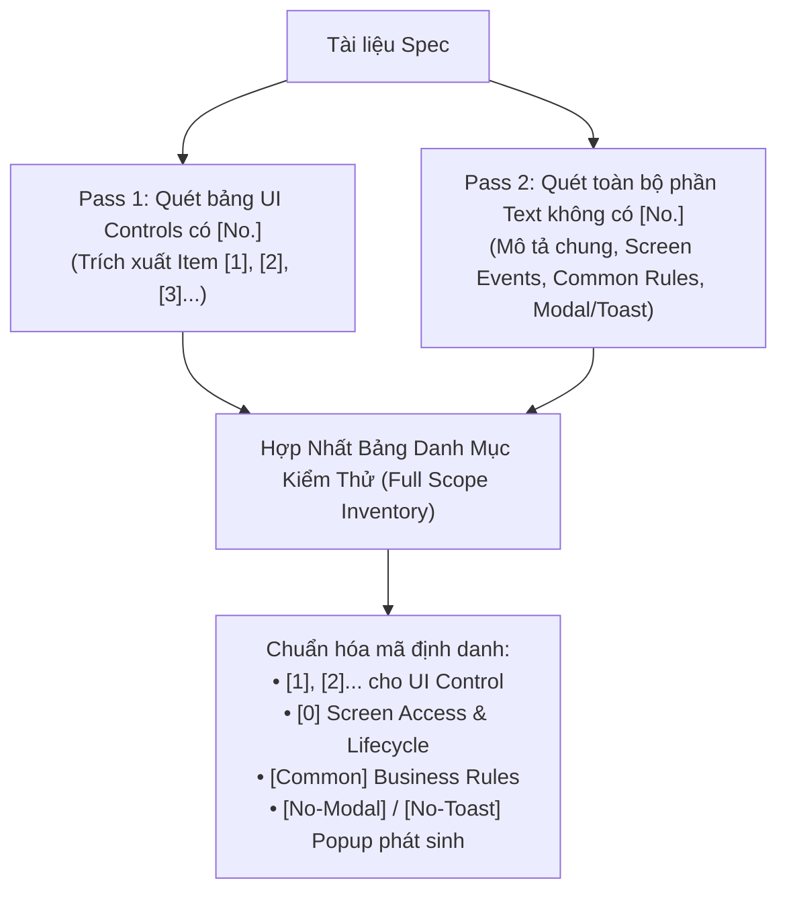

# QUY CHUẨN PHÂN TÍCH ĐẶC TẢ KỸ THUẬT & LÀM RÕ YÊU CẦU (UNIVERSAL SPEC ANALYSIS & CLARIFICATION RULE)
## Trụ Cột 1: Cổng Tiếp Nhận Đầu Vào & Kiểm Soát Chất Lượng Đặc Tả (Pillar 1)

> [!IMPORTANT]
> **Mục tiêu:** Cung cấp quy chuẩn chuyên biệt cho việc đọc hiểu, bóc tách tài liệu đặc tả (Spec / PRD / Requirement Sheet) cho bất kỳ hệ thống phần mềm nào; tự động truy xuất và đối chiếu 1:1 với nguồn thiết kế (Figma / HTML Prototype); trích xuất ma trận logic nghiệp vụ cốt lõi; xác định phạm vi API; và thiết lập bảng câu hỏi Q&A trực quan có cấu trúc lựa chọn (Option A / Option B).
> - **Độc lập dự án (Project-Agnostic):** Áp dụng nhất quán cho mọi loại dự án và ngôn ngữ, tham số hóa toàn bộ qua bảng biến cấu hình `{{PROJECT_PROFILE}}`.
> - **Cổng vào đầu tiên (Entry Gate):** Cung cấp toàn bộ dữ liệu đầu vào cho Trụ cột 2 (Manual UI Testing) và Trụ cột 3 (Backend API Testing).

---

## I. NGUYÊN TẮC QUÉT ĐẶC TẢ 2 BƯỚC BẮT BUỘC (2-PASS SCANNING PROTOCOL)

Để triệt tiêu hoàn toàn lỗi bỏ sót logic ẩn hoặc tự suy diễn (hallucination), AI bắt buộc phải thực hiện quét Spec theo 2 lượt tuần tự:

### 1. Pass 1 - Quét toàn bộ các phần tử có mã số `[No.]`:
- Trích xuất toàn bộ các control xuất hiện trong bảng phân tích màn hình của Spec (`[1]`, `[2]`, `[3]`,...).
- Ghi nhận đầy đủ: Tên Item, Loại UI Control (Textbox, Select, Button, Table...), Giá trị mặc định, Điều kiện hiển thị/khóa.
- **Quy tắc neo Spec (Spec-Anchoring):** Cấm tự ý bịa đặt thêm control nếu bảng Spec không định nghĩa.

### 2. Pass 2 - Quét toàn bộ phần Text/Logic KHÔNG CÓ `[No.]` & Đọc Bộ Ba Sheet Dùng Chung (Chống Bẫy Bỏ Sót):
- **Bắt buộc đọc bộ ba sheet nền tảng trong tài liệu Spec (nếu có):**
  + **`CommonSpec`:** Danh mục 70 quy tắc kỹ thuật chung (CMR01 đến CMR68+) để nhận diện toàn bộ hành vi chuẩn của các control xuất hiện trên màn hình (Paging CMR01/CMR23, Search box CMR02, Input CMR04/09/11, Dropdown CMR08/13, Datepicker CMR14/38, Submit Debounce CMR15, Delete CMR25, Back CMR07, Upload CMR10, Overflow CMR48...).
  + **`Common MSG`:** Danh mục 60 mã lỗi và thông báo toàn cục (CMMSG1 đến CMMSG60) để nạp chính xác chuỗi thông báo tiếng Nhật nguyên văn cho lỗi hệ thống, xác nhận, validation, và kết quả CRUD.
  + **`MSG`:** Danh mục hơn 240 thông báo nghiệp vụ đặc thù (MSG1 đến MSG242+) để nạp nội dung thông báo riêng biệt của từng tính năng.
- Bắt buộc đọc kỹ phần mô tả chung đầu màn hình, các sự kiện màn hình (Screen Events), luồng điều hướng, ghi chú (Note/Remark), quy tắc chung (CMR) và danh mục thông báo lỗi.
- Chuẩn hóa mã định danh cho các mục không có `[No.]`:
  + **`[0] Screen Access & Lifecycle`:** Luồng mở màn hình, Inbound Deep-link nhận tham số từ URL, F5 reload trang, nút Back/Breadcrumb quay về trang cha, kiểm tra layout tổng thể theo Figma.
  + **`[Common] Business Rules`:** Logic phân quyền người dùng (Role-Based Access Control - RBAC), điều kiện ẩn/hiện cả khối giao diện, quy tắc làm tròn/format số liệu toàn hệ thống.
  + **`[<No>-Modal]` hoặc `[<No>-Toast]`:** Các popup xác nhận hoặc thông báo kết quả phát sinh từ hành động của một nút bấm có số No. (Ví dụ: Nút bấm là `[5] Nút Xóa` $\rightarrow$ Popup xác nhận ghi là `[5-Modal] Popup xác nhận xóa`, Toast kết quả ghi là `[5-Toast] Thông báo kết quả xóa`).
  + **`[-] Common Controls (Phân trang & Xuất file & Batch)`:** Thanh phân trang (Pagination 10 viewpoints), nút xuất file CSV/Excel (UTF-8 with BOM), chu kỳ cập nhật dữ liệu batch (Batch timestamp).
  + **`[Empty State]` / `[Error Handling]`:** Trạng thái không có dữ liệu (CMMSG47), mất kết nối mạng (CMMSG8) hoặc lỗi server 500 (CMMSG1).

---

## II. QUY CHUẨN TỰ ĐỘNG ĐỐI CHIẾU THIẾT KẾ 1:1 (DESIGN EXTRACTION & CROSS-CHECK)

1. **Nguyên tắc tự động quét nguồn thiết kế (Zero-User-Prompt Extraction):**
   - Chủ động tìm kiếm và đọc trực tiếp link Figma, ảnh mockup hoặc file HTML Prototype có sẵn trong tài liệu Spec.
   - Tuyệt đối không yêu cầu người dùng cung cấp link riêng nếu trong tài liệu đã có thông tin.
2. **Quy trình đối chiếu Text 1:1 (Strict Text Matching):**
   - So sánh từng chuỗi ký tự giữa Spec và Design: Tiêu đề trang, Label của control, Placeholder text, Tên cột trong bảng dữ liệu, Text trên các nút bấm.
   - Kiểm tra quy tắc chuẩn hóa văn bản theo `{{PRIMARY_LANG}}` và `{{TEXT_NORM_RULE}}` (VD: Ký tự toàn giác/bán giác trong tiếng Nhật, dấu thanh trong tiếng Việt, dấu cách chuẩn Unicode).
3. **Xử lý sai lệch giữa Spec và Design (Discrepancy Resolution):**
   - Nếu có sự khác biệt giữa Spec và Figma (ví dụ: Spec ghi "Tìm kiếm", Figma vẽ "Tra cứu"):
     + Ghi nhận ngay vào Bảng Q&A Clarification.
     + Tạm thời ưu tiên hiển thị theo tài liệu Spec và đánh dấu cờ `[Pending Q&A]` để không làm chậm tiến độ.

---

## III. BÓC TÁCH MA TRẬN LOGIC NGHIỆP VỤ CỐT LÕI (BUSINESS LOGIC MATRIX - TIER 2)

Mỗi màn hình bắt buộc phải được bóc tách thành **4 Nhóm Logic Nghiệp vụ Cốt lõi**:

| Nhóm Logic | Phạm vi kiểm tra | Ví dụ thực tế |
| :--- | :--- | :--- |
| **1. Điều kiện Tiên quyết & Phân quyền (Precondition & RBAC)** | Ai được phép xem? Điều kiện dữ liệu ban đầu là gì? | Admin xem toàn bộ; Agency chỉ xem dữ liệu thuộc quyền; User thông thường bị chặn 403. |
| **2. Ràng buộc Dữ liệu & Cận biên (Validation & Boundaries)** | Định dạng hợp lệ, độ dài Min/Max, ký tự cấm, quan hệ phụ thuộc giữa các trường. | Từ ngày $\le$ Đến ngày; Mật khẩu từ 8-32 ký tự có cả chữ và số; Email đúng định dạng regex. |
| **3. Biến đổi Trạng thái & Tính toán (State Change & Calculations)** | Công thức tính số liệu, cơ chế trừ/cộng dồn, thay đổi trạng thái sau thao tác. | Tổng tiền = Số lượng $\times$ Đơn giá $-$ Giảm giá; Chuyển trạng thái từ "Chờ duyệt" sang "Đã duyệt". |
| **4. Phản hồi Hệ thống & Thông báo (System Feedback & Error Codes)** | Mã lỗi kỹ thuật, nội dung thông báo thành công/thất bại, popup cảnh báo. | Hiển thị mã lỗi chuẩn `{{ERROR_FORMAT}}` (VD: `ERR_001: Tên đăng nhập đã tồn tại`). |

---

## IV. BÓC TÁCH DANH MỤC API & XÁC ĐỊNH PHẠM VI (API SCOPE IDENTIFICATION)

1. **Liệt kê danh mục API liên quan đến màn hình:**
   - Trích xuất toàn bộ các API được gọi từ màn hình: API tải dữ liệu khởi tạo (`GET init`), API tìm kiếm/lọc (`GET list`), API thao tác (`POST`, `PUT/PATCH`, `DELETE`).
2. **Phân định rõ In-Scope vs Out-of-Scope:**
   - **In-Scope (Phải kiểm thử):** Các API phục vụ trực tiếp cho chức năng của màn hình hiện tại.
   - **Out-of-Scope (Bỏ qua):** Các API của hệ thống thứ 3 không do dự án phát triển hoặc API của phân hệ khác không bị tác động.

---

## V. QUY CHUẨN LẬP BẢNG Q&A CLARIFICATION TRỰC QUAN (OPTION A / OPTION B)

Khi phát hiện điểm mơ hồ, mâu thuẫn hoặc thiếu thông tin trong Spec, AI đóng vai trò **Senior QA** chủ động thiết lập bảng câu hỏi làm rõ:

### 1. Nguyên tắc đặt câu hỏi:
- Ngắn gọn, đi thẳng vào vấn đề kỹ thuật/nghiệp vụ.
- **Bắt buộc đưa ra 2 phương án gợi ý (Option A / Option B)** dựa trên best-practice của ngành phần mềm.
- **Bắt buộc nêu Giả định tạm thời (Assumption):** Giả định phương án tối ưu để tiếp tục viết test case ngay, không chờ đợi phản hồi làm nghẽn dự án.

### 2. Cấu trúc Bảng Q&A Xuất Chuẩn:

| No. | Control / Logic [No. Spec] | Vấn đề chưa rõ trong Spec | Câu hỏi làm rõ | Phương án đề xuất | Giả định tạm thời khi viết TC | Trạng thái |
| :---: | :--- | :--- | :--- | :--- | :--- | :---: |
| `Q1` | `[1] DatePicker` | Chưa quy định việc cho phép chọn ngày tương lai (> Hôm nay) hay không. | Hệ thống có cho phép chọn ngày trong tương lai không? | **Option A:** Chặn chọn ngày tương lai (Disabled trên lịch). **Option B:** Cho phép chọn nhưng tìm kiếm ra 0 bản ghi. | Tạm giả định theo **Option A** (Chặn chọn ngày > Hôm nay). | `Pending` |
| `Q2` | `[3] DeleteButton` | Chưa có mô tả về popup xác nhận khi bấm nút Xóa. | Khi bấm Xóa có hiển thị modal confirm trước khi xóa thật không? | **Option A:** Hiển thị Modal Confirm "Bạn có chắc chắn muốn xóa?". **Option B:** Xóa trực tiếp không qua xác nhận. | Tạm giả định theo **Option A** (Có Modal Confirm). | `Pending` |

### 3. Quy chuẩn Thư mục & Tên File Lưu trữ (Output Storage):
- **Thư mục lưu trữ bắt buộc:** `Q&A/`
- **Định dạng tên file chuẩn:** `Q&A/[Tên màn hình]_Q&A.md` *(hoặc `Q&A/{{MODULE_PREFIX}}_Q&A.md`)*
  - Ví dụ thực tế: `Q&A/AE800_Q&A.md`, `Q&A/AP213_Q&A.md`, `Q&A/AQ200_Q&A.md`.
- **Nghiêm cấm:** Tuyệt đối không lưu file Q&A tự do ở thư mục gốc (Root directory) của dự án.

---

## VI. BỘ TIÊU CHÍ NGHIỆM THU ĐẦU RA CỦA TRỤ CỘT 1 (ACCEPTANCE GATES)

Trước khi bàn giao kết quả phân tích sang Trụ cột 2 và Trụ cột 3, AI bắt buộc tự kiểm tra:
1. [ ] Đã phủ 100% các mục có số `[No.]` trong Spec.
2. [ ] Đã phủ đầy đủ các mục không có số No. (`[0] Screen Access & Lifecycle`, `[Common] Business Rules`, `[Empty State]`).
3. [ ] Đã đối chiếu 1:1 các label, placeholder và button giữa Spec và Design.
4. [ ] Bảng Q&A có đủ Option A / Option B kèm giả định tạm thời cho mọi câu hỏi.
