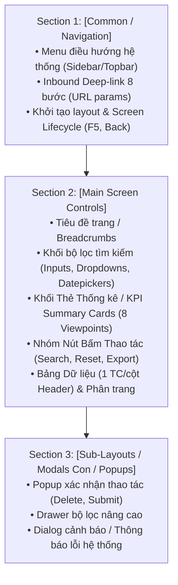
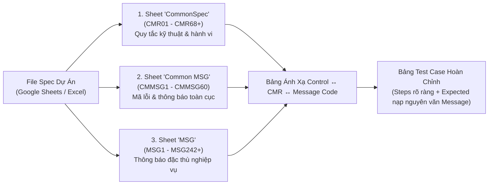

# QUY CHUẨN THIẾT KẾ TEST CASE GIAO DIỆN THỦ CÔNG (UNIVERSAL MANUAL UI TEST CASE STANDARD)
## Trụ Cột 2: Động Cơ Thiết Kế Kiểm Thử Giao Diện 2 Tầng (Pillar 2)

> [!IMPORTANT]
> **Mục tiêu:** Tiếp nhận danh mục UI Controls, Ma trận Logic Tầng 2 và Bảng Q&A từ Trụ cột 1 ([01_core_spec_analysis_rule.md](01_core_spec_analysis_rule.md)); tự động tra cứu, nạp tri thức kiểm thử từ Thư viện Chuẩn hóa `UI_controls/`; áp dụng các bộ lọc tiết chế để chống lạm phát test case; và thiết kế bộ kịch bản kiểm thử giao diện thủ công chuẩn mực.
> - **Độc lập dự án (Project-Agnostic):** Áp dụng nhất quán cho mọi hệ thống phần mềm (Web B2B/B2C, Admin Portal, ERP, CRM, E-Commerce, Mobile Web) và đa ngôn ngữ.
> - **Chiến lược kiểm thử 2 tầng (Two-Tier UI Testing):**
>   + **Tầng 1 (Micro-Interaction & Input):** Nạp Viewpoints kỹ thuật từ thư viện `UI_controls/`.
>   + **Tầng 2 (Business Logic & System Integrity):** Hòa trộn trực tiếp logic nghiệp vụ, công thức tính toán và phân quyền từ Ma trận Tầng 2 vào dưới từng control tương ứng.

---

## 1. KIẾN TRÚC PHÂN BỔ SECTION TUẦN TỰ (STRICT MULTI-SECTION PIPELINE)

Mọi bộ test suite giao diện bắt buộc phải được tổ chức thành 3 Section tuần tự:



### 1.1. Section 1 - `[Common / Navigation]` (Bắt buộc ở đầu bảng):
- **Kênh 1: Menu Điều hướng Hệ thống:** Hiển thị mặc định, Active highlight theo URL, Hover, Điều hướng sang trang khác, Cuộn dọc độc lập, Phân quyền RBAC.
- **Kênh 2: Luồng Inbound Deep-Link kèm Tham số (8 Kịch bản Chuẩn):** Khi màn hình nhận params từ màn khác truyền sang qua URL (VD: `user_id`, `order_code`), bắt buộc phủ đủ:
  1. *Điều hướng thành công:* Mở đúng trang chi tiết với URL chứa query params hợp lệ.
  2. *Tự động điền dữ liệu (Auto-fill):* Các ô bộ lọc tiếp nhận chính xác giá trị từ tham số URL.
  3. *Tự động kích hoạt tìm kiếm (Auto-search):* Gọi API tìm kiếm và tải dữ liệu ngay khi mở trang.
  4. *Khớp dữ liệu kết quả:* Dữ liệu bảng hiển thị đúng các bản ghi khớp với tham số truyền vào.
  5. *Cập nhật khối thẻ KPI:* Các thẻ số liệu phản ánh đúng dữ liệu đã tìm kiếm.
  6. *Tham số không tồn tại / Không có dữ liệu:* Hiển thị thông điệp Empty State chuẩn mực hoặc báo 404 thân thiện.
  7. *Tham số rỗng / Thiếu tham số:* Báo lỗi hợp lệ hoặc redirect về trang danh sách cha.
  8. *Nút Back / Breadcrumb:* Quay về đúng trang cha và bảo lưu bộ lọc trước đó.
- **Screen Lifecycle:** Kiểm tra F5 Reload trang (bảo lưu dữ liệu tìm kiếm đang xem, không bị văng lỗi).

### 1.2. Section 2 - `[Main Screen Controls]`:
Bố trí tuần tự từ trên xuống dưới theo bố cục thực tế trên màn hình:
- Tiêu đề & Breadcrumbs $\rightarrow$ Bộ lọc $\rightarrow$ Thẻ KPI $\rightarrow$ Nút hành động $\rightarrow$ Bảng dữ liệu $\rightarrow$ Phân trang.

### 1.3. Section 3 - `[Sub-Layouts / Modals / Popups]`:
Bao phủ các modal thêm/sửa chi tiết, popup xác nhận thao tác hoặc dialog cảnh báo phát sinh từ Section 2.

---

## 2. CƠ CHẾ ÁNH XẠ VÀO THƯ VIỆN `UI_controls/` (ROUTING & PRUNING)

### 2.1. Bảng Tra Cứu Nhanh Thư Viện UI_controls:

| Loại UI Control trên Spec | Thư mục & File tham chiếu trong `UI_controls/` |
| :--- | :--- |
| **Textbox, Input văn bản, số, ghi chú** | `input_control/01_Textbox.md`, `03_Textarea.md` |
| **Datepicker, chọn khoảng ngày, thời gian** | `input_control/09_Date_Time_Picker.md` |
| **Dropdown, Combobox, Auto-suggest** | `input_control/06_Dropdown_Select_Box.md`, `07_Autocomplete_Combobox.md` |
| **Checkbox, Radio, Toggle Switch** | `input_control/04_Checkbox.md`, `05_Radio_Button.md`, `08_Toggle_Switch.md` |
| **Nút bấm, Nút chọn nhanh, Link** | `action_control/01_Primary_Button.md`, `02_Secondary_...`, `05_Link_...` |
| **Bảng dữ liệu danh sách (Data Grid)** | `display_control/02_Table_Data_Grid.md` |
| **Thẻ số liệu tổng quan (Overview / KPI)** | `display_control/03_List_View_Card.md` (kết hợp công thức Spec) |
| **Thanh phân trang (Pagination)** | `navigation_control/04_Pagination.md` |
| **Popup xác nhận, Hộp thoại cảnh báo** | `feedback_control/01_Modal_Popup_Dialog.md`, `02_Alert_Banner.md` |
| **Thông báo nổi (Toast / Snackbar)** | `feedback_control/03_Toast_Snackbar.md` |

### 2.2. Ranh Giới Cắt Tỉa & Tiết Chế (Strict Anti-Over-Pruning Boundary):

Để đảm bảo bảng test case vừa tinh gọn, vừa **tuyệt đối không bị cắt tỉa thiếu sót các kịch bản dùng chung quan trọng**, AI và QA bắt buộc tuân thủ ranh giới phân định sau:

1. **NHỮNG HẠNG MỤC ĐƯỢC PHÉP CẮT TỈA / TIẾT CHẾ (PERMITTED PRUNING):**
   - **Hover chuột vào chữ tĩnh / Label Text:** Tuyệt đối không viết test case rê chuột vào các đoạn text tĩnh, nhãn tiêu đề chỉ đọc (không phải hyperlink, tab hay button).
   - **Click chuột vào chữ tĩnh / Label Text:** Không viết ca click vào text tĩnh nếu text đó không mang tính tương tác (không mở modal, không trigger sự kiện, không điều hướng).
   - **Tiết chế Header Bảng dữ liệu (Table Header Optimization):** Chỉ tạo **01 Testcase/cột** để kiểm tra đồng thời: Tên cột hiển thị + Căn lề chuẩn (Chữ căn trái, Số/Tiền căn phải, Ngày/Status căn giữa). **CẤM** viết riêng ca font, color, hover, click cho từng Header nếu cột đó không có tính năng Sort hoặc Filter.
   - **Cắt tỉa các tính năng nâng cao không có trên Spec:** Nếu Dropdown trên Spec là dropdown tĩnh thông thường, bỏ qua search autocomplete, clear button `(x)` trong `06_Dropdown_Select_Box.md`; nếu Datepicker chỉ chọn ngày, bỏ qua time selection giờ/phút.

2. **NHỮNG HẠNG MỤC TUYỆT ĐỐI CẤM CẮT TỈA (STRICTLY FORBIDDEN TO OVER-PRUNE):**
   - **CẤM gom tóm tắt thanh Phân trang (Pagination):** Tuyệt đối không được gom phân trang thành 1-2 case chung chung. Bắt buộc phủ đủ tối thiểu **8 - 10 viewpoints** theo Checklist Phân trang chuẩn tại Mục 2.3.
   - **CẤM gộp các Options của Dropdown:** Bắt buộc phải có test case kiểm tra click chọn **TỪNG OPTION CỤ THỂ** trong danh sách dropdown.
   - **CẤM bỏ qua các Common Rules (CMR) hệ thống:** Toàn bộ các quy tắc chung như Debounce chống double-click (`CMR15`), Rút gọn số trang `…` (`CMR23`), Ràng buộc dải ngày (`CMR38`), Empty State (`CMMSG47`), Loading spinner bắt buộc phải được thiết kế thành test case độc lập.

---

### 2.3. BỘ TIÊU CHÍ BẮT BUỘC CHO COMMON CONTROLS & QUY TẮC CHUNG (MANDATORY COMMON CONTROLS & CMR CHECKLIST):

Mọi màn hình có chứa các thành phần dùng chung (Common Controls) bắt buộc phải phủ đủ 100% danh mục viewpoints tiêu chuẩn sau:

#### A. Thanh Phân Trang (Pagination - `04_Pagination.md` & `CMR23`): Bắt buộc đủ 8 - 10 TCs
1. **[UI Mặc định]:** Hiển thị thanh phân trang đầy đủ (`<<前`, các số trang, `次>>`), highlight active Trang 1, tổng số trang tính đúng = `roundup(Tổng bản ghi / PageSize)`.
2. **[Page Size]:** Kiểm tra số bản ghi tối đa hiển thị trên mỗi trang theo Spec/CMR01 (VD: 10 dòng/trang; kiểm tra không có dropdown đổi size nếu cố định, hoặc test đổi 10/20/50 nếu có dropdown).
3. **[Chuyển trang]:** Click trực tiếp vào số trang (1, 2, 3...) và các nút điều hướng Next (`次>>`), Previous (`<<前`), First (`<<`), Last (`>>`). Dữ liệu tải đúng, không trùng lặp, không sót bản ghi.
4. **[Khóa nút Disabled]:** Tại Trang 1: Nút `<<前` / First bị khóa (Disabled). Tại Trang cuối: Nút `次>>` / Last bị khóa (Disabled).
5. **[Biên 0 bản ghi]:** Khi tìm kiếm không có dữ liệu: Thanh phân trang ẩn hoàn toàn, bảng hiển thị Empty State chuẩn `CMMSG47`.
6. **[Biên đúng Page Size (10 bản ghi)]:** Hiển thị trọn vẹn trên 1 trang duy nhất, thanh phân trang ẩn hoặc cả Prev và Next đều disabled.
7. **[Biên Page Size + 1 (11 bản ghi)]:** Tự động tách thành 2 trang: Trang 1 có 10 dòng đầu, Trang 2 có đúng 1 dòng lẻ cuối cùng.
8. **[Đồng bộ Tìm kiếm & Bộ lọc (Reset Page 1)]:** Khi đang đứng ở Trang > 1 mà thay đổi bộ lọc hoặc bấm nút Tìm kiếm (`検索`) mới $\rightarrow$ **Bắt buộc tự động Reset về Trang 1** (chống lỗi đứng ở trang rỗng); khi chuyển qua lại giữa các trang thì bảo lưu bộ lọc.
9. **[Rút gọn số trang '…' (CMR23)]:** Khi tổng số trang > 7, dãy số trang tự động rút gọn bằng ký hiệu `…` (VD: `<<前 1 2 3 4 5 … 11 次>>`). Click vào `…` mở ô input nhỏ để nhập số trang chuyển nhanh.
10. **[URL Tampering & Negative]:** Ô input tại `…` chặn ký tự cấm; khi người dùng cố tình sửa tham số `?page=` trên URL (VD: `?page=-1`, `?page=99999`, `?page=abc`) thì hệ thống xử lý an toàn đưa về Trang 1 hoặc Trang cuối, tuyệt đối không bị lỗi 500 hoặc crash trắng trang.

#### B. Hộp Chọn Xổ Xuống (Dropdown / Pulldown - `06_Dropdown_Select_Box.md`):
1. **[Hiển thị & Mặc định]:** Hiển thị đúng giá trị mặc định kèm icon mũi tên xổ xuống, mở dropdown hiển thị đầy đủ danh sách options tiếng Nhật đúng thứ tự Spec.
2. **[Chọn từng Option]:** Bắt buộc thiết kế test case kiểm tra click chọn **TỪNG OPTION CỤ THỂ** trong dropdown (dropdown đóng lại và ô tiếp nhận chính xác giá trị vừa chọn).
3. **[Đóng khi click ngoài]:** Click ra ngoài vùng dropdown thì dropdown tự động đóng lại và giữ nguyên giá trị trước đó.
4. **[Phụ thuộc động & Auto-switch (Cascade Dropdown)]:** Nếu danh sách options của Dropdown B thay đổi theo giá trị của Dropdown A, bắt buộc test toàn bộ ma trận tùy chọn và quy tắc Auto-switch / Fallback về giá trị mặc định hợp lệ.

#### C. Bộ Chọn Khoảng Thời Gian (Datepicker - `09_Date_Time_Picker.md` & `CMR38`):
1. **[Giao diện & Mặc định]:** Hiển thị icon lịch, giá trị mặc định Từ ngày (ngày 01 tháng trước) và Đến ngày (ngày cuối tháng trước 23:59:59) theo giờ JST hoặc theo Spec.
2. **[Chọn lịch]:** Mở popup lịch trực quan, chọn khoảng ngày hợp lệ, chọn cùng một ngày (Từ ngày = Đến ngày).
3. **[Ràng buộc thời gian (CMR38)]:** Chặn chọn ngày Đến nhỏ hơn ngày Từ (End Date < Start Date) ngay trên popup lịch (làm mờ ngày cấm) và khi nhập tay.
4. **[Nhập liệu bàn phím & Validation]:** Nhập trực tiếp chuỗi ngày hợp lệ `YYYY/MM/DD`, chặn nhập ký tự chữ/ký tự đặc biệt, chặn ngày không tồn tại trên lịch (VD: `2026/02/31`), tự động trim khoảng trắng thừa ở đầu và cuối chuỗi paste.
5. **[Xóa trắng]:** Xóa trắng ô ngày thì khi tìm kiếm hệ thống không giới hạn mốc thời gian đó.
6. **[Click ngoài]:** Click ra ngoài popup lịch tự động đóng lại.

#### D. Nhóm Nút Thao Tác (Action Buttons: Search, Reset, Export - `01_Primary_Button.md`, `02_Secondary...`, `01_Direct_Download...`):
1. **[Nút Tìm kiếm 検索]:**
   - Tìm kiếm theo bộ lọc mặc định.
   - Tìm kiếm theo từng tiêu chí riêng lẻ.
   - Tìm kiếm kết hợp đồng thời nhiều tiêu chí (Logic AND).
   - Chống double-click (Debounce - `CMR15`): Tạm thời vô hiệu hóa nút trong khi gọi API để tránh spam request.
   - Trạng thái Loading (Spinner / Skeleton screen): Hiển thị hiệu ứng loading trên bảng trong suốt thời gian API phản hồi.
2. **[Nút Xóa bộ lọc クリア]:** Khôi phục toàn bộ các trường lọc về giá trị mặc định ban đầu và **tự động kích hoạt tìm kiếm tải lại dữ liệu bảng**.
3. **[Nút Xuất file CSV出力]:** Tải file CSV thành công, định dạng mã hóa UTF-8 with BOM (đảm bảo không bị vỡ font tiếng Nhật/Unicode trên Microsoft Excel), tên file chuẩn Spec/CMR, nội dung chứa đúng các bản ghi khớp bộ lọc hiện tại.

#### E. Bảng Dữ Liệu & Trạng Thái Rỗng (Data Grid & Empty State - `02_Table_Data_Grid.md`, `06_Empty_State.md`):
1. **[Header & Căn lề]:** 1 TC/cột kiểm tra tên header + quy tắc căn lề chuẩn (Chữ căn trái, Số/Tiền/Phần trăm căn phải, Ngày/Trạng thái căn giữa).
2. **[Data Mapping từng dòng (`<td>`)]:** Mapping chính xác dữ liệu từ DB, định dạng dấu phẩy phân cách hàng nghìn cho số tiền/điểm, định dạng ngày giờ chuẩn `YYYY/MM/DD HH:MM:SS`, hiển thị ký tự gạch ngang `ー` cho dữ liệu trống hoặc không áp dụng.
3. **[Link điều hướng]:** Các cột chứa liên kết chi tiết (Username, Stream ID...) click mở tab mới `target="_blank"`, bảo lưu trang gốc.
4. **[Empty State (CMMSG47)]:** Khi tìm kiếm không có bản ghi nào, hiển thị thông báo rỗng chuẩn căn giữa bảng `一致する検索結果はありません。`, ẩn thanh phân trang và đưa các thẻ tổng quan về 0.

#### F. Xử Lý Ngoại Lệ & Phân Quyền Hệ Thống (Error Handling & RBAC):
1. **[Mất mạng]:** Ngắt mạng Internet hiển thị thông điệp chuẩn `CMMSG8: 通信に失敗しました。電波の良い場所で再度お試しください。` (hoặc `CMMSG8: ネットワークエラー。接続を確認してください。`).
2. **[Lỗi máy chủ 500]:** API trả về 500 hiển thị thông điệp chuẩn `CMMSG1: 予期しないサーバーエラーが発生しました。` kèm nút Thử lại (Retry).
3. **[Phân quyền Role]:** Kiểm tra quyền xem, thao tác và xuất dữ liệu nhạy cảm giữa các nhóm tài khoản (Master Admin, Admin, Monitor/Giám sát viên).

---

### 2.4. QUY TRÌNH BẮT BUỘC ĐỌC & ĐỐI CHIẾU BỘ BA SHEET DÙNG CHUNG TRONG SPEC (CommonSpec, Common MSG, MSG):

Để triệt tiêu hoàn toàn nguy cơ bỏ sót (miss) các kịch bản kiểm thử dùng chung và đảm bảo tính chuẩn xác của thông điệp hệ thống, AI và QA bắt buộc phải tuân thủ quy trình tra cứu bộ ba sheet nền tảng trong tài liệu Spec:



#### 1. Định nghĩa & Phạm vi của Bộ Ba Sheet Dùng Chung:
- **Sheet `CommonSpec` (Hệ thống Quy tắc Chung Toàn Hệ thống - CMR01 đến CMR68+):**
  + Quản lý toàn bộ định nghĩa tương tác chuẩn cho từng loại UI control và luồng xử lý hệ thống: `CMR01` (Infinite Scroll), `CMR02` (Search Box), `CMR03` (Label), `CMR04` (Proactive Input Blocking), `CMR05` (Multi-language), `CMR06` (Error Response), `CMR07` (Back Button & Unsaved Check), `CMR08`/`CMR13` (Dropdown), `CMR09`/`CMR11` (Input Form Initial/Edit), `CMR10`/`CMR66` (Upload Image/File & S3 flow), `CMR12` (CKEditor), `CMR14`/`CMR14A` (Datepicker & Format), `CMR15` (Submit Debounce), `CMR20` (Navigation Bar), `CMR23` (Web Pagination), `CMR24` (Checkbox), `CMR25` (Delete Button & Confirmation Modal), `CMR26` (Cancel Button), `CMR27` (Toggle Switch), `CMR29` (Timepicker), `CMR30`-`CMR34`/`CMR42`/`CMR43` (Email/ID/Password Validations), `CMR35` (Breadcrumb), `CMR36` (Sort), `CMR38` (Date Range Filter), `CMR39`/`CMR44` (Bottom Modal), `CMR40` (Tab Navigation), `CMR41` (Required Fields Validation), `CMR48` (Text Overflow Truncation), `CMR49` (Draft Button), `CMR61` (Number Count 1万), `CMR68` (Password Expiration Rule).
- **Sheet `Common MSG` (Hệ thống Mã Thông Báo Toàn Cục - CMMSG1 đến CMMSG60):**
  + Quản lý tập trung mọi chuỗi thông điệp dùng chung cho toàn bộ ứng dụng (Web Frontend, App, Web Admin):
    * **Lỗi Hạ tầng & HTTP Code:** `CMMSG1` (500 Internal Server Error: `予期しないサーバーエラーが発生しました。`), `CMMSG2` (503 Service Unavailable), `CMMSG3` (404 Not Found), `CMMSG4` (401 Unauthorized), `CMMSG5` (403 Permission Denied: `この操作を行う権限がありません。`), `CMMSG6` (400 Bad Request), `CMMSG7` (408 Timeout), `CMMSG8` (Network Error: `ネットワークエラー。接続を確認してください。`), `CMMSG10` (Session Expired).
    * **Thành công & Thất bại (CRUD Feedback):** Tạo (`CMMSG12`/`20`), Cập nhật (`CMMSG13`/`21`), Xóa (`CMMSG14`: `正常に削除されました。` / `CMMSG22`), Upload (`CMMSG15`/`23`), Lưu (`CMMSG17`: `正常に保存されました。` / `CMMSG25`), Gửi/Submit (`CMMSG18`/`26`).
    * **Giao diện & Xác nhận:** Loading (`CMMSG27`: `読み込み中、しばらくお待ちください...`), Xác nhận tiếp tục (`CMMSG28`: `本当に進みますか？`), Thoát khi chưa lưu (`CMMSG46`: `戻ってもよろしいですか？保存されていない変更は失われます。`), Trạng thái rỗng không có kết quả (`CMMSG47`: `一致する検索結果はありません。`), Lưu nháp (`CMMSG50`/`51`).
    * **Ràng buộc Dữ liệu & Input Form:** Ô bắt buộc trống (`CMMSG29`: `{Field}は空欄にできません。`), Sai format chung (`CMMSG30`), Sai giờ (`CMMSG31`-`35`), Sai ngày/Ngày ngược (`CMMSG36`-`40` trong đó `CMMSG39`: `{Field}の開始日は終了日より前でなければなりません。`), Giới hạn Min/Max (`CMMSG41`/`42`), Sai định dạng ảnh/file & dung lượng (`CMMSG43`-`45`), Giới hạn ký tự Max/Min (`CMMSG49`: `{Field}は文字数が多すぎます。{number}文字以内で入力してください。` / `CMMSG52`), Chỉ nhập số nửa độ rộng (`CMMSG54`: `半角数字のみ入力してください。`), Chỉ nhập chữ số nửa độ rộng (`CMMSG55`: `半角英字（a-z）と数字（0-9）のみ入力してください。`), Dữ liệu đã tồn tại (`CMMSG57`).
- **Sheet `MSG` (Hệ thống Thông Báo Nghiệp Vụ Riêng - MSG1 đến MSG242+):**
  + Quản lý các thông điệp đặc thù của từng chức năng/màn hình cụ thể: `MSG1` (Số điện thoại không hợp lệ), `MSG2` (Back khi chưa lưu), `MSG3`-`MSG5` (Giới hạn/format OTP), `MSG10` (Sai thông tin đăng nhập), `MSG12` (Email không hợp lệ), `MSG13` (Độ phức tạp mật khẩu), `MSG14`/`MSG15` (Email/ID đã tồn tại), `MSG16`/`MSG17` (Xác nhận xóa post/comment), `MSG20`/`MSG21` (Follow/Unfollow prompt), `MSG25` (Mật khẩu xác nhận không khớp), `MSG28` (Độ dài ID 6-15 ký tự)...

#### 2. Ma Trận Ánh Xạ Control ↔ CMR ↔ Message Code (Anti-Miss Traceability Matrix):

Khi bắt gặp bất kỳ control hoặc tương tác nào trên màn hình, AI/QA bắt buộc tra cứu và nạp đủ các kịch bản theo bảng ánh xạ chuẩn sau:

| UI Control / Nghiệp vụ trên Màn hình | Sheet `CommonSpec` (CMR) | Sheet `Common MSG` / `MSG` | Viewpoints & Kịch bản bắt buộc phủ đủ (Mandatory Coverage) |
| :--- | :--- | :--- | :--- |
| **Thanh Phân trang (Pagination)** | `CMR01`, `CMR23` | `CMMSG47`, `CMMSG2`, `CMMSG8` | Phủ đủ 10 viewpoints Mục 2.3.A: UI mặc định, Page Size, Điều hướng số trang & Next/Prev/First/Last, Khóa nút disabled tại trang 1/trang cuối, Biên 0 bản ghi (hiện `CMMSG47`), Biên 10 bản ghi, Biên 11 bản ghi phân trang, Reset về trang 1 khi lọc mới, Rút gọn dấu `…` khi > 7 trang, Xử lý URL tampering an toàn. |
| **Ô Tìm kiếm (Search Box)** | `CMR02`, `CMR04` | `CMMSG47`, `CMMSG54`, `CMMSG55` | Nhấn Enter tìm kiếm; Chặn Enter khi rỗng; Icon "X" xóa nhanh ký tự; Tìm kiếm một phần (partial match) không phân biệt hoa thường; Hỗ trợ mọi ký tự và Emoji; Không có kết quả hiển thị `CMMSG47: 一致する検索結果はありません。`. |
| **Ô Nhập Liệu Văn Bản & Số (Input Field / Textbox)** | `CMR04`, `CMR09`, `CMR11` | `CMMSG29`, `CMMSG49`, `CMMSG52`, `CMMSG54`, `CMMSG55` | Autofocus ô đầu tiên; Blocking UX chặn ký tự cấm trực tiếp trên UI; Bỏ trống ô bắt buộc báo `CMMSG29`; Quá độ dài báo `CMMSG49`; Nhập chữ vào ô số báo `CMMSG54`; Chứa ký tự cấm báo `CMMSG55`; Cắt tỉa (trim) khoảng trắng đầu và cuối chuỗi. |
| **Hộp Chọn Xổ Xuống (Dropdown / Pulldown)** | `CMR08`, `CMR13` | `CMMSG29` (nếu bắt buộc) | Hiển thị giá trị mặc định kèm mũi tên xổ xuống; **Click chọn từng option cụ thể**; Click ra ngoài tự đóng; Phụ thuộc động giữa các dropdown (Cascade dropdown) và auto-switch về giá trị hợp lệ. |
| **Bộ Chọn Khoảng Ngày & Giờ (Datepicker & Timepicker)** | `CMR14`, `CMR14A`, `CMR29`, `CMR38` | `CMMSG31`-`35` (Giờ), `CMMSG36`, `CMMSG37`, `CMMSG38`, `CMMSG39`, `CMMSG40` | Mở popup lịch trực quan; Định dạng chuẩn `YYYY/MM/DD` (hoặc `YYYY/MM/DD HH:MM`); Chặn chọn và nhập ngày Đến nhỏ hơn ngày Từ (`CMR38`) báo `CMMSG39: 開始日は終了日より前でなければなりません。`; Chặn ngày quá khứ/tương lai nếu nghiệp vụ cấm (`CMMSG37`/`40`); Trim space khi paste; Xóa trắng ô ngày tìm kiếm toàn thời gian. |
| **Nút Thao Tác Lưu / Gửi (Save / Update / Submit)** | `CMR15`, `CMR09` | `CMMSG27` (Loading), `CMMSG12`/`13`/`17`/`18` (Success), `CMMSG20`/`21`/`25`/`26` (Fail) | Validate toàn bộ form trước khi gọi API; Debounce chống double-click (`CMR15`); Hiển thị spinner/loading (`CMMSG27: 読み込み中、しばらくお待ちください...`); Thành công báo `CMMSG17: 正常に保存されました。` hoặc tương ứng; Thất bại báo lỗi rõ ràng. |
| **Nút Xóa Dữ Liệu (Delete Button)** | `CMR25` | `MSG16`/`17` hoặc `CMMSG28`, `CMMSG14`, `CMMSG22` | Click nút Xóa mở Modal popup xác nhận (`MSG16: この投稿を削除します。よろしいですか？` / `CMMSG28`); Bấm [Hủy] hoặc icon "X" đóng popup giữ nguyên dữ liệu; Bấm [Xác nhận] gọi API xóa, báo `CMMSG14: 正常に削除されました。` và tự động cập nhật lại danh sách; Báo `CMMSG22` nếu xóa thất bại. |
| **Nút Hủy / Quay Lại (Cancel / Back Button)** | `CMR07`, `CMR26` | `MSG2` / `CMMSG46` | Chưa sửa dữ liệu: Điều hướng quay lại ngay lập tức; Đã nhập/sửa dữ liệu: Hiển thị popup cảnh báo `MSG2` (`CMMSG46: 戻ってもよろしいですか？保存されていない変更は失われます。`); Chọn [Hủy] ở lại màn hình giữ nguyên input; Chọn [OK] thoát ra không lưu. |
| **Tải Lên Tệp & Ảnh (Upload Image / File)** | `CMR10`, `CMR66` | `CMMSG43` (Ảnh), `CMMSG44` (File), `CMMSG45` (Size), `CMMSG15`, `CMMSG23` | Resize client-side giữ tỷ lệ; Kiểm tra giới hạn dung lượng ({size}MB) báo `CMMSG45`; Sai đuôi file/ảnh báo `CMMSG43`/`CMMSG44`; Luồng signed URL S3; Thành công báo `CMMSG15`; Thất bại báo `CMMSG23`. |
| **Ngoại Lệ Toàn Cục & Mất Mạng (Global Exceptions & RBAC)** | `CMR06` | `CMMSG1` (500), `CMMSG2` (503), `CMMSG4` (401), `CMMSG5` (403), `CMMSG8` (Mạng), `CMMSG10` (Hết phiên) | Ngắt kết nối mạng báo `CMMSG8: ネットワークエラー。接続を確認してください。`; Lỗi máy chủ 500 báo `CMMSG1: 予期しないサーバーエラーが発生しました。` kèm nút thử lại; Hết phiên đăng nhập báo `CMMSG10` và redirect về trang Login; Không có quyền thao tác báo `CMMSG5: この操作を行う権限がありません。`. |
| **Rút Gọn Text Quá Dài (Text Overflow)** | `CMR17`, `CMR48` | - | Chuỗi văn bản/Tên người dùng vượt quá độ rộng vùng hiển thị tự động cắt tỉa bằng dấu ba chấm `…`; Di chuột (Hover) hiển thị tooltip toàn bộ nội dung. |

#### 3. Quy Tắc Bắt Buộc Khi Nạp Thông Điệp Vào Cột Expected (Strict Message Text Injection):
- **CẤM TUYỆT ĐỐI:** Viết kết quả mong đợi chung chung không có căn cứ (VD: *"Hiển thị thông báo lỗi"*, *"Báo thành công"*, *"Hiện popup cảnh báo"*).
- **BẮT BUỘC:** Mọi ca kiểm thử liên quan đến thông báo lỗi, popup xác nhận, hoặc phản hồi hệ thống đều phải trích xuất và nạp **MÃ ĐỊNH DANH + CHUỖI VĂN BẢN TIẾNG NHẬT/SPEC NGUYÊN VĂN** từ sheet `Common MSG` hoặc `MSG`:
  * *Ví dụ Bắt buộc nhập:* `1. Hiển thị thông báo lỗi CMMSG29: {Field}は空欄にできません。`
  * *Ví dụ Ngày ngược:* `1. Hiển thị thông báo lỗi CMMSG39: 開始日は終了日より前でなければなりません。`
  * *Ví dụ Empty State:* `1. Bảng dữ liệu hiển thị thông báo căn giữa CMMSG47: 一致する検索結果はありません。`
  * *Ví dụ Xác nhận xóa:* `1. Hiển thị popup xác nhận MSG16/CMMSG28: この投稿を削除します。よろしいですか？ kèm 2 nút [キャンセル] và [削除].`
  * *Ví dụ Xóa thành công:* `1. Hiển thị thông báo CMMSG14: 正常に削除されました。 và đóng popup, làm mới danh sách.`
  * *Ví dụ Thoát chưa lưu:* `1. Hiển thị dialog xác nhận CMMSG46 (MSG2): 戻ってもよろしいですか？保存されていない変更は失われます。`
  * *Ví dụ Lỗi mạng:* `1. Hiển thị thông báo lỗi CMMSG8: ネットワークエラー。接続を確認してください。`
  * *Ví dụ Lỗi 500:* `1. Hiển thị thông báo lỗi CMMSG1: 予期しないサーバーエラーが発生しました。 kèm nút 再試行.`

---

## 3. CHUẨN HÓA 8 VIEWPOINTS CHO THẺ SỐ LIỆU ĐỘNG (KPI / OVERVIEW CARDS)

Mọi thẻ tổng hợp số liệu động (Tổng tiền, Coin, Lượt xem...) bắt buộc phủ đủ 8 góc nhìn kỹ thuật:
1. `[UI]` Label tiêu đề thẻ hiển thị đúng theo thiết kế.
2. `[UI]` Định dạng text, font chữ, icon minh họa.
3. `[UI]` Tooltip giải thích ý nghĩa số liệu (nếu có).
4. `[Action]` Click vào thẻ (nếu thẻ có liên kết điều hướng sang chi tiết).
5. `[Calculation]` Công thức tính toán chính xác 100% theo định nghĩa trong Spec.
6. `[Format]` Định dạng phân cách hàng nghìn bằng dấu phẩy `,` (Thousand separator).
7. `[Boundary]` Hiển thị số `0` khi không có dữ liệu (tuyệt đối không để trống ô số liệu).
8. `[Reactivity]` Tự động tính toán lại tức thì khi thay đổi dải tìm kiếm (Search Filter).

---

## 4. QUY TẮC HÀNH VĂN & NẠP DỮ LIỆU THỰC TẾ (DATA INJECTION & COMPACT PHRASING)

1. **Tuyệt đối không dùng văn mẫu chung chung:**
   - Cấm viết: *"Nhập dữ liệu hợp lệ"*, *"Hiển thị thông báo lỗi"*.
   - Bắt buộc thay bằng giá trị thực tế của Spec:
     + **Cột Steps:** Ghi rõ thao tác và dữ liệu cụ thể (`1. Nhập chuỗi 50 ký tự`, `1. Chọn Từ ngày = 2026/08/01`).
     + **Cột Expected:** Ghi rõ kết quả và mã lỗi nguyên văn (`1. Hiển thị thông báo lỗi CMMSG39: 開始日は終了日より前でなければなりません。`).
2. **Quy tắc hành văn tối giản, ngắn gọn (Compact Phrasing):**
   - Tuyệt đối không viết câu văn giải thích rườm rà, không dùng từ nối hay câu mô tả dài dòng.
   - **Cột `Title` (Nhóm kiểm tra tổng quát / Tên control theo cột `No.` trong Spec):**
     + Tiền tố số trong ngoặc vuông `[0]`, `[1]`, `[2]`,... **bắt buộc lấy chính xác từ cột `No.` trong tài liệu Spec**.
     + Case truy cập chung toàn màn hình: `[0] Kiểm tra truy cập màn hình` (hoặc theo No. của màn hình chung trong Spec).
     + Case theo từng phần tử UI: `[<No_trong_Spec>] <Tên control / Hành động tổng quát>` (VD: `[1] Kiểm tra Bread crumbs`, `[2] Search box`, `Label 投稿一覧`).
   - **Cột `Big item` (Mục kiểm tra con / Check item cụ thể):**
     + Đi thẳng vào mục kiểm tra ngắn gọn, không lặp lại tên control đã có ở Title (VD: `Check hiển thị`, `Check điều hướng breadcrumb`, `Kiểm tra nội dung trên label`, `Kiểm tra khi di chuyển chuột vào label`, `Kiểm tra khi click vào label`, `Kiểm tra thực hiện input data`, `Kiểm tra khi paste data`).
   - **Cột `Steps` (Thao tác ngắn):** Viết trực diện 1 thao tác thực tế:
     + Click/Điều hướng: `1. Click [Tên nút/link]`
     + Nhập liệu: `1. Thực hiện nhập ký tự là [chữ / số / ký tự đặc biệt / data có chứa space ở đầu / data có chứa space ở cuối]`
     + Paste: `1. Thực hiện paste chuỗi ký tự gồm [chữ, số, ký tự đặc biệt]`
     + Hover: `1. Thực hiện di chuyển chuột vào [Tên phần tử]`
   - **Cột `Expected` (Kết quả trực diện):** Trả lời thẳng trạng thái hệ thống:
     + Cho phép/Không cho phép: `1. Hệ thống cho phép nhập` / `1. Không cho phép người dùng click vào label`.
     + Điều hướng/Giữ nguyên: `1. Ở nguyên màn [Tên màn]` / `1. Di chuyển về màn [Tên màn]`.
     + Hiển thị: Ghi rõ nội dung hiển thị hoặc dạng con trỏ (`Hiển thị text [Tên]`, `Con trỏ chuột hiển thị dạng Text (I-beam)`).
3. **Tính nguyên tử (Atomic Test Case):**
   - Mỗi dòng testcase chỉ kiểm tra **duy nhất 01 ý độc lập** để dễ dàng chấm Pass/Fail và gắn Bug ID.
4. **Cột Pre-condition:**
   - Chỉ ghi ở ca truy cập màn hình đầu tiên (VD: `User là Admin đăng nhập thành công`).
   - Để trống (`-`) ở toàn bộ các ca kiểm tra giao diện bên dưới nếu không có điều kiện dữ liệu đặc thù.

---

## 5. QUY CHUẨN CẤU TRÚC BẢNG, QUY TẮC MERGE & CÔNG THỨC TÍNH (SPREADSHEET & MARKDOWN)

### 5.1. Quy Tắc Không Để Trống / Merge & Điền Đầy Đủ Thông Tin (No Blank Title & Big Item):
- **Tuyệt đối không bỏ trống cột `Title` và `Big item`:** Mọi dòng test case đều phải có đầy đủ thông tin phân cấp nhóm kiểm tra.
- **Quy chuẩn trong Markdown (.md):**
  + Bắt buộc phải **lặp lại đầy đủ giá trị** của `Title` và `Big item` trên từng dòng.
  + **Tuyệt đối không để trống, không dùng dấu ngoặc kép `"` hoặc ký hiệu viết tắt `...`** để đảm bảo khi copy sang Google Sheets hoặc filter/sort không bị mất ngữ cảnh dữ liệu.
- **Quy chuẩn hiển thị trên Google Sheets / Excel:**
  + Cột `Title` (Cột B): Được **merge ô theo toàn bộ phạm vi các dòng** thuộc cùng một control (hoặc cùng một `No.` trong Spec).
  + Cột `Big item` (Cột C): Được **merge ô theo các dòng cùng thuộc một nhóm kiểm tra con** (VD: merge các dòng kiểm tra nhập ký tự thành 1 khối `Kiểm tra thực hiện input data`).
- **Quy tắc dòng tiêu đề phân nhóm (Group Header Row):**
  + Dòng phân nhóm lớn (VD: `I. COMMON & NAVIGATION`, `II. MAIN CONTROLS`, `III. SUB-LAYOUTS / MODALS`) được merge từ **Cột B đến Cột Q** (hoặc B đến L), viết in hoa, bôi đậm, tô màu xám nhạt (`#F3F3F3` hoặc `#EFEFEF`).
  + **Cột A của dòng tiêu đề nhóm BẮT BUỘC ĐỂ TRỐNG** để không làm nhảy cóc bộ đếm ID tự động.

### 5.2. Cấu Trúc Bảng 17 Cột Chuẩn Trên Google Sheets / Excel:
Mỗi sheet test case chuẩn bao gồm 17 cột (từ cột A đến cột Q):

| STT | Tên cột | Ký hiệu | Ý nghĩa & Quy chuẩn điền khi Thiết Kế Test Case |
| :---: | :--- | :---: | :--- |
| 1 | **ID** | Cột A | Mã testcase tự sinh theo công thức động (VD: `[AE800-1]`, `[AE800-2]`). |
| 2 | **Title** | Cột B | Nhóm kiểm tra tổng quát theo `[No.]` Spec. **Merge theo phạm vi control.** |
| 3 | **Big item** | Cột C | Mục kiểm tra con / hành động cụ thể. **Merge theo nhóm thao tác.** |
| 4 | **Steps** | Cột D | Các bước thực hiện thao tác đánh số `1. ...`, `2. ...`. |
| 5 | **Pre-condition** | Cột E | Điều kiện tiên quyết (chỉ ghi ở ca đầu tiên, dưới để `-`). |
| 6 | **Expected** | Cột F | Kết quả mong đợi chi tiết (mã lỗi, chuỗi text, phản hồi). |
| 7 | **Priority** | Cột G | Mức độ ưu tiên: `High` \| `Medium` \| `Low`. |
| 8 | **Round 1 (Result)** | Cột H | Kết quả thực thi Round 1 (`Pass`, `Fail`, `Impact`, rỗng = `Not Run`). **BẮT BUỘC ĐỂ TRỐNG KHI THIẾT KẾ.** |
| 9 | **Bug ID (R1)** | Cột I | Link hoặc mã Bug phát sinh ở Round 1. **BẮT BUỘC ĐỂ TRỐNG KHI THIẾT KẾ.** |
| 10 | **Status (R1)** | Cột J | Trạng thái xử lý lỗi (`Open`, `Fixed`, `Closed`, `Reopen`). **BẮT BUỘC ĐỂ TRỐNG KHI THIẾT KẾ.** |
| 11 | **Comment (R1)** | Cột K | Ghi chú thực thi, lý do fail ở Round 1. **BẮT BUỘC ĐỂ TRỐNG KHI THIẾT KẾ.** |
| 12 | **Note (R1)** | Cột L | Ghi chú nghiệp vụ / Cờ câu hỏi Q&A (`[Pending Q&A #1]` $\rightarrow$ `=> Confirmed: ...`) / Cờ khả năng tự động hóa (`[Auto]` \| `[Manual Only]`) để bàn giao cho Trụ cột 5 ([05_automation_test_rule.md](05_automation_test_rule.md)). |
| 13 | **Round 2 (Result)** | Cột M | Kết quả thực thi Round 2 (`Pass`, `Fail`, `Impact`, `Not run`). **BẮT BUỘC ĐỂ TRỐNG KHI THIẾT KẾ.** |
| 14 | **Bug ID (R2)** | Cột N | Link hoặc mã Bug phát sinh ở Round 2. **BẮT BUỘC ĐỂ TRỐNG KHI THIẾT KẾ.** |
| 15 | **Status (R2)** | Cột O | Trạng thái xử lý lỗi Round 2. **BẮT BUỘC ĐỂ TRỐNG KHI THIẾT KẾ.** |
| 16 | **Comment (R2)** | Cột P | Ghi chú thực thi Round 2. **BẮT BUỘC ĐỂ TRỐNG KHI THIẾT KẾ.** |
| 17 | **Note (R2)** | Cột Q | Ghi chú bổ sung Round 2. **BẮT BUỘC ĐỂ TRỐNG KHI THIẾT KẾ.** |

### 5.3. Cấu Trúc Header Dashboard 7 Dòng & Công Thức Tính Tự Động:
Bố cục 7 dòng đầu trên Google Sheets được thiết kế cố định (Freeze rows 1-7) làm bảng thông số điều khiển (Dashboard):

```
Row 1: [Module Code: B1]
Row 2: Total created (B2) | % Executed (D2) | [Round 1 Header: H2:L2] | [Round 2 Header: M2:Q2]
Row 3: Plan to exec (B3)  |                  | Pass | Fail | Impact | Not Run | Total (H3:L3 & M3:Q3)
Row 4: (Dòng đệm phân cách)
Row 5: [Merged Header 2 tầng: A5:G6 merge dọc, H5:L5 Round 1 merge ngang, M5:Q5 Round 2 merge ngang]
Row 6: [Sub-headers Round 1 & Round 2: Result | Bug ID | Status | Comment | Note]
Row 7: [Phân loại kiểm thử: UI & Functional (Merge B7:Q7 hoặc B7:L7, cột A để trống)]
Row 8+: [Dữ liệu test cases bắt đầu từ Row 8]
```

#### Bảng Công Thức Chuẩn Xác (Formula Specifications):
1. **Ô B1:** Nhập mã màn hình / Module Code (VD: `AE800`, `BC200`). Dùng làm tiền tố cố định cho công thức cột A.
2. **Khối Thống kê Tổng quan (Info Block - B2, B3, D2):**
   - **Tổng ca tạo (B2):**
     ```excel
     =COUNTA(A8:A)
     ```
   - **Kế hoạch chạy (B3):**
     ```excel
     =B2
     ```
   - **% Tiến độ đã chạy (D2):** *(Định dạng ô: Percentage `%`)*
     ```excel
     =IF(L3 > 0, L3/B2, 0)
     ```
3. **Khối Thống kê Kết quả Round 1 (H3:L3):**
   - `Pass (H3)`: `=COUNTIF(H8:H, "Pass")`
   - `Fail (I3)`: `=COUNTIF(H8:H, "Fail")`
   - `Impact (J3)`: `=COUNTIF(H8:H, "Impact")`
   - `Not Run (K3)`: `=COUNTIFS(A8:A, "<>", H8:H, "Not run")`
   - `Total (L3)`: `=SUM(H3:K3)`
4. **Khối Thống kê Kết quả Round 2 (M3:Q3):**
   - `Pass (M3)`: `=COUNTIF(M8:M, "Pass")`
   - `Fail (N3)`: `=COUNTIF(M8:M, "Fail")`
   - `Impact (O3)`: `=COUNTIF(M8:M, "Impact")`
   - `Not Run (P3)`: `=COUNTIFS(A8:A, "<>", M8:M, "Not run")`
   - `Total (Q3)`: `=SUM(M3:P3)`
5. **Công thức sinh mã ID tự động tại ô A8 (kéo xuống):**
   ```excel
   =IF(OR(D8<>"",F8<>""),"["&TEXT($B$1,"##")&"-"&TEXT(ROW()-7-COUNTBLANK($F$8:F8),"##")&"]","")
   ```
   - **Nguyên tắc hoạt động:**
     + Chỉ sinh ID khi cột `Steps` (D) hoặc `Expected` (F) có dữ liệu; các dòng phân nhóm (Title group row) không có Steps/Expected nên sẽ tự động để trống ô ID.
     + Mã tiền tố lấy động theo ô `$B$1` (Module Code).
     + Số thứ tự tự động tăng tuần tự từ 1 và tự động trừ đi các dòng rỗng/merge ở cột Expected (`COUNTBLANK($F$8:F8)`) để đảm bảo số luôn liên tục không bị nhảy cóc: `[<Module_Code>-1]`, `[<Module_Code>-2]`, `[<Module_Code>-3]`,...

### 5.4. Quy Chuẩn Bảng Xuất Markdown (.md) 7 Cột Chuẩn:
Khi xuất ra file tài liệu Markdown (`.md`) lưu tại thư mục `testcase_ui/`:
- Cấu trúc bắt buộc gồm **7 cột**:
  ```markdown
  | ID | Title | Big item | Steps | Pre-condition | Expected | Priority |
  ```
- **Quy tắc lặp lại thông tin:** Toàn bộ cột `Title` và `Big item` trên mọi dòng phải được điền đầy đủ text nguyên vẹn (không để trống, không merge, không viết tắt).
- **Mã ID:** Hiển thị dưới dạng text tĩnh chính xác theo kết quả đã sinh (VD: `[AE800-1]`, `[AE800-2]`).

---

## 6. QUY CHUẨN THƯ MỤC & TÊN FILE LƯU TRỮ (STORAGE & FILE NAMING)
- **Thư mục lưu trữ bắt buộc:** `testcase_ui/`
- **Định dạng tên file chuẩn:** `testcase_ui/[Tên màn hình]_testcase.md` *(hoặc `testcase_ui/{{MODULE_PREFIX}}_testcase.md`)*
  - Ví dụ thực tế: `testcase_ui/AE800_testcase.md`, `testcase_ui/AP213_testcase.md`, `testcase_ui/AS100_testcase.md`.
- **Nghiêm cấm:** Tuyệt đối không lưu file test case tự do ở thư mục gốc (Root directory).

---

## 7. QUY CHUẨN NGHIỆM THU 3 CHỐT CHẶN (3-GATE QUALITY AUDIT)

Trước khi bàn giao bảng test case, AI bắt buộc tự đối soát:
1. **Chốt 1 (Structure & Scope - Phủ đủ Spec & 3 Sheet Dùng Chung):**
   - Đủ 3 Section chuẩn (Navigation, Main Controls, Modals); không sót bất kỳ `No.` nào trong Spec.
   - **Đã tra cứu đối chiếu bộ ba sheet nền tảng trong tài liệu Spec:** `CommonSpec` (CMR01-CMR68+), `Common MSG` (CMMSG1-CMMSG60) và `MSG` (MSG1-MSG242+) theo Ma trận Ánh xạ tại Mục 2.4 chưa?
2. **Chốt 2 (Pruning & Mandatory Common Controls & Message Injection):**
   - [ ] **Table Header:** Đã được gom đúng 1 TC/cột (Header text + Căn lề) chưa? Đã loại bỏ các ca hover/click vào chữ tĩnh/label text readonly chưa?
   - [ ] **Phân trang (Pagination):** Đã phủ đủ tối thiểu 8-10 viewpoints theo Checklist Mục 2.3.A & CMR01/CMR23 (Hiển thị mặc định, Page Size cố định/động, Chuyển trang, Disabled nút tại Trang 1/Trang cuối, 3 giá trị biên 0/10/11 bản ghi, Tự động Reset về Trang 1 khi search mới, Rút gọn `...` CMR23, URL Tampering) chưa? **CẤM gom tóm tắt 1-2 ca.**
   - [ ] **Dropdown:** Đã có test case click chọn từng option cụ thể trong dropdown chưa? Đã bao quát cascade auto-switch chưa?
   - [ ] **Datepicker:** Đã có CMR38 chặn ngày ngược (End < Start), báo đúng CMMSG39, format YYYY/MM/DD, trim space chưa?
   - [ ] **Nút Thao tác (Search/Reset/Export/Save):** Đã có Debounce CMR15, Loading state CMMSG27, Reset tự reload, CSV UTF-8 with BOM chưa?
   - [ ] **Nút Xóa / Nút Hủy:** Đã có popup xác nhận xóa (MSG16/CMMSG28), xác nhận thoát chưa lưu (MSG2/CMMSG46), thông báo xóa thành công CMMSG14 chưa?
   - [ ] **KPI Thẻ số liệu:** Đã phủ đủ 8 viewpoints (UI, format dấu phẩy, công thức, boundary 0, reactivity, role) chưa?
   - [ ] **Bảng & Empty State:** Đã có Data Mapping từng dòng (`<td>`), target `_blank`, và Empty state CMMSG47 khi 0 bản ghi chưa?
   - [ ] **Message Injection:** Toàn bộ cột Expected của các ca validation, popup xác nhận, thông báo thành công/thất bại, empty state và lỗi hệ thống đã nạp chính xác mã định danh kèm chuỗi văn bản tiếng Nhật nguyên văn từ `Common MSG` / `MSG` chưa? **TUYỆT ĐỐI CẤM dùng văn mẫu chung chung.**
3. **Chốt 3 (Execution Hygiene & Data Integrity):**
   - Toàn bộ cột từ H đến Q (Round 1 & Round 2) đã để trống 100% khi thiết kế chưa?
   - Cột A của các dòng header nhóm có để trống để tránh nhảy cóc ID không?
   - Cột `Title` và `Big item` đã được merge chuẩn theo phạm vi control trên Sheets, hoặc lặp lại đầy đủ giá trị (no blank, không viết tắt) trên Markdown chưa?
   - Đã cài đặt chính xác các công thức Dashboard (B2, B3, D2, H3:L3, M3:Q3) và công thức động cột ID tại A8 chưa?
