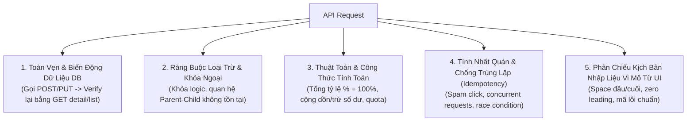

# QUY CHUẨN KIỂM THỬ BACKEND API & LOGIC DỮ LIỆU (UNIVERSAL API SPECIFICATION & TEST CASE RULE)
## Trụ Cột 3: Động Cơ Kiểm Thử Backend & 419 Viewpoints (Pillar 3)

> [!IMPORTANT]
> **Mục tiêu:** Tiếp nhận danh mục In-Scope APIs, Ma trận Logic Nghiệp vụ Tầng 2 và Bảng Q&A từ Trụ cột 1 ([01_core_spec_analysis_rule.md](01_core_spec_analysis_rule.md)). Áp dụng danh mục **419 Viewpoints từ thư viện `API_controls/API_Viewpoint.md`**, tập trung kiểm thử logic nghiệp vụ backend, biến động dữ liệu DB, đối chiếu nguồn đặc tả thực tế (Postman Collection / Swagger / OpenAPI) và thiết kế kịch bản kiểm thử API chuyên sâu.
> - **Độc lập dự án (Project-Agnostic):** Tham số hóa hoàn toàn qua bộ biến cấu hình (`{{PROJECT_CODE}}`, `{{MODULE_PREFIX}}`, `{{API_DOC_SOURCE}}`, `{{ERROR_FORMAT}}`).

---

## 1. NGUYÊN TẮC TRỌNG TÂM KIỂM THỬ LOGIC BACKEND (BACKEND BUSINESS LOGIC FOCUS)

Bên cạnh việc quét các trường input/params đơn lẻ theo contract (Key, Type, Min/Max), **bắt buộc phải thiết kế bộ ca kiểm thử chuyên sâu cho 5 nhóm logic cốt lõi**:

1. **Tính toàn vẹn & Biến động Dữ liệu DB (Database Persistence & State Change):**
   - Sau khi gọi API làm thay đổi dữ liệu thành công (`POST` tạo mới, `PUT/PATCH` cập nhật, `DELETE` soft-delete):
     - Gọi ngay API `GET detail` hoặc `GET list` tương ứng để verify xem các trường dữ liệu trong DB có được lưu trữ chính xác 100% theo payload gửi lên hay không.
     - Kiểm tra các trường tự sinh ở tầng server (`updated_at`, `created_by`, `status`, `version_id`).
2. **Ràng buộc loại trừ & Toàn vẹn nghiệp vụ (Business Integrity & Exclusion Rules):**
   - Thao tác API vi phạm quy tắc loại trừ logic nghiệp vụ (Ví dụ: Gán tài nguyên đang bị khóa) $\rightarrow$ Kỳ vọng trả về mã lỗi business `400/409/422` kèm mã thông báo chuẩn, tuyệt đối không cho phép ghi đè làm sai lệch dữ liệu.
   - Thao tác với khóa ngoại không tồn tại hoặc sai cặp quan hệ cha-con (`child_id` không thuộc `parent_id`) $\rightarrow$ Kỳ vọng bị chặn và trả về lỗi rõ ràng.
3. **Công thức tính toán & Cơ chế tích lũy (Calculation & Algorithms):**
   - API cấu hình tỷ lệ: Kiểm tra tổng tỷ lệ các phần tử có bắt buộc phải đạt đủ 100% hay không; nếu vượt quá hoặc nhỏ hơn 100% thì API phản hồi thế nào.
   - Kiểm tra logic cộng dồn, trừ số dư, hoàn tiền hoặc reset chỉ số khi người dùng đạt hạn mức/quota.
4. **Tính nhất quán trạng thái (Idempotency & Race Condition Logic):**
   - Kiểm tra gửi trùng lặp request API trong thời gian cực ngắn (Spam click / Concurrent requests): Hệ thống phải đảm bảo tính toàn vẹn (chỉ xử lý 1 lần, không tạo duplicate record, không trừ tài nguyên 2 lần và không sinh lỗi `500`).
5. **Đồng bộ kịch bản vi mô từ UI sang API (Micro-Validation Reflection):**
   - Kiểm tra gửi chuỗi có khoảng trắng ở đầu/cuối/giữa xem Backend trim space tự động hay báo lỗi.
   - Kiểm tra gửi số nguyên có số 0 ở đầu (VD: `0100`).
   - Kiểm tra mã lỗi nghiệp vụ trả về từ response JSON (`code`, `message`) phải khớp chính xác với `{{ERROR_FORMAT}}` của dự án.

---

## 2. QUY TRÌNH 6 BƯỚC ÁP DỤNG VIEWPOINT CHO TỪNG API (HOW TO APPLY)

Khi sinh test case cho bất kỳ API nào, bắt buộc thực hiện tuần tự 6 bước:

* **Bước 1 (Bóc tách Contract của API):**
  * Liệt kê toàn bộ params/fields của API theo từng vị trí: `Query`, `Path`, `JSON body`, `Form-data`, `Header`.
  * Xác định thuộc tính từng field: Kiểu dữ liệu (`String`, `Integer`, `Decimal`, `Boolean`, `Date`, `Enum`, `Array`, `File`), tính bắt buộc (`Required` / `Optional`), tính duy nhất (`Unique`), cận biên (`Min` / `Max`), dải giá trị (`Enum list`).
* **Bước 2 (Lọc Viewpoint tương ứng theo Vị trí):**
  * Tra cứu bảng danh mục trong `API_controls/API_Viewpoint.md` (khớp đúng vị trí Query, Path, JSON, Form, Header).
  * Tích hợp nhóm Business Logic từ Mục 1.
* **Bước 3 (Nạp giá trị kiểm thử cụ thể - Concrete Data Injection):**
  * Thay thế toàn bộ placeholder chung chung bằng dữ liệu thực tế (VD: `name = "50 ký tự..."`, `status = "ACTIVE"`).
* **Bước 4 (Thiết lập Kỳ vọng đa tầng - Multi-Tier Expected):**
  * Kỳ vọng Status Code (200, 201, 400, 401, 403, 404, 409, 422).
  * Kỳ vọng Response Body (Cấu trúc JSON, mã lỗi, thông báo lỗi).
  * Kỳ vọng Database State (Dữ liệu trong bảng thay đổi ra sao).
* **Bước 5 (Gắn thẻ ưu tiên & Phân loại):**
  * Gắn Priority: `High` (CRUD chính, Validation bắt buộc, Phân quyền), `Medium` (Boundary, Negative format), `Low` (Ký tự hiếm gặp).
* **Bước 6 (Đối soát tính độc lập - Atomic Verification):**
  * Đảm bảo mỗi testcase chỉ assert một mục tiêu độc lập.

---

## 3. HỆ THỐNG 14 GIẢ ĐỊNH KỸ THUẬT MẶC ĐỊNH CHO API (`A1` – `A14`)

Khi tài liệu đặc tả API chưa nêu chi tiết, AI áp dụng các giả định kỹ thuật chuẩn mực sau:

| Mã | Tên Giả Định | Chi Tiết Quy Ước Kỹ Thuật |
| :---: | :--- | :--- |
| `A1` | **String Trim Space** | Backend tự động trim space ở đầu và cuối chuỗi; giữ nguyên space ở giữa. |
| `A2` | **Empty String vs Null** | Trường chuỗi bắt buộc nếu gửi `""` hoặc `null` đều bị từ chối với lỗi `400/422`. |
| `A3` | **Integer Validation** | Trường số nguyên nếu gửi số thực (float/decimal) hoặc chuỗi không phải số đều bị từ chối. |
| `A4` | **Date Format** | Chuẩn format ngày mặc định là ISO 8601 (`YYYY-MM-DD` hoặc `YYYY-MM-DDTHH:mm:ssZ`). |
| `A5` | **Enum Strictness** | Giá trị Enum có phân biệt hoa/thường (Case-sensitive); gửi ngoài danh mục báo lỗi `400`. |
| `A6` | **Max Length UTF-8** | Độ dài chuỗi tính theo số lượng ký tự Unicode (characters), không tính theo số bytes. |
| `A7` | **Array Bounds** | Mảng dữ liệu nếu rỗng `[]` khi trường đó bắt buộc sẽ bị báo lỗi `400/422`. |
| `A8` | **SQL Injection / XSS** | Payload chứa script `<script>` hoặc SQL `' OR 1=1` phải được sanitize hoặc escape an toàn. |
| `A9` | **Authentication 401** | Thiếu Token / Token hết hạn / Token sai định dạng bắt buộc trả về HTTP `401 Unauthorized`. |
| `A10` | **Authorization 403** | Token hợp lệ nhưng Role không có quyền truy cập endpoint bắt buộc trả về HTTP `403 Forbidden`. |
| `A11` | **Resource Not Found 404**| Path parameter chứa ID không tồn tại trong DB bắt buộc trả về HTTP `404 Not Found`. |
| `A12` | **Idempotent DELETE** | Gọi DELETE lần 1 trả về `200/204`; gọi DELETE lần 2 với cùng ID đó trả về `404 Not Found`. |
| `A13` | **Pagination Defaults** | Mặc định `page = 1`, `limit = 10` (hoặc `20`) nếu client không truyền tham số phân trang. |
| `A14` | **Error Response Contract**| Response lỗi luôn trả về định dạng JSON thống nhất: `{ "code": "...", "message": "..." }`. |

---

## 4. CẤU TRÚC BẢNG TEST CASE API CHUẨN DỰ ÁN (GOOGLE SHEETS / EXCEL)

- **Cột A (ID):** Công thức tự động sinh mã `[{{MODULE_PREFIX}}-API-1]`.
- **Cột B (API Name / Endpoint):** `[METHOD] /api/v1/endpoint` (Merge theo khối API).
- **Cột C (Group / Viewpoint Group):** Nhóm kiểm thử (VD: `Query Validation`, `Payload Validation`, `Business Logic`).
- **Cột D (Test Case / Scenario):** Tóm tắt kịch bản kiểm thử.
- **Cột E (Pre-condition):** Token đăng nhập, dữ liệu DB có sẵn.
- **Cột F (Request Data / Payload):** Query params, Headers, JSON Request body cụ thể.
- **Cột G (Expected HTTP Status):** Mã trạng thái mong đợi (`200`, `201`, `400`, `401`, `403`, `404`, `422`).
- **Cột H (Expected Response Body & DB State):** Response JSON mong đợi + Trạng thái DB thay đổi.
- **Cột I (Priority):** `High` | `Medium` | `Low`.
- **Cột J (Round 1):** Kết quả thực thi round 1 (`Pass`, `Fail`, để trống = `Not Run`). **BẮT BUỘC ĐỂ TRỐNG KHI THIẾT KẾ.**
- **Cột K (Round 2):** Kết quả thực thi round 2 (**để trống khi thiết kế**).
- **Cột L (Note / Q&A Flag):** Ghi chú câu hỏi Q&A hoặc giả định áp dụng (`[Pending Q&A #2]`).

---

## 5. QUY CHUẨN THƯ MỤC & TÊN FILE LƯU TRỮ (STORAGE & FILE NAMING)
- **Thư mục lưu trữ bắt buộc:** `testcase_api/`
- **Định dạng tên file chuẩn:** `testcase_api/[Tên màn hình]_api.md` *(hoặc `testcase_api/{{MODULE_PREFIX}}_api.md`)*
  - Ví dụ thực tế: `testcase_api/AQ200_api.md`, `testcase_api/AQ201_api.md`, `testcase_api/AE800_api.md`.
- **Nghiêm cấm:** Tuyệt đối không lưu file test case API tự do ở thư mục gốc (Root directory).

---

## 6. BỘ TIÊU CHÍ NGHIỆM THU ĐẦU RA CHO API (3-GATE AUDIT)

1. [ ] Đã bao phủ toàn bộ danh mục In-Scope APIs được bóc tách từ Trụ cột 1.
2. [ ] Đã kiểm tra đầy đủ 5 nhóm logic cốt lõi (Toàn vẹn DB, Khóa ngoại, Thuật toán, Idempotency, Micro-validation).
3. [ ] Cột kết quả thực thi (Round 1, Round 2) để trống 100% khi bàn giao thiết kế.
