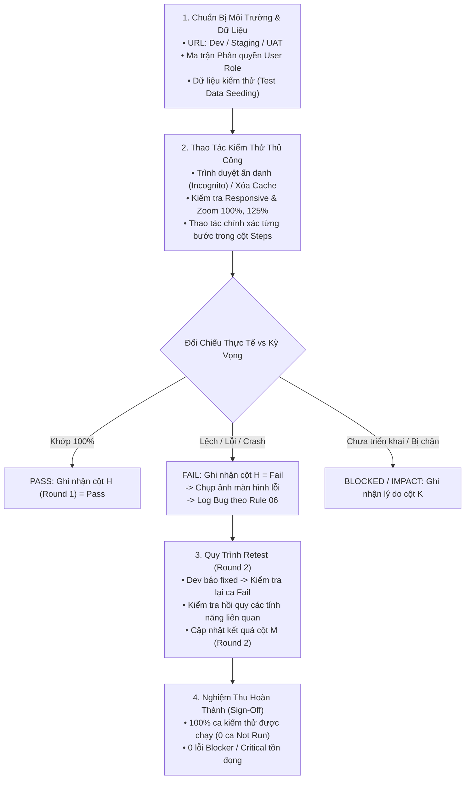

# QUY CHUẨN THỰC THI KIỂM THỬ THỦ CÔNG (UNIVERSAL MANUAL TEST EXECUTION STANDARD)
## Trụ Cột 4: Quy Trình Thực Thi Kiểm Thử Trên Môi Trường Thực Tế & Quản Lý Vòng Test (Pillar 4)

> [!IMPORTANT]
> **Mục tiêu:** Cung cấp quy chuẩn chi tiết cho Tester (hoặc AI tương tác trực tiếp trên giao diện) khi tiến hành **Thực thi kiểm thử thủ công (Manual Test Execution)**: từ chuẩn bị môi trường, ma trận tài khoản phân quyền, kỹ thuật thao tác trên trình duyệt, quy tắc ghi nhận kết quả Round 1 / Round 2 trên bảng tính, cho đến quy trình nghiệm thu (Sign-off) hoàn thành vòng test.
> - **Độc lập dự án (Project-Agnostic):** Áp dụng nhất quán cho mọi hệ thống phần mềm (Web B2B/B2C, SaaS, ERP, CRM, E-Commerce, Mobile Web).

---

## 1. QUY TRÌNH THỰC THI KIỂM THỬ THỦ CÔNG TỔNG THỂ

---

## 2. CHUẨN BỊ TRƯỚC KHI THỰC THI (PRE-EXECUTION READINESS)

Trước khi bắt đầu bấm vào ca kiểm thử đầu tiên, Tester bắt buộc hoàn thành 4 bước chuẩn bị:

### 2.1. Xác Định Môi Trường & Phiên Bản Build:
- Xác nhận đúng URL môi trường được chỉ định (Dev, Staging hoặc UAT).
- Ghi nhận mã phiên bản (Build Version / Commit Tag) đang chạy trên môi trường để đảm bảo các tính năng mới đã được deploy đầy đủ.

### 2.2. Thiết Lập Ma Trận Tài Khoản & Phân Quyền (Role Matrix):
Chuẩn bị sẵn danh sách tài khoản tương ứng với từng vai trò người dùng trong Spec:
- Tài khoản Quản trị tối cao (Super Admin / Master Admin).
- Tài khoản Quản trị phân quyền (Sub-admin / Staff).
- Tài khoản Đối tác / Đại lý (Agency / Merchant).
- Tài khoản Người dùng thông thường (Free User / End-User).
- Tài khoản bị khóa / hết hạn (Blocked / Expired User) để test negative.

### 2.3. Chuẩn Bị Dữ Liệu Kiểm Thử (Test Data Seeding):
- Đảm bảo cơ sở dữ liệu có sẵn các bản ghi mẫu:
  + Dữ liệu có nhiều dòng để kiểm tra phân trang (Pagination).
  + Dữ liệu có tên cực dài để kiểm tra độ giãn cột và cắt chữ `...`.
  + Tài khoản có số dư lớn, tài khoản có số dư bằng 0, tài khoản mới tạo chưa có giao dịch nào (để test Empty State).

### 2.4. Vệ Sinh Trình Duyệt (Browser Hygiene):
- **BẮT BUỘC:** Luôn mở cửa sổ ẩn danh (**Incognito / Private Window**) khi bắt đầu phiên test để tránh việc cookie hoặc cache JavaScript/CSS cũ làm sai lệch kết quả.
- Khi Dev vừa cập nhật bản vá lỗi: Bắt buộc nhấn tổ hợp phím **Hard Refresh** (`Ctrl + Shift + R` trên Windows hoặc `Cmd + Shift + R` trên Mac) để xóa toàn bộ cache trang web.

---

## 3. THAO TÁC THỰC THI & QUY TẮC ĐÁNH GIÁ TRẠNG THÁI (EXECUTION PROTOCOL)

Khi chạy từng dòng testcase trong bảng kiểm thử:

1. **Thực hiện đúng từng thao tác:**
   - Đọc kỹ `Pre-condition` $\rightarrow$ Thao tác tuần tự theo `Steps` $\rightarrow$ Quan sát giao diện và phản hồi hệ thống.
2. **Tiêu chuẩn đánh giá kết quả:**
   - **`Pass` (Đạt):** Kết quả thực tế (**Actual Result**) khớp hoàn toàn 100% với đặc tả kỳ vọng (**Expected Result**), không phát sinh lỗi giao diện, không văng console error.
   - **`Fail` (Không đạt):** Có bất kỳ sai lệch nào về nội dung text, sai công thức tính toán, nút bấm không phản hồi, báo mã lỗi sai, văng lỗi 500 hoặc crash màn hình.
   - **`Impact` (Bị ảnh hưởng):** Chức năng này bị ảnh hưởng gián tiếp do một chức năng khác bị lỗi (ví dụ: màn hình tạo mới bị lỗi nên không có dữ liệu để test màn hình danh sách).
   - **`Blocked` (Bị chặn):** Tính năng chưa được deploy hoặc bị khóa hoàn toàn, không thể tiếp tục thực hiện các bước tiếp theo.
   - **Để trống (`Not Run`):** Ca test chưa được thực thi. **TUYỆT ĐỐI KHÔNG GÕ CHỮ "Not Run" VÀO Ô ĐỂ TRÁNH LÀM SAI LỆCH CÔNG THỨC THỐNG KÊ.**

---

### 3.1. NGUYÊN TẮC BẤT DI BẤT DỊCH: KHÔNG SUY ĐOÁN - KHÔNG GHI NHẬN KHỐNG (ZERO-ASSUMPTION & ANTI-FALSE REPORTING)

> [!CAUTION]
> **QUY CHUẨN ĐỎ ÁP DỤNG ĐỒNG BỘ CHO MỌI MÀN HÌNH & CHỨC NĂNG TRONG DỰ ÁN:**
> 1. **CẤM LẤY KẾT QUẢ ROUND 1 ĐỂ BÁO CÁO CHO ROUND 2:** Khi được yêu cầu kiểm thử Round 2 (hoặc Retest bất kỳ màn hình nào), Tester/AI bắt buộc phải thực thi lại từng bước trên môi trường live. Tuyệt đối không được lấy kết quả cũ từ cột Round 1 (Cột H:L) để báo `Pass` cho Round 2.
> 2. **CẤM ĐIỀN PASS KHI CHƯA CHẠY THỰC TẾ (NO EXECUTION = NO PASS):** Tuyệt đối không được đọc code Frontend/Backend, đọc file bundle JavaScript, hoặc suy đoán logic code để tuyên bố ca test đã `Pass`. Kết quả Mocking chỉ dùng để debug nội bộ, không được công nhận là kết quả của Manual Test Execution trên môi trường thật.
> 3. **BẮT BUỘC CÓ BẰNG CHỨNG (EVIDENCE ENFORCEMENT):** Bất kỳ ca kiểm thử nào báo `Pass` hoặc `Fail` ở bất kỳ màn hình nào đều phải có bằng chứng thực tế (ảnh chụp màn hình trong `evidence/` hoặc log request/response HTTP mạng live). Không có bằng chứng $\rightarrow$ Không được công nhận kết quả.

---

### 3.2. QUY CHUẨN THIẾT LẬP TIỀN ĐỀ & TỰ SINH DỮ LIỆU KIỂM THỬ (PROACTIVE TEST DATA & PRECONDITION PROTOCOL)

Nhằm tối đa hóa tỷ lệ thực thi thực tế (Execution Coverage) và triệt tiêu phản xạ dừng kiểm thử thụ động, quy chuẩn thiết lập tiền đề và dữ liệu kiểm thử được chuẩn hóa độc lập dự án như sau:

#### 3.2.1. Phân tầng Khả Năng Tự Sinh Dữ Liệu (3-Tier Data Readiness & Seeding Strategy)
Khi gặp ca kiểm thử thiếu dữ liệu mẫu (danh sách rỗng, bản ghi chưa đạt trạng thái yêu cầu, chưa có ràng buộc nghiệp vụ):

| Phân tầng | Bản chất dữ liệu / Tiền đề | Hành động BẮT BUỘC của Tester / AI Agent |
| :--- | :--- | :--- |
| **Tier 1: UI Self-Seeding (Tự tạo qua Giao diện)** | Dữ liệu hoặc trạng thái có thể khởi tạo/cập nhật thông qua bất kỳ màn hình nào trên hệ thống (Form tạo mới, cập nhật trạng thái, phê duyệt/từ chối, gán cờ cấu hình...). | • **Bắt buộc chủ động điều hướng sang màn hình chức năng liên quan** để tạo dữ liệu hoặc thiết lập trạng thái trước. • Sau khi tạo thành công, quay lại màn hình kiểm thử chính để thực hiện ca test. • **NGHIÊM CẤM** dừng lại báo `Blocked`. |
| **Tier 2: API Self-Seeding (Tự tạo qua API)** | Màn hình UI tạo dữ liệu chưa hoàn thiện hoặc thao tác UI quá nhiều bước, nhưng hệ thống có sẵn endpoint API trong cấu hình kiểm thử (Postman Collection / Swagger / Test Config). | • **Chủ động kích hoạt request API** để tạo bản ghi/trạng thái trên môi trường test. • Sau khi API trả về 200/201, quay lại giao diện web để xác nhận và thực thi testcase. • **NGHIÊM CẤM** dừng lại báo `Blocked`. |
| **Tier 3: True Blocker (Bị chặn thực sự)** | Dữ liệu bắt buộc can thiệp trực tiếp cơ sở dữ liệu (chạy script DB nội bộ), phụ thuộc dịch vụ bên thứ 3 (OTP SMS, Cổng thanh toán Live không có sandbox), hoặc tài khoản đặc thù chưa từng được cung cấp trong cấu hình. | • **Được phép đánh dấu `Blocked`** tại cột Result. • Ghi rõ lý do kỹ thuật chi tiết tại cột Comment. • Lập danh sách yêu cầu dữ liệu (Test Data Request) gửi Dev/PO. |

#### 3.2.2. Kiểm Thử Phối Hợp Đa Vai Trò & Đa Cổng Giao Diện (Cross-Role & Cross-Portal RBAC Protocol)
Đối với các ca kiểm thử liên quan đến kiểm soát quyền truy cập (RBAC), bất đối xứng quyền lực, hoặc quy trình duyệt đa cấp (Ví dụ: Vai trò A cấu hình/hạn chế quyền $\rightarrow$ Vai trò B chịu tác động trên giao diện):

1. **Tận dụng toàn bộ Ma trận Tài khoản (Role Matrix):**
   - Khi cấu hình kiểm thử (`TEST_CONFIG.md` hoặc tài liệu tương đương) đã cung cấp thông tin đăng nhập của các vai trò liên quan (Role Quản trị cấp cao / Role Quản trị nhánh / Role Người dùng cuối):
     + **Bước 1 (Precondition Setup):** Đăng nhập cổng quản trị của vai trò có thẩm quyền (Role A) $\rightarrow$ Thao tác bật/tắt quyền hoặc cấu hình trạng thái theo yêu cầu của tiền đề $\rightarrow$ Chụp ảnh bằng chứng thao tác setup.
     + **Bước 2 (Target Verification):** Chuyển đổi ngữ cảnh sang vai trò bị tác động (Role B) $\rightarrow$ Mở màn hình kiểm thử đích $\rightarrow$ Kiểm tra và xác minh trạng thái phần tử giao diện (nút bấm bị disabled/ẩn, quyền truy cập bị chặn, thông báo lỗi).
     + **Bước 3 (Evidence & Result):** Chụp ảnh bằng chứng thực tế tại màn hình đích $\rightarrow$ Kết luận `Pass`/`Fail`.
   - **TUYỆT ĐỐI KHÔNG COI cổng giao diện của Role A là "ngoài phạm vi kiểm thử"** để tự ý báo `Blocked` cho ca test của Role B.

2. **Quản lý Phiên Đăng Nhập (Session Isolation):**
   - Khi luân chuyển giữa các vai trò hoặc cổng giao diện khác nhau, bắt buộc mở cửa sổ/tab ẩn danh riêng biệt hoặc thực hiện quy trình Đăng xuất $\rightarrow$ Xóa Session/Cookie $\rightarrow$ Đăng nhập vai trò mới để tránh xung đột quyền hạn hoặc cache token cũ.

#### 3.2.3. Quy Chuẩn Đặt Tên & Ghi Nhận Dữ Liệu Tự Tạo (Data Hygiene & Traceability)
- **Tiền tố nhận diện (Prefix Standard):** Mọi bản ghi được tự tạo để phục vụ kiểm thử bắt buộc phải chứa tiền tố nhận diện chuẩn nhằm tránh nhầm lẫn với dữ liệu thật và dễ dọn dẹp:  
  `[TEST_AUTO]_{Mã_Chức_Năng}_{Timestamp}` hoặc `[QA_SEED]_{Mô_tả}`.
- **Minh bạch hóa kết quả (Audit Trail):** Tại cột Comment của bảng kết quả kiểm thử, ghi nhận rõ:  
  `[Self-Seeded: Đã chủ động khởi tạo bản ghi {Tên/ID} qua {Màn hình/API} để thực thi ca test]`.
- **Ranh giới an toàn:** Tự tạo dữ liệu là phương tiện để thực thi kiểm thử thật, **TUYỆT ĐỐI CẤM** tự ý đánh `Pass` khi chưa thực hiện thao tác kiểm tra trên giao diện sau khi tạo data.

#### 3.2.4. Khai Thác CSDL Để Truy Tìm & Chuẩn Bị Dữ Liệu (Database-Driven Precondition Discovery)
- Khi môi trường thử nghiệm đã cấu hình kết nối CSDL theo [07_database_testing_rule.md](07_database_testing_rule.md):
  + Tester / AI Agent chủ động sử dụng câu lệnh SQL `SELECT` để truy tìm các bản ghi mẫu đáp ứng đúng điều kiện tiên quyết của ca kiểm thử (ví dụ: tìm bản ghi có số lượng liên kết bằng 0 để test Empty State, tìm tài khoản bị khóa để test Negative Authentication, tìm bản ghi có mốc thời gian đặc thù để test Expired State).
  + Ghi nhận mã ID bản ghi tìm được vào cột Comment để phục vụ truy vết bằng chứng.

---

### 3.3. QUY CHUẨN XÁC THỰC CƠ SỞ DỮ LIỆU SAU THAO TÁC (DATABASE STATE VERIFICATION PROTOCOL)

Nhằm triệt tiêu lỗi ngầm (Silent Failure / UI False Positive - giao diện báo thành công nhưng cơ sở dữ liệu không cập nhật hoặc cập nhật sai trường), Tester và AI Agent bắt buộc áp dụng **Trụ Cột 7 ([07_database_testing_rule.md](07_database_testing_rule.md))**:

1. **Các nhóm ca kiểm thử bắt buộc đối soát CSDL:**
   - **Tạo mới (Create / Register):** Xác minh bản ghi mới đã được chèn vào đúng bảng, khóa chính tự sinh hợp lệ, các trường thông tin nhận đúng giá trị nhập trên form, và cờ `is_deleted = false`.
   - **Cập nhật & Chỉnh sửa (Update / Edit):** Xác minh các trường thay đổi nhận đúng giá trị mới, trường không chỉnh sửa giữ nguyên giá trị cũ, và trường `updated_at` được cập nhật thời gian hiện tại.
   - **Đổi trạng thái (Toggle Switch / Segmented Button / Status Dropdown):** Xác minh mã trạng thái (`status` / `state`) trong CSDL chuyển đổi chính xác theo ma trận nghiệp vụ.
   - **Phê duyệt / Từ chối (Approval / Rejection Workflow):** Xác minh trạng thái duyệt, thời điểm duyệt (`approved_at` / `rejected_at`) và người duyệt (`approved_by`).
   - **Xóa bản ghi (Deletion):** Với hệ thống xóa mềm, xác minh bản ghi không bị mất mà được gắn cờ `is_deleted = true` hoặc `deleted_at` có giá trị.
   - **Báo cáo & Tổng hợp số liệu (Aggregation & Calculations):** Đối soát con số tổng (Total, Sum, Count, Average) trên UI với kết quả hàm tổng hợp trong CSDL.
2. **Quy tắc đánh giá Pass/Fail:**
   - Nếu giao diện hiển thị thông báo "Thành công" nhưng trong CSDL dữ liệu không đổi hoặc sai lệch: **BẮT BUỘC ĐÁNH GIÁ `Fail`** và ghi nhận log CSDL làm bằng chứng lỗi theo [06_bug_reporting_rule.md](06_bug_reporting_rule.md).

---

## 4. QUY CHUẨN GHI NHẬN KẾT QUẢ & BẢO TỒN CÔNG THỨC BẢNG TÍNH (FORMULA PRESERVATION & RESULT ENTRY STANDARD)

Theo kiến trúc chuẩn hóa 17 cột tại [02_manual_ui_test_case_rule.md](02_manual_ui_test_case_rule.md), việc ghi nhận kết quả kiểm thử bắt buộc phải tuân thủ nghiêm ngặt nguyên tắc **Tự động hóa số liệu 100% bằng công thức** và **Bảo vệ toàn vẹn vùng tính toán**:

### 4.1. Nguyên Tắc Bất Khả Xâm Phạm Vùng Công Thức (Zero-Hardcoding Formula Protection Zone)

1. **Vùng cấm ghi đè giá trị tĩnh (Formula Protection Zone - Dòng 1 đến Dòng 7 & Sheet tổng Master):**
   - **Tuyệt đối CẤM gõ đè, paste đè hoặc xóa** các ô chứa công thức toán học/thống kê:
     + Khối thông số tổng quan (`B2` - Total Created, `B3` - Plan to Exec, `D2` - % Executed).
     + Khối thống kê kết quả Round 1 (`H3:L3` - Pass, Fail, Impact, Not Run, Total).
     + Khối thống kê kết quả Round 2 (`M3:Q3` - Pass, Fail, Impact, Not Run, Total).
     + Cột mã định danh tự động (`A8:A` - Công thức sinh mã ID).
     + Toàn bộ các dòng tổng hợp trên Sheet tổng quan dự án (`Result` / Master Dashboard) sử dụng hàm liên kết `=INDIRECT(...)` hoặc công thức tham chiếu.
   - **Hành vi vi phạm:** Gõ cứng con số đếm (VD: gõ số "70", "4", "0.829", "100%") vào bất kỳ ô nào thuộc Dashboard hoặc Sheet tổng hợp sẽ bị coi là **làm hỏng tính toàn vẹn của bảng tính (Sheet Corruption)** và không được nghiệm thu.

2. **Vùng duy nhất được phép ghi nhận dữ liệu (Data Entry Zone - Dòng 8 trở đi):**
   - Tester / AI Agent **CHỈ ĐƯỢC PHÉP** thao tác nhập liệu trên từng dòng testcase thực tế (từ dòng 8 trở đi, tại các cột được phân quyền):
     + **Round 1:** Cột H (Result), Cột I (Bug ID), Cột J (Status), Cột K (Comment), Cột L (Note).
     + **Round 2:** Cột M (Result), Cột N (Bug ID), Cột O (Status), Cột P (Comment), Cột Q (Note).
   - Khi điền kết quả vào Cột H hoặc Cột M, toàn bộ số liệu thống kê tại Dashboard (Dòng 2-3) và Sheet tổng hợp (`Result`) **bắt buộc phải tự động cập nhật nhảy số theo công thức sẵn có**.

---

### 4.2. Quy Chuẩn Chuỗi Nhập Liệu Bắt Buộc (Strict Enum Values for Formula Compatibility)

Các công thức Dashboard sử dụng hàm `=COUNTIF(H8:H, "Pass")` hoặc `=COUNTIFS(...)`. Do đó, dữ liệu nhập vào cột Result bắt buộc phải chuẩn xác 100% theo danh mục định danh (Enum):

| Giá trị hợp lệ | Định dạng text chuẩn | Quy tắc bắt buộc |
| :--- | :--- | :--- |
| **Đạt** | `Pass` | Viết hoa chữ cái đầu, các chữ sau viết thường. Không có dấu cách thừa trước/sau. |
| **Không đạt** | `Fail` | Viết hoa chữ cái đầu, các chữ sau viết thường. Không có dấu cách thừa trước/sau. |
| **Bị ảnh hưởng** | `Impact` | Viết hoa chữ cái đầu, các chữ sau viết thường. Dùng khi chức năng bị lỗi kéo theo. |
| **Bị chặn** | `Blocked` | Viết hoa chữ cái đầu. Chỉ dùng khi gặp lỗi Tier 3 (True Blocker). |
| **Chưa chạy** | *(Để trống - Blank)* | **TUYỆT ĐỐI ĐỂ TRỐNG Ô.** Nghiêm cấm gõ chữ `"Not Run"`, `"Not run"` hoặc gạch nối `"-"` vào ô Result. Việc gõ text vào ô chưa chạy sẽ làm sai lệch hoàn toàn công thức đếm ca tồn đọng (`COUNTBLANK` hoặc `COUNTIFS(..., "")`). |

---

### 4.3. Quy Chuẩn Bảng 17 Cột Khi Thực Thi (Field Specification Table)

| Khối | Cột | Tên Cột | Quy Chuẩn Ghi Nhận Khi Thực Thi |
| :---: | :---: | :--- | :--- |
| **Round 1** | **H** | **Round 1 (Result)** | • Điền chính xác: `Pass`, `Fail`, `Impact`, `Blocked`. • Bắt buộc để trống nếu chưa chạy (Not Run) để công thức tự đếm. |
| | **I** | **Bug ID (R1)** | Link hoặc mã Bug phát sinh ở Round 1 sau khi log lên hệ thống bug (VD: `BUG-101`). |
| | **J** | **Status (R1)** | Trạng thái xử lý: `Open` (Mới phát hiện lỗi), `Fixing` (Đang sửa), `Closed` (Đã sửa). |
| | **K** | **Comment (R1)** | Ghi nhận chi tiết kết quả thực tế nếu có sai lệch, hoặc lý do bị Blocked / Impact / ghi chú [Self-Seeded]. |
| | **L** | **Note (R1)** | Ghi chú nghiệp vụ / Trạng thái Q&A liên quan. |
| **Round 2** | **M** | **Round 2 (Result)** | • Dành riêng cho Retest sau khi Dev báo đã sửa xong bug hoặc khi User yêu cầu chạy lại Round 2. • Bắt buộc thực thi lại thực tế trên live environment. • Tuyệt đối không copy cột H sang cột M. • Điền chính xác: `Pass`, `Fail`, `Impact`, `Blocked`. Bắt buộc để trống nếu chưa retest. • Ước lượng thời gian Retest theo định mức [Trụ Cột 8 (08_task_estimation_rule.md)](08_task_estimation_rule.md). |
| | **N** | **Bug ID (R2)** | Link hoặc mã Bug phát sinh thêm hoặc ticket liên quan ở Round 2. |
| | **O** | **Status (R2)** | Trạng thái xử lý lỗi Round 2: `Reopen`, `Closed`, v.v. |
| | **P** | **Comment (R2)** | Ghi nhận chi tiết kết quả thực tế khi retest Round 2 kèm bằng chứng. |
| | **Q** | **Note (R2)** | Ghi chú bổ sung Round 2. |

---

### 4.4. Quy Trình Đồng Bộ & Kiểm Soát Sheet Tổng Hợp (Master / Result Sheet Synchronization)

Khi hoàn thành việc chạy test trên sheet của bất kỳ màn hình nào:
1. **Kiểm tra dòng tương ứng trên Sheet tổng hợp (`Result`):**
   - Đảm bảo dòng của màn hình đó trên Sheet tổng (`Result`) đang chứa đầy đủ các công thức liên kết động tham chiếu sang sheet con:
     + `Total Created`: `=INDIRECT($A{Row}&"!B2")` hoặc `=INDIRECT("'"&$A{Row}&"'!B2")`
     + `Plan to Exec`: `=INDIRECT($A{Row}&"!B3")`
     + `Pass`: `=INDIRECT($A{Row}&"!H3")+INDIRECT($A{Row}&"!M3")`
     + `Fail`: `=INDIRECT($A{Row}&"!I3")+INDIRECT($A{Row}&"!N3")`
     + `Impact`: `=INDIRECT($A{Row}&"!J3")+INDIRECT($A{Row}&"!O3")`
     + `Not Run`: `=INDIRECT($A{Row}&"!K3")+INDIRECT($A{Row}&"!P3")`
2. **Xử lý khi thiếu công thức:**
   - Nếu dòng của màn hình trên sheet `Result` chưa có công thức: Tester/Agent **BẮT BUỘC sao chép/kéo công thức liên kết chuẩn** từ dòng trên xuống. **NGHIÊM CẤM** gõ tay số đếm vào sheet tổng hợp.

---

### 4.5. Checklist Đối Soát Tính Toàn Vẹn Công Thức (Post-Execution Formula Checklist)

Sau khi hoàn tất phiên test, Tester / Agent bắt buộc tự kiểm tra 4 điểm cốt tử:
- [ ] **Tự động phản hồi:** Khi đổi giá trị tại cột H/M (Result), các ô Pass/Fail/Total tại dòng 3 tự động nhảy số tương ứng.
- [ ] **Không mất công thức Dashboard:** Kiểm tra các ô `B2`, `B3`, `D2`, `H3:L3`, `M3:Q3` trên sheet con vẫn giữ nguyên công thức toán học (`COUNTIF`, `COUNTA`, `SUM`), không bị biến thành giá trị số tĩnh.
- [ ] **Không lỗi tham chiếu:** Toàn bộ bảng tính không xuất hiện các mã lỗi `#REF!`, `#VALUE!`, `#NAME?`, `#DIV/0!`.
- [ ] **Đồng bộ Sheet tổng (`Result`):** Số liệu Pass/Fail/Total trên sheet tổng hợp khớp hoàn toàn 100% với sheet con thông qua công thức liên kết.

---

## 5. QUY TRÌNH RETEST & KIỂM THỬ HỒI QUY (RETEST & REGRESSION WORKFLOW)

Khi Developer thông báo đã sửa xong bug và deploy bản build mới:

1. **Verify lại chính xác ca kiểm thử bị Fail:**
   - Đọc lại `Bug Report` $\rightarrow$ Thực hiện lại đúng các bước tái hiện lỗi.
   - Nếu lỗi đã được khắc phục hoàn toàn $\rightarrow$ Cập nhật cột **M (Round 2) = `Pass`**, đóng bug trên Jira/hệ thống quản lý lỗi (`Status = Closed` tại cột O).
   - Nếu lỗi vẫn còn tồn tại $\rightarrow$ Cập nhật cột **M (Round 2) = `Fail`**, mở lại bug (`Status = Reopen` tại cột O) kèm ảnh chụp màn hình mới.
2. **Kiểm thử hồi quy (Regression Test):**
   - Chạy lại các ca kiểm thử xung quanh hoặc các tính năng có liên quan trực tiếp đến đoạn code vừa được sửa để đảm bảo việc sửa bug không làm phát sinh lỗi mới (Side-effect).

---

## 6. KIỂM THỬ ĐA NỀN TẢNG THỦ CÔNG (CROSS-BROWSER & RESPONSIVENESS)

Tester bắt buộc thực hiện kiểm tra thủ công thêm các góc nhìn sau trên giao diện:

1. **Cross-Browser:**
   - Kiểm tra giao diện và tính năng chính trên tối thiểu 2 trình duyệt phổ biến: Google Chrome và Safari (trên Mac/iOS) hoặc Microsoft Edge.
2. **Độ phân giải & Mức Zoom màn hình:**
   - Thử phóng to/thu nhỏ trình duyệt ở các mức: `80%`, `100%`, `125%`.
   - Kiểm tra: Dòng tiêu đề bảng (`Sticky Header`) và cột Thao tác (`Sticky Column`) có bị lệch hàng khi cuộn ngang/dọc hay không.
3. **Mạng chập chờn (Network Throttling):**
   - Mở DevTools (`F12`) $\rightarrow$ Tab Network $\rightarrow$ Chọn chế độ `Slow 3G`.
   - Bấm nút Submit/Lưu $\rightarrow$ Kiểm tra xem nút có bị vô hiệu hóa (disabled) ngay lập tức và hiển thị vòng xoay loading hay không (chống người dùng spam click nhiều lần tạo duplicate bản ghi).

---

## 7. TIÊU CHÍ NGHIỆM THU HOÀN THÀNH VÒNG TEST (MANUAL TEST SIGN-OFF)

Một vòng kiểm thử thủ công chỉ được coi là hoàn thành và đủ điều kiện bàn giao khi thỏa mãn đồng thời:
1. [ ] **Tỷ lệ thực thi đạt 100%:** Toàn bộ testcase trong phạm vi kế hoạch đều đã được chạy (không còn ca nào ở trạng thái Not Run).
2. [ ] **Chất lượng bug:** 
   - `0` lỗi Blocker (Lỗi chặn đứng hệ thống / Crash).
   - `0` lỗi Critical (Lỗi sai lệch dữ liệu tài chính, mất dữ liệu, hổng bảo mật).
   - Mọi lỗi Major / Minor còn lại phải được PO/BA xác nhận đồng ý dời sang đợt release tiếp theo.
3. [ ] **Xuất báo cáo kết quả kiểm thử:**
   - Tổng số ca test đã chạy, tỷ lệ Pass Rate (`Pass / Total`).
   - Tổng số bug phát hiện phân theo mức độ nghiêm trọng.
   - Danh sách bug đã fix và retest thành công.
