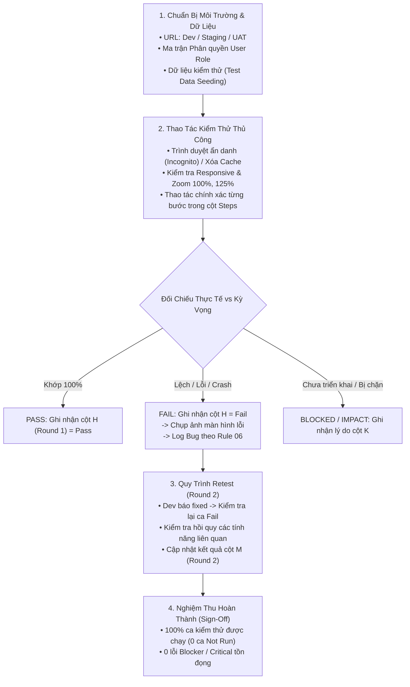

# QUY CHUẨN THỰC THI KIỂM THỬ THỦ CÔNG (UNIVERSAL MANUAL TEST EXECUTION STANDARD)
## Trụ Cột 4: Quy Trình Thực Thi Kiểm Thử Trên Môi Trường Thực Tế & Quản Lý Vòng Test (Pillar 4)

> [!IMPORTANT]
> **Mục tiêu:** Cung cấp quy chuẩn chi tiết cho Tester (hoặc AI tương tác trực tiếp trên giao diện) khi tiến hành **Thực thi kiểm thử thủ công (Manual Test Execution)**: từ chuẩn bị môi trường, ma trận tài khoản phân quyền, kỹ thuật thao tác trên trình duyệt, quy tắc ghi nhận kết quả Round 1 / Round 2 trên bảng tính, cho đến quy trình nghiệm thu (Sign-off) hoàn thành vòng test.
> - **Độc lập dự án (Project-Agnostic):** Áp dụng nhất quán cho mọi hệ thống phần mềm (Web B2B/B2C, SaaS, ERP, CRM, E-Commerce, Mobile Web).

---

## 1. QUY TRÌNH THỰC THI KIỂM THỬ THỦ CÔNG TỔNG THỂ

---

## 2. CHUẨN BỊ TRƯỚC KHI THỰC THI (PRE-EXECUTION READINESS)

Trước khi bắt đầu bấm vào ca kiểm thử đầu tiên, Tester bắt buộc hoàn thành 4 bước chuẩn bị:

### 2.1. Xác Định Môi Trường & Phiên Bản Build:
- Xác nhận đúng URL môi trường được chỉ định (Dev, Staging hoặc UAT).
- Ghi nhận mã phiên bản (Build Version / Commit Tag) đang chạy trên môi trường để đảm bảo các tính năng mới đã được deploy đầy đủ.

### 2.2. Thiết Lập Ma Trận Tài Khoản & Phân Quyền (Role Matrix):
Chuẩn bị sẵn danh sách tài khoản tương ứng với từng vai trò người dùng trong Spec:
- Tài khoản Quản trị tối cao (Super Admin / Master Admin).
- Tài khoản Quản trị phân quyền (Sub-admin / Staff).
- Tài khoản Đối tác / Đại lý (Agency / Merchant).
- Tài khoản Người dùng thông thường (Free User / End-User).
- Tài khoản bị khóa / hết hạn (Blocked / Expired User) để test negative.

### 2.3. Chuẩn Bị Dữ Liệu Kiểm Thử (Test Data Seeding):
- Đảm bảo cơ sở dữ liệu có sẵn các bản ghi mẫu:
  + Dữ liệu có nhiều dòng để kiểm tra phân trang (Pagination).
  + Dữ liệu có tên cực dài để kiểm tra độ giãn cột và cắt chữ `...`.
  + Tài khoản có số dư lớn, tài khoản có số dư bằng 0, tài khoản mới tạo chưa có giao dịch nào (để test Empty State).

### 2.4. Vệ Sinh Trình Duyệt (Browser Hygiene):
- **BẮT BUỘC:** Luôn mở cửa sổ ẩn danh (**Incognito / Private Window**) khi bắt đầu phiên test để tránh việc cookie hoặc cache JavaScript/CSS cũ làm sai lệch kết quả.
- Khi Dev vừa cập nhật bản vá lỗi: Bắt buộc nhấn tổ hợp phím **Hard Refresh** (`Ctrl + Shift + R` trên Windows hoặc `Cmd + Shift + R` trên Mac) để xóa toàn bộ cache trang web.

---

## 3. THAO TÁC THỰC THI & QUY TẮC ĐÁNH GIÁ TRẠNG THÁI (EXECUTION PROTOCOL)

Khi chạy từng dòng testcase trong bảng kiểm thử:

1. **Thực hiện đúng từng thao tác:**
   - Đọc kỹ `Pre-condition` $\rightarrow$ Thao tác tuần tự theo `Steps` $\rightarrow$ Quan sát giao diện và phản hồi hệ thống.
2. **Tiêu chuẩn đánh giá kết quả:**
   - **`Pass` (Đạt):** Kết quả thực tế (**Actual Result**) khớp hoàn toàn 100% với đặc tả kỳ vọng (**Expected Result**), không phát sinh lỗi giao diện, không văng console error.
   - **`Fail` (Không đạt):** Có bất kỳ sai lệch nào về nội dung text, sai công thức tính toán, nút bấm không phản hồi, báo mã lỗi sai, văng lỗi 500 hoặc crash màn hình.
   - **`Impact` (Bị ảnh hưởng):** Chức năng này bị ảnh hưởng gián tiếp do một chức năng khác bị lỗi (ví dụ: màn hình tạo mới bị lỗi nên không có dữ liệu để test màn hình danh sách).
   - **`Blocked` (Bị chặn):** Tính năng chưa được deploy hoặc bị khóa hoàn toàn, không thể tiếp tục thực hiện các bước tiếp theo.
   - **Để trống (`Not Run`):** Ca test chưa được thực thi. **TUYỆT ĐỐI KHÔNG GÕ CHỮ "Not Run" VÀO Ô ĐỂ TRÁNH LÀM SAI LỆCH CÔNG THỨC THỐNG KÊ.**

---

## 4. QUY CHUẨN GHI NHẬN KẾT QUẢ TRÊN BẢNG TÍNH 17 CỘT (GOOGLE SHEETS / EXCEL)

Theo quy chuẩn cấu trúc 17 cột tại [02_manual_ui_test_case_rule.md](02_manual_ui_test_case_rule.md):

| Khối | Cột | Tên Cột | Quy Chuẩn Ghi Nhận Khi Thực Thi |
| :---: | :---: | :--- | :--- |
| **Round 1** | **H** | **Round 1 (Result)** | • Chọn đúng giá trị: `Pass` (Chữ xanh), `Fail` (Chữ đỏ), `Impact` (Chữ vàng). • Tuyệt đối để trống nếu chưa chạy (Not Run). |
| | **I** | **Bug ID (R1)** | Link hoặc mã Bug phát sinh ở Round 1 sau khi log lên Jira/hệ thống bug (VD: `BUG-101`). |
| | **J** | **Status (R1)** | Trạng thái xử lý: `Open` (Mới phát hiện lỗi), `Fixing` (Đang sửa), `Closed` (Đã sửa). |
| | **K** | **Comment (R1)** | Ghi nhận chi tiết kết quả thực tế nếu có sai lệch, hoặc lý do bị Blocked / Impact. |
| | **L** | **Note (R1)** | Ghi chú nghiệp vụ / Trạng thái Q&A liên quan. |
| **Round 2** | **M** | **Round 2 (Result)** | • Dành riêng cho Retest sau khi Dev báo đã sửa xong bug. • Nếu ca đó ở Round 1 là `Pass` $\rightarrow$ Để trống cột M. • Nếu ca đó ở Round 1 là `Fail` $\rightarrow$ Sau khi test lại: điền `Pass` (nếu đã fix) hoặc `Fail` (nếu vẫn lỗi) hoặc `Not run`. |
| | **N** | **Bug ID (R2)** | Link hoặc mã Bug phát sinh thêm hoặc ticket liên quan ở Round 2. |
| | **O** | **Status (R2)** | Trạng thái xử lý lỗi Round 2: `Reopen`, `Closed`, v.v. |
| | **P** | **Comment (R2)** | Ghi nhận chi tiết kết quả thực tế khi retest Round 2. |
| | **Q** | **Note (R2)** | Ghi chú bổ sung Round 2. |

---

## 5. QUY TRÌNH RETEST & KIỂM THỬ HỒI QUY (RETEST & REGRESSION WORKFLOW)

Khi Developer thông báo đã sửa xong bug và deploy bản build mới:

1. **Verify lại chính xác ca kiểm thử bị Fail:**
   - Đọc lại `Bug Report` $\rightarrow$ Thực hiện lại đúng các bước tái hiện lỗi.
   - Nếu lỗi đã được khắc phục hoàn toàn $\rightarrow$ Cập nhật cột **M (Round 2) = `Pass`**, đóng bug trên Jira/hệ thống quản lý lỗi (`Status = Closed` tại cột O).
   - Nếu lỗi vẫn còn tồn tại $\rightarrow$ Cập nhật cột **M (Round 2) = `Fail`**, mở lại bug (`Status = Reopen` tại cột O) kèm ảnh chụp màn hình mới.
2. **Kiểm thử hồi quy (Regression Test):**
   - Chạy lại các ca kiểm thử xung quanh hoặc các tính năng có liên quan trực tiếp đến đoạn code vừa được sửa để đảm bảo việc sửa bug không làm phát sinh lỗi mới (Side-effect).

---

## 6. KIỂM THỬ ĐA NỀN TẢNG THỦ CÔNG (CROSS-BROWSER & RESPONSIVENESS)

Tester bắt buộc thực hiện kiểm tra thủ công thêm các góc nhìn sau trên giao diện:

1. **Cross-Browser:**
   - Kiểm tra giao diện và tính năng chính trên tối thiểu 2 trình duyệt phổ biến: Google Chrome và Safari (trên Mac/iOS) hoặc Microsoft Edge.
2. **Độ phân giải & Mức Zoom màn hình:**
   - Thử phóng to/thu nhỏ trình duyệt ở các mức: `80%`, `100%`, `125%`.
   - Kiểm tra: Dòng tiêu đề bảng (`Sticky Header`) và cột Thao tác (`Sticky Column`) có bị lệch hàng khi cuộn ngang/dọc hay không.
3. **Mạng chập chờn (Network Throttling):**
   - Mở DevTools (`F12`) $\rightarrow$ Tab Network $\rightarrow$ Chọn chế độ `Slow 3G`.
   - Bấm nút Submit/Lưu $\rightarrow$ Kiểm tra xem nút có bị vô hiệu hóa (disabled) ngay lập tức và hiển thị vòng xoay loading hay không (chống người dùng spam click nhiều lần tạo duplicate bản ghi).

---

## 7. TIÊU CHÍ NGHIỆM THU HOÀN THÀNH VÒNG TEST (MANUAL TEST SIGN-OFF)

Một vòng kiểm thử thủ công chỉ được coi là hoàn thành và đủ điều kiện bàn giao khi thỏa mãn đồng thời:
1. [ ] **Tỷ lệ thực thi đạt 100%:** Toàn bộ testcase trong phạm vi kế hoạch đều đã được chạy (không còn ca nào ở trạng thái Not Run).
2. [ ] **Chất lượng bug:** 
   - `0` lỗi Blocker (Lỗi chặn đứng hệ thống / Crash).
   - `0` lỗi Critical (Lỗi sai lệch dữ liệu tài chính, mất dữ liệu, hổng bảo mật).
   - Mọi lỗi Major / Minor còn lại phải được PO/BA xác nhận đồng ý dời sang đợt release tiếp theo.
3. [ ] **Xuất báo cáo kết quả kiểm thử:**
   - Tổng số ca test đã chạy, tỷ lệ Pass Rate (`Pass / Total`).
   - Tổng số bug phát hiện phân theo mức độ nghiêm trọng.
   - Danh sách bug đã fix và retest thành công.
