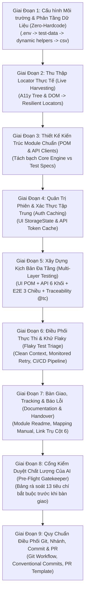
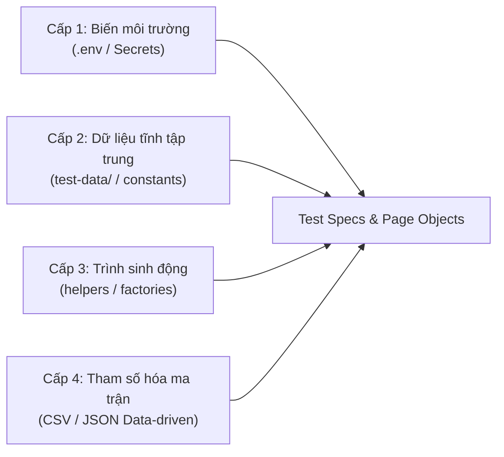
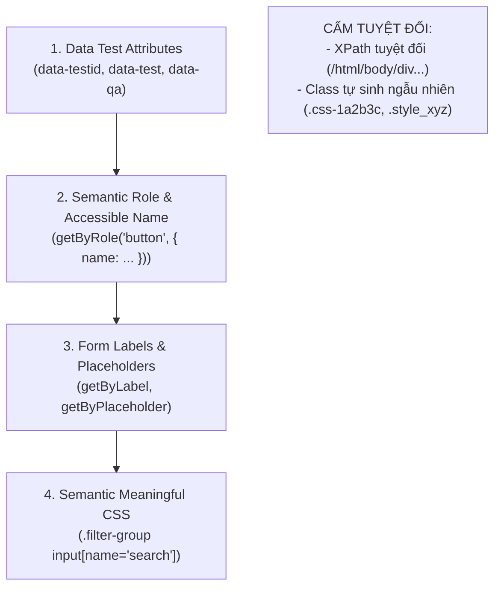
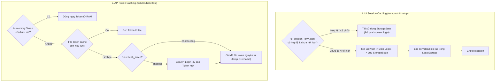
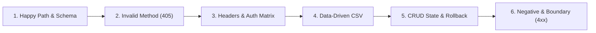

# QUY CHUẨN KIỂM THỬ TỰ ĐỘNG HÓA PHỔ QUÁT (UNIVERSAL AUTOMATION TESTING STANDARD)
## Trụ Cột 5: Động Cơ Sinh Mã Tự Động Hóa, Quản Trị Phiên & Điều Phối CI/CD (Pillar 5)

> [!IMPORTANT]
> **Tôn chỉ phổ quát (Universal & Project-Agnostic):**
> Bộ quy chuẩn này được thiết kế để áp dụng cho **bất kỳ dự án phần mềm nào** (Web, API, Mobile Web), độc lập với ngôn ngữ lập trình (TypeScript, JavaScript, Python, Java) và framework kiểm thử (Playwright, Cypress, Selenium, Pytest, v.v.):
> - **Tiếp nhận đầu vào từ Trụ cột 1, 2, 3:** Nhận danh mục UI Controls, kịch bản Manual UI Test Cases và Backend API Test Cases để chuyển hóa thành mã nguồn tự động hóa.
> - **Cấu hình độc lập (Config-Driven):** Tham số hóa toàn bộ môi trường, URL, tài khoản và cổng truy cập trực tiếp từ `.env` và `TEST_CONFIG.md`.
> - **Nguyên tắc Zero-Hardcode tuyệt đối:** Triệt tiêu hoàn toàn các giá trị gán cứng (URL, credentials, magic IDs, ngày tháng, thông điệp ngôn ngữ).
> - **Quản trị phiên thông minh (Session & Token Caching):** Tái sử dụng phiên UI và Token API, tự động làm mới (Auto-Refresh) và tự phục hồi khi mạng chập chờn (Transient Error Resilience).
> - **Xác thực 3 chiều toàn vẹn (Triple-Layer Assertion):** Đối chiếu chéo dữ liệu giữa **Giao diện (UI) $\leftrightarrow$ Dịch vụ mạng (API) $\leftrightarrow$ Cơ sở dữ liệu (Database)**.
> - **Tối ưu tốc độ & Khử Flaky:** Ứng dụng kỹ thuật chặn tài nguyên nặng (Resource Aborting) và cơ chế chờ động theo trạng thái (Smart Waiting).

---

## SƠ ĐỒ VÒNG ĐỜI PHÁT TRIỂN & THỰC THI (AUTOMATION LIFECYCLE FLOW)

Mọi kịch bản kiểm thử tự động được thiết kế, sinh mã và vận hành tuần tự qua 9 giai đoạn khép kín:



---

## GIAI ĐOẠN 1: CẤU HÌNH MÔI TRƯỜNG & NGUYÊN TẮC ZERO-HARDCODE

> [!CAUTION]
> **Quy định nghiêm ngặt:** AI khi sinh mã kiểm thử tự động **tuyệt đối không được gán cứng bất kỳ giá trị literal nào** trực tiếp trong file kiểm thử (`specs/`) hoặc Page Object (`pages/`).

Mọi dữ liệu kiểm thử bắt buộc phải được phân tầng qua **Kiến trúc Dữ liệu 4 Cấp**:



### 1.1. Phân bổ dữ liệu chuẩn hóa:
1. **Cấp 1 - Môi trường & Thông tin nhạy cảm (`.env` / Environment Variables):**
   - Base URLs (`UI_BASE_URL`, `API_BASE_URL`).
   - Thông tin xác thực (`ADMIN_EMAIL`, `ADMIN_PASSWORD`, `BASIC_AUTH_USER`, `BASIC_AUTH_PASS`).
   - Target IDs đặc thù của môi trường (`TEST_MODEL_ID`, `TEST_PACKAGE_ID`, `SAMPLE_USER_ID`).
2. **Cấp 2 - Dữ liệu tĩnh, Bộ Selector tập trung & Từ điển giao diện (`test-data/`):**
   - **Tập hợp Selectors tĩnh (`selectors: { ... }`):** Toàn bộ chuỗi CSS, XPath, aria-label, role template phải được khai báo dạng biến tại đây (VD: `selectors.breadcrumb`, `selectors.searchInput`).
   - **Bảng ánh xạ vị trí cột (`selectors.columns: { ... }`):** Định nghĩa index ngữ nghĩa của từng cột trong bảng dữ liệu (VD: `{ id: 0, agencyCode: 1, streamerCount: 4 }`) để triệt tiêu magic index `nth(4)`.
   - **URL Templates & Dynamic Query Builders:** `detailUrl: (id) => \`/items/detail/\${id}\`` và `buildQuery: (params) => new URLSearchParams(params).toString()`.
   - Nhãn nút bấm, tiêu đề bảng, selector regex, placeholder (hỗ trợ đa ngôn ngữ i18n).
   - Danh mục mã thông điệp lỗi hệ thống mong đợi (`ERROR_MESSAGES.*`).
   - Thời gian chờ tiêu chuẩn (`timeouts: { pageLoad: 15000, modal: 5000, action: 10000, suite: 60000 }`).
   - Đường dẫn tài nguyên mẫu để upload (`assets.sampleBannerPath`).
3. **Cấp 3 - Quản trị Toàn diện Dữ liệu Động & Trình sinh dữ liệu (Universal Dynamic Data Governance):**
   Mọi dữ liệu kiểm thử mang tính động bắt buộc phải tuân thủ chuẩn hóa 5 nhóm sau:
   - **Dynamic Identifiers & Random Entities:**
     + **CẤM:** Gán cứng ID hoặc Code bản ghi cố định (như `id = 1`, `code = "AG001"`).
     + **BẮT BUỘC:** Lấy từ biến môi trường (`process.env.TEST_TARGET_ID`), truy vấn động từ DB/API, hoặc sinh động có tiền tố thời gian/ngẫu nhiên: `generateUniqueCode("AG")`, `generateTestEmail()`. Đảm bảo tính **Idempotent** khi chạy lại test nhiều lần không bị duplicate key conflict.
   - **Dynamic Dates & Timestamps:**
     + **CẤM:** Điền ngày tháng cố định (VD: `"2026-11-16"`).
     + **BẮT BUỘC:** Sử dụng Dynamic Date Helpers: `getToday(format)`, `getFutureDate(offsetDays, format)`, `getPastDate(offsetDays, format)`, `getDateRange(startOffset, endOffset, format)`.
   - **Dynamic URLs & Query Parameters:**
     + **CẤM:** Nối chuỗi URL query thủ công trong spec (VD: `goto("q=Tokyo&status=1")`, `goto("page=-1")`).
     + **BẮT BUỘC:** Dùng hàm builder đóng gói tham số: `routes.buildAgencyListQuery({ page: 1, q: keyword, status: 1 })`.
   - **Dynamic Request Payloads & Form Data:**
     + **CẤM:** Dùng object JSON tĩnh cho các ca kiểm thử tạo mới (Create Mutation).
     + **BẮT BUỘC:** Áp dụng **Data Factory Pattern** (`buildAgencyPayload(overrides)`) sinh tự động các trường bắt buộc kèm giá trị ngẫu nhiên hợp lệ.
   - **Dynamic Assertions & Schema Matching:**
     + **CẤM:** So khớp cứng các trường tự sinh từ máy chủ: `expect(res.id).toBe(10)`, `expect(res.created_at).toBe("2026-11-16")`.
     + **BẮT BUỘC:** Dùng Schema Matcher (`expect.any(Number)`, `expect.any(String)`), Regex Matching (`expect.stringMatching(/^\d{4}-\d{2}-\d{2}/)`), hoặc so sánh tương đối với mốc thời gian bắt đầu test (`toBeGreaterThanOrEqual(testStartTime)`).
4. **Cấp 4 - Dữ liệu kiểm thử hướng dữ liệu (Data-driven CSV / JSON):**
   - Đưa các ma trận kiểm thử tham số phân trang, giá trị biên, tìm kiếm vào file `.csv` hoặc `.json` để nạp tự động thay vì viết lặp mã nguồn.

---

## GIAI ĐOẠN 2: THU THẬP & ĐỊNH DANH PHẦN TỬ BỀN VỮNG (RESILIENT LOCATORS)

### 2.1. Thứ tự ưu tiên định danh phần tử (Locator Priority Hierarchy):
Để đảm bảo mã kiểm thử không bị gãy khi UI thay đổi giao diện, AI tuân thủ thứ tự ưu tiên:



### 2.2. Giao thức thu thập Locator thực tế (Live Locator Harvesting Protocol):
Khi sinh mã tự động, nếu có công cụ hỗ trợ (như Chrome DevTools MCP hoặc trình duyệt headless):
1. **Khởi tạo phiên duyệt:** Truy cập trực tiếp môi trường Dev/Staging thực tế theo cấu hình tại `TEST_CONFIG.md` / `.env`.
2. **Bóc tách cây Accessibility (A11y Tree) & DOM Snapshot:**
   - Quét các phần tử tương ứng với danh mục UI Controls đã được bóc tách từ Trụ cột 1 & 2.
   - Trích xuất định danh theo đúng thứ tự ưu tiên của Mục 2.1.
3. **Xử lý tình huống ngoại lệ:**
   - **Màn hình chưa deploy:** Tạm thời sinh locator suy luận từ Spec/HTML và đánh dấu cờ `// [Pending Live Verification]`.
   - **iFrame / Shadow DOM:** Khai báo locator chuyển ngữ cảnh (`page.frameLocator(...)`).

### 2.3. Quy Chuẩn Quản Trị Selector Tập Trung (Centralized Selector Management):
> [!CAUTION]
> **CẤM TUYỆT ĐỐI VIẾT RAW SELECTOR STRINGS:**
> Không được viết bất kỳ chuỗi selector CSS, XPath, hoặc test-id literal nào (VD: `'.breadcrumb, [aria-label="Breadcrumb"]'`, `'.data-table'`, `'input[name="q"]'`) trực tiếp trong file Page Object hoặc Test Spec.

Toàn bộ selector tĩnh phải được quy hoạch tập trung tại `src/test-data/[module]Data.js` theo cấu trúc:
```javascript
export const moduleData = {
  selectors: {
    // 1. Selector chuỗi tĩnh duy nhất
    breadcrumb: '.breadcrumb, [aria-label="Breadcrumb"]',
    searchInput: 'input[type="text"][name="q"], input[type="search"]',
    dataTable: '.data-table, [data-testid="agency-table"]',
    loadingSpinner: '.loading-spinner, [data-testid="loading-indicator"]',
    emptyState: '.empty-state, [data-testid="empty-state"]',
    paginationContainer: '.pagination, [aria-label="Pagination"]',
    
    // 2. Bảng ánh xạ vị trí cột ngữ nghĩa (Semantic Column Index Mapping)
    // CẤM DÙNG MAGIC INDEX (.nth(4)): Bắt buộc dùng biến ánh xạ này
    columns: {
      id: 0,
      agencyCode: 1,
      agencyName: 2,
      contactOwner: 3,
      streamerCount: 4,
      pointSales: 5,
      familiaSales: 6,
      totalSales: 7,
      status: 8,
      createdAt: 9,
      updatedAt: 10,
    },
  },
  // ...
};
```

### 2.4. Chuẩn Hóa Locator Động & Selector Tham Số Hóa (Parameterized Locators):
> [!IMPORTANT]
> **Quy tắc phân định Static Locators vs Dynamic Locators trong Page Object:**
> - **Static Locators (Chỉ phần tử tĩnh duy nhất trên màn hình):** Được phép khai báo trong `constructor(page)` nhưng **BẮT BUỘC** phải tham chiếu 100% qua biến `moduleData.selectors.*`.
> - **Dynamic Locators (Phần tử biến thiên theo dữ liệu runtime):** Tuyệt đối **CẤM GÁN CHẾT VÀO CONSTRUCTOR** với 1 nhãn đơn lẻ (như `this.sidebarMenu = page.getByRole("button", { name: label })`). Bắt buộc phải đóng gói thành các **Hàm nhận tham số (Parameterized Locator Methods)**:

```javascript
export class ModulePage {
  constructor(page) {
    this.page = page;
    // 1. Static Locators: Tham chiếu 100% qua biến tập trung
    this.searchInput = page.locator(moduleData.selectors.searchInput);
    this.table = page.locator(moduleData.selectors.dataTable);
    this.tableRows = this.table.locator("tbody tr");
  }

  // 2. Dynamic Locators: Hàm nhận tham số linh hoạt
  getSidebarMenu(menuName = moduleData.labels.sidebarMenu) {
    return this.page.getByRole("button", { name: menuName });
  }

  getSidebarSubmenu(submenuName = moduleData.labels.sidebarSubmenu) {
    return this.page.getByRole("link", { name: submenuName });
  }

  getTableCell(rowIndex, columnName) {
    const colIndex = moduleData.selectors.columns[columnName];
    return this.tableRows.nth(rowIndex).locator("td").nth(colIndex);
  }

  getTableRowById(entityId) {
    return this.tableRows.filter({ has: this.page.locator(`td:text("${entityId}")`) });
  }

  getPageNumberButton(pageNumber) {
    return this.page.getByRole("button", { name: String(pageNumber), exact: true });
  }
}
```

---

## GIAI ĐOẠN 3: THIẾT KẾ KIẾN TRÚC MÃ NGUỒN PHÂN TẦNG (POM & API CLIENTS)

Mọi bộ mã kiểm thử tự động phải phân tách rành mạch thành 2 tầng:

```
[project_root]/
├── .env.example                     # Mẫu biến môi trường
├── .env.[env]                       # File cấu hình môi trường cụ thể (dev, staging, prod)
├── config_file (vd: playwright.config.js) # Cấu hình runner, multi-project, timeouts
├── src/ (hoặc core/)                # TẦNG LÕI HỆ THỐNG (RE-USABLE CORE ENGINE)
│   ├── config/
│   │   └── endpoint.*               # Nạp ENV động, Base URLs, danh mục Route Endpoints
│   ├── fixtures/
│   │   └── baseTest.*               # Mở rộng Test Context (AuthenticatedClient, DB, Pages)
│   ├── pages/                       # Page Object Model (Chỉ chứa Locators & Actions)
│   │   ├── LoginPage.*
│   │   └── [Module]Page.*
│   ├── api/                         # API Client Wrappers (Đóng gói HTTP Requests theo Module)
│   │   ├── AuthAPI.*
│   │   └── [Module]API.*
│   ├── test-data/                   # Dữ liệu kiểm thử tập trung (Single Source of Truth)
│   │   ├── [module]Data.*           # Labels, Timeouts, Regex, Payloads mẫu
│   │   ├── commonData.*             # Header matrices, Auth matrices, Generic errors
│   │   ├── assets/                  # File mẫu upload (ảnh, pdf, csv)
│   │   └── csv/                     # File CSV phục vụ Data-driven testing
│   └── utils/                       # Bộ công cụ dùng chung
│       ├── constants.*              # HTTP Methods, Status Codes, Content-Types
│       ├── helpers.*                # Dynamic Date helpers, Random Generator, Data Factory
│       ├── csvHelper.*              # Đọc và parse dữ liệu CSV sang mảng Test Cases
│       └── db.helper.*              # Client truy vấn trực tiếp CSDL (PostgreSQL, MySQL...)
└── tests/ (hoặc specs/)             # TẦNG KỊCH BẢN KIỂM THỬ (EXECUTION SPECS)
    ├── auth/
    │   └── admin.setup.*            # Global Setup: Login 1 lần và cache session/token
    ├── ui/
    │   └── [mã_màn].ui.spec.*       # Kịch bản UI theo ID Spec (VD: ad100.ui.spec.js)
    ├── api/
    │   └── [mã_màn].api.spec.*      # Kịch bản API theo ID Spec (VD: ad100.api.spec.js)
    └── e2e/
        └── [mã_màn].e2e.spec.*      # Kịch bản E2E theo ID Spec (VD: ad100.e2e.spec.js)
```

### 3.1. Quy chuẩn Đặt tên File Đồng bộ theo Mã Màn hình (Spec ID Naming Standard):
> [!IMPORTANT]
> **Tôn chỉ truy xuất nguồn gốc 1:1 (Traceability & Spec-Driven Naming):**
> Toàn bộ file mã nguồn kiểm thử tự động sinh ra **BẮT BUỘC ĐẶT TÊN THEO MÃ MÀN HÌNH (SPEC ID / SCREEN ID)** tương ứng trong Spec.
> **TUYỆT ĐỐI CẤM:** Thêm tiền tố số thứ tự ma thuật tùy tiện (`01.`, `05.`, `06.`, `[stt].`) làm gãy đứt liên kết tìm kiếm trực tiếp giữa Spec $\leftrightarrow$ Manual Testcase $\leftrightarrow$ Automation Script.

#### Bảng Quy Chuẩn Định Danh File Toàn Diện:
| Thành phần Automation | Cú pháp đặt tên bắt buộc | Ví dụ thực tế (Mã `AD100`) | Quy cách chữ (Case) |
| :--- | :--- | :--- | :--- |
| **Kịch bản UI Spec** | `tests/ui/[mã_màn].ui.spec.js` | `tests/ui/ad100.ui.spec.js` | `[mã_màn]` viết thường |
| **Kịch bản API Spec** | `tests/api/[mã_màn].api.spec.js` | `tests/api/ad100.api.spec.js` | `[mã_màn]` viết thường |
| **Kịch bản E2E Spec** | `tests/e2e/[mã_màn].e2e.spec.js` | `tests/e2e/ad100.e2e.spec.js` | `[mã_màn]` viết thường |
| **Page Object Model** | `src/pages/[MÃ_MÀN]Page.js` (hoặc `[MÃ_MÀN]_[VaiTrò]_[TênMàn]Page.js` / `[MÃ_MÀN][TênChứcNăng]Page.js`) | `src/pages/AA000Page.js` hoặc `src/pages/AD100AgencyListPage.js` | `PascalCase` giữ nguyên mã màn viết hoa |
| **API Client Wrapper** | `src/api/[MÃ_MÀN]API.js` (hoặc `[MÃ_MÀN]_[VaiTrò]_[TênMàn]API.js` / `[MÃ_MÀN][TênChứcNăng]API.js`) | `src/api/AA000API.js` hoặc `src/api/AD100AgencyAPI.js` | `PascalCase` giữ nguyên mã màn viết hoa |
| **UI Test Data** | `src/test-data/[mã_màn]Data.js` | `src/test-data/ad100Data.js` | `camelCase` (mã màn viết thường + `Data.js`) |
| **API Test Data Matrix** | `src/test-data/api[Mã_Màn]Data.js` | `src/test-data/apiAd100Data.js` | `camelCase` (tiền tố `api` + mã màn + `Data.js`) |
| **Tài liệu Bàn giao** | `automation/[MÃ_MÀN]_readme.md` | `automation/AD100_readme.md` | `[MÃ_MÀN]` viết hoa + `_readme.md` |

> [!NOTE] **Quy ước định danh riêng cho LoginPage / Màn hình Đăng nhập:**
> - **Ưu tiên 1 (Chỉ để mỗi mã màn):** `src/pages/[MÃ_MÀN]Page.js` (Ví dụ: `AA000Page.js`).
> - **Ưu tiên 2 (Nếu để cả tên màn):** Bắt buộc theo đúng định dạng `[ID]_[Admin/Agency]_[Tên_màn]Page.js` để phân định rõ ràng giữa cổng Admin và Agency (Ví dụ: `AA000_Admin_LoginPage.js` cho cổng Master Admin, `BA100_Agency_LoginPage.js` cho cổng Agency Portal). Áp dụng tương tự cho API Client (`AA000API.js` hoặc `AA000_Admin_AuthAPI.js`).

### Quy tắc bất biến của Tầng Lõi:
- **Tầng Page Object (`pages/`):** Chỉ chứa khai báo phần tử (Locators) và hàm tương tác người dùng (`fillSearchForm()`, `clickSubmitButton()`). **CẤM TUYỆT ĐỐI:** Không viết câu lệnh `expect / assert` logic nghiệp vụ trong Page Object để tránh làm vỡ tính tái sử dụng.
- **Tầng API Client (`api/`):** Chỉ đóng gói logic gửi nhận request HTTP (`GET`, `POST`, `PUT`, `PATCH`, `DELETE`). Trả về raw response để tầng Spec kiểm tra.
- **Tầng Test Spec (`tests/`):** Nơi duy nhất chứa các câu lệnh kiểm tra kỳ vọng (`expect`), mỗi test case phải độc lập, không phụ thuộc vào thứ tự chạy của nhau.

---

## GIAI ĐOẠN 4: QUẢN TRỊ PHIÊN & XÁC THỰC TẬP TRUNG (SESSION & TOKEN CACHING)

CẤM thực hiện bước đăng nhập từ đầu cho mọi test case. Bắt buộc áp dụng cơ chế 2 tầng:



### 4.1. Quản trị phiên Giao diện (UI StorageState Caching):
1. **Kiểm tra hạn sử dụng:** Bóc tách payload JWT từ cookie `access_token`. Nếu hạn dùng còn trên 5 phút thì lập tức tái sử dụng, không mở browser để đăng nhập lại.
2. **Lọc sạch dữ liệu rác:** Tự động loại bỏ các key cache dung lượng lớn không cần thiết trong `localStorage` (như blob media, stream cache) trước khi ghi file session để giữ file gọn nhẹ.
3. **Cấu hình Runner:** Toàn bộ Project UI và E2E đều phụ thuộc vào bước `setup` và nạp sẵn `storageState` để vào thẳng màn hình chức năng.

### 4.2. Quản trị Token Dịch vụ & HTTP Client Tự Phục Hồi (Resilience Client):
1. **3 cấp kiểm tra Token:** In-memory Cache (RAM) $\rightarrow$ File Token Cache $\rightarrow$ Refresh Token API $\rightarrow$ Full API Login.
2. **Ghi file nguyên tử (Atomic Write):** Ghi token tạm vào `${authFile}.${pid}.${timestamp}.tmp` sau đó dùng lệnh đổi tên (`rename`) để tránh xung đột file khi nhiều worker chạy song song.
3. **Tự phục hồi lỗi mạng tạm thời (Transient Error Handling):**
   - Đóng gói request context vào `CustomApiClient`.
   - Khi API gặp mã lỗi tạm thời từ Gateway Dev/Staging (`502 Bad Gateway`, `503 Service Unavailable`, `504 Gateway Timeout`), tự động chờ một khoảng ngắn (jitter backoff) và retry 01 lần duy nhất trước khi đánh Fail.
   - Khi gặp `401 Unauthorized` hoặc `403 Forbidden`, tự động xóa file cache token để buộc phiên tiếp theo lấy token mới.

---

## GIAI ĐOẠN 5: XÂY DỰNG KỊCH BẢN ĐA TẦNG (MULTI-LAYER TESTING)

### 5.1. Kịch bản Kiểm thử Giao diện (UI Testing):
1. **Chặn tài nguyên nặng (Resource Aborting):**
   Trong mọi test suite UI và E2E không liên quan đến kiểm thử trực quan (Visual Regression), bắt buộc chặn nạp các file hình ảnh/video nặng:
   ```javascript
   await page.route(/\.(png|jpeg|jpg|webp|gif|svg|mp4)$/, (route) => route.abort());
   ```
   *Hiệu quả:* Giảm từ 50% - 80% thời gian tải trang, triệt tiêu lỗi chập chờn do nghẽn mạng tải assets.
2. **Cơ chế chờ động thông minh (Smart Waiting):**
   - **CẤM:** Tuyệt đối không dùng `sleep(5000)` hay lệnh chờ thời gian cố định.
   - **BẮT BUỘC:** Chờ theo vòng đời phần tử hoặc sự kiện mạng:
     + Chờ DOM hiển thị: `await pageHeading.waitFor({ state: "visible", timeout: timeouts.pageLoad })`
     + Chờ Spinner biến mất: `await spinner.waitFor({ state: "detached", timeout: timeouts.modal })`
     + Chờ hoàn tất request mạng:
       ```javascript
       const [response] = await Promise.all([
         page.waitForResponse(resp => resp.url().includes('/api/v1/...') && resp.request().method() === 'POST'),
         submitButton.click()
       ]);
       ```

### 5.2. Kịch bản Kiểm thử API 6 Khối Chuẩn Mực (API Test Anatomy):
Mỗi file kiểm thử API (`*.api.spec.*`) phải tổ chức thành đúng 6 khối kịch bản chuyên biệt:



1. **Khối 1 - Happy Path & Schema Integrity:** Kiểm tra `200 OK` / `201 Created`, Content-Type hợp lệ. So khớp cấu trúc schema (`toMatchObject`) với các trường bắt buộc, kiểu dữ liệu (`expect.any(Number)`, `expect.any(String)`).
2. **Khối 2 - Invalid HTTP Methods (405):** Gửi các HTTP Method không hỗ trợ (gửi `PUT/DELETE/PATCH` vào endpoint chỉ đọc `GET`) $\rightarrow$ Kỳ vọng `405 Method Not Allowed`.
3. **Khối 3 - Headers & Auth Matrix:**
   - *Accept Header:* Gửi các giá trị `application/json`, `*/*`, `text/html` để xác nhận hành vi phản hồi.
   - *Auth Matrix:* Chạy qua các ca: không kèm token, token rác, token giả mạo, token hết hạn $\rightarrow$ Kỳ vọng `401` hoặc `403`.
4. **Khối 4 - Query Parameters (Data-Driven CSV):** Đọc danh sách ca test từ file `.csv`. Kiểm tra phân trang (`page`, `limit`), sắp xếp, lọc theo điều kiện biên (BVA).
5. **Khối 5 - CRUD State Mutation & Safe Rollback:**
   - Khi test các thao tác ghi dữ liệu (`POST / PUT / PATCH / DELETE`):
     + *Bước 1:* Lưu lại trạng thái gốc trước khi sửa (Snapshot).
     + *Bước 2:* Thực hiện cập nhật dữ liệu mới và verify kết quả.
     + *Bước 3 (Bắt buộc):* Chạy lệnh **Rollback** khôi phục lại dữ liệu ban đầu để bảo toàn môi trường test.
6. **Khối 6 - Negative & Input Validation (400/422):** Gửi payload thiếu trường bắt buộc, giá trị âm, sai định dạng $\rightarrow$ Kiểm tra thông báo lỗi trả về khớp với hằng số `ERROR_MESSAGES.*`.

### 5.3. Kịch bản E2E & Xác thực 3 Chiều Toàn Vẹn (Triple-Layer Validation - Trụ Cột 7):
Đối với các luồng nghiệp vụ quan trọng: Bắt buộc áp dụng **Trụ Cột 7 ([07_database_testing_rule.md](07_database_testing_rule.md))** để đối chiếu chéo dữ liệu giữa **Giao diện (UI) $\leftrightarrow$ Dịch vụ mạng (API) $\leftrightarrow$ Cơ sở dữ liệu (Database)**:
```typescript
test("TC_E2E_01: Verify entity data consistency across UI, API and Database", async ({ page, authenticatedRequest, db }) => {
  // 1. Lấy dữ liệu qua API
  const apiRes = await authenticatedRequest.get(`/api/v1/entities/${entityId}`);
  const apiData = await apiRes.json();

  // 2. Truy vấn trực tiếp Cơ sở dữ liệu theo Trụ Cột 7 (Read-Only)
  const dbData = await db.getEntityById(entityId);

  // 3. Đối chiếu 3 chiều: API vs DB vs UI
  expect(apiData.name).toBe(dbData.name);
  expect(apiData.status).toBe(dbData.status);

  // 4. Đối chiếu UI vs DB (Xác nhận hiển thị và trạng thái không bị lỗi ngầm)
  await page.goto(`/entities/detail/${entityId}`);
  await expect(page.getByTestId('entity-name')).toHaveText(dbData.name);
  expect(new Date(dbData.updated_at).getTime()).toBeGreaterThan(testStartTime);
});
```

#### Quy tắc quản lý dữ liệu kiểm thử tự động (DB Seeding & Teardown Rule):
- **Pre-test Seeding:** Khi kịch bản cần dữ liệu mẫu đặc thù (User chưa kích hoạt, đơn hàng chờ duyệt...), test runner ưu tiên truy vấn DB thông qua `db.helper` để tìm bản ghi phù hợp thay vì gán cứng ID (Zero-Hardcoding).
- **Post-test Teardown:** Các bản ghi được sinh ra trong phiên test bắt buộc phải được gắn prefix định danh duy nhất (Timestamp / UUID) và được thu hồi/dọn dẹp trong hook `afterAll` hoặc qua API cleanup để tránh làm bẩn CSDL kiểm thử.

### 5.4. Quy chuẩn truy xuất nguồn gốc (Traceability Mapping: Manual -> Automation):
Mọi ca kiểm thử trong tầng `specs/` bắt buộc phải gắn mã định danh của Test Case Manual từ Trụ cột 2 & 3:
```typescript
// @tc: TC_MODULE_01 - Tìm kiếm thành công với từ khóa hợp lệ
test('TC_MODULE_01: Verify search returns matching results', async ({ page }) => {
  const modulePage = new ModulePage(page);
  await modulePage.search(moduleData.search.validKeyword);
  await expect(page.getByRole('table')).toContainText(moduleData.search.validKeyword);
});
```

### 5.5. Quy chuẩn Triển khai Data-Driven Testing & Chống Sinh Mã Minh Họa (Anti-Scaffolding Standard):
- **Nguyên tắc Zero-Scaffolding (Cấm sinh code khung / làm mẫu):**
  Nghiêm cấm tuyệt đối việc AI chỉ chọn lọc một vài ca đơn lẻ để viết test "làm mẫu" rồi bỏ qua hàng chục hoặc hàng trăm ca kiểm thử khác đã được thiết kế trong `testcase_ui/` và `testcase_api/`.
- **Cơ chế chuyển đổi Data-Driven bắt buộc:**
  Đối với các nhóm kiểm thử có số lượng ca lớn (hàng chục đến hàng trăm ca API viewpoints, boundary values, negative validation, security payloads):
  1. **Đóng gói ma trận ca kiểm thử:** Toàn bộ danh mục test case được đưa vào mảng dữ liệu tập trung tại thư mục `src/test-data/` (Ví dụ: `api[Module]Data.js` hoặc `[module]Data.js`). Mỗi phần tử định nghĩa rõ: `{ id, title, method, payload, expectedStatus, expectedError }`.
  2. **Thực thi lặp tuần tự bằng Playwright Runner:** Trong file test spec (`tests/api/` hoặc `tests/ui/`), bắt buộc sử dụng vòng lặp để sinh ra từng ca test độc lập:
     ```javascript
     for (const tc of testMatrix) {
       test(`[${tc.id}] ${tc.title}`, async () => {
         const response = await client.sendRequest({ method: tc.method, data: tc.payload });
         expect(response.status()).toBe(tc.expectedStatus);
         if (tc.expectedError) {
           expect(await response.json()).toMatchObject(tc.expectedError);
         }
       });
     }
     ```
  $\rightarrow$ Đảm bảo toàn bộ 100% các ca kiểm thử thuộc nhóm `Auto-API` và `Auto-Data` được chạy độc lập, có báo cáo kết quả chi tiết từng ca mà mã nguồn vẫn gọn gàng, có tính bảo trì cao.

---

## GIAI ĐOẠN 6: ĐIỀU PHỐI THỰC THI & KHỬ FLAKY (FLAKY TEST TRIAGE)

1. **Phân lập môi trường chạy (Clean Context):**
   - Mỗi ca kiểm thử phải khởi tạo trong một Context sạch, xóa sạch cookie và local storage tạm, không dùng chung session rác của ca test trước.
2. **Quy trình xử lý ca test chập chờn (Flaky Test Triage Protocol):**
   - Khi một ca kiểm thử bị Fail trong quá trình chạy tự động:
     + **Tự động Retry 01 lần duy nhất** trong một session mới và bật chế độ ghi vết (`trace: 'on-first-retry'`).
     + Nếu lần 2 **PASS**: Đánh dấu trạng thái `PASS [Flaky]` kèm cảnh báo log nguyên nhân (VD: do trễ mạng hoặc animation delay), không được đánh Pass sạch sẽ.
     + Nếu lần 2 tiếp tục **FAIL**: Đánh dấu chính thức `FAIL`, thu thập bằng chứng lỗi (screenshot, video, network logs) và kích hoạt quy trình Log Bug theo [06_bug_reporting_rule.md](06_bug_reporting_rule.md).

---

## GIAI ĐOẠN 7: BÀN GIAO, TRACKING & BẢNG ĐỐI SOÁT ĐỘ PHỦ ĐỊNH LƯỢNG

- **Thư mục lưu trữ tài liệu theo dõi:** `automation/`
- **Định dạng file theo dõi kịch bản chuyển đổi:** `automation/[Tên_Module]_readme.md` *(Ví dụ: `automation/GachaLimited_readme.md`, `automation/UserManagement_readme.md`, `automation/AD100_readme.md`)*.
- **Nội dung bắt buộc trong file readme:**
  1. **Bảng Thống kê Tỷ lệ Chuyển đổi Định lượng (Quantitative Coverage Audit):**
     Bắt buộc thống kê rõ ràng số liệu toán học:
     | Tiêu chí | Số lượng | Tỷ lệ chuyển đổi |
     | :--- | :---: | :---: |
     | **Tổng số ca kiểm thử UI nguồn** (`testcase_ui/`) | $N_{\text{UI}}$ | - |
     | **Tổng số ca kiểm thử Backend API nguồn** (`testcase_api/`) | $N_{\text{API}}$ | - |
     | **Số ca phân loại Manual-Only** (kèm lý do chuẩn) | $N_{\text{Manual}}$ | - |
     | **Tổng số ca Playwright Auto thực tế sinh ra** | $N_{\text{Auto}}$ | **$\frac{N_{\text{Auto}}}{N_{\text{UI}} + N_{\text{API}} - N_{\text{Manual}}} \ge 80\%$** |
  2. **Danh mục Automated:** Danh sách các mã test case manual (TC ID) đã được tự động hóa kèm đường dẫn file spec tương ứng.
  3. **Danh mục Manual Only:** Danh sách các ca không thể tự động hóa kèm lý do rõ ràng (CAPTCHA, OTP SMS qua điện thoại vật lý, phần cứng 3rd party, visual UX...).
  4. **Lệnh chạy nhanh (Quick Run Commands):**
     ```bash
     npm run test:[module]:ui
     npm run test:[module]:api
     npm run test:[module]:e2e
     ```
- **Nghiêm cấm:** Tuyệt đối không lưu file script hoặc file readme tự do ở thư mục gốc.

---

## GIAI ĐOẠN 8: CỔNG KIỂM DUYỆT CHẤT LƯỢNG CỦA AI (PRE-FLIGHT GATEKEEPER)

Trước khi kết thúc lượt sinh mã, AI bắt buộc phải tự quét lại toàn bộ file sinh ra theo bảng 8 tiêu chí kiểm duyệt:

| Tiêu chí kiểm duyệt | Dấu hiệu vi phạm (NGHIÊM CẤM) | Cách khắc phục chuẩn |
| :--- | :--- | :--- |
| **1. URL & Account** | Xuất hiện `'http://'`, `'https://'`, email/password string | Đọc qua `process.env.*` hoặc file cấu hình tập trung. |
| **2. Target IDs** | Gán cứng số ID (`id = 45`, `code = 'A102'`) | Đọc từ `process.env.TEST_TARGET_ID` hoặc truy vấn động từ DB/API. |
| **3. Magic Values & Enum** | Viết số/chuỗi trực tiếp (`type: 2`, `status === 1`) | Định nghĩa Enum/Object trong `constants` hoặc `test-data`. |
| **4. Thông báo lỗi & Nhãn UI** | Viết chuỗi hiển thị trực tiếp trong lệnh `expect()` | Tham chiếu từ hằng số `ERROR_MESSAGES.*` hoặc `labels.*`. |
| **5. Thời gian & Ngày tháng** | Điền chuỗi ngày cố định dạng `YYYY-MM-DD` | Sử dụng helper động `getToday()`, `getFutureDate()`, `getDateRange()`. |
| **6. Timeouts** | Gán số thời gian chờ tự do (`{ timeout: 5000 }`) | Tham chiếu từ `data.timeouts.modal`. |
| **7. Asset Upload Path** | Viết đường dẫn file trực tiếp trong test spec | Định nghĩa tập trung trong `test-data/assets`. |
| **8. Quantitative Coverage Audit** | Sinh code "làm mẫu" (Scaffold/Skeleton), tỷ lệ ca auto < 70% tổng testcase | Tự động đếm số block `test(` thực tế trong các file spec (`tests/ui/`, `tests/api/`, `tests/e2e/`). Bắt buộc đạt tỷ lệ chuyển đổi $\ge 70\% - 80\%$. Nếu chưa đạt, tiếp tục bổ sung các ca kiểm thử còn thiếu trước khi bàn giao. |
| **9. Raw Selector Strings** | Xuất hiện raw CSS/XPath/ID inline trong POM hoặc Spec (VD: `locator('.breadcrumb')`, `locator('input[name="q"]')`) | Khai báo 100% trong `src/test-data/[module]Data.js` (`selectors: { ... }`). |
| **10. Parameterized Dynamic Locators** | Gán chết nhãn/option vào constructor (VD: `this.menu = page.getByRole('button', { name: '事務所' })`) | Viết thành hàm nhận tham số trong POM: `getSidebarMenu(name)`, `getOption(text)`. |
| **11. Magic Column & Row Index** | Dùng số thứ tự cột ma thuật (VD: `locator('td').nth(4)`, `cellTexts[1]`) | Ánh xạ qua `selectors.columns[columnName]` hoặc data-attribute ngữ nghĩa. |
| **12. Dynamic Query & Payloads** | Viết query string hoặc payload tĩnh (VD: `goto("q=Tokyo&status=1")`, `{ q: "Tokyo" }`) | Dùng hàm `routes.buildQuery(params)` và Data Factory Pattern (`buildPayload()`). |
| **13. Spec ID File Naming** | Tên file có tiền tố STT ma thuật (`05.ad100.ui.spec.js`) hoặc không khớp mã màn hình trong Spec | Đặt tên đồng bộ theo Mã màn hình (Spec ID): `tests/ui/[mã_màn].ui.spec.js`, `src/pages/[MÃ]Page.js`, `automation/[MÃ]_readme.md`. |

### 8.1. Bộ lọc Regex Kiểm duyệt Tự động (Pre-Flight Anti-Hardcode Linter Checklist):
Trước khi bàn giao mã nguồn, AI bắt buộc tự chạy quét codebase theo 4 mẫu Regex sau:
1. `page\.locator\(["'][\.\#\[]` trong `pages/`: Bắt lỗi raw selector string inline.
2. `\.nth\(\d+\)` trong `pages/` & `tests/`: Bắt lỗi magic index cột/hàng.
3. `goto\(["'].*[?&=]` trong `tests/`: Bắt lỗi query param URL bị gán cứng.
4. `(page|sharedPage)\.locator\(` trong `tests/`: Bắt lỗi viết locator trực tiếp trong test spec.
*(Nếu phát hiện bất kỳ dòng nào khớp regex trên, nhiệm vụ bị đánh dấu Chưa Đạt và bắt buộc phải refactor sạch sẽ trước khi báo cáo hoàn thành).*

---

## GIAI ĐOẠN 9: QUY CHUẨN ĐIỀU PHỐI GIT, NHÁNH, COMMIT & PULL REQUEST (GIT WORKFLOW CONVENTIONS)

Quy chuẩn hóa toàn bộ quy trình làm việc với hệ thống quản lý phiên bản (Git), đảm bảo tính toàn vẹn của nhánh chính (`main`), tối ưu hóa khả năng truy vết lịch sử kiểm thử và tương thích tuyệt đối với quy trình CI/CD tự động.

> [!IMPORTANT]
> **Tương thích Trụ cột 9:** Giai đoạn này kế thừa và chi tiết hóa giao thức Git từ [09_git_workflow_rule.md](file:///Users/ngaphuong/projects/SurrealDoll/Universal_Rules/09_git_workflow_rule.md), áp dụng chuyên biệt cho mã nguồn kiểm thử tự động, cấu hình CI và hạ tầng test.

### 9.1. Quy chuẩn Đặt tên Nhánh (Branch Naming Convention)

#### Cú pháp chuẩn:
```text
<type>/<scope>-<short-description>
# hoặc nếu gắn với Ticket / Issue Tracker:
<type>/<ticket-id>-<short-description>
```

#### Bảng tiền tố nhánh (`type`) chuẩn hóa:
| Tiền tố (`type`) | Ý nghĩa & Phạm vi áp dụng | Ví dụ thực tế |
| :--- | :--- | :--- |
| **`feat/`** | Thêm test suite mới, tạo module kiểm thử mới, viết utility dùng chung | `feat/ad301-agency-crud`<br/>`feat/crud-lifecycle-manager` |
| **`fix/`** | Sửa kịch bản kiểm thử bị fail, sửa selector bị gãy, sửa logic xóa nhầm dữ liệu, sửa auth | `fix/ad301-ephemeral-agency-delete`<br/>`fix/dev-auth-password` |
| **`refactor/`** | Tái cấu trúc mã nguồn test, loại bỏ hardcode, tối ưu POM/helper mà không làm đổi logic kiểm thử | `refactor/data-discovery-zero-hardcode`<br/>`refactor/base-test-fixtures` |
| **`perf/`** | Tối ưu hóa thời gian thực thi test suite, song song hóa worker, cải thiện caching trình duyệt/API | `perf/smart-pr-testing-workflow`<br/>`perf/cache-playwright-browsers` |
| **`ci/`** | Thay đổi cấu hình CI/CD (GitHub Actions `.github/workflows/`, Jenkinsfile, Dockerfile) | `ci/jenkins-parameterized-all-tests`<br/>`ci/sync-dev-secrets-workflow` |
| **`test/`** | Bổ sung thêm test viewpoints, mở rộng ma trận kiểm thử dữ liệu mà không đổi code kiến trúc | `test/ae100-gacha-matrix-update`<br/>`test/ad302-streamer-edge-cases` |
| **`docs/`** | Cập nhật tài liệu automation readme, checklist, tài liệu quy chuẩn kiểm thử | `docs/ci-cd-pipeline-documentation`<br/>`docs/crud-lifecycle-guidelines` |
| **`chore/`** | Nâng cấp package phụ thuộc (`npm update`), tinh chỉnh eslint, cấu hình `.gitignore` | `chore/upgrade-playwright-v1-49`<br/>`chore/cleanup-temp-traces` |

#### Quy tắc bắt buộc khi đặt tên nhánh:
1. **Chữ thường hoàn toàn (kebab-case):** Dùng `feat/ad301-crud`, nghiêm cấm chữ hoa PascalCase (`feat/AD301_Crud`) hoặc camelCase (`feat/ad301Crud`).
2. **Ký tự phân cách:** Sử dụng dấu gạch nối ngang (`-`). Tuyệt đối không dùng khoảng trắng, dấu gạch dưới `_`, hoặc ký tự đặc biệt.
3. **Độ dài tối ưu:** Ngắn gọn, súc tích (3–6 từ), nêu bật hành động và đối tượng kiểm thử.
4. **Quy tắc Zero Direct Push to Main:** Nghiêm cấm push mã nguồn trực tiếp vào nhánh `main`/`master`. Mọi thay đổi đều phải đi qua nhánh riêng và mở Pull Request.

---

### 9.2. Quy chuẩn Đặt tên Commit (Conventional Commits v1.0.0)

Mọi commit bắt buộc tuân theo chuẩn **Conventional Commits v1.0.0** nhằm phục vụ tự động hóa changelog, semantic versioning và khả năng truy vết lịch sử codebase.

#### Cú pháp chuẩn:
```text
<type>(<scope>): <subject>

[optional body: giải thích chi tiết Tại sao (Why) và Cái gì (What)]

[optional footer: liên kết Issue ID, Breaking Changes (e.g., Refs #123)]
```

#### Quy tắc định dạng thành phần:
1. **`type` (Bắt buộc):** Đồng nhất với các phân loại chuẩn (`feat`, `fix`, `refactor`, `perf`, `ci`, `test`, `docs`, `chore`).
2. **`scope` (Bắt buộc):** Xác định rõ module, màn hình hoặc tầng kiến trúc chịu ảnh hưởng:
   - *Theo mã màn hình:* `ad301`, `ad100`, `aa000`, `ad200`, `ad302`, `ae100`, `aq100`...
   - *Theo tầng kiến trúc test:* `utils`, `fixtures`, `discovery`, `config`, `auth`, `ci`.
3. **`subject` (Bắt buộc):**
   - Sử dụng thể mệnh lệnh ở thì hiện tại (imperative mood: e.g. `add`, `fix`, `implement`, `update`, `refactor` thay vì `added`, `fixes`, `implementing`).
   - Bắt đầu bằng chữ thường, **không** có dấu chấm kết câu (`.`).
   - Giới hạn độ dài: Tối đa **72 ký tự**.

#### Ví dụ commit message chuẩn trong dự án:
```bash
# Thêm tính năng kiểm thử mới / Utility mới
feat(ad301): implement full CRUD lifecycle on ephemeral agency across test suite
feat(utils): create CrudLifecycleManager common utility for disposable resources

# Sửa lỗi kiểm thử / Vá lỗi môi trường
fix(ad301): isolate destructive DELETE tests to prevent persistent data loss
fix(ci): synchronize dev admin password fallback across workflow, baseTest and test-data

# Tái cấu trúc / Triệt tiêu hardcode
refactor(discovery): eliminate hardcoded IDs, methods, and status codes

# Tối ưu hóa CI/CD
ci(workflow): enable smart PR test detection for core infrastructure changes
```

---

### 9.3. Quy chuẩn Mô tả & Kiểm duyệt Pull Request (PR Template)

Khi đẩy code lên remote repository (GitHub/GitLab), Pull Request phải có tiêu đề và nội dung mô tả cấu trúc theo biểu mẫu chuẩn:

#### Tiêu đề PR (PR Title):
```text
[<Scope>] <Type>: <Tóm tắt ngắn gọn mục tiêu PR>
# Ví dụ:
[AD301] feat: implement full CRUD lifecycle with CrudLifecycleManager
[CI/Auth] fix: synchronize dev admin credentials and fallback
```

#### Biểu mẫu Nội dung PR (PR Description Markdown Template):
```markdown
## 🎯 Mục tiêu (Objective)
- Giải quyết vấn đề gì? (e.g. Bảo vệ Database khỏi việc bị xóa nhầm dữ liệu gốc khi chạy test suite AD301).
- Đưa ra giải pháp gì? (e.g. Tích hợp CrudLifecycleManager tự động tạo và thu hồi agency tạm thời).

## 🛠️ Chi tiết thay đổi (Changes)
- `src/utils/crudLifecycleManager.js`: Tiện ích điều phối vòng đời dữ liệu khép kín (Create -> View -> Edit -> Delete -> Auto-cleanup).
- `tests/api/ad301.api.spec.js`: Cấu hình tuần tự (`mode: 'serial'`) trên thực thể tạm thời độc lập.
- `src/fixtures/baseTest.js`: Tránh xóa session cache khi gặp lỗi 401/403 ở các ca negative tests.

## ✅ Kết quả kiểm thử (Verification Evidence)
- [x] Môi trường Staging: 91/91 passed (thời gian chạy: 43.7s)
- [x] Môi trường Dev: 50/50 passed (thời gian chạy: 48.5s)
- [x] CI/CD Pipeline (GitHub Actions): Green / Success (Run #45549188706)

## 📋 Checklist rà soát chất lượng
- [x] Tuân thủ 100% Nguyên tắc Zero-Hardcode (Trụ cột 5 - Giai đoạn 1).
- [x] Đã quét sạch regex bộ lọc anti-hardcode (Giai đoạn 8.1).
- [x] Không push trực tiếp lên nhánh `main`.
- [x] Tự động thu hồi/dọn dẹp dữ liệu rác sau khi kết thúc test (không để lại orphan records trong DB).
```
