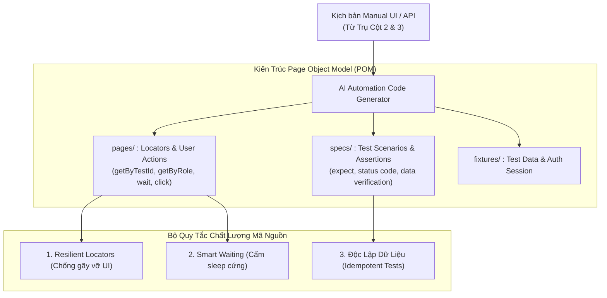

# QUY CHUẨN KIỂM THỬ TỰ ĐỘNG HÓA (UNIVERSAL AUTOMATION TESTING STANDARD)
## Trụ Cột 5: Động Cơ Sinh Mã Tự Động Hóa & Điều Phối Chạy Test CI/CD (Pillar 5)

> [!IMPORTANT]
> **Mục tiêu:** Cung cấp quy chuẩn chuyên biệt cho việc thiết kế, xây dựng và điều phối mã kiểm thử tự động (Automation Testing):
> - **Sinh mã kiểm thử tự động (Automation Code Generation):** Tiếp nhận kịch bản từ Trụ cột 2 (Manual UI) và Trụ cột 3 (API) để sinh mã nguồn kiểm thử chuẩn mực theo mô hình Page Object Model (POM), đa ngôn ngữ và đa framework (Playwright, Cypress, Selenium, Pytest, Postman/Newman).
> - **Thực thi kiểm thử tự động (Automated Test Execution):** Quản lý phiên chạy độc lập (Browser Context), xử lý chờ động (Smart Waiting), triệt tiêu ca test chập chờn (Flaky Test Triage), và tích hợp pipeline CI/CD.
> - **Độc lập dự án (Project-Agnostic):** Tham số hóa toàn bộ qua bộ biến `{{UI_FRAMEWORK}}`, `{{API_FRAMEWORK}}`, `{{BASE_URL}}`, `{{LOCATOR_STRATEGY}}`.

---

## 1. KIẾN TRÚC MÃ NGUỒN CHUẨN: PAGE OBJECT MODEL (POM)

Mọi bộ mã kiểm thử UI tự động bắt buộc phải phân tách thành 2 tầng rõ rệt:

### 1.1. Tầng Page Object (`pages/`):
- Chứa khai báo định danh phần tử (Locators) và các hàm thao tác người dùng (Actions: `clickSearch()`, `fillDateRange()`).
- **CẤM:** Tuyệt đối không viết các câu lệnh `expect / assert` logic nghiệp vụ trong Page Object để tránh phụ thuộc và làm vỡ cấu trúc tái sử dụng.

### 1.2. Tầng Test Spec (`specs/`):
- Chứa kịch bản kiểm thử, dữ liệu truyền vào và các câu lệnh kiểm tra kỳ vọng (`expect(page.getByText('...')).toBeVisible()`).
- Mỗi test spec phải độc lập, không phụ thuộc vào thứ tự chạy của các test spec khác.

---

## 2. CHIẾN LƯỢC BẮT PHẦN TỬ BỀN VỮNG (RESILIENT LOCATOR STRATEGY)

Để đảm bảo mã kiểm thử không bị gãy khi UI thay đổi giao diện, AI tuân thủ thứ tự ưu tiên:

1. **Ưu tiên 1 (Tối ưu nhất):** `data-testid`, `data-test`, `data-qa` (VD: `getByTestId('search-submit-btn')`).
2. **Ưu tiên 2:** Semantic Role & Accessible Name (VD: `getByRole('button', { name: 'Tìm kiếm' })`).
3. **Ưu tiên 3:** Label & Placeholder (VD: `getByLabel('Từ ngày')`, `getByPlaceholder('Nhập từ khóa')`).
4. **Ưu tiên 4:** Semantic CSS Selector có ý nghĩa rõ ràng (VD: `.filter-container input[name="start_date"]`).
5. **NGHIÊM CẤM:** Tuyệt đối cấm dùng đường dẫn XPath tuyệt đối (`/html/body/div[2]/...`) hoặc các class tự sinh ngẫu nhiên của CSS Modules / Tailwind (`.css-12a8bcd`).

---

## 3. CƠ CHẾ CHỜ ĐỘNG (SMART WAITING - TRIỆT TIÊU HARD SLEEP)

- **CẤM:** Tuyệt đối không sử dụng `sleep(5000)` hoặc `wait(3000)` cố định thời gian.
- **BẮT BUỘC:** Sử dụng cơ chế auto-waiting hoặc explicit wait theo trạng thái phần tử:
  + Chờ phần tử hiển thị: `waitFor({ state: 'visible' })`
  + Chờ API phản hồi: `waitForResponse(url => url.includes('/api/v1/...') && url.status() === 200)`
  + Chờ biến mất loading spinner: `waitForSelector('.loading-spinner', { state: 'detached' })`

---

## 4. QUY TẮC SINH MÃ API AUTOMATION (API TESTING AUTOMATION)

Mỗi kịch bản kiểm thử API tự động phải bao gồm đủ 4 tầng xác thực:
1. **HTTP Status Code:** Đúng mã mong đợi (`200 OK`, `201 Created`, `400 Bad Request`, `403 Forbidden`).
2. **Response Time:** Thời gian phản hồi nằm trong ngưỡng cho phép (VD: `< 2000ms`).
3. **JSON Schema Validation:** Đúng cấu trúc trường, kiểu dữ liệu và các trường bắt buộc (`required`).
4. **Business Logic Assertion:** Khớp dữ liệu cụ thể trong DB hoặc kết quả thuật toán tính toán.

---

## 5. ĐIỀU PHỐI CHẠY TEST & XỬ LÝ CA TEST CHẬP CHỜN (FLAKY TEST TRIAGE)

1. **Phân lập môi trường chạy (Clean Browser Context):**
   - Mỗi ca kiểm thử phải khởi tạo trong một Browser Context sạch, xóa sạch cookie và local storage trước khi chạy, không dùng chung session của ca test trước.
2. **Cơ chế xử lý ca test không ổn định (Flaky Test Triage Protocol):**
   - Khi một ca kiểm thử bị Fail trong quá trình chạy tự động:
     + **Tự động Retry 01 lần duy nhất** trong một session mới.
     + Nếu lần 2 **PASS**: Đánh dấu trạng thái `PASS [Flaky]` kèm cảnh báo log nguyên nhân (VD: do trễ mạng hoặc animation delay), không được đánh Pass sạch sẽ.
     + Nếu lần 2 tiếp tục **FAIL**: Đánh dấu chính thức `FAIL`, thu thập bằng chứng lỗi và kích hoạt quy trình Log Bug theo [06_bug_reporting_rule.md](file:///home/nga/Documents/SurrealDoll/Universal_Rules/06_bug_reporting_rule.md).

---

## 6. QUY CHUẨN THƯ MỤC & TÊN FILE LƯU TRỮ (STORAGE & FILE NAMING)

- **Thư mục lưu trữ bắt buộc:** `automation/`
- **Định dạng file theo dõi kịch bản chuyển đổi Manual -> Automation:** `automation/[Tên màn hình]_readme.md` *(hoặc `automation/{{MODULE_PREFIX}}_readme.md`)*
  - Ví dụ thực tế: `automation/AE800_readme.md`, `automation/AP213_readme.md`.
- **Nội dung file readme:** 
  1. Danh sách các mã testcase manual (TC ID) đã được chuyển hóa thành kịch bản tự động hóa (Automated).
  2. Danh sách các ca không thể tự động hóa (Manual Only - lý do: CAPTCHA, OTP SMS, 3rd party hardware...).
  3. Đường dẫn tới file mã nguồn spec tương ứng (VD: `tests/specs/AE800.spec.ts`).
  4. Lệnh chạy kiểm thử nhanh (VD: `npx playwright test tests/specs/AE800.spec.ts`).
- **Nghiêm cấm:** Tuyệt đối không lưu file script hoặc file readme tự do ở thư mục gốc.
