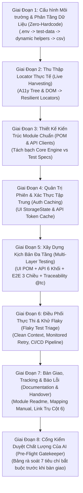
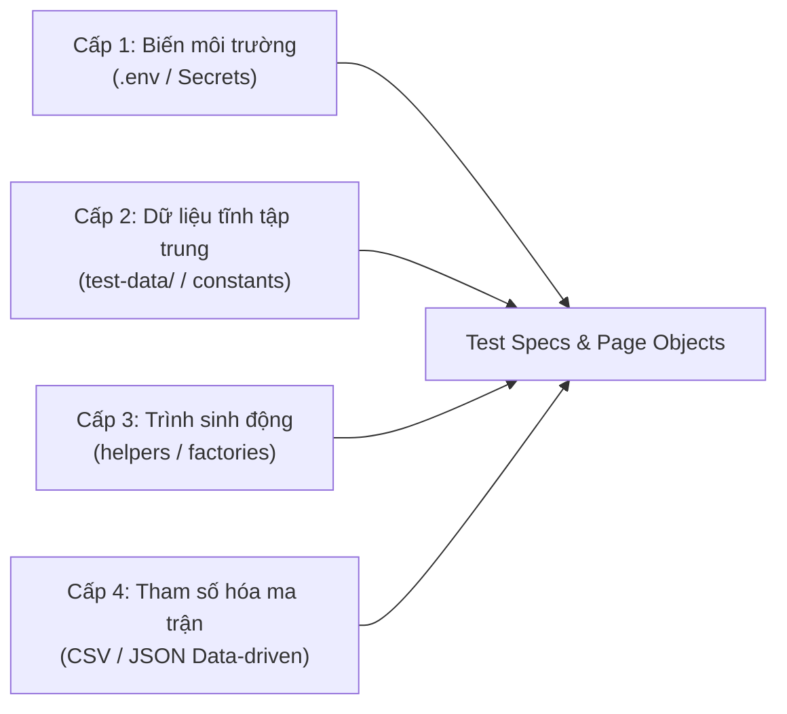
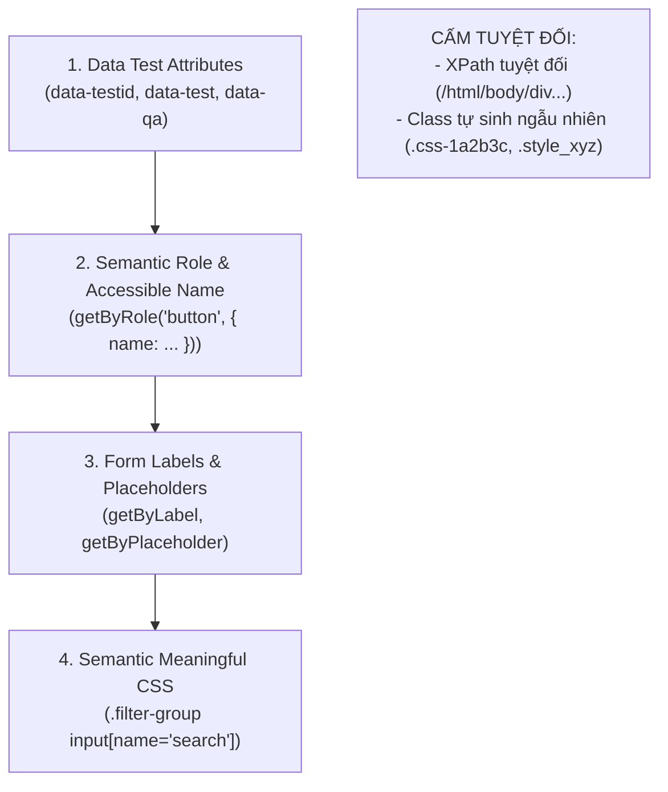
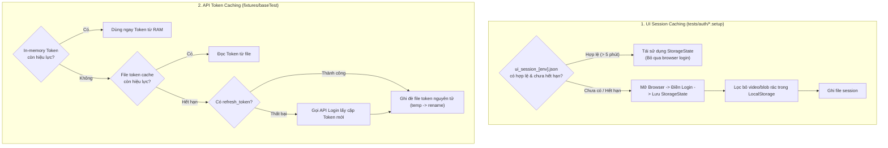
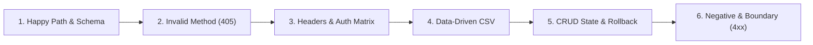

# QUY CHUẨN KIỂM THỬ TỰ ĐỘNG HÓA PHỔ QUÁT (UNIVERSAL AUTOMATION TESTING STANDARD)
## Trụ Cột 5: Động Cơ Sinh Mã Tự Động Hóa, Quản Trị Phiên & Điều Phối CI/CD (Pillar 5)

> [!IMPORTANT]
> **Tôn chỉ phổ quát (Universal & Project-Agnostic):**
> Bộ quy chuẩn này được thiết kế để áp dụng cho **bất kỳ dự án phần mềm nào** (Web, API, Mobile Web), độc lập với ngôn ngữ lập trình (TypeScript, JavaScript, Python, Java) và framework kiểm thử (Playwright, Cypress, Selenium, Pytest, v.v.):
> - **Tiếp nhận đầu vào từ Trụ cột 1, 2, 3:** Nhận danh mục UI Controls, kịch bản Manual UI Test Cases và Backend API Test Cases để chuyển hóa thành mã nguồn tự động hóa.
> - **Cấu hình độc lập (Config-Driven):** Tham số hóa toàn bộ môi trường, URL, tài khoản và cổng truy cập trực tiếp từ `.env` và `TEST_CONFIG.md`.
> - **Nguyên tắc Zero-Hardcode tuyệt đối:** Triệt tiêu hoàn toàn các giá trị gán cứng (URL, credentials, magic IDs, ngày tháng, thông điệp ngôn ngữ).
> - **Quản trị phiên thông minh (Session & Token Caching):** Tái sử dụng phiên UI và Token API, tự động làm mới (Auto-Refresh) và tự phục hồi khi mạng chập chờn (Transient Error Resilience).
> - **Xác thực 3 chiều toàn vẹn (Triple-Layer Assertion):** Đối chiếu chéo dữ liệu giữa **Giao diện (UI) $\leftrightarrow$ Dịch vụ mạng (API) $\leftrightarrow$ Cơ sở dữ liệu (Database)**.
> - **Tối ưu tốc độ & Khử Flaky:** Ứng dụng kỹ thuật chặn tài nguyên nặng (Resource Aborting) và cơ chế chờ động theo trạng thái (Smart Waiting).

---

## SƠ ĐỒ VÒNG ĐỜI PHÁT TRIỂN & THỰC THI (AUTOMATION LIFECYCLE FLOW)

Mọi kịch bản kiểm thử tự động được thiết kế, sinh mã và vận hành tuần tự qua 8 giai đoạn khép kín:



---

## GIAI ĐOẠN 1: CẤU HÌNH MÔI TRƯỜNG & NGUYÊN TẮC ZERO-HARDCODE

> [!CAUTION]
> **Quy định nghiêm ngặt:** AI khi sinh mã kiểm thử tự động **tuyệt đối không được gán cứng bất kỳ giá trị literal nào** trực tiếp trong file kiểm thử (`specs/`) hoặc Page Object (`pages/`).

Mọi dữ liệu kiểm thử bắt buộc phải được phân tầng qua **Kiến trúc Dữ liệu 4 Cấp**:



### 1.1. Phân bổ dữ liệu chuẩn hóa:
1. **Cấp 1 - Môi trường & Thông tin nhạy cảm (`.env` / Environment Variables):**
   - Base URLs (`UI_BASE_URL`, `API_BASE_URL`).
   - Thông tin xác thực (`ADMIN_EMAIL`, `ADMIN_PASSWORD`, `BASIC_AUTH_USER`, `BASIC_AUTH_PASS`).
   - Target IDs đặc thù của môi trường (`TEST_MODEL_ID`, `TEST_PACKAGE_ID`, `SAMPLE_USER_ID`).
2. **Cấp 2 - Dữ liệu tĩnh & Từ điển giao diện (`test-data/`):**
   - URL template: `detailUrl: (id) => `/items/detail/${id}``.
   - Nhãn nút bấm, tiêu đề bảng, selector regex, placeholder (hỗ trợ đa ngôn ngữ i18n).
   - Danh mục mã thông điệp lỗi hệ thống mong đợi (`ERROR_MESSAGES.*`).
   - Thời gian chờ tiêu chuẩn (`timeouts: { pageLoad: 15000, modal: 5000, action: 10000, suite: 60000 }`).
   - Đường dẫn tài nguyên mẫu để upload (`assets.sampleBannerPath`).
3. **Cấp 3 - Trình sinh dữ liệu động & Ngày tháng (`utils/helpers`):**
   - **CẤM:** Điền ngày tháng cố định (VD: `"2026-11-07"`).
   - **BẮT BUỘC:** Sử dụng Dynamic Date Helper:
     + `getToday(format)`: Lấy ngày hiện tại.
     + `getFutureDate(offsetDays, format)`: Lấy ngày tương lai ($+N$ ngày).
     + `getPastDate(offsetDays, format)`: Lấy ngày quá khứ ($-N$ ngày).
     + `getDateRange(startOffset, endOffset, format)`: Khoảng thời gian động cho bộ lọc ngày.
   - **Đảm bảo tính Idempotent:** Mọi dữ liệu tạo mới (User, Tên campaign, Mã giao dịch) phải sinh qua UUID, timestamp hoặc thư viện Faker để khi chạy lặp lại nhiều lần không bị lỗi trùng lặp (Duplicate Key / Database Conflict).
4. **Cấp 4 - Dữ liệu kiểm thử hướng dữ liệu (Data-driven CSV / JSON):**
   - Đưa các ma trận kiểm thử tham số phân trang, giá trị biên, tìm kiếm vào file `.csv` hoặc `.json` để nạp tự động thay vì viết lặp mã nguồn.

---

## GIAI ĐOẠN 2: THU THẬP & ĐỊNH DANH PHẦN TỬ BỀN VỮNG (RESILIENT LOCATORS)

### 2.1. Thứ tự ưu tiên định danh phần tử (Locator Priority Hierarchy):
Để đảm bảo mã kiểm thử không bị gãy khi UI thay đổi giao diện, AI tuân thủ thứ tự ưu tiên:



### 2.2. Giao thức thu thập Locator thực tế (Live Locator Harvesting Protocol):
Khi sinh mã tự động, nếu có công cụ hỗ trợ (như Chrome DevTools MCP hoặc trình duyệt headless):
1. **Khởi tạo phiên duyệt:** Truy cập trực tiếp môi trường Dev/Staging thực tế theo cấu hình tại `TEST_CONFIG.md` / `.env`.
2. **Bóc tách cây Accessibility (A11y Tree) & DOM Snapshot:**
   - Quét các phần tử tương ứng với danh mục UI Controls đã được bóc tách từ Trụ cột 1 & 2.
   - Trích xuất định danh theo đúng thứ tự ưu tiên của Mục 2.1.
3. **Xử lý tình huống ngoại lệ:**
   - **Màn hình chưa deploy:** Tạm thời sinh locator suy luận từ Spec/HTML và đánh dấu cờ `// [Pending Live Verification]`.
   - **iFrame / Shadow DOM:** Khai báo locator chuyển ngữ cảnh (`page.frameLocator(...)`).

---

## GIAI ĐOẠN 3: THIẾT KẾ KIẾN TRÚC MÃ NGUỒN PHÂN TẦNG (POM & API CLIENTS)

Mọi bộ mã kiểm thử tự động phải phân tách rành mạch thành 2 tầng:

```
[project_root]/
├── .env.example                     # Mẫu biến môi trường
├── .env.[env]                       # File cấu hình môi trường cụ thể (dev, staging, prod)
├── config_file (vd: playwright.config.js) # Cấu hình runner, multi-project, timeouts
├── src/ (hoặc core/)                # TẦNG LÕI HỆ THỐNG (RE-USABLE CORE ENGINE)
│   ├── config/
│   │   └── endpoint.*               # Nạp ENV động, Base URLs, danh mục Route Endpoints
│   ├── fixtures/
│   │   └── baseTest.*               # Mở rộng Test Context (AuthenticatedClient, DB, Pages)
│   ├── pages/                       # Page Object Model (Chỉ chứa Locators & Actions)
│   │   ├── LoginPage.*
│   │   └── [Module]Page.*
│   ├── api/                         # API Client Wrappers (Đóng gói HTTP Requests theo Module)
│   │   ├── AuthAPI.*
│   │   └── [Module]API.*
│   ├── test-data/                   # Dữ liệu kiểm thử tập trung (Single Source of Truth)
│   │   ├── [module]Data.*           # Labels, Timeouts, Regex, Payloads mẫu
│   │   ├── commonData.*             # Header matrices, Auth matrices, Generic errors
│   │   ├── assets/                  # File mẫu upload (ảnh, pdf, csv)
│   │   └── csv/                     # File CSV phục vụ Data-driven testing
│   └── utils/                       # Bộ công cụ dùng chung
│       ├── constants.*              # HTTP Methods, Status Codes, Content-Types
│       ├── helpers.*                # Dynamic Date helpers, Random Generator, Data Factory
│       ├── csvHelper.*              # Đọc và parse dữ liệu CSV sang mảng Test Cases
│       └── db.helper.*              # Client truy vấn trực tiếp CSDL (PostgreSQL, MySQL...)
└── tests/ (hoặc specs/)             # TẦNG KỊCH BẢN KIỂM THỬ (EXECUTION SPECS)
    ├── auth/
    │   └── admin.setup.*            # Global Setup: Login 1 lần và cache session/token
    ├── ui/
    │   └── [stt].[module].ui.spec.* # Kịch bản kiểm thử giao diện thuần túy
    ├── api/
    │   └── [stt].[module].api.spec.*# Kịch bản kiểm thử API độc lập (hỗ trợ chạy song song)
    └── e2e/
        └── [stt].[module].e2e.spec.*# Luồng tích hợp xuyên suốt UI <-> API <-> Database
```

### Quy tắc bất biến của Tầng Lõi:
- **Tầng Page Object (`pages/`):** Chỉ chứa khai báo phần tử (Locators) và hàm tương tác người dùng (`fillSearchForm()`, `clickSubmitButton()`). **CẤM TUYỆT ĐỐI:** Không viết câu lệnh `expect / assert` logic nghiệp vụ trong Page Object để tránh làm vỡ tính tái sử dụng.
- **Tầng API Client (`api/`):** Chỉ đóng gói logic gửi nhận request HTTP (`GET`, `POST`, `PUT`, `PATCH`, `DELETE`). Trả về raw response để tầng Spec kiểm tra.
- **Tầng Test Spec (`tests/`):** Nơi duy nhất chứa các câu lệnh kiểm tra kỳ vọng (`expect`), mỗi test case phải độc lập, không phụ thuộc vào thứ tự chạy của nhau.

---

## GIAI ĐOẠN 4: QUẢN TRỊ PHIÊN & XÁC THỰC TẬP TRUNG (SESSION & TOKEN CACHING)

CẤM thực hiện bước đăng nhập từ đầu cho mọi test case. Bắt buộc áp dụng cơ chế 2 tầng:



### 4.1. Quản trị phiên Giao diện (UI StorageState Caching):
1. **Kiểm tra hạn sử dụng:** Bóc tách payload JWT từ cookie `access_token`. Nếu hạn dùng còn trên 5 phút thì lập tức tái sử dụng, không mở browser để đăng nhập lại.
2. **Lọc sạch dữ liệu rác:** Tự động loại bỏ các key cache dung lượng lớn không cần thiết trong `localStorage` (như blob media, stream cache) trước khi ghi file session để giữ file gọn nhẹ.
3. **Cấu hình Runner:** Toàn bộ Project UI và E2E đều phụ thuộc vào bước `setup` và nạp sẵn `storageState` để vào thẳng màn hình chức năng.

### 4.2. Quản trị Token Dịch vụ & HTTP Client Tự Phục Hồi (Resilience Client):
1. **3 cấp kiểm tra Token:** In-memory Cache (RAM) $\rightarrow$ File Token Cache $\rightarrow$ Refresh Token API $\rightarrow$ Full API Login.
2. **Ghi file nguyên tử (Atomic Write):** Ghi token tạm vào `${authFile}.${pid}.${timestamp}.tmp` sau đó dùng lệnh đổi tên (`rename`) để tránh xung đột file khi nhiều worker chạy song song.
3. **Tự phục hồi lỗi mạng tạm thời (Transient Error Handling):**
   - Đóng gói request context vào `CustomApiClient`.
   - Khi API gặp mã lỗi tạm thời từ Gateway Dev/Staging (`502 Bad Gateway`, `503 Service Unavailable`, `504 Gateway Timeout`), tự động chờ một khoảng ngắn (jitter backoff) và retry 01 lần duy nhất trước khi đánh Fail.
   - Khi gặp `401 Unauthorized` hoặc `403 Forbidden`, tự động xóa file cache token để buộc phiên tiếp theo lấy token mới.

---

## GIAI ĐOẠN 5: XÂY DỰNG KỊCH BẢN ĐA TẦNG (MULTI-LAYER TESTING)

### 5.1. Kịch bản Kiểm thử Giao diện (UI Testing):
1. **Chặn tài nguyên nặng (Resource Aborting):**
   Trong mọi test suite UI và E2E không liên quan đến kiểm thử trực quan (Visual Regression), bắt buộc chặn nạp các file hình ảnh/video nặng:
   ```javascript
   await page.route(/\.(png|jpeg|jpg|webp|gif|svg|mp4)$/, (route) => route.abort());
   ```
   *Hiệu quả:* Giảm từ 50% - 80% thời gian tải trang, triệt tiêu lỗi chập chờn do nghẽn mạng tải assets.
2. **Cơ chế chờ động thông minh (Smart Waiting):**
   - **CẤM:** Tuyệt đối không dùng `sleep(5000)` hay lệnh chờ thời gian cố định.
   - **BẮT BUỘC:** Chờ theo vòng đời phần tử hoặc sự kiện mạng:
     + Chờ DOM hiển thị: `await pageHeading.waitFor({ state: "visible", timeout: timeouts.pageLoad })`
     + Chờ Spinner biến mất: `await spinner.waitFor({ state: "detached", timeout: timeouts.modal })`
     + Chờ hoàn tất request mạng:
       ```javascript
       const [response] = await Promise.all([
         page.waitForResponse(resp => resp.url().includes('/api/v1/...') && resp.request().method() === 'POST'),
         submitButton.click()
       ]);
       ```

### 5.2. Kịch bản Kiểm thử API 6 Khối Chuẩn Mực (API Test Anatomy):
Mỗi file kiểm thử API (`*.api.spec.*`) phải tổ chức thành đúng 6 khối kịch bản chuyên biệt:



1. **Khối 1 - Happy Path & Schema Integrity:** Kiểm tra `200 OK` / `201 Created`, Content-Type hợp lệ. So khớp cấu trúc schema (`toMatchObject`) với các trường bắt buộc, kiểu dữ liệu (`expect.any(Number)`, `expect.any(String)`).
2. **Khối 2 - Invalid HTTP Methods (405):** Gửi các HTTP Method không hỗ trợ (gửi `PUT/DELETE/PATCH` vào endpoint chỉ đọc `GET`) $\rightarrow$ Kỳ vọng `405 Method Not Allowed`.
3. **Khối 3 - Headers & Auth Matrix:**
   - *Accept Header:* Gửi các giá trị `application/json`, `*/*`, `text/html` để xác nhận hành vi phản hồi.
   - *Auth Matrix:* Chạy qua các ca: không kèm token, token rác, token giả mạo, token hết hạn $\rightarrow$ Kỳ vọng `401` hoặc `403`.
4. **Khối 4 - Query Parameters (Data-Driven CSV):** Đọc danh sách ca test từ file `.csv`. Kiểm tra phân trang (`page`, `limit`), sắp xếp, lọc theo điều kiện biên (BVA).
5. **Khối 5 - CRUD State Mutation & Safe Rollback:**
   - Khi test các thao tác ghi dữ liệu (`POST / PUT / PATCH / DELETE`):
     + *Bước 1:* Lưu lại trạng thái gốc trước khi sửa (Snapshot).
     + *Bước 2:* Thực hiện cập nhật dữ liệu mới và verify kết quả.
     + *Bước 3 (Bắt buộc):* Chạy lệnh **Rollback** khôi phục lại dữ liệu ban đầu để bảo toàn môi trường test.
6. **Khối 6 - Negative & Input Validation (400/422):** Gửi payload thiếu trường bắt buộc, giá trị âm, sai định dạng $\rightarrow$ Kiểm tra thông báo lỗi trả về khớp với hằng số `ERROR_MESSAGES.*`.

### 5.3. Kịch bản E2E & Xác thực 3 Chiều (Triple-Layer Validation):
Đối với các luồng nghiệp vụ quan trọng: Đối chiếu chéo dữ liệu giữa **Giao diện (UI) $\leftrightarrow$ Dịch vụ mạng (API) $\leftrightarrow$ Cơ sở dữ liệu (Database)**:
```typescript
test("TC_E2E_01: Verify entity data consistency across UI, API and Database", async ({ page, authenticatedRequest, db }) => {
  // 1. Lấy dữ liệu qua API
  const apiRes = await authenticatedRequest.get(`/api/v1/entities/${entityId}`);
  const apiData = await apiRes.json();

  // 2. Truy vấn trực tiếp Cơ sở dữ liệu
  const dbData = await db.getEntityById(entityId);

  // 3. Đối chiếu API vs DB
  expect(apiData.name).toBe(dbData.name);
  expect(apiData.status).toBe(dbData.status);

  // 4. Đối chiếu UI vs DB
  await page.goto(`/entities/detail/${entityId}`);
  await expect(page.getByTestId('entity-name')).toHaveText(dbData.name);
});
```

### 5.4. Quy chuẩn truy xuất nguồn gốc (Traceability Mapping: Manual -> Automation):
Mọi ca kiểm thử trong tầng `specs/` bắt buộc phải gắn mã định danh của Test Case Manual từ Trụ cột 2 & 3:
```typescript
// @tc: TC_MODULE_01 - Tìm kiếm thành công với từ khóa hợp lệ
test('TC_MODULE_01: Verify search returns matching results', async ({ page }) => {
  const modulePage = new ModulePage(page);
  await modulePage.search(moduleData.search.validKeyword);
  await expect(page.getByRole('table')).toContainText(moduleData.search.validKeyword);
});
```

---

## GIAI ĐOẠN 6: ĐIỀU PHỐI THỰC THI & KHỬ FLAKY (FLAKY TEST TRIAGE)

1. **Phân lập môi trường chạy (Clean Context):**
   - Mỗi ca kiểm thử phải khởi tạo trong một Context sạch, xóa sạch cookie và local storage tạm, không dùng chung session rác của ca test trước.
2. **Quy trình xử lý ca test chập chờn (Flaky Test Triage Protocol):**
   - Khi một ca kiểm thử bị Fail trong quá trình chạy tự động:
     + **Tự động Retry 01 lần duy nhất** trong một session mới và bật chế độ ghi vết (`trace: 'on-first-retry'`).
     + Nếu lần 2 **PASS**: Đánh dấu trạng thái `PASS [Flaky]` kèm cảnh báo log nguyên nhân (VD: do trễ mạng hoặc animation delay), không được đánh Pass sạch sẽ.
     + Nếu lần 2 tiếp tục **FAIL**: Đánh dấu chính thức `FAIL`, thu thập bằng chứng lỗi (screenshot, video, network logs) và kích hoạt quy trình Log Bug theo [06_bug_reporting_rule.md](06_bug_reporting_rule.md).

---

## GIAI ĐOẠN 7: BÀN GIAO, TRACKING & QUY CHUẨN THƯ MỤC LƯU TRỮ

- **Thư mục lưu trữ tài liệu theo dõi:** `automation/`
- **Định dạng file theo dõi kịch bản chuyển đổi:** `automation/[Tên_Module]_readme.md` *(Ví dụ: `automation/GachaLimited_readme.md`, `automation/UserManagement_readme.md`)*.
- **Nội dung file readme:**
  1. **Danh mục Automated:** Danh sách các mã test case manual (TC ID) đã được tự động hóa kèm đường dẫn file spec tương ứng.
  2. **Danh mục Manual Only:** Danh sách các ca không thể tự động hóa kèm lý do rõ ràng (CAPTCHA, OTP SMS qua điện thoại vật lý, phần cứng 3rd party, biometric...).
  3. **Lệnh chạy nhanh (Quick Run Commands):**
     ```bash
     npm run test:[module]:ui
     npm run test:[module]:api
     npm run test:[module]:e2e
     ```
- **Nghiêm cấm:** Tuyệt đối không lưu file script hoặc file readme tự do ở thư mục gốc.

---

## GIAI ĐOẠN 8: CỔNG KIỂM DUYỆT CHẤT LƯỢNG CỦA AI (PRE-FLIGHT GATEKEEPER)

Trước khi kết thúc lượt sinh mã, AI bắt buộc phải tự quét lại toàn bộ file sinh ra theo bảng 7 tiêu chí kiểm duyệt:

| Tiêu chí kiểm duyệt | Dấu hiệu vi phạm (NGHIÊM CẤM) | Cách khắc phục chuẩn |
| :--- | :--- | :--- |
| **1. URL & Account** | Xuất hiện `'http://'`, `'https://'`, email/password string | Đọc qua `process.env.*` hoặc file cấu hình tập trung. |
| **2. Target IDs** | Gán cứng số ID (`id = 45`, `code = 'A102'`) | Đọc từ `process.env.TEST_TARGET_ID` hoặc truy vấn động từ DB/API. |
| **3. Magic Values & Enum** | Viết số/chuỗi trực tiếp (`type: 2`, `status === 1`) | Định nghĩa Enum/Object trong `constants` hoặc `test-data`. |
| **4. Thông báo lỗi & Nhãn UI** | Viết chuỗi hiển thị trực tiếp trong lệnh `expect()` | Tham chiếu từ hằng số `ERROR_MESSAGES.*` hoặc `labels.*`. |
| **5. Thời gian & Ngày tháng** | Điền chuỗi ngày cố định dạng `YYYY-MM-DD` | Sử dụng helper động `getToday()`, `getFutureDate()`, `getDateRange()`. |
| **6. Timeouts** | Gán số thời gian chờ tự do (`{ timeout: 5000 }`) | Tham chiếu từ `data.timeouts.modal`. |
| **7. Asset Upload Path** | Viết đường dẫn file trực tiếp trong test spec | Định nghĩa tập trung trong `test-data/assets`. |
