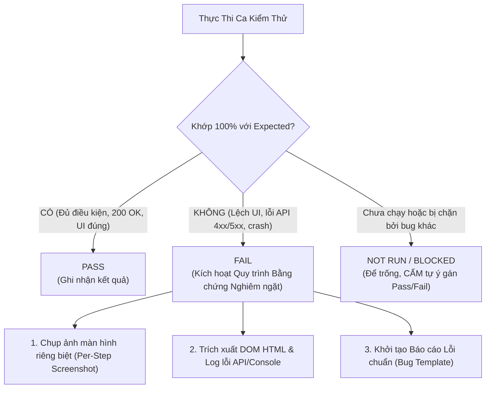

# QUY CHUẨN BÁO CÁO LỖI & QUẢN LÝ BẰNG CHỨNG (UNIVERSAL BUG REPORTING & EVIDENCE RULE)
## Trụ Cột 6: Quy Chuẩn Chuyên Biệt Cho Quản Lý & Báo Cáo Lỗi Bằng AI (Pillar 6)

> [!IMPORTANT]
> **Mục tiêu:** Cung cấp bộ quy chuẩn nghiêm ngặt và độc lập cho việc xác thực trạng thái lỗi, thu thập bằng chứng độc nhất (không trùng lặp), cấu trúc hóa mẫu báo cáo bug (Bug Report Template) và bảng tổng hợp lỗi khi thực thi kiểm thử trên môi trường thực tế.
> - **Độc lập dự án (Project-Agnostic):** Áp dụng nhất quán cho mọi hệ thống và công cụ quản lý bug (Jira, Redmine, GitHub Issues, Google Sheets).

---

## 1. NGUYÊN TẮC CỐT LÕI KHI ĐÁNH GIÁ & BÁO CÁO LỖI (CORE PRINCIPLES)



### 1.1. Tiêu Chí Xác Định Trạng Thái Pass / Fail (Evidence-Based Verification)
- **PASS:** Chỉ được xác nhận khi đáp ứng đồng thời:
  1. Tiền điều kiện (Pre-condition) đạt.
  2. Kết quả thực tế (**Actual Result**) khớp 100% với đặc tả kỳ vọng (**Expected Result**) trong Spec/Testcase.
  3. Có bằng chứng xác thực thành công (DOM selector, status code 200, text hiển thị đúng).
- **FAIL:** Đánh dấu khi có bất kỳ sai lệch nào giữa Actual Result và Expected Result, hoặc phát sinh lỗi UI, API 4xx/5xx, crash/chặn luồng nghiệp vụ.
- **NOT RUN / BLOCKED:** Để trống cột kết quả khi ca test chưa được thực thi hoặc bị chặn bởi một bug phụ thuộc trước đó. **Cấm tự ý gán Pass/Fail** nếu chưa thực hiện hành động kiểm tra thực tế.

### 1.2. Phân Lập Ngữ Cảnh & Chống Nhiễm Chéo Dữ Liệu (Task Isolation)
- **Độc lập tuyệt đối:** Chỉ chạy test và đánh giá trên đúng URL màn hình và Tab Google Sheet được chỉ định trong prompt hiện tại.
- **Không tái sử dụng dữ liệu cũ:** Tuyệt đối KHÔNG trích xuất, tham chiếu chéo hoặc gán nhầm Bug ID, URL ticket hoặc kết quả của các màn hình/task khác trong lịch sử trò chuyện.
- Khi chuyển đổi sang màn hình mới, toàn bộ trạng thái và mã lỗi của màn hình trước phải được coi là không tồn tại trong phiên đánh giá mới.

### 1.3. Quy Định Về Mã Bug ID (Anti-Hallucination)
- **Mặc định:** Cột `Bug ID` / `Link Bug` bắt buộc để **TRỐNG** hoàn toàn cho tất cả các ca FAIL khi tạo báo cáo ban đầu.
- **Cấm tự bịa:** Không tự sinh mã ticket giả (ví dụ: `BUG-01`, `AP-999`) hoặc copy link bug của testcase/màn hình khác dán vào.
- Chỉ điền Bug ID khi người dùng cung cấp danh sách ID có sẵn trong prompt, hoặc hệ thống có tool tích hợp tạo issue tự động trả về ID hợp lệ trong phiên chạy hiện tại.

---

## 2. QUY ĐỊNH NGHIÊM NGẶT VỀ EVIDENCE CHO CA FAIL (STRICT EVIDENCE RULES)

Mọi ca kiểm thử bị đánh giá là **FAIL** bắt buộc phải có bằng chứng độc lập, không được trùng lặp.

### 2.1. Chống Trùng Lặp Evidence (Strict Anti-Duplicate Capture)
- **Chụp ảnh theo từng ca riêng biệt (Atomic Per-Step Screenshot):**
  - **CẤM** sử dụng cùng 1 ảnh chụp tổng thể/màn hình mặc định ban đầu cho nhiều ca Fail khác nhau.
  - Mỗi ảnh chụp **bắt buộc phải được thực hiện ngay tại thời điểm assert thất bại**, tức là sau khi đã hoàn thành các bước tương tác (nhập chuỗi ký tự, click nút submit, trigger validation) của chính ca test đó.
  - Hình ảnh phải thể hiện rõ:
    + Dữ liệu vừa nhập vào control (Input Value).
    + Hoặc thông báo lỗi/trạng thái không mong muốn của control đó.
- **Quy chuẩn định danh file ảnh (Unique Filename):**
  - Định dạng bắt buộc: `evidence_{{MODULE_PREFIX}}_{{TC_ID}}_{{Timestamp/Mô_tả_ngắn}}.png`
  - Ví dụ: `evidence_AE800_TC05_duplicate_name_error.png`, `evidence_AP330_TC12_boundary_maxlength.png`.
  - Nếu hai ca test khác nhau có cùng một file ảnh evidence thì báo cáo đó bị coi là **KHÔNG HỢP LỆ**.
- **Chế độ chụp tập trung (Element-Level / Highlight):**
  - Ưu tiên chụp crop hoặc scroll màn hình đến đúng phần tử (element) bị fail.
  - Nếu chụp full-page, element bị lỗi phải được highlight (viền đỏ) hoặc đang ở trạng thái active/focused.

### 2.2. Bằng Chứng Kỹ Thuật Song Hành (Technical Evidence)
Bên cạnh ảnh chụp, bắt buộc trích xuất trực tiếp:
- **DOM / Attribute Dump:** Trích đoạn mã HTML hoặc text thực tế của phần tử (VD: `<input value="Test12345" maxlength="10">` hoặc text hiển thị tại tooltip: `"None"`).
- **Network / Console Log:** Nếu fail liên quan đến API hoặc JS error, trích xuất mã phản hồi (HTTP Status code) và URL API tương ứng.

---

## 3. CẤU TRÚC MẪU BÁO CÁO BUG CHUẨN (BUG REPORT TEMPLATES)

### 3.1. Cấu Trúc Báo Cáo Lỗi Chi Tiết (Detailed Bug Report Form)
Khi log từng bug lên hệ thống quản lý lỗi (Jira / GitHub Issues / Markdown):

```markdown
### [BUG] [{{MODULE_PREFIX}}] [{{CONTROL_NAME}}] Tóm tắt ngắn gọn lỗi phát hiện

- **Mã Test Case liên quan:** `[{{TC_ID}}]`
- **Mức độ nghiêm trọng (Severity):** Blocker | Critical | Major | Minor
- **Môi trường (Environment):** URL: `{{TARGET_URL}}` | Trình duyệt: Chromium / Firefox | Role: `{{USER_ROLE}}`
- **Các bước tái hiện (Steps to Reproduce):**
  1. Truy cập URL: `{{TARGET_URL}}`
  2. Thao tác: `{{TEST_STEPS_WITH_ACTUAL_INPUT}}`
  3. Quan sát: `{{OBSERVED_BEHAVIOR}}`
- **Kết quả kỳ vọng (Expected Result):** `{{EXPECTED_BEHAVIOR_PER_SPEC}}`
- **Kết quả thực tế (Actual Result):** `{{ACTUAL_BEHAVIOR_OBSERVED}}`
- **Bằng chứng đính kèm (Evidence):**
  - File ảnh chụp lỗi: `evidence/evidence_{{MODULE_PREFIX}}_{{TC_ID}}_{{Mô_tả}}.png`
  - Bằng chứng DOM HTML:
    ```html
    <input name="user_name" value="Test12345678901" maxlength="10">
    ```
  - Bằng chứng API Log (nếu có):
    ```json
    { "status": 500, "error": "Internal Server Error", "path": "/api/v1/users" }
    ```
```

### 3.2. Bảng Tổng Hợp Danh Sách Lỗi (Fail Summary Table)
Tại mục danh sách lỗi phát hiện trong phiên kiểm thử, xuất theo bảng Markdown chi tiết:

| TC ID | Control / Chức năng | Các bước tái hiện (Steps) | Expected Result | Actual Result | Mức độ | File Evidence (Unique) & DOM Log | Bug ID |
| :--- | :--- | :--- | :--- | :--- | :--- | :--- | :--- |
| `[{{MODULE_PREFIX}}-5]` | Textbox Tên | 1. Vào màn hình<br>2. Nhập trùng tên 'Body Tracking'<br>3. Bấm Save | Hiển thị thông báo lỗi trùng tên | Cho phép lưu thành công, không báo lỗi | Major | `evidence_{{MODULE_PREFIX}}_TC05_dup_name.png`<br>`Value: "Body Tracking"` | *(Để trống)* |
| `[{{MODULE_PREFIX}}-12]` | Input Giới hạn ký tự | 1. Vào màn hình<br>2. Nhập 256 ký tự vào ô Textbox<br>3. Bấm Save | Giới hạn tối đa 255 ký tự | Nhận đủ 256 ký tự và lưu thành công | Minor | `evidence_{{MODULE_PREFIX}}_TC12_maxlength.png`<br>`DOM length: 256` | *(Để trống)* |

---

## 4. QUY CHUẨN THƯ MỤC & TÊN FILE LƯU TRỮ (STORAGE & FILE NAMING)

- **Thư mục lưu báo cáo bug:** `bugs/`
- **Định dạng tên file báo cáo bug:** `bugs/[Tên màn hình]_bugs.md` *(hoặc `bugs/{{MODULE_PREFIX}}_bugs.md`)*
  - Ví dụ thực tế: `bugs/AE800_bugs.md`, `bugs/AP213_bugs.md`, `bugs/AP330_bugs.md`.
- **Thư mục lưu ảnh bằng chứng lỗi:** `evidence/`
  - Tên file ảnh bắt buộc: `evidence/evidence_{{MODULE_PREFIX}}_{{TC_ID}}_{{Timestamp/Mô_tả_ngắn}}.png`.
- **Nghiêm cấm:** Tuyệt đối không lưu file báo cáo bug hoặc file ảnh screenshot tự do ở thư mục gốc của dự án.
