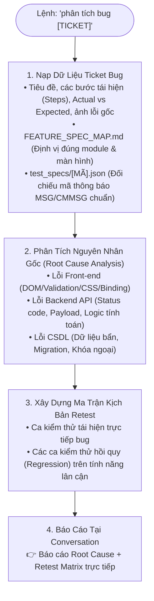
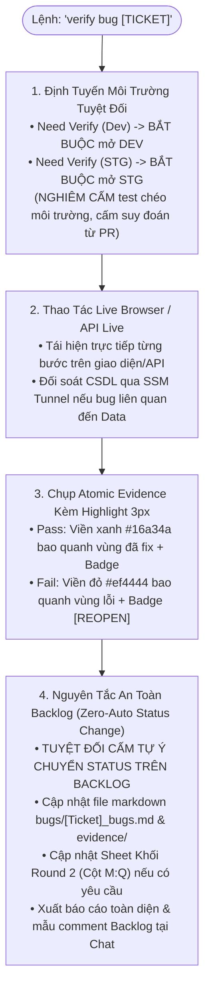
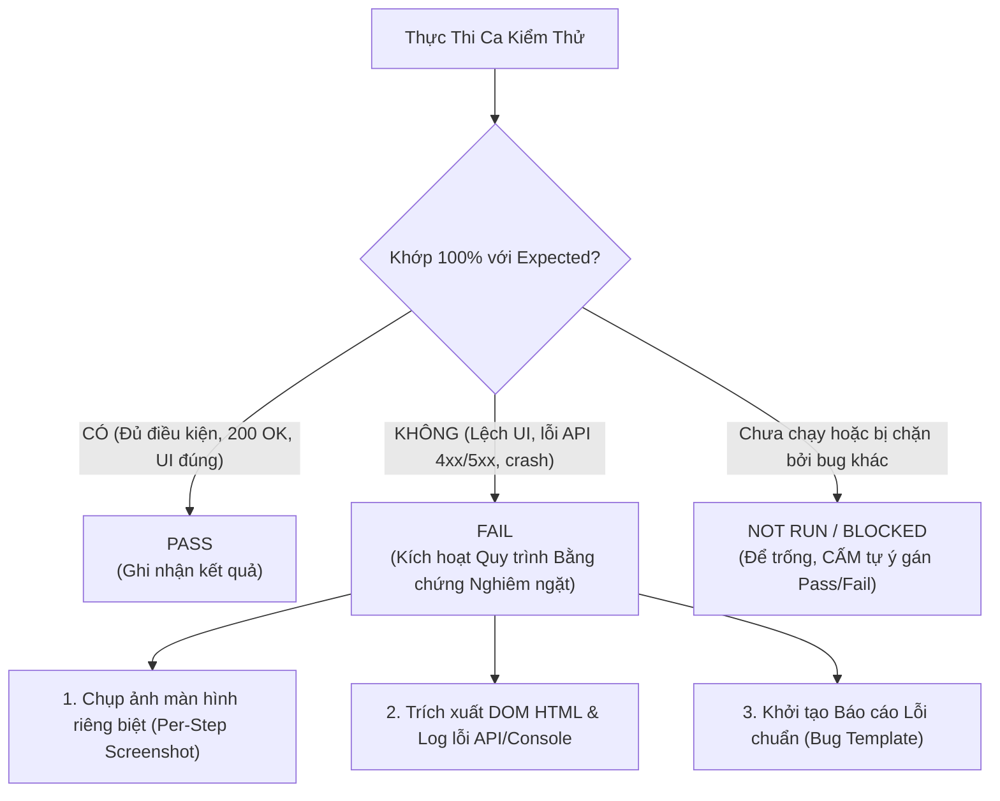
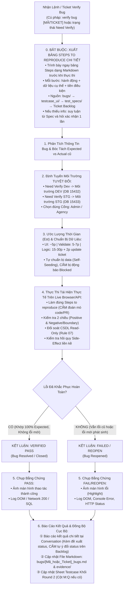

# QUY CHUẨN BÁO CÁO LỖI & QUẢN LÝ BẰNG CHỨNG (UNIVERSAL BUG REPORTING & EVIDENCE RULE)
## Trụ Cột 6: Quy Chuẩn Chuyên Biệt Cho Quản Lý & Báo Cáo Lỗi Bằng AI (Pillar 6)

> [!IMPORTANT]
> **Mục tiêu:** Cung cấp bộ quy chuẩn nghiêm ngặt và độc lập cho việc xác thực trạng thái lỗi, thu thập bằng chứng độc nhất (không trùng lặp), cấu trúc hóa mẫu báo cáo bug (Bug Report Template) và bảng tổng hợp lỗi khi thực thi kiểm thử trên môi trường thực tế.
> - **Độc lập dự án (Project-Agnostic):** Áp dụng nhất quán cho mọi hệ thống và công cụ quản lý bug (Jira, Redmine, GitHub Issues, Google Sheets).

---

## 0. LUỒNG THỰC THI CHUẨN HÓA (MANDATORY BUG FLOWS)

> [!IMPORTANT]
> **PHÂN ĐỊNH RẠCH RÒI GIỮA RULE TIÊU CHUẨN & CÔNG CỤ THỰC THI:**
> - **Rule Tiêu chuẩn (Rule 06):** Định nghĩa chuẩn Bug Report, quy tắc chụp ảnh Highlight 3px, định tuyến bắt buộc DEV/STG, và lệnh cấm tự ý đổi trạng thái Backlog.
> - **Công cụ Thực thi (Guardrail Script):** `scripts/bug_verifier.py [TICKET]` là script chốt chặn định tuyến đúng môi trường, tái hiện lỗi, đối soát ảnh và xuất báo cáo `bugs/[TICKET]/[TICKET]_bugs.md`.

### 0.1. Flow 3: Đọc & Phân Tích Bug từ Backlog
*Cú pháp gợi ý:* `phân tích bug [TICKET]`, `đọc bug [TICKET]`, `check bug [TICKET]`.
*Công cụ tự động:* `scripts/bug_verifier.py [TICKET]`



### 0.2. Flow 8: Xác Thực & Retest Bug Trực Tiếp (Verify Bug)
*Cú pháp gợi ý:* `verify bug [MÃ/TICKET]`, `kiểm tra lại bug [MÃ/TICKET]`, `retest bug [TICKET]`.



---

## 1. NGUYÊN TẮC CỐT LÕI KHI ĐÁNH GIÁ & BÁO CÁO LỖI (CORE PRINCIPLES)



### 1.1. Tiêu Chí Xác Định Trạng Thái Pass / Fail (Evidence-Based Verification)
- **PASS:** Chỉ được xác nhận khi đáp ứng đồng thời:
  1. Tiền điều kiện (Pre-condition) đạt.
  2. Kết quả thực tế (**Actual Result**) khớp 100% với đặc tả kỳ vọng (**Expected Result**) trong Spec/Testcase.
  3. Có bằng chứng xác thực thành công (DOM selector, status code 200, text hiển thị đúng).
- **FAIL:** Đánh dấu khi có bất kỳ sai lệch nào giữa Actual Result và Expected Result, hoặc phát sinh lỗi UI, API 4xx/5xx, crash/chặn luồng nghiệp vụ.
- **NOT RUN / BLOCKED:** Để trống cột kết quả khi ca test chưa được thực thi hoặc bị chặn bởi một bug phụ thuộc trước đó. **Cấm tự ý gán Pass/Fail** nếu chưa thực hiện hành động kiểm tra thực tế.

### 1.2. Phân Lập Ngữ Cảnh & Chống Nhiễm Chéo Dữ Liệu (Task Isolation)
- **Độc lập tuyệt đối:** Chỉ chạy test và đánh giá trên đúng URL màn hình và Tab Google Sheet được chỉ định trong prompt hiện tại.
- **Không tái sử dụng dữ liệu cũ:** Tuyệt đối KHÔNG trích xuất, tham chiếu chéo hoặc gán nhầm Bug ID, URL ticket hoặc kết quả của các màn hình/task khác trong lịch sử trò chuyện.
- Khi chuyển đổi sang màn hình mới, toàn bộ trạng thái và mã lỗi của màn hình trước phải được coi là không tồn tại trong phiên đánh giá mới.

### 1.3. Quy Định Về Mã Bug ID (Anti-Hallucination)
- **Mặc định:** Cột `Bug ID` / `Link Bug` bắt buộc để **TRỐNG** hoàn toàn cho tất cả các ca FAIL khi tạo báo cáo ban đầu.
- **Cấm tự bịa:** Không tự sinh mã ticket giả (ví dụ: `BUG-01`, `AP-999`) hoặc copy link bug của testcase/màn hình khác dán vào.
- Chỉ điền Bug ID khi người dùng cung cấp danh sách ID có sẵn trong prompt, hoặc hệ thống có tool tích hợp tạo issue tự động trả về ID hợp lệ trong phiên chạy hiện tại.

---

## 2. QUY ĐỊNH NGHIÊM NGẶT VỀ EVIDENCE CHO CA FAIL (STRICT EVIDENCE RULES)

Mọi ca kiểm thử bị đánh giá là **FAIL** bắt buộc phải có bằng chứng độc lập, không được trùng lặp.

### 2.1. Chống Trùng Lặp Evidence (Strict Anti-Duplicate Capture)
- **Chụp ảnh theo từng ca riêng biệt (Atomic Per-Step Screenshot):**
  - **CẤM** sử dụng cùng 1 ảnh chụp tổng thể/màn hình mặc định ban đầu cho nhiều ca Fail khác nhau.
  - Mỗi ảnh chụp **bắt buộc phải được thực hiện ngay tại thời điểm assert thất bại**, tức là sau khi đã hoàn thành các bước tương tác (nhập chuỗi ký tự, click nút submit, trigger validation) của chính ca test đó.
  - Hình ảnh phải thể hiện rõ:
    + Dữ liệu vừa nhập vào control (Input Value).
    + Hoặc thông báo lỗi/trạng thái không mong muốn của control đó.
- **Quy chuẩn định danh và cấu trúc thư mục lưu ảnh (Unique Filename & Folder Structure):**
  - Thư mục lưu ảnh bắt buộc tạo riêng theo từng màn hình: `evidence/[Tên_màn_hình]/` (trong đó `[Tên_màn_hình]` là mã màn hình, ví dụ: `BA100`, `BA1003`, `AA003`).
  - Định dạng đường dẫn file ảnh bắt buộc: `evidence/[Tên_màn_hình]/evidence_{{MODULE_PREFIX}}_{{TC_ID}}_{{Timestamp/Mô_tả_ngắn}}.png`
  - Ví dụ: 
    + `evidence/AE800/evidence_AE800_TC05_duplicate_name_error.png`
    + `evidence/BA1003/evidence_BA1003_TC02_500_server_error_PEM3.png`
    + `evidence/AA003/evidence_AA003_TC08_missing_triangle_icon.png`
  - Nếu hai ca test khác nhau có cùng một file ảnh evidence thì báo cáo đó bị coi là **KHÔNG HỢP LỆ**.
- **Chế độ chụp tập trung & Điểm neo thị giác (Element-Level & Visual Anchor):**
  - **CẤM TUYỆT ĐỐI** chụp ảnh toàn cảnh màn hình trơ trọi (unmarked full-page) khiến người xem phải tự tìm kiếm vị trí bị lỗi hoặc vị trí đã được re-test.
  - Ảnh chụp **BẮT BUỘC** phải có **khung viền nổi bật (Bounding Box / Outline màu đỏ `#ef4444` hoặc xanh lá `#16a34a`)** bao quanh trực tiếp phần tử bị tác động trước khi chụp.
  - Ưu tiên chụp crop cận cảnh phần tử (Element-Level Screenshot) hoặc chụp toàn cảnh nhưng có highlight rõ ràng (Context Overview with Highlight).

### 2.2. Quy Chuẩn Đánh Dấu Trực Quan Bắt Buộc (Mandatory Visual Highlighting Protocol)
> [!IMPORTANT]
> **NGUYÊN TẮC 3 GIÂY (THE 3-SECOND VISUAL CLARITY RULE):**
> Bất kỳ ai (Developer, Product Owner, PM, Tester khác) khi mở ảnh bằng chứng ra **BẮT BUỘC PHẢI NHẬN BIẾT ĐƯỢC NGAY VỊ TRÍ VỪA KIỂM TRA TRONG VÒNG 3 GIÂY** nhờ các dấu hiệu thị giác nổi bật.

1. **Phương pháp gắn Highlight tự động qua Script (Inject Highlighting):**
   - Trước khi gọi lệnh chụp màn hình (trong Chrome DevTools, Playwright, hoặc Puppeteer), Tester/Agent thực thi đoạn script CSS inject trực tiếp vào phần tử cần kiểm tra:
   ```javascript
   // Snippet chuẩn áp dụng trước khi chụp màn hình:
   ((selector, label = "INSPECTED POINT", isPass = true) => {
     const el = typeof selector === 'string' ? document.querySelector(selector) : selector;
     if (!el) return;
     el.scrollIntoView({ behavior: 'instant', block: 'center', inline: 'center' });
     const color = isPass ? '#16a34a' : '#ef4444'; // Xanh lá nếu Pass, Đỏ nếu Fail/Reopen
     el.style.outline = `3px solid ${color}`;
     el.style.outlineOffset = '3px';
     el.style.boxShadow = `0 0 12px ${color}`;
     
     // Thêm badge nhãn trực quan phía trên phần tử:
     const badge = document.createElement('div');
     badge.className = 'qa-verify-badge';
     badge.textContent = `🔍 ${label}`;
     badge.style.cssText = `
       position: absolute; background: ${color}; color: #ffffff;
       font-size: 11px; font-weight: bold; padding: 2px 6px;
       border-radius: 3px; z-index: 999999; box-shadow: 0 2px 4px rgba(0,0,0,0.4);
       pointer-events: none; transform: translateY(-100%);
     `;
     el.parentNode.insertBefore(badge, el);
   })('#target-control-id', 'RE-TEST POINT: VALIDATION MSG', true);
   ```

2. **Quy chuẩn đánh dấu theo từng nhóm phần tử giao diện:**
   - **Form Input & Message lỗi:** Bắt buộc bao khung viền highlight **CẢ Ô INPUT VÀ DÒNG MESSAGE LỖI**. Nghiêm cấm chỉ chụp ô input mà bỏ qua message, hoặc chỉ chụp dòng text lỗi trơ trọi giữa trang.
   - **Badge / Tag / Icon / Độ hiếm:** Bắt buộc khoanh viền đỏ/xanh trực tiếp vào card hoặc badge cụ thể được kiểm tra. Nếu màn hình có hàng chục card, phải highlight tối thiểu 1-3 card tiêu biểu mang dữ liệu re-test, tuyệt đối không chụp nguyên cả lưới (grid) 50 card mà không có điểm nhấn.
   - **Bảng dữ liệu (Data Table):** Bắt buộc highlight trực tiếp dòng bản ghi (`<tr>`) và ô dữ liệu (`<td>`) mang giá trị vừa re-test. Cấm chụp nguyên bảng 20 dòng mà không chỉ rõ dòng nào.
   - **Modal / Popup / Dialog:** Đóng khung phần nút bấm (Save/Confirm) hoặc khối nội dung vừa thay đổi bên trong Modal.

3. **Giao thức chụp 2 cấp độ (Dual-Shot Protocol - Khuyến nghị cho màn hình phức tạp):**
   - **Shot 1 (Element Zoom / Cropped):** Chụp cận cảnh riêng phần tử hoặc nhóm control đã kiểm tra để nhìn rõ từng ký tự text, style border, icon.
   - **Shot 2 (Context Overview with Highlight):** Chụp ảnh toàn cảnh (viewport) chứa phần tử đó kèm viền highlight đỏ/xanh để định vị phần tử đó nằm ở khu vực nào trên trang.

---

### 2.3. Bằng Chứng Kỹ Thuật Song Hành (Technical Evidence)
Bên cạnh ảnh chụp, bắt buộc trích xuất trực tiếp:
- **DOM / Attribute Dump:** Trích đoạn mã HTML hoặc text thực tế của phần tử (VD: `<input value="Test12345" maxlength="10">` hoặc text hiển thị tại tooltip: `"None"`).
- **Network / Console Log:** Nếu fail liên quan đến API hoặc JS error, trích xuất mã phản hồi (HTTP Status code) và URL API tương ứng.
- **Database Query Log & Data Dump:** Khi lỗi liên quan đến sai lệch dữ liệu ngầm (Silent Data Failure / UI False Positive), trạng thái DB không cập nhật, vi phạm ràng buộc dữ liệu hoặc cờ xóa mềm/audit trail sai lệch, trích xuất câu lệnh SQL `SELECT` và kết quả truy vấn thực tế theo quy chuẩn Trụ Cột 7 ([07_database_testing_rule.md](07_database_testing_rule.md)).

---

## 3. CẤU TRÚC MẪU BÁO CÁO BUG CHUẨN (BUG REPORT TEMPLATES)

### 3.1. Cấu Trúc Báo Cáo Lỗi Chi Tiết (Detailed Bug Report Form)
Khi log từng bug lên hệ thống quản lý lỗi (Jira / GitHub Issues / Markdown):

```markdown
### [BUG] [{{MODULE_PREFIX}}] [{{CONTROL_NAME}}] Tóm tắt ngắn gọn lỗi phát hiện

- **Mã Test Case liên quan:** `[{{TC_ID}}]`
- **Mức độ nghiêm trọng (Severity):** Blocker | Critical | Major | Minor
- **Môi trường (Environment):** URL: `{{TARGET_URL}}` | Trình duyệt: Chromium / Firefox | Role: `{{USER_ROLE}}`
- **Các bước tái hiện (Steps to Reproduce):**
  1. Truy cập URL: `{{TARGET_URL}}`
  2. Đăng nhập tài khoản: `[username / role]`
  3. Điều hướng đến màn hình: `[Tên menu → submenu / path cụ thể]`
  4. [Hành động 1 — nguyên tử, 1 thao tác/bước]: Nhập `"{{GIÁ_TRỊ_CỤ_THỂ}}"` vào ô `[Tên field]`
  5. [Hành động trigger lỗi]: Nhấn nút `[Tên nút]` / Thực hiện `{{THAO_TÁC}}`
  6. Quan sát: `{{OBSERVED_BEHAVIOR}}`
  > ⚠️ Bắt buộc: Mỗi bước chỉ 1 hành động. Dữ liệu nhập phải là giá trị cụ thể (không dùng "nhập dữ liệu không hợp lệ" chung chung).
- **Kết quả kỳ vọng (Expected Result):** `{{EXPECTED_BEHAVIOR_PER_SPEC}}`
- **Kết quả thực tế (Actual Result):** `{{ACTUAL_BEHAVIOR_OBSERVED}}`
- **Bằng chứng đính kèm (Evidence):**
  - File ảnh chụp lỗi: `evidence/[Tên_màn_hình]/evidence_{{MODULE_PREFIX}}_{{TC_ID}}_{{Timestamp/Mô_tả_ngắn}}.png`
  - Bằng chứng DOM HTML:
    ```html
    <input name="user_name" value="Test12345678901" maxlength="10">
    ```
  - Bằng chứng API Log (nếu có):
    ```json
    { "status": 500, "error": "Internal Server Error", "path": "/api/v1/users" }
    ```
  - Bằng chứng CSDL (nếu phát hiện sai lệch dữ liệu ngầm theo Trụ Cột 7):
    ```sql
    -- Query kiểm tra trạng thái trong DB:
    SELECT id, status, updated_at FROM users WHERE id = 'user_123';
    -- Actual result: status vẫn là 'active' thay vì 'suspended' như UI thông báo
    ```
```

### 3.2. Bảng Tổng Hợp Danh Sách Lỗi (Fail Summary Table)
Tại mục danh sách lỗi phát hiện trong phiên kiểm thử, xuất theo bảng Markdown chi tiết kèm phân loại và thời gian ước lượng (Est) cho từng bug để kiểm soát thời gian:

| TC ID | Control / Chức năng | Các bước tái hiện (Steps) | Expected Result | Actual Result | Mức độ | Phân loại | Est (Phút) | File Evidence (Unique) & DOM Log | Bug ID |
| :--- | :--- | :--- | :--- | :--- | :--- | :---: | :---: | :--- | :--- |
| `[{{MODULE_PREFIX}}-5]` | Textbox Tên | 1. Vào màn hình<br>2. Nhập trùng tên 'Body Tracking'<br>3. Bấm Save | Hiển thị thông báo lỗi trùng tên | Cho phép lưu thành công, không báo lỗi | Major | **Validate** | **7p** | `evidence/{{MODULE_PREFIX}}/evidence_{{MODULE_PREFIX}}_TC05_dup_name.png`<br>`Value: "Body Tracking"` | *(Để trống)* |
| `[{{MODULE_PREFIX}}-12]` | Input Giới hạn ký tự | 1. Vào màn hình<br>2. Nhập 256 ký tự vào ô Textbox<br>3. Bấm Save | Giới hạn tối đa 255 ký tự | Nhận đủ 256 ký tự và lưu thành công | Minor | **Validate** | **5p** | `evidence/{{MODULE_PREFIX}}/evidence_{{MODULE_PREFIX}}_TC12_maxlength.png`<br>`DOM length: 256` | *(Để trống)* |
| 🎯 **TỔNG CỘNG** | **2 bugs** | | | | | | **12p (~0.2h)** | | |

---

## 4. QUY CHUẨN THƯ MỤC & TÊN FILE LƯU TRỮ (STORAGE & FOLDER STRUCTURE)

Mọi báo cáo lỗi và file bằng chứng bắt buộc phải được phân nhóm theo thư mục riêng của từng màn hình (`[Tên_màn_hình]` là thư mục con):

### 4.1. Cấu Trúc Thư Mục Báo Cáo Bug (Bug Reports):
- **Định dạng đường dẫn:** `bugs/[Tên_màn_hình]/[Tên_màn_hình]_bugs.md`
- Trong đó `[Tên_màn_hình]` là thư mục riêng biệt cho màn hình đó bên trong `bugs/`.
- **Ví dụ thực tế:**
  + `bugs/BA100/BA100_bugs.md`
  + `bugs/BA1001/BA1001_bugs.md`
  + `bugs/BA1003/BA1003_bugs.md`
  + `bugs/BA200/BA200_bugs.md`
  + `bugs/AA003/AA003_bugs.md`
  + `bugs/AE800/AE800_bugs.md`

### 4.2. Cấu Trúc Thư Mục Lưu Evidence (Screenshots):
- **Định dạng đường dẫn:** `evidence/[Tên_màn_hình]/evidence_{{MODULE_PREFIX}}_{{TC_ID}}_{{Timestamp/Mô_tả_ngắn}}.png`
- Trong đó `[Tên_màn_hình]` là thư mục riêng biệt cho màn hình đó bên trong `evidence/`.
- **Ví dụ thực tế:**
  + `evidence/BA1003/evidence_BA1003_TC02_500_server_error_PEM3.png`
  + `evidence/BA1001/evidence_BA1001_TC26_500_server_error.png`
  + `evidence/BA200/evidence_BA200_TC08_missing_triangle_icon.png`
  + `evidence/AA003/evidence_AA003_TC08_missing_triangle_icon.png`

> [!WARNING]
> **Quy định nghiêm ngặt:** Tuyệt đối không lưu file báo cáo bug hoặc file ảnh screenshot tự do ở thư mục gốc của dự án hoặc lưu ngang cấp ở thư mục cha `bugs/`, `evidence/` mà không phân vào thư mục con `[Tên_màn_hình]`. AI khi tạo báo cáo hoặc chụp ảnh bắt buộc phải tự động tạo thư mục con tương ứng nếu chưa tồn tại.

---

## 5. QUY TRÌNH & TIÊU CHUẨN XÁC THỰC LỖI KHI CÓ YÊU CẦU VERIFY BUG (BUG VERIFICATION & RETEST PROTOCOL)

Khi có yêu cầu xác thực lỗi đã sửa (Verify Bug) từ câu lệnh người dùng hoặc khi nhận ticket chuyển trạng thái từ Developer, Tester và AI Agent **BẮT BUỘC** tuân thủ quy trình chuẩn hóa 6 bước dưới đây:

> [!IMPORTANT]
> **ĐIỀU KIỆN TIÊN QUYẾT BẮT BUỘC (MANDATORY PRE-CONDITION):**
> Trước khi bắt đầu bất kỳ bước nào trong quy trình 6 bước, Agent **BẮT BUỘC** phải trình bày rõ ràng **Bảng Steps to Reproduce chi tiết** của bug cần verify. Không có bảng này → không được phép tiến hành kiểm tra thực tế.

---

### 5.0. Bắt Buộc Tổng Hợp & Trình Bày Steps to Reproduce Chi Tiết (Mandatory Steps-Before-Verify)

> [!IMPORTANT]
> **QUY TẮC VÀNG:** Khi nhận bất kỳ lệnh nào liên quan đến `check bug`, `verify bug`, `retest bug`, `log bug`, `báo cáo lỗi`, Agent **BẮT BUỘC** phải xuất ra ngay một bảng **Steps to Reproduce chi tiết** dưới dạng Markdown **TRƯỚC KHI** tiến hành bất kỳ thao tác nào trên browser/API/DB. Người xem phải đọc bảng này và biết chính xác cần làm gì để tái hiện lỗi.

#### 5.0.1. Cấu Trúc Bảng Steps to Reproduce Bắt Buộc

Với mỗi bug cần check/verify, Agent **bắt buộc** trình bày theo đúng mẫu sau (không được rút gọn, không được viết chung chung):

```markdown
### 🔁 STEPS TO REPRODUCE — [MÃ TICKET / BUG ID] | [Tên bug ngắn gọn]

| # | Hành động (Action) | Dữ liệu đầu vào (Input Data) | Trạng thái tiền điều kiện |
|:--|:---|:---|:---|
| 1 | Mở trình duyệt, truy cập URL | `https://admin-dev.surrealdolls.com/sign-in/` | — |
| 2 | Đăng nhập bằng tài khoản | Username: `[user]` / Password: `[pass]` | Tài khoản phải có role [admin/agency] |
| 3 | Điều hướng đến màn hình | Vào menu: `[Tên menu → Tên submenu]` → URL: `/path/to/screen` | Màn hình load đầy đủ, không có lỗi 403/404 |
| 4 | [Thao tác cụ thể trên UI] | [Giá trị nhập vào ô input / button nhấn / file upload…] | [Dữ liệu mẫu cần có sẵn nếu có] |
| 5 | [Thao tác trigger lỗi] | [Dữ liệu boundary / invalid / edge-case cụ thể] | — |
| 6 | Quan sát kết quả | — | — |

**Expected Result (kỳ vọng theo Spec):** [Mô tả rõ hành vi hệ thống kỳ vọng]
**Actual Result (thực tế cũ — trước khi sửa):** [Mô tả hành vi lỗi đã xảy ra]
**Môi trường cần verify:** DEV / STG
**Tài khoản sử dụng:** Admin (`[url]`) / Agency (`[url]`)
```

#### 5.0.2. Quy Tắc Chất Lượng Steps to Reproduce (Quality Gates)

Agent **BẮT BUỘC** đảm bảo các tiêu chí sau cho từng bước trong bảng:

| Tiêu chí | Mô tả bắt buộc |
|:---|:---|
| **Tính nguyên tử (Atomic)** | Mỗi bước chỉ mô tả **1 hành động duy nhất**. Nghiêm cấm viết "Vào màn hình và nhập dữ liệu và bấm Save" trong 1 dòng. |
| **Dữ liệu cụ thể (Concrete Input)** | Phải ghi rõ **giá trị thực tế** sẽ nhập vào từng ô input (ví dụ: `"Test@123"`, `256 ký tự "a"*256`, `file: test_invalid.pdf`). Nghiêm cấm viết `"nhập dữ liệu không hợp lệ"` chung chung. |
| **URL chính xác (Exact URL)** | Bước đầu tiên hoặc bước điều hướng bắt buộc ghi URL đầy đủ của màn hình cần kiểm tra. |
| **Tiền điều kiện rõ ràng (Precondition)** | Nếu bước cần dữ liệu mẫu hoặc trạng thái hệ thống đặc biệt (ví dụ: "Phải có ít nhất 1 bản ghi trong bảng X"), phải ghi rõ ở cột "Trạng thái tiền điều kiện". |
| **Bước trigger lỗi rõ ràng (Trigger Step)** | Bước cuối cùng trước khi quan sát phải chỉ rõ hành động cụ thể dẫn đến lỗi (ví dụ: `"Nhấn nút [Save]"`, `"Scroll xuống, nhấn [Load More]"`). |
| **Không suy đoán (No Assumption)** | Các bước phải dựa trên nội dung bug report gốc / testcase gốc. Nếu bug report cũ thiếu thông tin, Agent phải **tự suy luận từ Spec và ghi chú rõ `[Suy luận từ Spec]`** để Tester biết. |

#### 5.0.3. Nguồn Thông Tin Để Tổng Hợp Steps (Auto-Discovery Priority)

Agent tự động đọc theo thứ tự ưu tiên sau để tổng hợp bảng steps:

1. **`bugs/[MÃ_MÀN_hoặc_TICKET]/[MÃ]_bugs.md`** → Trích xuất Steps to Reproduce gốc đã ghi nhận.
2. **`testcase_ui/[MÃ_MÀN]_testcase.md`** → Đối chiếu TC liên quan để bổ sung bước chi tiết còn thiếu.
3. **`test_specs/[MÃ_MÀN]_online.json` hoặc `test_specs/[MÃ_MÀN].json`** → Lấy luồng nghiệp vụ, ràng buộc dữ liệu, và mã thông báo lỗi (MSG/CMMSG) chuẩn.
4. **Ticket Backlog** (nếu có tool tích hợp hoặc người dùng paste nội dung vào conversation) → Trích xuất nội dung mô tả lỗi gốc.

#### 5.0.4. Xử Lý Trường Hợp Thiếu Thông Tin (Incomplete Bug Report Handling)

Khi bug report gốc không có Steps to Reproduce hoặc thiếu dữ liệu cụ thể:
- Agent **KHÔNG ĐƯỢC** dừng lại hỏi người dùng từng mục nhỏ.
- Agent **BẮT BUỘC** tự suy luận từ Spec và điền bảng steps đầy đủ, đánh dấu các bước không chắc chắn bằng `[Suy luận từ Spec]`.
- Sau khi trình bày bảng, Agent hỏi **1 câu duy nhất**: *"Bảng Steps to Reproduce trên có đúng với bug bạn cần verify không? Nếu cần điều chỉnh bước nào, hãy sửa trước khi tôi thực thi kiểm tra thực tế."*

---

### 5.1. Các Tình Huống Kích Hoạt Yêu Cầu Verify Bug (Trigger Events & Commands)
Yêu cầu Verify Bug được kích hoạt tự động khi:
1. **Người dùng ra lệnh bằng các cú pháp:**
   - `verify bug [MÃ/TICKET]`, `kiểm tra lại bug [MÃ/TICKET]`, `retest bug [MÃ/TICKET]`, `xác nhận bug [TICKET]`, `verify [TICKET]`.
2. **Ticket trên hệ thống quản lý lỗi (Backlog / Jira) chuyển trạng thái:**
   - `Need Verify (Dev)` $\rightarrow$ Cần xác thực trên môi trường **DEV**.
   - `Need Verify (STG)` $\rightarrow$ Cần xác thực trên môi trường **STG**.
3. **Task được phân công mang thuộc tính:**
   - `type = verify bug` hoặc danh sách subtasks cần retest trong kế hoạch làm việc 8h hàng ngày (theo [08_task_estimation_rule.md](08_task_estimation_rule.md)).

---

### 5.2. Sơ Đồ Quy Trình 6 Bước Xác Thực Lỗi Chuẩn (6-Step Bug Verification Workflow)



---

### 5.3. Chi Tiết Thực Thi 6 Bước Xác Thực Lỗi (Detailed Execution Guide)

#### Bước 1: Tiếp Nhận & Phân Tích Thông Tin Lỗi (Bug Analysis)
- Đọc kỹ nội dung ticket hoặc file báo cáo lỗi ban đầu (`bugs/[Mã_màn]/[Mã_màn]_bugs.md`):
  + **Bug ID & Tiêu đề:** Xác định chính xác bug cần verify.
  + **Màn hình / Phân hệ:** Xác định mã màn hình (ví dụ: `BB300`, `AE300`, `BA100`).
  + **Các bước tái hiện (Steps to Reproduce):** Ghi nhớ chuỗi thao tác từng bước.
  + **Kết quả kỳ vọng (Expected Result):** Đặc tả đúng theo Spec/SRS.
  + **Kết quả thực tế cũ (Old Actual Result):** Hành vi lỗi từng xảy ra trước đó.

#### Bước 2: Định Tuyến Môi Trường & Cổng Phân Hệ Chuẩn Tuyệt Đối (Strict Environment Routing)
> [!CAUTION]
> **RANH GIỚI ĐỎ:** Tuyệt đối **CẤM KIỂM TRA CHÉO MÔI TRƯỜNG** (dùng STG để verify bug Dev hoặc ngược lại). Sự khác biệt về phiên bản deploy (commit) và cấu trúc dữ liệu giữa Dev và STG sẽ dẫn đến kết luận sai lệch nghiêm trọng.

- **Khi ticket ở trạng thái `Need Verify (Dev)` hoặc chỉ định DEV:**
  + **Dev-Admin Web:** `https://admin-dev.surrealdolls.com/sign-in/`
  + **Dev-Agency Web:** `https://admin-dev.surrealdolls.com/sign-in/agency`
  + **Database Dev (Local Tunnel):** `localhost:15432` (`surreal`)
- **Khi ticket ở trạng thái `Need Verify (STG)` hoặc chỉ định STG:**
  + **STG-Admin Web:** `https://admin-stg.surrealdolls.com/sign-in`
  + **STG-Agency Web:** `https://admin-stg.surrealdolls.com/sign-in/agency`
  + **Database STG (Local Tunnel):** `localhost:15433` (`surreal_stg`)
- Chọn đúng tài khoản kiểm thử tương ứng (Admin vs Agency) theo [TEST_CONFIG.md](../../TEST_CONFIG.md).

#### Bước 3: Ước Lượng Thời Gian & Chủ Động Dữ Liệu (Estimation & Preconditions)
- **Ước lượng thời gian (Est):** Áp dụng định mức theo [08_task_estimation_rule.md](08_task_estimation_rule.md):
  + Bug UI: **~5 phút** / bug.
  + Bug Validate: **5 – 7 phút** / bug.
  + Bug Logic / CSDL: **15 – 30 phút** (TB 20 phút) / bug.
  + Chi phí cập nhật ticket & đính kèm evidence: **2 phút** / bug.
- **Chủ động dữ liệu kiểm thử (Self-Seeding):**
  + Nếu ca verify cần tài khoản đặc thù hoặc bản ghi dữ liệu mẫu, Tester/Agent **BẮT BUỘC chủ động tự tạo** qua UI hoặc API theo Trụ Cột 4 ([04_manual_test_execution_rule.md](04_manual_test_execution_rule.md)).
  + **NGHIÊM CẤM** dừng lại thụ động báo `Blocked` khi luồng hệ thống cho phép tự khởi tạo dữ liệu.

#### Bước 4: Thực Thi Xác Thực Thực Tế Trên Live Environment (Live Verification & Side-Effect Check)
- **Nguyên tắc "No Execution, No Pass":**
  + Tuyệt đối **KHÔNG SUY ĐOÁN** từ git commit, PR diff, hoặc mã nguồn build JS để kết luận "đã sửa". Bắt buộc phải trực tiếp thao tác click, nhập liệu, gửi request trên trình duyệt/API thật.
- **Thực hiện đúng Steps to Reproduce:**
  + Tái hiện lại đúng các bước và dữ liệu đầu vào đã ghi trong bug report cũ.
- **Kiểm tra 2 chiều (Positive & Boundary/Negative):**
  + **Positive:** Xác nhận tính năng/control đã hoạt động đúng theo Expected Result.
  + **Negative:** Thử lại các ca biên, ca sai để đảm bảo không bị hổng validation hoặc bypass rule khác.
- **Đối soát CSDL (Áp dụng Trụ Cột 7 cho bug Logic/Data):**
  + Chạy truy vấn SQL `SELECT` (quyền Read-Only) qua SSM Tunnel cổng 15432 (DEV) hoặc 15433 (STG) để kiểm tra các trường dữ liệu, cờ trạng thái (`status`, `is_deleted`), thời gian cập nhật (`updated_at`). Triệt tiêu 100% lỗi ngầm (Silent Bug).
- **Kiểm thử hồi quy nhanh (Side-Effect & Quick Regression Check):**
  + Kiểm tra nhanh các nút bấm, luồng nghiệp vụ liền kề hoặc các control cùng nhóm để đảm bảo việc sửa bug không gây gãy đổ tính năng khác.

#### Bước 5: Bằng Chứng Xác Thực Bắt Buộc & Đánh Dấu Vị Trí Re-Test (Mandatory Re-Test Evidence & Visual Highlighting)
> [!IMPORTANT]
> **NO EVIDENCE, NO PASS / NO REPORT & NGUYÊN TẮC RÕ RÀNG VỊ TRÍ RE-TEST:**
> - Mọi kết luận Verify (kể cả PASS hay FAIL) **BẮT BUỘC** phải có file ảnh chụp màn hình thực tế (Atomic Screenshot) tại thời điểm kiểm tra.
> - **CẤM TUYỆT ĐỐI CHỤP ẢNH TOÀN CẢNH TRƠ TRỌI:** Ảnh chụp evidence khi re-test bắt buộc phải có **khung viền nổi bật (Bounding Box viền đỏ `#ef4444` hoặc xanh lá `#16a34a`, độ dày 3px)** hoặc badge nhãn trực quan đánh dấu chính xác phần tử/vùng vừa được re-test.
> - Người xem (Dev, PO, PM) khi nhìn vào ảnh **bắt buộc phải nhận diện được ngay điểm re-test trong vòng 3 giây** mà không cần phải căng mắt dò tìm giữa hàng chục controls hay hàng trăm bản ghi.

1. **Quy chuẩn đánh dấu trực quan khi Verify từng loại thành phần:**
   - **Xác minh sửa lỗi Validate / Thông báo lỗi (MSG / CMMSG):**
     + Bắt buộc inject viền highlight đóng khung **CẢ Ô INPUT VÀ DÒNG THÔNG BÁO LỖI**.
     + Đảm bảo nhìn rõ nội dung text của thông báo lỗi mới và giá trị chuỗi nhập thử nghiệm.
   - **Xác minh sửa lỗi Icon / Badge / Tag độ hiếm / Style hiển thị:**
     + Bắt buộc đóng khung viền đỏ/xanh trực tiếp vào đúng các card/item đại diện cụ thể đã được sửa lỗi (tối thiểu 1 – 3 card tiêu biểu).
     + **Nghiêm cấm chụp toàn bộ danh sách 50 – 100 card trôi nổi** mà không có bất kỳ khung viền hay mũi tên chỉ điểm card nào là card vừa được re-test.
   - **Xác minh sửa lỗi Bảng dữ liệu (Data Table / Grid):**
     + Đóng khung highlight trực tiếp vào **dòng bản ghi (`<tr>`) và cột dữ liệu (`<td>`)** vừa kiểm tra.
   - **Xác minh Modal / Dialog / Nút bấm (Buttons):**
     + Đóng khung highlight vào vị trí nút bấm hoặc nội dung thay đổi bên trong dialog.

2. **Giao thức chụp 2 ảnh (Dual-Shot) cho màn hình phức tạp:**
   - **Ảnh 1 (Cận cảnh - Element Cropped Shot):** Chụp zoom đúng phần tử/card/dòng đã re-test để nhìn rõ chi tiết từng ký tự và trạng thái.
   - **Ảnh 2 (Toàn cảnh có điểm nhấn - Overview with Bounding Box):** Chụp vùng nhìn (Viewport) có viền highlight bao quanh vị trí phần tử để định vị rõ ngữ cảnh trên trang.

3. **Quy chuẩn định danh file ảnh Evidence Verify:**
   - Thư mục lưu: `evidence/[Mã_màn_hình]/` (hoặc `evidence/[Mã_Ticket]/`)
   - Định dạng tên file:
     `evidence/[Mã_màn]/evidence_{{MÃ}}_{{TICKET/TC}}_{{DEV/STG}}_{{PASS/FAIL}}_{{Mô_tả_ngắn}}.png`
   - Ví dụ thực tế:
     * `evidence/AE300/evidence_AE300_DEV_PASS_TC01_avatar_items_badges_highlighted.png`
     * `evidence/BB300/evidence_BB300_BB300-47_DEV_FAIL_invalid_email_no_domain.png`
     * `evidence/BA100/evidence_BA100_SURREALDOLLS-14252_DEV_PASS_filter_common.png`
   - **Kèm log kỹ thuật song hành:** Trích xuất DOM element HTML, HTTP Status code / API response JSON, hoặc kết quả câu lệnh SQL đối soát CSDL (Trụ Cột 7).

#### Bước 6: Báo Cáo Kết Quả Tại Conversation & Đồng Bộ Báo Cáo Cục Bộ (Conversation Reporting & Safe Sync)

> [!CAUTION]
> **RANH GIỚI ĐỎ — TUYỆT ĐỐI KHÔNG TỰ Ý CHUYỂN TRẠNG THÁI TRÊN BACKLOG:**
> Khi thực hiện tác vụ Verify Bug, Agent **NGHIÊM CẤM TỰ Ý CHUYỂN TRẠNG THÁI TICKET TRÊN BACKLOG** (không tự click chuyển sang `Resolved`, `Closed`, `Reopen`, `完了`...). 
> - Toàn bộ kết quả kiểm thử, hình ảnh evidence, log API/DOM/DB **BẮT BUỘC CHỈ GHI NHẬN TẠI CONVERSATION** và file markdown cục bộ để người dùng (Tester / PM) chủ động kiểm tra và thực hiện cập nhật trên Backlog.

Sau khi hoàn tất kiểm tra và thu thập bằng chứng, Tester/Agent thực hiện:

1. **Báo Cáo Toàn Diện Trực Tiếp Tại Conversation:**
   - **Bảng tổng hợp kết quả từng tiêu chí:** Đánh giá chi tiết Expected vs Actual kèm kết luận Pass/Fail.
   - **Bằng chứng trực quan:** Đính kèm toàn bộ link ảnh evidence (đã inject bounding box 3px và badge nhận diện trong 3 giây theo Mục 2.2).
   - **Log kỹ thuật song hành:** Trích xuất API Request/Response JSON, mã trạng thái HTTP, DOM element hoặc câu lệnh SQL đối soát CSDL (Trụ Cột 7).
   - **Đề xuất hành động cho Backlog:**
     + Khi kết quả là PASS: Đề xuất chuyển trạng thái sang **`Resolved`** (hoặc `Closed` / `完了` theo workflow dự án) kèm số giờ thực làm (**Actual Hours**).
     + Khi kết quả là FAIL: Đề xuất chuyển trạng thái sang **`Reopen`** (hoặc `In Progress` giao lại cho Dev).
     + Cung cấp mẫu comment chuẩn (theo Mục 5.5) để người dùng có thể sao chép trực tiếp lên Backlog.

2. **Cập nhật Báo Cáo Markdown Cục Bộ (`bugs/`):**
   - Lưu hoặc cập nhật file: `bugs/[Mã_màn_hoặc_Ticket]/[Mã_màn_hoặc_Ticket]_bugs.md` theo mẫu chuẩn tại Mục 5.4.
   - Lưu trữ toàn bộ file ảnh chụp bằng chứng vào `evidence/[Mã_màn]/`.

3. **Cập nhật trên Bảng Google Sheet Test Case (Khối Round 2 - Cột M:Q) (Nếu có yêu cầu):**
   - Đối với các testcase tương ứng trên Sheet kiểm thử 17 cột:
     + **Cột M (Round 2 Result):** Điền `Pass` hoặc `Fail` (TUYỆT ĐỐI không ghi đè vào cột H của Round 1).
     + **Cột N (Bug ID R2):** Điền mã Bug ID vừa verify.
     + **Cột O (Status R2):** Điền `Closed` (nếu Pass) hoặc `Reopen` (nếu Fail).
     + **Cột P (Comment R2):** Ghi rõ `[Verified DEV/STG - YYYY-MM-DD: Mô tả kết quả thực tế]`.
     + **Cột Q (Note R2):** Ghi chú bổ sung nếu có.
     + **Bảo tồn công thức:** Giữ nguyên 100% công thức tại dòng 1-7 và sheet tổng hợp.

---

### 5.4. Mẫu Báo Cáo Xác Minh Lỗi Chuẩn Cục Bộ (Local Bug Verification Report Template)

Định dạng file lưu trữ tại: `bugs/[Mã_Ticket]/[Mã_Ticket]_bugs.md` (hoặc `bugs/[Mã_màn]/[Mã_màn]_bugs.md`):

```markdown
# BÁO CÁO XÁC MINH LỖI TICKET [MÃ_TICKET]
## [BUG] - [MÃ_MÀN] - [Tiêu đề tóm tắt lỗi]
### Áp dụng: Master Agent Policy (GEMINI.md) & Trụ cột 6 (06_bug_reporting_rule.md)

---

## 1. THÔNG TIN TỔNG QUAN

- **Ticket ID:** [[MÃ_TICKET]](https://issoh.backlog.com/view/[MÃ_TICKET])
- **Màn hình / Phân hệ:** [MÃ_MÀN] - [Tên màn hình tiếng Nhật / Anh]
- **Môi trường định tuyến:** **DEV** / **STG** (URL: `https://...`)
- **Tài khoản kiểm thử:** [admin / agency] (HTTP Basic Auth: `suriaru` / `suriaru`)
- **Trạng thái Backlog tiếp nhận:** `Need Verify (Dev)` / `Need Verify (STG)`
- **Thời lượng ước tính (Est):** 0.15h (9 phút)
- **Thời lượng thực tế (Actual):** 0.20h (12 phút)
- **Tester:** `NgaDTP` / `Antigravity QA`
- **Ngày kiểm tra:** DD/MM/YYYY
- **Kết luận:** **VERIFIED PASS (ĐÃ SỬA XONG / RESOLVED)** hoặc **FAIL (CHƯA ĐƯỢC SỬA / REOPEN TICKET)**

---

## 2. KẾT QUẢ ĐỐI SOÁT CHI TIẾT

| Tiêu chí | Đặc tả kỳ vọng (Expected) | Thực tế trên live [DEV/STG] (Actual) | Đánh giá |
| :--- | :--- | :--- | :---: |
| **Hành vi / Validate** | [Mô tả Expected theo spec] | [Mô tả Actual thực tế quan sát được] | **PASS** / **FAIL** |
| **Mã thông báo lỗi** | [Mã MSG / CMMSG kỳ vọng] | [Mã thông báo hiển thị thực tế] | **PASS** / **FAIL** |
| **DOM Element / Style** | `<p ...>Nội dung kỳ vọng</p>` | `<p ...>Nội dung thực tế</p>` | **PASS** / **FAIL** |
| **Dữ liệu CSDL (Rule 07)** | [Giá trị trường/cờ trong DB] | [Dữ liệu query thực tế qua SSM tunnel] | **PASS** / **FAIL** |

---

## 3. NGUYÊN NHÂN KỸ THUẬT (Áp dụng khi FAIL / REOPEN)

*(Trích xuất đoạn mã FE, API response hoặc Schema nếu phát hiện căn nguyên lỗi)*
- Phân tích nguyên nhân: ...
```javascript
// Ví dụ trích xuất code lỗi trong bundle:
message: schema.INVALID_EMAIL // Thay vì dùng schema.EMAIL chuẩn
```

---

## 4. BẰNG CHỨNG KIỂM THỬ (EVIDENCE)

- Case 1: [evidence_MÃ_TICKET_DEV_PASS_case1.png](file:///home/nga/Documents/SurrealDoll/evidence/[MÃ]/evidence_MÃ_TICKET_DEV_PASS_case1.png)
- Case 2: [evidence_MÃ_TICKET_DEV_FAIL_case2.png](file:///home/nga/Documents/SurrealDoll/evidence/[MÃ]/evidence_MÃ_TICKET_DEV_FAIL_case2.png)

---

## 5. HÀNH ĐỘNG TIẾP THEO

- Báo cáo kết quả chi tiết kèm bằng chứng tại conversation.
- Đề xuất trạng thái ticket trên Backlog: **`Resolved`** / **`Closed`** (nếu PASS) hoặc **`Reopen`** (nếu FAIL) để người dùng chủ động duyệt chuyển trạng thái.
- Đề xuất mẫu comment kèm Evidence để người dùng sao chép lên Backlog.
- Tính toán thời gian làm thực tế (**Actual Hours** = +...h).
- Cập nhật Khối Round 2 (Cột M:Q) trên Google Sheet Testcase tương ứng (nếu có).
```

---

### 5.5. Mẫu Comment Đề Xuất Cho Người Dùng Copy Lên Ticket Backlog Khi Verify Bug

#### Mẫu Comment khi PASS (Bug Resolved):
```markdown
Đã tiến hành xác minh lại lỗi trên môi trường **[DEV / STG]** (URL: `{{TARGET_URL}}`):
- **Kết quả:** Bug đã được khắc phục hoàn toàn theo đúng đặc tả.
  + Hành vi thực tế: [Mô tả ngắn kết quả quan sát được]
  + Đối soát CSDL (nếu có): Trạng thái bản ghi đã cập nhật chính xác (`status = ...`).
- **Bằng chứng xác thực:** Đã đính kèm ảnh chụp màn hình kiểm tra thành công: `[Tên_file_ảnh_evidence_PASS.png]`.
- **Trạng thái:** Chuyển sang **Resolved** / **Closed**.
- **Actual Time:** [X.XX]h
```

#### Mẫu Comment khi FAIL (Bug Reopen):
```markdown
Đã tiến hành xác minh lại lỗi trên môi trường **[DEV / STG]** (URL: `{{TARGET_URL}}`):
- **Kết quả:** Bug **VẪN CÒN TỒN TẠI** (Chưa được khắc phục hoàn toàn).
  + **Các bước tái hiện chi tiết (Steps to Reproduce):**
    1. Truy cập URL: `{{TARGET_URL}}`
    2. Đăng nhập tài khoản: `[username/role]`
    3. Điều hướng đến màn hình: `[Tên menu → submenu / path]`
    4. [Hành động cụ thể]: Nhập `[giá trị cụ thể]` vào ô `[tên field]`
    5. [Hành động trigger lỗi]: Nhấn `[Tên nút]` / Thực hiện `[thao tác]`
    6. Quan sát kết quả
  + Kết quả kỳ vọng (Expected): [Nội dung theo spec/SRS]
  + Kết quả thực tế (Actual): [Lỗi thực tế còn vướng phải]
  + DOM / API Log: [Trích xuất mã lỗi nếu có]
- **Bằng chứng lỗi:** Đính kèm ảnh chụp màn hình tái hiện: `[Tên_file_ảnh_evidence_FAIL.png]`.
- **Trạng thái:** Chuyển sang **Reopen** nhờ Developer kiểm tra và xử lý lại giúp em nhé!
- **Actual Time:** [X.XX]h
```

---

## 6. QUY CHUẨN ƯỚC LƯỢNG KHI VERIFY BUG & LỆNH CHECK LIST BUG

### 6.1. Lệnh Kiểm Tra Danh Sách Lỗi & Lên Est Từng Bug (`check list bug`):
Khi người dùng gõ các lệnh: `check list bug [MÃ]`, `check bug [MÃ]`, `danh sách bug [MÃ]`, `tổng hợp bug [MÃ]`:
- **Bắt buộc lên Estimate (Est) cho TỪNG BUG để kiểm soát thời gian:**
  1. Tự động đọc file `bugs/[Mã_màn]/[Mã_màn]_bugs.md` của màn hình tương ứng.
  2. Bóc tách từng bug và phân loại độ khó kỹ thuật:
     - **Bug UI:** **~5 phút**
     - **Bug Validate:** **5 – 7 phút**
     - **Bug Logic / CSDL:** **15 – 30 phút**
  3. Lập bảng danh sách bug có 2 cột riêng biệt: `Phân loại` và `Est (Dự kiến)`.
  4. Cuối bảng **BẮT BUỘC** có dòng **TỔNG CỘNG THỜI GIAN (TOTAL EST)** và quy đổi sang giờ để người dùng kiểm soát và phân bổ thời gian thực thi.

### 6.2. Công Thức Ước Lượng Cho Task Verify Bug / Subtasking:
Khi nhận nhiệm vụ xác thực lại lỗi đã fix (Verify Bug) hoặc nhận ticket có `type = verify bug`:
- Tester / AI Agent bắt buộc áp dụng **Trụ Cột 8 ([08_task_estimation_rule.md](08_task_estimation_rule.md))** để bóc tách theo số lượng subtasks:
  - Subtask Bug UI: **~5 phút** / bug.
  - Subtask Bug Validate: **5 – 7 phút** / bug.
  - Subtask Bug Logic / CSDL: **15 – 30 phút** / bug.
  - Chi phí cập nhật ticket & đính kèm evidence: **2 phút** / subtask.
- Công thức: $\text{Total Estimate} = \sum (N_{\text{UI}} \times 5\text{p} + N_{\text{Validate}} \times 7\text{p} + N_{\text{Logic}} \times 20\text{p}) + N_{\text{Tổng}} \times 2\text{p}$.
