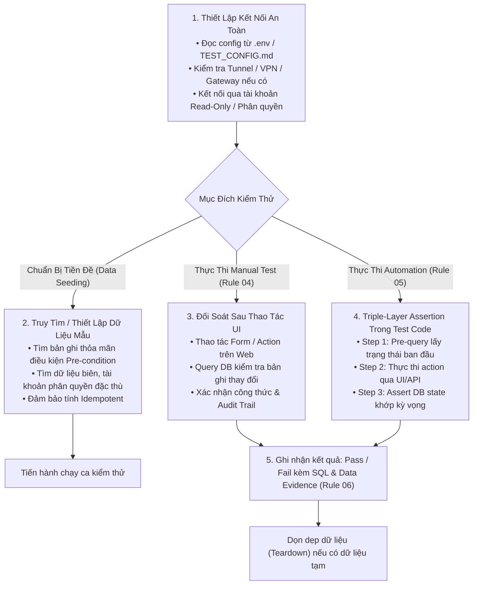

# QUY CHUẨN KIỂM THỬ CƠ SỞ DỮ LIỆU & ĐỐI SOÁT TÍNH TOÀN VẸN DỮ LIỆU (UNIVERSAL DATABASE TESTING STANDARD)
## Trụ Cột 7: Phương Pháp Luận Kiểm Thử CSDL, Xác Thực 3 Chiều & Bảo Vệ Dữ Liệu Phổ Quát (Pillar 7)

> [!IMPORTANT]
> **Tôn chỉ phổ quát (Universal & Project-Agnostic):**
> Bộ quy chuẩn này được thiết kế để áp dụng nhất quán cho **mọi hệ thống phần mềm** (Web B2B/B2C, SaaS, ERP, CRM, Fintech, E-Commerce, Mobile Backend), độc lập với hệ quản trị CSDL (PostgreSQL, MySQL, MariaDB, Oracle, SQL Server, MongoDB, DynamoDB):
> - **Tiếp nhận đầu vào từ Trụ cột 1, 2, 3:** Nhận mô hình thực thể dữ liệu (ERD), từ điển dữ liệu (Data Dictionary), ràng buộc nghiệp vụ từ Spec ([Rule 01](01_core_spec_analysis_rule.md)) và ma trận kịch bản kiểm thử ([Rule 02](02_manual_ui_test_case_rule.md), [Rule 03](03_api_test_case_rule.md)) làm chuẩn đối soát.
> - **Nguyên tắc Xác thực 3 Chiều (Triple-Layer Assertion):** Đối chiếu chéo trạng thái thực tế giữa **Giao diện (UI) $\leftrightarrow$ Dịch vụ mạng (API) $\leftrightarrow$ Cơ sở dữ liệu (Database)**.
> - **Nguyên tắc An toàn Dữ liệu Tuyệt đối (Data Safety & Least Privilege):** 100% hoạt động kiểm định trên môi trường dùng chung (Staging, Pre-prod, UAT) phải thực thi qua tài khoản phân quyền tối thiểu (ưu tiên Read-Only).
> - **Cấu hình độc lập (Config-Driven):** Mọi tham số kết nối, tài khoản và cổng truy cập bắt buộc phải tham chiếu từ file cấu hình môi trường (`.env` hoặc [TEST_CONFIG.md](../TEST_CONFIG.md)), triệt tiêu hoàn toàn việc hardcode trong mã kịch bản.

---

## SƠ ĐỒ VÒNG ĐỜI KIỂM THỬ CƠ SỞ DỮ LIỆU (DATABASE TESTING LIFECYCLE)

Mọi quy trình kiểm thử CSDL và đối soát dữ liệu được tổ chức theo chu trình 5 giai đoạn khép kín:



---

## 1. NGUYÊN TẮC XÁC THỰC DỮ LIỆU CỐT LÕI (CORE VERIFICATION PRINCIPLES)

Mọi hoạt động kiểm tra CSDL phải tập trung vào 6 khía cạnh cốt lõi độc lập với loại nghiệp vụ cụ thể:

### 1.1. Kiểm tra Tính Toàn vẹn Ràng buộc (Schema & Constraint Integrity):
- **Khóa chính & Khóa ngoại (PK/FK):** Đảm bảo tính duy nhất của ID và tính toàn vẹn tham chiếu giữa bảng cha và bảng con khi tạo/xóa liên kết (Cascade / Set Null / Restrict).
- **Ràng buộc Duy nhất (Unique Constraints):** Kiểm tra hệ thống từ chối lưu và ném lỗi nghiệp vụ khi người dùng nhập trùng lặp các trường định danh duy nhất (Username, Email, Mã code, Số điện thoại, Mã số thuế).
- **Ràng buộc Không rỗng (Not Null) & Giá trị mặc định (Default Values):** Xác minh các trường bắt buộc không bị nhận `NULL` và các trường tùy chọn nhận đúng giá trị mặc định được định nghĩa trong tài liệu đặc tả.

### 1.2. Kiểm tra Vòng đời & Chuyển đổi Trạng thái (State Transition Verification):
- Khi một thực thể trải qua các bước trong luồng nghiệp vụ (ví dụ: `Draft` $\rightarrow$ `Pending` $\rightarrow$ `Approved` / `Rejected` $\rightarrow$ `Completed` / `Cancelled`):
  - Giá trị trường trạng thái (`status` / `state` / `stage`) trong CSDL phải thay đổi chính xác theo ma trận trạng thái nghiệp vụ.
  - Các trường mốc thời gian liên quan (ví dụ: `approved_at`, `rejected_at`, `status_changed_at`) phải được tự động ghi nhận thời điểm thao tác thực tế.

### 1.3. Kiểm tra Tính Toàn vẹn Lịch sử & Dấu vết Kiểm toán (Audit Trail Integrity):
- Mọi thao tác thêm mới hoặc cập nhật bắt buộc phải xác minh:
  - `created_at`: Thời gian tạo lập bản ghi ban đầu (không bị thay đổi khi cập nhật).
  - `updated_at`: Tự động cập nhật bằng thời gian hiện tại khi có bất kỳ trường nào trong bản ghi thay đổi.
  - `created_by` / `updated_by`: Ghi nhận đúng định danh người dùng (User ID) vừa thực hiện thao tác.

### 1.4. Kiểm tra Cơ chế Xóa Mềm (Soft Deletion vs Hard Deletion):
- Đối với hệ thống áp dụng cơ chế xóa mềm:
  - Khi người dùng thực hiện xóa trên UI: Bản ghi **KHÔNG ĐƯỢC PHÉP BIẾN MẤT** khỏi CSDL.
  - Cờ xóa mềm (`is_deleted = true` hoặc `deleted_at` nhận timestamp) phải được ghi nhận.
  - Các màn hình danh sách và API truy vấn thông thường bắt buộc phải loại bỏ bản ghi này (`WHERE NOT is_deleted` hoặc `WHERE deleted_at IS NULL`).

### 1.5. Đối soát Tính toán & Tổng hợp Dữ liệu (Calculation & Aggregation Verification):
- Đối với các màn hình bảng biểu, báo cáo, tổng kết tài chính hoặc chỉ số tương tác:
  - Số liệu tổng (Total, Subtotal, Sum, Count, Average) hiển thị trên giao diện phải khớp 100% với kết quả của câu lệnh truy vấn hàm tổng hợp trên CSDL.
  - Xử lý giá trị `NULL`: Bắt buộc sử dụng hàm bảo vệ giá trị rỗng (ví dụ: `COALESCE(SUM(amount), 0)`) để tránh lỗi tính toán hoặc trả về `null` / `NaN` trên giao diện người dùng.

### 1.6. Kiểm tra Bảo mật & Quyền Riêng tư (Data Security & PII Protection):
- **Mã hóa thông tin xác thực:** Mật khẩu người dùng tuyệt đối không được lưu dạng plain text mà phải được băm an toàn (bcrypt, argon2, pbkdf2).
- **Mặt nạ dữ liệu nhạy cảm (Data Masking):** Thông tin thẻ tín dụng, căn cước, thông tin định danh cá nhân (PII) phải tuân thủ quy chuẩn mã hóa hoặc che bớt ký tự theo quy định bảo mật.

---

## 2. QUY CHUẨN TÍCH HỢP VÀO KIỂM THỬ THỦ CÔNG (MANUAL TEST VERIFICATION)

Khi thực thi kiểm thử thủ công theo [04_manual_test_execution_rule.md](04_manual_test_execution_rule.md):

1. **Trạm kiểm soát dữ liệu ngầm (Database Verification Step):**
   - Với mọi ca kiểm thử liên quan đến:
     + Tạo mới bản ghi (Create / Register).
     + Chỉnh sửa thông tin (Update Form).
     + Đổi trạng thái (Toggle Switch / Segmented Button / Status Dropdown).
     + Phê duyệt hoặc từ chối (Approve / Reject).
     + Giao dịch thanh toán / cộng trừ số dư / điểm thưởng.
   - **Quy tắc bắt buộc:** Sau khi giao diện hiển thị thông báo thành công (Toast / Alert / Modal), Tester/Agent bắt buộc thực hiện truy vấn CSDL để đối soát:
     + Bản ghi tương ứng có tồn tại trong CSDL không?
     + Các trường dữ liệu có nhận đúng giá trị vừa nhập trên form không?
     + Cờ trạng thái (`status`) và thời gian cập nhật (`updated_at`) có thay đổi chính xác không?
2. **Quy tắc chống kết luận khống (Anti-Silent Bug):**
   - Nếu giao diện hiển thị thông báo "Thành công" nhưng trong CSDL dữ liệu không đổi hoặc bị ghi sai trường: Ca kiểm thử bắt buộc bị đánh giá là **`Fail`** (phát hiện lỗi nghiêm trọng Silent Failure).
3. **Tìm kiếm dữ liệu tiền đề (Pre-condition Data Discovery):**
   - Khi ca kiểm thử yêu cầu dữ liệu đặc thù (ví dụ: user có số dư = 0 để test Empty State, user bị khóa để test Negative Login, dữ liệu có nhiều bản ghi để test Phân trang):
   - Tester/Agent chủ động dùng câu lệnh SQL `SELECT` để tìm kiếm các bản ghi mẫu thỏa mãn điều kiện thay vì chờ đợi hỗ trợ thụ động.

---

## 3. QUY CHUẨN TÍCH HỢP VÀO KIỂM THỬ TỰ ĐỘNG (AUTOMATION TRIPLE-LAYER ASSERTION)

Khi sinh mã và vận hành kiểm thử tự động theo [05_automation_test_rule.md](05_automation_test_rule.md):

### 3.1. Kiến trúc Tầng Cơ Sở Dữ Liệu Trong Framework Automation:
Tổ chức thư mục truy cập CSDL độc lập, tách biệt khỏi tầng UI (Page Objects) và API (Clients):
```text
tests/ (hoặc src/)
├── pages/             # Tầng Giao diện (Page Objects)
├── api/               # Tầng Dịch vụ (API Clients)
├── db/                # Tầng Cơ sở dữ liệu (Trụ Cột 7)
│   ├── dbClient.js    # Khởi tạo kết nối & Quản trị Pool theo môi trường
│   ├── queries/       # Các hàm truy vấn tái sử dụng theo module
│   └── assertions.js  # Các hàm custom matcher đối soát dữ liệu
```

### 3.2. Mô hình Xác thực 3 Chiều (Triple-Layer Assertion Pattern):
Trong các kịch bản kiểm thử E2E và API quan trọng, mã kiểm thử bắt buộc tuân thủ mẫu 3 bước:

```javascript
// Step 1: Thao tác qua Giao diện UI hoặc gọi API Backend
await userManagementPage.updateUserStatus(userId, 'suspended');
await expect(userManagementPage.toastMessage).toHaveText('Cập nhật thành công');

// Step 2: Xác thực qua API (Nếu có)
const apiResponse = await userApi.getUserDetail(userId);
expect(apiResponse.status).toBe(200);
expect(apiResponse.data.status).toBe('suspended');

// Step 3: Xác thực 3 chiều trực tiếp trong CSDL (Trụ Cột 7)
const dbRecord = await dbClient.queryOne('SELECT status, updated_at FROM users WHERE id = $1', [userId]);
expect(dbRecord.status).toBe(STATUS_CODES.SUSPENDED);
expect(new Date(dbRecord.updated_at).getTime()).toBeGreaterThan(testStartTime);
```

### 3.3. Quy tắc Chuẩn bị Dữ liệu (Data Seeding & Teardown):
- **Tính Idempotent:** Kịch bản tự động khi tạo dữ liệu mẫu phục vụ test phải gắn tiền tố định danh duy nhất (ví dụ: `test_auto_${Date.now()}`).
- **Dọn dẹp sau khi chạy (Teardown):** Kết thúc kịch bản hoặc hook `afterAll` / `afterEach`, kịch bản phải dọn dẹp các bản ghi tạm do chính nó tạo ra để giữ môi trường kiểm thử luôn trong sạch.

---

## 4. RANH GIỚI ĐỎ AN TOÀN DỮ LIỆU & QUẢN TRỊ RỦI RO (DATABASE GUARDRAILS)

> [!CAUTION]
> **NGHIÊM CẤM VI PHẠM TRÊN MỌI MÔI TRƯỜNG VÀ DỰ ÁN:**
> 
> 1. **NGUYÊN TẮC READ-ONLY TRÊN MÔI TRƯỜNG DÙNG CHUNG:**
>    - Khi kết nối kiểm tra dữ liệu trên môi trường dùng chung (Dev, Staging, Pre-prod, UAT), Tester/Agent **CHỈ ĐƯỢC PHÉP SỬ DỤNG TÀI KHOẢN CÓ QUYỀN ĐỌC (READ-ONLY USER)**.
>    - Tuyệt đối nghiêm cấm tự ý thực thi các câu lệnh can thiệp cấu trúc hoặc phá hủy dữ liệu: `DROP`, `TRUNCATE`, `ALTER`, hoặc `DELETE` / `UPDATE` không có điều kiện `WHERE`.
> 2. **CẤM HARDCODE THÔNG TIN XÁC THỰC (ZERO-HARDCODING CREDENTIALS):**
>    - Tuyệt đối không viết cứng User, Password, Host, Port vào mã nguồn test hoặc kịch bản kiểm thử. Toàn bộ thông số kết nối phải được nạp thông qua biến môi trường (`.env`) hoặc file cấu hình tập trung ([TEST_CONFIG.md](../TEST_CONFIG.md)).
> 3. **GIỚI HẠN THỜI GIAN CHỜ & TẢI TRỌNG (QUERY TIMEOUT & LIMIT ENFORCEMENT):**
>    - Mọi câu lệnh truy vấn phục vụ kiểm tra phải thiết lập thời gian chờ tối đa (`statement_timeout` $\le$ 5000ms).
>    - Khi truy vấn bảng lớn phục vụ lấy mẫu, bắt buộc phải có mệnh đề giới hạn số dòng (`LIMIT`) để tránh khóa bảng hoặc làm cạn kiệt tài nguyên máy chủ CSDL.
> 4. **BẢO MẬT MÃ HÓA TRUYỀN TẢI (MANDATORY ENCRYPTION / SSL):**
>    - Mọi kết nối CSDL từ xa bắt buộc phải đi qua kết nối bảo mật (SSH Tunnel, SSM Port Forwarding, VPN) và kích hoạt chế độ mã hóa SSL/TLS.
