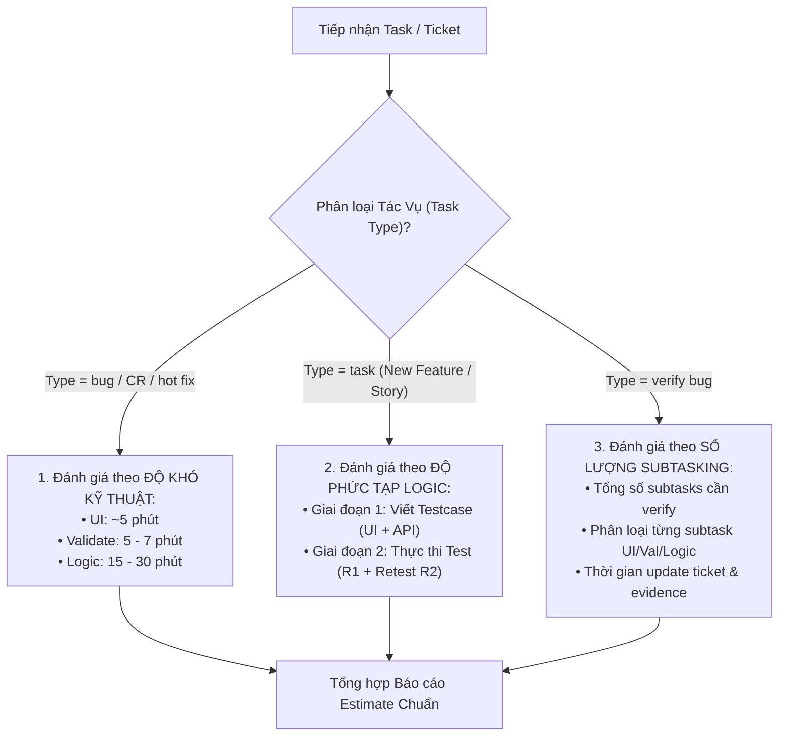

# QUY CHUẨN ƯỚC LƯỢNG THỜI GIAN & KHỐI LƯỢNG KIỂM THỬ (UNIVERSAL QA ESTIMATION RULE)
## Trụ Cột 8: Phương Pháp Luận Ước Lượng Tác Vụ Kiểm Thử Thực Tế (Pillar 8)

> [!IMPORTANT]
> **Mục tiêu:** Cung cấp bộ quy chuẩn đo lường và ước lượng (Estimation) thời gian kiểm thử thực tế, tinh gọn và nhất quán cho QA/Tester/AI Agent dựa trên phân loại tác vụ (Task Type), độ khó kỹ thuật, độ phức tạp của logic nghiệp vụ và số lượng subtasks.
> - **Đơn vị tính:** Phút / Giờ (1 Man-Day = 8 giờ).
> - **Nguyên tắc cốt lõi:** Dựa trên tốc độ và định mức thực tế của dự án, triệt tiêu việc thổi phồng thời gian (over-estimation) hoặc ước lượng thiếu căn cứ.

---

## SƠ ĐỒ ĐIỀU HƯỚNG ƯỚC LƯỢNG (ESTIMATION ROUTER)



---

## 1. QUY TẮC ESTIMATE CHO TYPE = BUG / CR / HOT FIX

Khi nhận các ticket xử lý lỗi hoặc thay đổi nhỏ, thời gian kiểm thử được xác định trực tiếp theo **độ khó kỹ thuật** của lỗi:

| Phân Loại Độ Khó | Đặc Điểm Kỹ Thuật | Thời Gian Thực Tế | Ghi Chú Thao Tác Kiểm Thử |
| :--- | :--- | :---: | :--- |
| **1. UI (Giao diện)** | Lệch layout, CSS, font chữ, màu sắc, typo text, icon, responsive hiển thị. | **~5 phút**<br>*(0.08h)* | Mở màn hình, kiểm tra trực quan element trên browser. |
| **2. Validate** | Form input, max length, regex, bắt buộc nhập, message lỗi (MSG/CMMSG), trạng thái nút. | **5 – 7 phút**<br>*(0.1h)* | Nhập thử ca biên, ca sai, kiểm tra message lỗi và trạng thái nút submit. |
| **3. Logic** | Sai luồng nghiệp vụ, sai công thức tính toán, phân quyền RBAC, sai trạng thái CSDL. | **15 – 30 phút**<br>*(0.25h – 0.5h)* | Chuẩn bị dữ liệu mẫu, chạy luồng E2E, đối soát DB/API theo [Rule 03](03_api_test_case_rule.md) & [Rule 07](07_database_testing_rule.md). |

### Lưu ý riêng cho Hot fix & CR:
- **Hot fix (Khẩn cấp):** Thời gian test theo độ khó trên + **10 – 15 phút** kiểm tra nhanh các luồng chính xung quanh (Smoke / Sanity Test) để đảm bảo không gãy tính năng đang chạy.
- **CR (Change Request nhỏ):** **10 – 15 phút** cập nhật lại Spec/Q&A/Testcase cũ + Thời gian test thực tế theo độ khó (UI / Validate / Logic).

---

## 2. QUY TẮC ESTIMATE CHO TYPE = TASK (TÍNH NĂNG MỚI / USER STORY)

Với các task phát triển mới (New Feature / Story), khối lượng công việc kiểm thử bắt buộc phải bóc tách thành **2 giai đoạn độc lập** dựa trên độ phức tạp của logic nghiệp vụ:

### 2.1. Thang đo độ phức tạp logic (Logic Complexity Scale)
- **Simple (Đơn giản):** Màn hình hiển thị dữ liệu tĩnh, danh sách chỉ xem, form dưới 5 fields, không có phân quyền phức tạp, 1-2 API cơ bản.
- **Medium (Trung bình):** Form CRUD chuẩn, 5-15 fields, có phân trang, bộ lọc tìm kiếm, validate 2 lớp (Client/Server), 3-5 API liên kết.
- **Complex (Phức tạp):** Form đa bước (Wizard), xử lý file upload/download, tính toán tài chính/doanh thu phức tạp, phân quyền đa vai trò (Admin/Agency), nhiều trigger DB.

### 2.2. Ma trận ước lượng chi tiết 2 giai đoạn

| Độ Phức Tạp Logic | Số Lượng Testcase Dự Kiến | Giai Đoạn 1: Viết Testcase (Design UI + API) | Giai Đoạn 2: Thực Thi Test (R1 + Retest R2) | Tổng Estimate Dự Kiến |
| :--- | :---: | :---: | :---: | :---: |
| **Simple** | ~15 – 30 TC | **1.0h – 2.0h** | **1.0h – 1.5h** | **2.0h – 3.5h**<br>*(~0.25 – 0.5 MD)* |
| **Medium** | ~30 – 60 TC | **2.0h – 4.0h** | **2.0h – 3.5h** | **4.0h – 7.5h**<br>*(~0.5 – 1.0 MD)* |
| **Complex** | > 60 TC | **4.0h – 8.0h** | **4.0h – 6.0h** | **8.0h – 14.0h**<br>*(~1.0 – 1.8 MD)* |

> [!NOTE]
> - **Giai đoạn 1 (Viết Testcase):** Bao gồm bóc tách controls theo [Rule 01](01_core_spec_analysis_rule.md), viết kịch bản UI theo [Rule 02](02_manual_ui_test_case_rule.md), và viết kịch bản API theo [Rule 03](03_api_test_case_rule.md).
> - **Giai đoạn 2 (Thực thi Test):** Round 1 (chạy toàn bộ kịch bản, log bug + evidence theo [Rule 06](06_bug_reporting_rule.md)) + Round 2 (Retest các bug đã fix theo [Rule 04](04_manual_test_execution_rule.md)).

---

## 3. QUY TẮC ESTIMATE CHO TYPE = VERIFY BUG (SUBTASKING)

Khi nhận task có `type = verify bug`, việc ước lượng được tính trực tiếp từ **danh sách số lượng subtasks** (các bug cụ thể cần kiểm tra lại):

### 3.1. Công thức tính tổng thời gian
$$\text{Total Estimate} = \sum \left( N_{\text{UI}} \times 5\text{p} + N_{\text{Validate}} \times 7\text{p} + N_{\text{Logic}} \times 20\text{p} \right) + (N_{\text{Tổng}} \times 2\text{p}_{\text{update ticket}})$$

Trong đó:
- $N_{\text{UI}}$: Số lượng subtask lỗi UI ($\times$ 5 phút/subtask).
- $N_{\text{Validate}}$: Số lượng subtask lỗi Validate ($\times$ 7 phút/subtask).
- $N_{\text{Logic}}$: Số lượng subtask lỗi Logic ($\times$ 15 – 30 phút, trung bình lấy 20 phút/subtask).
- $N_{\text{Tổng}} \times 2\text{p}$: Thời gian cập nhật trạng thái từng ticket, ghi chú kết quả và đính kèm ảnh bằng chứng (Atomic Screenshot theo [Rule 06](06_bug_reporting_rule.md)).

### 3.2. Ví dụ minh họa thực tế
Giả sử nhận 1 task `verify bug` chứa **6 subtasks** gồm: 3 bug UI, 2 bug Validate, 1 bug Logic:
- 3 bug UI: $3 \times 5\text{p} = 15\text{ phút}$
- 2 bug Validate: $2 \times 7\text{p} = 14\text{ phút}$
- 1 bug Logic: $1 \times 20\text{p} = 20\text{ phút}$
- Cập nhật 6 ticket + đính kèm evidence: $6 \times 2\text{p} = 12\text{ phút}$
- **$\rightarrow$ Tổng thời gian ước lượng:** $15 + 14 + 20 + 12 = \mathbf{61\text{ phút}} \approx \mathbf{1.0\text{ giờ}}$.

---

## 4. MẪU BÁO CÁO ESTIMATE CHUẨN (OUTPUT TEMPLATE)

Khi hoàn thành ước lượng, Agent xuất kết quả theo định dạng sau:

```markdown
### 📊 Báo Cáo Ước Lượng Kiểm Thử (QA Estimate Report)
- **Mã Task / Ticket:** [Tên hoặc Mã Ticket]
- **Task Type:** [bug / CR / hot fix | task | verify bug]
- **Phân loại / Số lượng:** [UI / Validate / Logic hoặc X subtasks]

#### 1. Bảng Phân Tích Khối Lượng Chi Tiết
| STT | Hạng mục công việc | Cơ sở tính toán | Thời gian (Phút / Giờ) |
| :-- | :--- | :--- | :--- |
| 1 | [Phân tích Spec / Viết Testcase / Verify Subtask UI...] | [...] | ... |
| 2 | [Thực thi Test R1 / Verify Subtask Validate...] | [...] | ... |
| 3 | [Retest R2 / Verify Subtask Logic...] | [...] | ... |
| 4 | Cập nhật ticket & lưu trữ Evidence | [...] | ... |
| **TỔNG CỘNG** | | | **... giờ (... MD)** |

#### 2. Giả Định & Rủi Ro (Assumptions)
- Môi trường và dữ liệu test sẵn sàng.
- Không phát sinh lỗi chặn nghiêm trọng (Blocker) trong quá trình thực thi.
```
