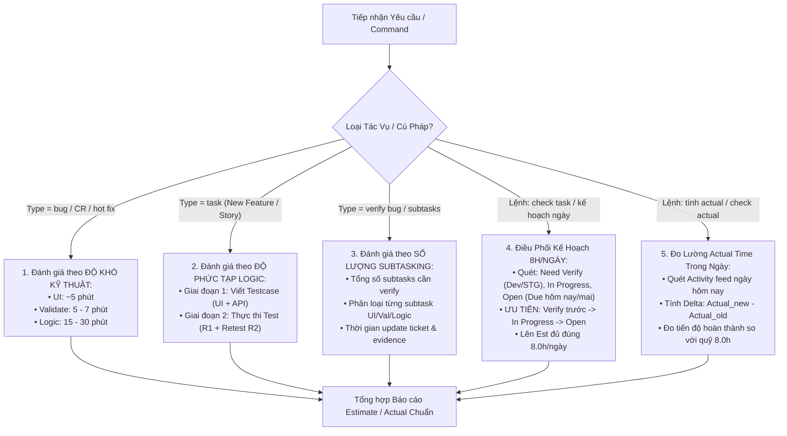
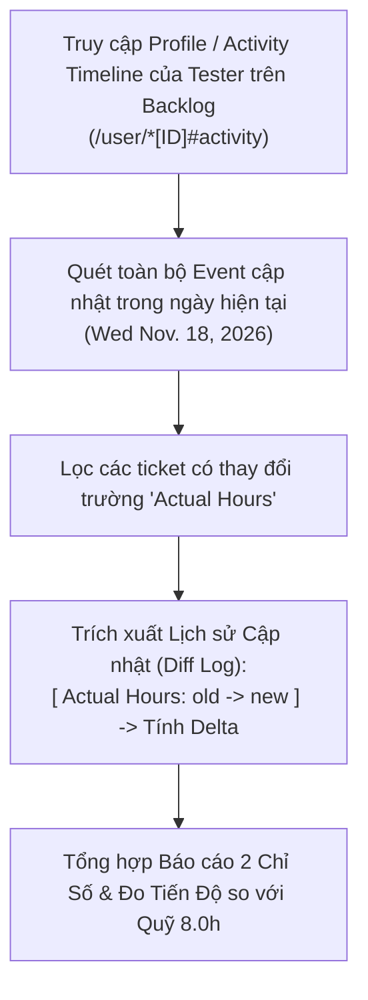

# QUY CHUẨN ƯỚC LƯỢNG THỜI GIAN & KHỐI LƯỢNG KIỂM THỬ (UNIVERSAL QA ESTIMATION RULE)
## Trụ Cột 8: Phương Pháp Luận Ước Lượng Tác Vụ Kiểm Thử Thực Tế (Pillar 8)

> [!IMPORTANT]
> **Mục tiêu:** Cung cấp bộ quy chuẩn đo lường và ước lượng (Estimation) thời gian kiểm thử thực tế, tinh gọn và nhất quán cho QA/Tester/AI Agent dựa trên phân loại tác vụ (Task Type), độ khó kỹ thuật, độ phức tạp của logic nghiệp vụ và số lượng subtasks.
> - **Đơn vị tính:** Phút / Giờ (1 Man-Day = 8 giờ).
> - **Nguyên tắc cốt lõi:** Dựa trên tốc độ và định mức thực tế của dự án, triệt tiêu việc thổi phồng thời gian (over-estimation) hoặc ước lượng thiếu căn cứ.

---

## 0. LUỒNG THỰC THI CHUẨN HÓA (ESTIMATION & ACTUAL WORKFLOW)

> [!IMPORTANT]
> **PHÂN ĐỊNH RẠCH RÒI GIỮA RULE TIÊU CHUẨN & CÔNG CỤ THỰC THI:**
> - **Rule Tiêu chuẩn (Rule 08):** Định nghĩa công thức tính định mức (UI ~5p, Val 5-7p, Logic 15-30p), ma trận 2 giai đoạn cho Feature mới, phân bổ quỹ 8h/ngày và đo lường Actual Time.
> - **Nguồn dữ liệu & Công cụ:** Nạp tự động từ snapshot Backlog `estimates/backlog_snapshot_latest.json` hoặc Activity Feed Backlog.

*Cú pháp gợi ý:* `estimate [MÃ/TICKET]`, `check task`, `tính actual`, `kế hoạch ngày`.

---

## SƠ ĐỒ ĐIỀU HƯỚNG ƯỚC LƯỢNG (ESTIMATION ROUTER)



---

## 1. QUY TẮC ESTIMATE CHO TYPE = BUG / CR / HOT FIX

Khi nhận các ticket xử lý lỗi hoặc thay đổi nhỏ, thời gian kiểm thử được xác định trực tiếp theo **độ khó kỹ thuật** của lỗi:

| Phân Loại Độ Khó | Đặc Điểm Kỹ Thuật | Thời Gian Thực Tế | Ghi Chú Thao Tác Kiểm Thử |
| :--- | :--- | :---: | :--- |
| **1. UI (Giao diện)** | Lệch layout, CSS, font chữ, màu sắc, typo text, icon, responsive hiển thị. | **~5 phút**<br>*(0.08h)* | Mở màn hình, kiểm tra trực quan element trên browser. |
| **2. Validate** | Form input, max length, regex, bắt buộc nhập, message lỗi (MSG/CMMSG), trạng thái nút. | **5 – 7 phút**<br>*(0.1h)* | Nhập thử ca biên, ca sai, kiểm tra message lỗi và trạng thái nút submit. |
| **3. Logic** | Sai luồng nghiệp vụ, sai công thức tính toán, phân quyền RBAC, sai trạng thái CSDL. | **15 – 30 phút**<br>*(0.25h – 0.5h)* | Chuẩn bị dữ liệu mẫu, chạy luồng E2E, đối soát DB/API theo [Rule 03](03_api_test_case_rule.md) & [Rule 07](07_database_testing_rule.md). |

### Lưu ý riêng cho Hot fix & CR:
- **Hot fix (Khẩn cấp):** Thời gian test theo độ khó trên + **10 – 15 phút** kiểm tra nhanh các luồng chính xung quanh (Smoke / Sanity Test) để đảm bảo không gãy tính năng đang chạy.
- **CR (Change Request nhỏ):** **10 – 15 phút** cập nhật lại Spec/Q&A/Testcase cũ + Thời gian test thực tế theo độ khó (UI / Validate / Logic).

---

## 2. QUY TẮC ESTIMATE CHO TYPE = TASK (TÍNH NĂNG MỚI / USER STORY)

Với các task phát triển mới (New Feature / Story), khối lượng công việc kiểm thử bắt buộc phải bóc tách thành **2 giai đoạn độc lập** dựa trên độ phức tạp của logic nghiệp vụ:

### 2.1. Thang đo độ phức tạp logic (Logic Complexity Scale)
- **Simple (Đơn giản):** Màn hình hiển thị dữ liệu tĩnh, danh sách chỉ xem, form dưới 5 fields, không có phân quyền phức tạp, 1-2 API cơ bản.
- **Medium (Trung bình):** Form CRUD chuẩn, 5-15 fields, có phân trang, bộ lọc tìm kiếm, validate 2 lớp (Client/Server), 3-5 API liên kết.
- **Complex (Phức tạp):** Form đa bước (Wizard), xử lý file upload/download, tính toán tài chính/doanh thu phức tạp, phân quyền đa vai trò (Admin/Agency), nhiều trigger DB.

### 2.2. Ma trận ước lượng chi tiết 2 giai đoạn

| Độ Phức Tạp Logic | Số Lượng Testcase Dự Kiến | Giai Đoạn 1: Viết Testcase (Design UI + API) | Giai Đoạn 2: Thực Thi Test (R1 + Retest R2) | Tổng Estimate Dự Kiến |
| :--- | :---: | :---: | :---: | :---: |
| **Simple** | ~15 – 30 TC | **1.0h – 2.0h** | **1.0h – 1.5h** | **2.0h – 3.5h**<br>*(~0.25 – 0.5 MD)* |
| **Medium** | ~30 – 60 TC | **2.0h – 4.0h** | **2.0h – 3.5h** | **4.0h – 7.5h**<br>*(~0.5 – 1.0 MD)* |
| **Complex** | > 60 TC | **4.0h – 8.0h** | **4.0h – 6.0h** | **8.0h – 14.0h**<br>*(~1.0 – 1.8 MD)* |

> [!NOTE]
> - **Giai đoạn 1 (Viết Testcase):** Bao gồm bóc tách controls theo [Rule 01](01_core_spec_analysis_rule.md), viết kịch bản UI theo [Rule 02](02_manual_ui_test_case_rule.md), và viết kịch bản API theo [Rule 03](03_api_test_case_rule.md).
> - **Giai đoạn 2 (Thực thi Test):** Round 1 (chạy toàn bộ kịch bản, log bug + evidence theo [Rule 06](06_bug_reporting_rule.md)) + Round 2 (Retest các bug đã fix theo [Rule 04](04_manual_test_execution_rule.md)).

---

## 3. QUY TẮC ESTIMATE CHO TYPE = VERIFY BUG & LỆNH VERIFY BUG (SUBTASKING)

Khi nhận task có `type = verify bug`, subtasks cần verify, hoặc khi người dùng ra lệnh `verify bug [MÃ/TICKET]`, `kiểm tra lại bug [MÃ/TICKET]`, `retest bug [TICKET]`:
- Tester / AI Agent áp dụng quy trình xác thực chuẩn tại **[06_bug_reporting_rule.md (Mục 5)](06_bug_reporting_rule.md)** và ước lượng thời gian theo số lượng bug và độ khó kỹ thuật:

### 3.1. Công thức tính tổng thời gian
$$\text{Total Estimate} = \sum \left( N_{\text{UI}} \times 5\text{p} + N_{\text{Validate}} \times 7\text{p} + N_{\text{Logic}} \times 20\text{p} \right) + (N_{\text{Tổng}} \times 2\text{p}_{\text{update ticket}})$$

Trong đó:
- $N_{\text{UI}}$: Số lượng bug/subtask lỗi UI ($\times$ 5 phút/bug).
- $N_{\text{Validate}}$: Số lượng bug/subtask lỗi Validate ($\times$ 7 phút/bug).
- $N_{\text{Logic}}$: Số lượng bug/subtask lỗi Logic ($\times$ 15 – 30 phút, trung bình lấy 20 phút/bug).
- $N_{\text{Tổng}} \times 2\text{p}$: Thời gian tổng hợp kết quả chi tiết, gắn ảnh bằng chứng (Atomic Screenshot theo [Rule 06](06_bug_reporting_rule.md)), soạn báo cáo conversation và tính toán Actual Hours.

### 3.2. Ước lượng cho từng bug đơn lẻ (Single Bug Verification):
- **Bug UI:** $5\text{p} + 2\text{p} = \mathbf{7\text{ phút}} \approx \mathbf{0.12\text{h}}$
- **Bug Validate:** $7\text{p} + 2\text{p} = \mathbf{9\text{ phút}} \approx \mathbf{0.15\text{h}}$
- **Bug Logic / CSDL:** $20\text{p} + 2\text{p} = \mathbf{22\text{ phút}} \approx \mathbf{0.37\text{h}}$ (hoặc tối đa $30\text{p} + 2\text{p} = 32\text{p} \approx 0.5\text{h}$ cho luồng CSDL/API phức tạp).

### 3.3. Ví dụ minh họa thực tế khi verify nhiều subtasks
Giả sử nhận 1 task `verify bug` chứa **6 subtasks** gồm: 3 bug UI, 2 bug Validate, 1 bug Logic:
- 3 bug UI: $3 \times 5\text{p} = 15\text{ phút}$
- 2 bug Validate: $2 \times 7\text{p} = 14\text{ phút}$
- 1 bug Logic: $1 \times 20\text{p} = 20\text{ phút}$
- Cập nhật 6 ticket + đính kèm evidence: $6 \times 2\text{p} = 12\text{ phút}$
- **$\rightarrow$ Tổng thời gian ước lượng:** $15 + 14 + 20 + 12 = \mathbf{61\text{ phút}} \approx \mathbf{1.0\text{ giờ}}$.

### 3.4. Quy Chuẩn Khi Nhận Lệnh "Check List Bug" (Per-Bug Estimation Protocol)

Khi người dùng đưa ra các câu lệnh như `check list bug [MÃ]`, `check bug [MÃ]`, `danh sách bug [MÃ]`, hoặc yêu cầu rà soát danh sách lỗi:
1. **Bắt buộc lên Estimate chi tiết cho TỪNG BUG:** Agent **TUYỆT ĐỐI KHÔNG** chỉ liệt kê danh sách lỗi thuần túy, mà **BẮT BUỘC** phải phân tích và gán mức thời gian kiểm thử dự kiến (Est) độc lập cho **từng bug một** dựa trên độ khó kỹ thuật:
   - Bug UI: **~5 phút**
   - Bug Validate: **5 – 7 phút**
   - Bug Logic: **15 – 30 phút** (mặc định lấy 20 phút cho logic thông thường, 30 phút cho logic sâu liên quan CSDL/API).
2. **Cấu trúc bảng kiểm soát thời gian per-bug:** Bảng danh sách bug bắt buộc phải bổ sung 2 cột: `Phân Loại Độ Khó` và `Est (Thời Gian Dự Kiến)`.
3. **Dòng Tổng Thời Gian Kiểm Soát (Total Est):** Cuối bảng danh sách bắt buộc phải có dòng tính tổng thời gian (tổng số phút và quy đổi ra giờ) để người dùng nắm rõ tổng khối lượng và kiểm soát tiến độ thực thi.

---

## 4. MẪU BÁO CÁO ESTIMATE CHUẨN (OUTPUT TEMPLATE)

### 4.1. Mẫu Báo Cáo Khi Có Lệnh "Check List Bug" (Bắt Buộc Lên Est Từng Bug)

Khi nhận lệnh `check list bug [MÃ]`:

```markdown
### 📋 Danh Sách Bug Kèm Bảng Estimate Kiểm Soát Thời Gian - Màn Hình [MÃ]

| STT | TC ID | Tiêu đề lỗi / Control | Phân Loại Độ Khó | Est (Dự kiến) | Trạng thái | Ghi chú kiểm tra |
| :---: | :--- | :--- | :---: | :---: | :---: | :--- |
| 1 | `[MÃ-05]` | Textbox Tên: Sai màu viền border khi focus | **UI** | **5p** | Open | Check trực quan style |
| 2 | `[MÃ-12]` | Input Giới hạn: Nhập quá 255 ký tự vẫn cho lưu | **Validate** | **7p** | Open | Test ca biên 255/256 ký tự & MSG |
| 3 | `[MÃ-45]` | Nút Lưu: Không cập nhật trạng thái bản ghi trong DB | **Logic** | **20p** | Open | Chạy luồng + đối soát SQL CSDL |
| ... | ... | ... | ... | ... | ... | ... |
| 🎯 | **TỔNG CỘNG** | **X bugs** (UI: A, Val: B, Logic: C) | — | **... phút (~... giờ)** | | **Tổng thời gian cần kiểm soát** |
```

### 4.2. Mẫu Báo Cáo Estimate Cho Task Phát Triển Mới / Ticket Tổng Hợp

Khi hoàn thành ước lượng task tổng thể, Agent xuất kết quả theo định dạng sau:

```markdown
### 📊 Báo Cáo Ước Lượng Kiểm Thử (QA Estimate Report)
- **Mã Task / Ticket:** [Tên hoặc Mã Ticket]
- **Task Type:** [bug / CR / hot fix | task | verify bug]
- **Phân loại / Số lượng:** [UI / Validate / Logic hoặc X subtasks]

#### 1. Bảng Phân Tích Khối Lượng Chi Tiết
| STT | Hạng mục công việc | Cơ sở tính toán | Thời gian (Phút / Giờ) |
| :-- | :--- | :--- | :--- |
| 1 | [Phân tích Spec / Viết Testcase / Verify Subtask UI...] | [...] | ... |
| 2 | [Thực thi Test R1 / Verify Subtask Validate...] | [...] | ... |
| 3 | [Retest R2 / Verify Subtask Logic...] | [...] | ... |
| 4 | Cập nhật ticket & lưu trữ Evidence | [...] | ... |
| **TỔNG CỘNG** | | | **... giờ (... MD)** |

#### 2. Giả Định & Rủi Ro (Assumptions)
- Môi trường và dữ liệu test sẵn sàng.
- Không phát sinh lỗi chặn nghiêm trọng (Blocker) trong quá trình thực thi.
```

---

## 5. QUY CHUẨN KHI NHẬN LỆNH "CHECK TASK" (ĐIỀU PHỐI KHỐI LƯỢNG 8H/NGÀY)

Khi người dùng ra lệnh `check task`, `kiểm tra task`, `kế hoạch hôm nay`, `daily task`, `check backlog` hoặc các câu lệnh tương đương:

### 5.0. Giao Thức Tăng Tốc & Bộ Đệm Dữ Liệu Thông Minh (Smart Caching & Direct Query Protocol)

> [!TIP]
> **Mục tiêu tối ưu hóa:** Triệt tiêu hoàn toàn độ trễ mở trình duyệt lặp đi lặp lại (giảm từ 9 phút xuống dưới 5 giây) mà **không cần quyền Admin/PM để tạo API Key**.

1. **Nguyên tắc Ưu tiên Bộ đệm Cục bộ (Cache-First Principle):**
   - Trước khi mở trình duyệt, Agent **BẮT BUỘC** kiểm tra file snapshot: `estimates/backlog_snapshot_latest.json`.
   - Nếu snapshot đã tồn tại, có trường `scanned_at` trong ngày hiện tại (`YYYY-MM-DD`) và cách thời điểm hiện tại $< 3\text{ giờ}$, đồng thời người dùng **KHÔNG** yêu cầu "quét mới / refresh / force check":
     $$\rightarrow \text{Agent lập tức sử dụng dữ liệu từ snapshot để tính toán và trả kết quả trong 3 – 5 giây!}$$
2. **Cơ chế Quét Trực Tiếp Tốc Độ Cao (Direct URL Query - Khi cần quét mới):**
   - Khi chưa có snapshot trong ngày hoặc người dùng yêu cầu `quét mới` / `refresh backlog`:
     - **Tuyệt đối không mở Kanban Board** để click thủ công từng filter (gây chậm trễ và tắc nghẽn UI).
     - **Bắt buộc trỏ thẳng URL Find Issues dạng Table:**
       - Quét Assignee: `https://issoh.backlog.com/find/SURREALDOLLS?projectId=607872&assigneeId=2424647&simpleSearch=true`
       - Quét Need Verify: `https://issoh.backlog.com/find/SURREALDOLLS?projectId=607872&statusId=370041&statusId=372631&simpleSearch=true`
     - Trích xuất toàn bộ bảng trong 1–2 bước gọn nhẹ, sau đó tự động lưu đè vào `estimates/backlog_snapshot_latest.json`.

### 5.1. Phạm Vi Quét Bắt Buộc (Strict 3-Tier Scan)
Agent bắt buộc truy cập Backlog (theo cấu hình [TEST_CONFIG.md](../TEST_CONFIG.md)), lọc theo Assignee mặc định (`Mume_ガー（テスター）`) và chỉ quét **đúng 3 nhóm trạng thái**:
1. **Nhóm 1 (Verify Dev & STG):** Toàn bộ các bug/task có trạng thái:
   - `Need Verify (Dev)` $\rightarrow$ **Mở đúng môi trường DEV** để kiểm tra (theo [TEST_CONFIG.md](../TEST_CONFIG.md)).
   - `Need Verify (STG)` $\rightarrow$ **Mở đúng môi trường STG** để kiểm tra (theo [TEST_CONFIG.md](../TEST_CONFIG.md)).
   - *(Cấm kiểm tra chéo môi trường: không dùng STG để verify bug Dev, không dùng DEV để verify bug STG)*.
2. **Nhóm 2 (Đang thực hiện):** Toàn bộ các task có trạng thái:
   - `In Progress` (Đang chạy dở dang)
3. **Nhóm 3 (Chờ thực hiện khẩn):** Các task có trạng thái `Open` (hoặc `未対応`) nhưng có:
   - `Due Date = Hôm nay` (Today) HOẶC `Due Date = Ngày mai` (Tomorrow).

### 5.2. Nguyên Tắc Lên Estimate & Phân Bổ Đủ 8 Giờ/Ngày (8-Hour Allocation Protocol)
1. **Mục tiêu quỹ thời gian:** Tổng khối lượng công việc được lên kế hoạch cho ngày phải đạt chuẩn **8.0 giờ / ngày** (tương đương 1 Man-Day).
2. **Thứ tự ưu tiên xếp việc (Priority Order):**
   - **Ưu tiên 1 (Cao nhất): CÁC TASK VERIFY** (Bugs `Need Verify STG`, Bugs `Need Verify Dev`, và các Task loại `Verify Bug`):
     - Áp dụng định mức chuẩn: Bug UI ~5p, Bug Validate 5-7p, Bug Logic 15-30p (TB 20p).
     - Lý do: Đóng vòng đời bug sớm để unblock tiến độ release và đội ngũ phát triển.
   - **Ưu tiên 2: CÁC TASK IN PROGRESS** (Đang chạy dở):
     - Hoàn thiện tiếp các task đang dang dở để tránh tồn đọng WIP (Work In Progress).
   - **Ưu tiên 3: CÁC TASK OPEN CÓ HẠN HÔM NAY / NGÀY MAI:**
     - Lựa chọn thêm các task Open này theo hạn chót gần nhất để lấp đầy quỹ thời gian cho đủ **8.0 giờ**.
3. **Cơ chế cân bằng tải & Cảnh báo quá tải xin PM lùi plan (Overload & Plan Adjustment Alert):**
   - **Khi tổng khối lượng $\le 8.0\text{h}$:** Phân bổ toàn bộ các task vào kế hoạch thực thi trong ngày.
   - **Khi tổng khối lượng $> 8.0\text{h}$ (Quá tải):**
     1. **Ưu tiên lấp đầy 8.0h:** Giữ nguyên các task ưu tiên cao nhất (Verify STG/Dev và task In Progress quan trọng) để hoàn thành trong 8 giờ làm việc chuẩn.
     2. **Phát cảnh báo quá tải (Overload Alert):** Hiển thị rõ tổng thời gian thực tế, số giờ bị vượt mức (ví dụ: Tổng 11.5h $\rightarrow$ Vượt +3.5h so với định mức 8h/ngày).
     3. **Chủ động thông báo để xin PM lùi plan:** Liệt kê các task có nguy cơ trễ hạn (At-Risk Tasks) kèm **mẫu tin nhắn soạn sẵn gửi PM** để xin dời hạn chót (lùi Due Date) sang ngày tiếp theo, nêu rõ lý do do đang dồn tải ưu tiên cho các task Verify/khẩn cấp.

### 5.3. Mẫu Báo Cáo Kế Hoạch 8h (Daily 8-Hour Workload Report)

```markdown
### 📋 Kế Hoạch Phân Bổ Công Việc 8H/Ngày - [Ngày hiện tại]
- **Assignee:** Mume_ガー（テスター）
- **Mục tiêu quỹ thời gian:** 8.0 giờ (1 Man-Day)

#### 1. Danh Sách Tác Vụ Ưu Tiên Trong Ngày (Tổng: ~8.0h)
| STT | Mã Ticket | Tiêu đề Task / Bug | Trạng Thái | Loại | Độ Ưu Tiên | Est (Giờ/Phút) | Lý Do Ưu Tiên |
| :---: | :--- | :--- | :---: | :---: | :---: | :---: | :--- |
| 1 | `[SURREALDOLLS-xxx]` | [Verify Bug] ... | Need Verify STG | Bug | High | 20p | Ưu tiên 1: Verify STG |
| 2 | `[SURREALDOLLS-xxx]` | [Verify Bug] ... | Need Verify Dev | Bug | Normal | 5p | Ưu tiên 1: Verify Dev |
| 3 | `[SURREALDOLLS-xxx]` | [Task đang làm] ... | In Progress | Task | Normal | 2.5h | Ưu tiên 2: Hoàn thiện In Progress |
| 4 | `[SURREALDOLLS-xxx]` | [Task mới] ... | Open | Task | High | 3.0h | Ưu tiên 3: Due date hôm nay/mai |
| 🎯 | **TỔNG CỘNG** | **X tasks/bugs** | — | — | — | **8.0 giờ (480p)** | **Đủ 1 Man-Day** |

#### 2. Cảnh Báo Quá Tải & Đề Xuất Xin PM Lùi Plan (Nếu tổng > 8h)
> [!WARNING]
> **CẢNH BÁO QUÁ TẢI (OVERLOAD ALERT):**
> Tổng khối lượng công việc hôm nay là **... giờ** (Vượt mức **+... giờ** so với định mức 8h/ngày).

- **Danh sách các task đề xuất xin lùi hạn chót:**
  - `[SURREALDOLLS-yyy]`: [Tên task] (Hạn chót hiện tại: ... $\rightarrow$ Đề xuất dời sang: ...)

- **Mẫu tin nhắn gửi PM:**
  > *"Chào PM, do hôm nay em cần tập trung ưu tiên xử lý dứt điểm các task Verify STG/Dev ([Mã_ticket_verify],...) và hoàn thiện task In Progress với tổng khối lượng đã đạt đủ 8h công, em xin phép đề xuất lùi hạn chót của task [Mã_ticket_cần_lùi] sang ngày [Ngày_mai/Ngày_kia] để đảm bảo chất lượng kiểm thử. Nhờ PM xác nhận giúp em nhé!"*
```

---

## 6. QUY CHUẨN ĐO LƯỜNG & TÍNH TOÁN ACTUAL TIME TRONG NGÀY (DAILY ACTUAL HOURS TRACKING PROTOCOL)

Khi người dùng ra lệnh `tính actual`, `tính tổng actual`, `check actual`, `actual hôm nay`, `thời gian thực tế hôm nay`, `tiến độ actual` hoặc các câu lệnh tương đương:

### 6.1. Nguyên Tắc Phân Biệt Hai Chỉ Số Actual Bắt Buộc (Mandatory Two-Metric Principle)

Agent **TUYỆT ĐỐI KHÔNG** được gộp chung hoặc nhầm lẫn giữa tổng giờ ghi nhận trên ticket và thời gian thực làm của Tester trong ngày. Bắt buộc phải phân tách rạch ròi 2 chỉ số:

1. **Thời gian thực làm trong ngày (Net Daily Actual / Delta $\Delta$):**
   - Định nghĩa: Là lượng thời gian chênh lệch mà Tester đã log vào các ticket trong phạm vi ngày hôm nay (`YYYY-MM-DD`):
     $$\Delta \text{Actual} = \text{Actual}_{\text{sau khi update}} - \text{Actual}_{\text{trước khi update}}$$
   - *(Trường hợp ticket mới tạo hoặc lần đầu tiên log Actual Hours trong ngày thì $\Delta \text{Actual} = \text{Actual}_{\text{mới}}$)*.
   - **Ý nghĩa sống còn:** Đây là **chỉ số DUY NHẤT** phản ánh đúng số giờ công lao động thực tế mà Tester đã bỏ ra trong ngày, dùng để đối soát với định mức kế hoạch chuẩn **8.0 giờ / ngày** (1 Man-Day).
2. **Tổng Actual Hours lũy kế của Ticket (Cumulative Ticket Actual Hours):**
   - Định nghĩa: Là tổng số giờ tích lũy ghi nhận trên trường `Actual Hours` của ticket từ khi tạo đến hiện tại (bao gồm cả công của Dev, BA, và Tester ở các vòng kiểm thử trước đó).
   - **Ý nghĩa:** Dùng để theo dõi toàn bộ chi phí/nỗ lực đã tiêu tốn cho ticket, **tuyệt đối không được lấy tổng này để báo cáo làm giờ công của Tester trong ngày** (vì sẽ gây sai lệch nghiêm trọng, thổi phồng giờ công).

### 6.2. Quy Trình 5 Bước Tự Động Truy Xuất & Tính Toán (Automated 5-Step Extraction Flow)



1. **Bước 1 (Truy cập nguồn Activity):** Truy cập trực tiếp trang cá nhân của Tester trên Backlog (`/user/*[ID]#activity`) hoặc lọc Activity Feed theo ngày hiện tại (`YYYY-MM-DD`).
2. **Bước 2 (Quét Event trong ngày):** Quét toàn bộ các hoạt động (Status updates, comments, issue edits) diễn ra từ `00:00:00` đến thời điểm hiện tại của ngày đang kiểm tra.
3. **Bước 3 (Lọc Ticket có Actual):** Xác định các ticket phát sinh cập nhật trường `Actual Hours`.
4. **Bước 4 (Tính Delta $\Delta$ từng Ticket):** So sánh giá trị trước và sau cập nhật trong nội dung comment/history:
   $$\Delta \text{Actual}_i = \text{Actual}_{\text{new}, i} - \text{Actual}_{\text{old}, i}$$
5. **Bước 5 (Tổng hợp chỉ số & Đối soát định mức 8h):**
   - **Tổng Actual thực làm trong ngày:**
     $$\text{Total Daily Actual} = \sum_{i=1}^{n} \Delta \text{Actual}_i$$
   - **Tỷ lệ hoàn thành kế hoạch ngày:**
     $$\text{Tỷ Lệ Hoàn Thành (\%)} = \frac{\text{Total Daily Actual}}{8.0\text{h}} \times 100\%$$
   - **Quỹ thời gian còn lại cần hoàn thành:**
     $$\text{Thời Gian Còn Lại} = 8.0\text{h} - \text{Total Daily Actual}$$

### 6.3. Mẫu Báo Cáo Actual Time Trong Ngày Chuẩn (Daily Actual Time Output Template)

```markdown
### ⏱️ Báo Cáo Tổng Hợp Actual Hours Thực Tế Trong Ngày - [Ngày hiện tại]
- **Assignee:** Mume_ガー（テスター）
- **Thời điểm trích xuất:** [Giờ:Phút:Giây - DD/MM/YYYY]
- **Mục tiêu định mức:** 8.00 giờ / ngày (1 Man-Day)

#### 1. Bảng Chi Tiết Actual Hours Từng Ticket Trong Ngày
| STT | Mã Ticket | Tiêu đề Task / Bug | Môi Trường | Giờ Trước Đó | Actual Sau Update | Actual Thực Tế Log Thêm (Delta) | Trạng Thái |
| :---: | :--- | :--- | :---: | :---: | :---: | :---: | :---: |
| 1 | `[SURREALDOLLS-xxx]` | [Tên bug/task] | STG/Dev | 0.50h | 0.75h | **+0.25h** *(15p)* | Resolved |
| 2 | `[SURREALDOLLS-yyy]` | [Tên bug/task] | STG/Dev | 1.10h | 1.47h | **+0.37h** *(22p)* | Resolved |
| ... | ... | ... | ... | ... | ... | ... | ... |

#### 2. Tổng Hợp Số Giờ & Tiến Độ Quỹ Thời Gian 8H
- 🔥 **Tổng thời gian thực tế Tester đã thực hiện & log trong ngày (Delta):**
  $$\mathbf{X.XX\text{ giờ}} \quad (\text{YY}\text{ phút})$$
- 📊 **Tổng Actual Hours lũy kế ghi nhận trên các ticket đã xử lý:**
  $$\mathbf{Z.ZZ\text{ giờ}} \quad (\text{ZZZ}\text{ phút})$$
- 🎯 **Đánh giá tiến độ so với quỹ 8.00h:**
  - **Đã hoàn thành:** X.XXh / 8.00h (Đạt **...%** kế hoạch ngày).
  - **Thời gian còn lại:** **... giờ** (... phút) để tiếp tục xử lý các task ưu tiên tiếp theo.
```


