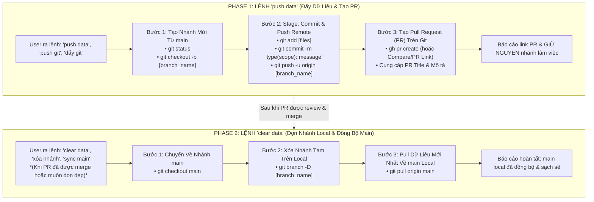

# QUY CHUẨN ĐẨY DỮ LIỆU LÊN GIT & QUẢN TRỊ PULL REQUEST (UNIVERSAL GIT WORKFLOW & PR PROTOCOL)
## Trụ Cột 9: Phân Định Rành Mạch Hai Lệnh: `push data` & `clear data` (Pillar 9)

> [!IMPORTANT]
> **Mục tiêu cốt lõi:** Đảm bảo toàn vẹn nhánh chính (`main`), triệt tiêu rủi ro xung đột hoặc ghi đè mã nguồn/dữ liệu kiểm thử trên môi trường production/main repo.
> Quy trình Git được phân định rạch ròi thành **2 lệnh độc lập**:
> 1. **Lệnh `push data`:** Tạo nhánh mới $\rightarrow$ Đẩy dữ liệu lên remote $\rightarrow$ Mở Pull Request (PR) $\rightarrow$ Giữ nguyên nhánh làm việc.
> 2. **Lệnh `clear data`:** Sau khi PR được merge (hoặc khi muốn dọn dẹp) $\rightarrow$ Xóa nhánh local $\rightarrow$ Pull dữ liệu mới nhất về `main` local.

---

## 0. LUỒNG THỰC THI CHUẨN HÓA (TWO-PHASE GIT PROTOCOL)

> [!IMPORTANT]
> **PHÂN ĐỊNH RẠCH RÒI GIỮA RULE TIÊU CHUẨN & CÔNG CỤ THỰC THI:**
> - **Rule Tiêu chuẩn (Rule 09):** Định nghĩa ranh giới đỏ tuyệt đối giữa 2 phase: Phase 1 `push data` (Tạo branch -> Push remote -> Mở PR -> Giữ nguyên branch local) và Phase 2 `clear data` (Chỉ chạy sau khi PR merge -> Checkout main -> Xóa branch local -> Pull main).
> - **Công cụ Thực thi:** Bộ lệnh Git CLI chuẩn hóa (`git checkout -b`, `git commit`, `git push`, `gh pr create`).

*Cú pháp gợi ý:*
- Lệnh 1: `push data`, `push git`, `tạo pr`.
- Lệnh 2: `clear data`, `clean git`, `xóa branch`.

---

## SƠ ĐỒ ĐIỀU PHỐI GIT PHÂN ĐỊNH (TWO-PHASE WORKFLOW)



---

## 1. QUY CHUẨN ĐẶT TÊN NHÁNH (BRANCH NAMING CONVENTION)

Khi tạo nhánh mới, tên nhánh bắt buộc phải ngắn gọn, viết thường, ngăn cách bằng dấu gạch ngang (`-`) hoặc gạch chéo (`/`), phản ánh đúng bản chất tác vụ:

| Loại Tác Vụ | Tiền Tố (Prefix) | Quy Tắc Định Danh | Ví Dụ |
| :--- | :--- | :--- | :--- |
| **Kiểm thử / Testcase / Evidence** | `test/` | `test/[mã_màn_hoặc_ticket]-[mô_tả_ngắn]` | `test/as100-testcase-evidence`<br>`test/surrealdolls-14885-verify` |
| **Báo cáo Lỗi (Bug Report)** | `bug/` hoặc `fix/` | `bug/[mã_màn]-[mã_bug]` | `bug/bb300-invalid-email`<br>`bug/ae300-badge-stg` |
| **Tính năng mới / Automation** | `feat/` | `feat/[mã_màn]-[tên_chức_năng]` | `feat/ba100-playwright-pom`<br>`feat/cache-backlog-protocol` |
| **Cập nhật Quy chuẩn (Rules)** | `rules/` | `rules/[tên_rule]-[nội_dung]` | `rules/git-workflow-two-phase`<br>`rules/verify-bug-reporting` |
| **Tài liệu / Checklist** | `docs/` | `docs/[nội_dung_cập_nhật]` | `docs/app-mobile-checklist` |
| **Đẩy tổng hợp nhiều file** | `update/` | `update/[ngày_YYYYMMDD]-[tóm_tắt]` | `update/20261120-test-reports` |

---

## 2. GIAO THỨC LỆNH `push data`: ĐẨY DỮ LIỆU & TẠO PULL REQUEST

Áp dụng khi nhận các câu lệnh: `push data`, `đẩy dữ liệu`, `push git`, `đẩy git`, `update git`, `tạo pr`.

### Quy trình 3 bước thực thi:

#### Bước 1: Tạo mới một branch từ `main`
```bash
git checkout main
git status
git checkout -b <branch_name>
```

#### Bước 2: Stage, Commit & Push lên Remote Branch
1. **Lọc file hợp lệ:** Chỉ `git add` những file thuộc phạm vi tác vụ (testcase, bugs, evidence, code automation, rules). **Tuyệt đối cấm `git add .` vô tội vạ** nếu có file rác, file nháp cá nhân, credentials hoặc binary không mong muốn:
   ```bash
   git add <danh_sách_file_thay_đổi>
   ```
2. **Commit chuẩn Conventional Commits:**
   ```bash
   git commit -m "<type>(<scope>): <mô tả ngắn gọn hành động>"
   ```
3. **Push lên Remote:**
   ```bash
   git push -u origin <branch_name>
   ```

#### Bước 3: Tạo Pull Request (PR) trên Git
1. **Nếu có GitHub CLI (`gh`):**
   ```bash
   gh pr create --title "<type>(<scope>): <tiêu đề PR>" --body "<mô tả chi tiết các thay đổi>" --base main --head <branch_name>
   ```
2. **Nếu không có `gh` CLI:**
   - Cung cấp Direct PR Link trên GitHub:
     $$\text{URL tạo PR: } \text{https://github.com/[owner]/[repo]/compare/main...<branch_name>?expand=1}$$
   - Xuất nội dung mẫu PR (Title, Body, danh sách file) để duyệt tạo ngay lập tức.
3. **GIỮ NGUYÊN NHÁNH:** Sau khi tạo PR xong, **Agent giữ nguyên nhánh làm việc** (hoặc thông báo rõ nhánh hiện tại), **KHÔNG TỰ Ý XÓA NHÁNH LOCAL** để đảm bảo dữ liệu không bị mất dấu trên máy khi PR chưa được merge.

---

## 3. GIAO THỨC LỆNH `clear data`: DỌN NHÁNH LOCAL & ĐỒNG BỘ MAIN

Áp dụng khi nhận các câu lệnh: `clear data`, `dọn git`, `xóa nhánh`, `sync main`, `dọn dẹp nhánh`, `clean git`.

> [!NOTE]
> Lệnh này thường được gọi **sau khi người dùng/team đã bấm Merge Pull Request trên GitHub**, hoặc khi người dùng muốn hủy nhánh làm việc tạm để quay về nhánh `main` mới nhất.

### Quy trình 3 bước thực thi:

#### Bước 1: Chuyển con trỏ về nhánh `main`
```bash
git checkout main
```

#### Bước 2: Xóa nhánh tạm vừa tạo trên Local
```bash
git branch -D <branch_name>
```
*(Lưu ý: Chỉ xóa nhánh local khi dữ liệu đã được push lên remote hoặc PR đã hoàn tất)*.

#### Bước 3: Pull dữ liệu mới nhất về nhánh `main` Local
```bash
git pull origin main
git status
```
*(Lúc này, toàn bộ dữ liệu vừa được merge trên GitHub sẽ được kéo đầy đủ, chính thức về nhánh `main` local; working tree đạt trạng thái sạch sẽ 100%)*.

---

## 4. RANH GIỚI ĐỎ & QUY TẮC AN TOÀN GIT (CORE GIT GUARDRAILS)

> [!CAUTION]
> **NGHIÊM CẤM VI PHẠM TRÊN TOÀN DỰ ÁN:**
>
> 1. **CẤM PUSH TRỰC TIẾP LÊN MAIN (`Zero Direct Push to Main`):** Tuyệt đối không chạy lệnh `git push origin main`. Toàn bộ dữ liệu cập nhật bắt buộc phải qua nhánh riêng và tạo Pull Request.
> 2. **CẤM XÓA NHÁNH TRONG LỆNH `push data`:** Khi thực hiện lệnh `push data`, **CẤM tự ý xóa nhánh local**. Nhánh local chỉ được xóa khi người dùng ra lệnh `clear data` (hoặc xác nhận PR đã được merge).
> 3. **BẢO TỒN DỮ LIỆU ĐÃ PUSH:** Chỉ xóa nhánh local trong lệnh `clear data` khi xác nhận nhánh đó đã tồn tại trên remote (`origin/<branch_name>`).
> 4. **CẤM COMMIT FILE CHỨA CREDENTIALS & TOKEN:** Tuyệt đối không commit file mật khẩu, token, cookie phiên hoặc file rác hệ thống.
> 5. **XỬ LÝ DIVERGENT/CONFLICT TRÊN MAIN:** Khi pull `main` ở lệnh `clear data`, nếu phát sinh conflict hoặc divergent, Agent phải thông báo rõ và xử lý hợp nhất an toàn, không được dùng `--force`.

---

## 5. MẪU BÁO CÁO KẾT QUẢ TẠI CONVERSATION

### Mẫu 1: Khi hoàn thành lệnh `push data`
```markdown
### 🚀 Báo cáo Đẩy Dữ Liệu Lên Git & Mở Pull Request (`push data`)

- **Nhánh đã đẩy (Remote Branch):** `[branch_name]` (đã push thành công lên `origin/[branch_name]`)
- **Nội dung commit:** `[commit message]`
- **Danh sách file cập nhật:**
  - `[đường dẫn file 1]`
  - `[đường dẫn file 2]`
- **Pull Request:**
  - **Tiêu đề:** `[PR Title]`
  - **Link tạo / xem PR:** [Mở Pull Request trên GitHub](https://github.com/[owner]/[repo]/compare/main...[branch_name]?expand=1)
- **Trạng thái nhánh local:** Đang ở nhánh `[branch_name]`. Nhánh được giữ nguyên trên local chờ bạn review/merge PR.
*(💡 Khi bạn đã merge PR trên GitHub xong, hãy gõ `clear data` để dọn nhánh local và đồng bộ `main` mới nhất!)*
```

### Mẫu 2: Khi hoàn thành lệnh `clear data`
```markdown
### 🧹 Báo cáo Dọn Nhánh Local & Đồng Bộ Main (`clear data`)

- **Nhánh local đã xóa:** `[branch_name]` (`git branch -D [branch_name]`)
- **Trạng thái nhánh hiện tại:** `main` (`git checkout main`)
- **Đồng bộ remote:** Đã kéo dữ liệu mới nhất từ `origin/main` (`git pull origin main`)
- **Trạng thái Git:** `Working tree clean` - Nhánh `main` local hoàn toàn đồng bộ với remote.
```
