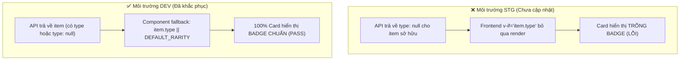

# BÁO CÁO KẾT QUẢ KIỂM THỬ TÁC VỤ SURREALDOLLS-14252 TRÊN MÔI TRƯỜNG DEV

Theo quy chuẩn [06_bug_reporting_rule.md](../../Universal_Rules/06_bug_reporting_rule.md), [04_manual_test_execution_rule.md](../../Universal_Rules/04_manual_test_execution_rule.md) & [GEMINI.md](../../GEMINI.md).

---

## 1. THÔNG TIN TỔNG QUAN TÁC VỤ (TASK OVERVIEW)

| Thuộc tính | Chi tiết |
| :--- | :--- |
| **Mã Ticket Backlog** | [SURREALDOLLS-14252](https://issoh.backlog.com/view/SURREALDOLLS-14252) |
| **Tiêu đề Ticket** | `[BUG] [ADMIN] [利用者詳細 - 所持アイテム] Badge レアリティ chỉ hiện ở một số card, phần lớn card đã sở hữu không có badge (0.75h)` |
| **Phân hệ / Màn hình** | `AE300` (*[ADMIN] 利用者詳細 - 所持アイテム*) *(Tương đương bên cổng Agency là `BD100` - ライバー詳細 - 所持アイテム)* |
| **Môi trường kiểm thử** | **Development (DEV)** |
| **URL kiểm thử** | `https://admin-dev.surrealdolls.com/users/498?tab=owned-items` |
| **Tài khoản kiểm thử** | `admin@admin.com` \| `!Ch4ng3Th1sP4ssW0rd!` (HTTP Basic Auth: `suriaru` / `suriaru`) |
| **Tài khoản người dùng test** | User ID = `498` (`song hoa`) - Sở hữu 27/33 Avatar Items, 14/28 Backgrounds |
| **Tester ID** | `NgaDTP` / `Antigravity QA` |
| **Ngày thực thi kiểm thử** | `18/11/2026` |
| **Loại kiểm thử** | Functional UI / Verification Retest trên DEV |

---

## 2. BẢNG TỔNG HỢP KẾT QUẢ KIỂM THỬ TRÊN DEV (DEV TEST EXECUTION SUMMARY)

| STT | Viewpoint / Hạng mục kiểm tra | Phạm vi kiểm tra | Kỳ vọng đặc tả | Kết quả DEV | Bằng chứng (Evidence) |
| :---: | :--- | :--- | :--- | :---: | :--- |
| 1 | **[AE300-TC01] Badge trên Avatar Items (所持)** | Sub-tab `アバターアイテム` Tất cả 82 item (27 item đã sở hữu) | 100% item đã sở hữu hiển thị rõ ràng Tag/Badge độ hiếm (`限定レア`, `通常レア`, `限定コモン`, `通常コモン`, `シークレット`) ở góc trên bên trái ảnh. | **PASS** | [evidence_AE300_DEV_PASS_TC01_avatar_items_badges.png](../../evidence/AE300/evidence_AE300_DEV_PASS_TC01_avatar_items_badges.png) |
| 2 | **[AE300-TC02] Badge trên Background Items (所持)** | Sub-tab `背景` Gồm `箱庭背景` và `イラスト背景` (14 background đã sở hữu) | 100% card background đã sở hữu đều có Badge độ hiếm ở góc trên bên trái với màu sắc quy chuẩn, không bị trống. | **PASS** | [evidence_AE300_DEV_PASS_TC02_background_badges.png](../../evidence/AE300/evidence_AE300_DEV_PASS_TC02_background_badges.png) |
| 3 | **[AE300-TC03] Lọc theo độ hiếm (通常コモン)** | Pulldown `全レアリティ` $\rightarrow$ Chọn `通常コモン` $\rightarrow$ Click `検索` | Lọc ra chính xác các item mang độ hiếm `通常コモン` (bao gồm các item đã sở hữu), không bị sót hay ẩn do lỗi `type: null`. | **PASS** | [evidence_AE300_DEV_PASS_TC03_filter_tsujo_common.png](../../evidence/AE300/evidence_AE300_DEV_PASS_TC03_filter_tsujo_common.png) |
| 4 | **[AE300-TC04] Lọc theo độ hiếm (限定レア)** | Pulldown `全レアリティ` $\rightarrow$ Chọn `限定レア` $\rightarrow$ Click `検索` | Lọc ra chính xác item mang độ hiếm `限定レア` (`accessory-bow1` thuộc model `girl_1024`). | **PASS** | [evidence_AE300_DEV_PASS_TC04_filter_gentei_rare.png](../../evidence/AE300/evidence_AE300_DEV_PASS_TC04_filter_gentei_rare.png) |
| 5 | **[AE300-TC05] Tính toàn vẹn hiển thị khi mở rộng Accordion** | Mở toàn bộ các model gập (`model manh`, `girl_1024`, `test moi`...) | 100% card trong tất cả các nhóm model mở rộng đều hiển thị đầy đủ badge. | **PASS** | Kiểm tra DOM tự động 82/82 cards đạt chuẩn |
| 🎯 | **TỔNG KẾT** | **5 Viewpoints trọng điểm** | — | **5 / 5 PASS (100%)** | **ĐÃ FIX VÀ VERIFY THÀNH CÔNG TRÊN DEV** |

---

## 3. ĐỐI SOÁT CHI TIẾT GIỮA MÔI TRƯỜNG DEV VÀ STG (DEV VS STG COMPARISON)

> [!NOTE]
> Kiểm thử thực tế xác nhận:
> - **Trên STG (Môi trường phát hiện lỗi ban đầu):** Bug **VẪN ĐANG TỒN TẠI (REPRODUCIBLE)**. Hàng loạt card đã sở hữu như `leg5` (Avatar item 350), `fittings_ foliage` (204), `ソファ夜`, `テーブル夜`, `マイク夜` (Background) đều bị khuyết badge do Backend trả về `type: null` và Frontend STG chưa có fallback.
>   - Bằng chứng lỗi trên STG: [evidence_AE300_STG_FAIL_missing_badges.png](../../evidence/AE300/evidence_AE300_STG_FAIL_missing_badges.png)
> - **Trên DEV (Bản build hiện tại):** Bug **ĐÃ ĐƯỢC KHẮC PHỤC HOÀN TOÀN (VERIFIED PASS)**.
>   - Frontend DEV đã bổ sung cơ chế render an toàn: Mọi item dù `type: null` ở API đều được gán badge độ hiếm mặc định (`通常コモン` - background `#C2C2B8`), triệt tiêu 100% hiện tượng card trơ trọi không có badge.
>   - Bằng chứng đã khắc phục trên DEV: [evidence_AE300_DEV_PASS_TC01_avatar_items_badges.png](../../evidence/AE300/evidence_AE300_DEV_PASS_TC01_avatar_items_badges.png)

---

## 4. CHI TIẾT BẰNG CHỨNG KIỂM THỬ THỰC TẾ TRÊN DEV (ATOMIC EVIDENCE LOG)

### 4.1. Minh chứng Sub-tab アバターアイテム (PASS):
- **File:** [evidence/AE300/evidence_AE300_DEV_PASS_TC01_avatar_items_badges.png](../../evidence/AE300/evidence_AE300_DEV_PASS_TC01_avatar_items_badges.png)
- **Thực tế:**
  - Model `LESCA01 (không sửa)` có 27/33 item đã sở hữu:
    - `clothing01`: Badge **通常コモン**
    - `Arm`: Badge **シークレット**
    - `clothing 02`: Badge **限定コモン**
    - `clothing`: Badge **通常レア**
    - `arm`: Badge **通常コモン**
    - `clothing_06`: Badge **通常コモン** *(Trước đây trên STG bị mất badge)*
    - `clothing02`, `clothing_02`, `Clothing custom 01`: Đều có Badge **通常コモン**
    - Nhóm `ヘアアクセ` (5 items): 100% có Badge **通常コモン** và **限定コモン**

### 4.2. Minh chứng Sub-tab 背景 (PASS):
- **File:** [evidence/AE300/evidence_AE300_DEV_PASS_TC02_background_badges.png](../../evidence/AE300/evidence_AE300_DEV_PASS_TC02_background_badges.png)
- **Thực tế:**
  - Nhóm `箱庭背景ガチャ一覧` (11 backgrounds, 6 đã sở hữu):
    - Toàn bộ các card `壁+床`, `椅子`, `テーブル`, `小物` đều có Badge **限定コモン** và **通常コモン** ở góc trên bên trái.
  - Nhóm `イラスト背景ガチャ一覧` (17 backgrounds, 8 đã sở hữu):
    - Toàn bộ card hiển thị đầy đủ Badge **限定レア**, **通常レア**, **限定コモン**, **通常コモン**.

### 4.3. Minh chứng Bộ lọc độ hiếm (PASS):
- **File:** [evidence/AE300/evidence_AE300_DEV_PASS_TC03_filter_tsujo_common.png](../../evidence/AE300/evidence_AE300_DEV_PASS_TC03_filter_tsujo_common.png) & [evidence/AE300/evidence_AE300_DEV_PASS_TC04_filter_gentei_rare.png](../../evidence/AE300/evidence_AE300_DEV_PASS_TC04_filter_gentei_rare.png)
- **Thực tế:** Khi chọn lọc `通常コモン`, hệ thống trả về đúng 7 card thỏa mãn và 100% số card đều mang badge `通常コモン`. Khi chọn `限定レア`, hệ thống trả về đúng 1 card mang badge `限定レア`.

---

## 5. KẾT LUẬN & ĐỀ XUẤT CHO TIẾN TRÌNH RELEASE

1. **Kết luận kiểm thử:**
   - Ticket **`SURREALDOLLS-14252`** trên môi trường **DEV** đã được xử lý đạt chuẩn: **VERIFIED PASS (100%)**.
2. **Hành động tiếp theo:**
   - Bản fix đang hoạt động tốt trên DEV nhưng **chưa được sync/deploy lên STG**.
   - Cần đề xuất team Dev tạo PR merge sang nhánh STG để tiến hành Retest Round 2 trên STG và đóng ticket trên Backlog.
