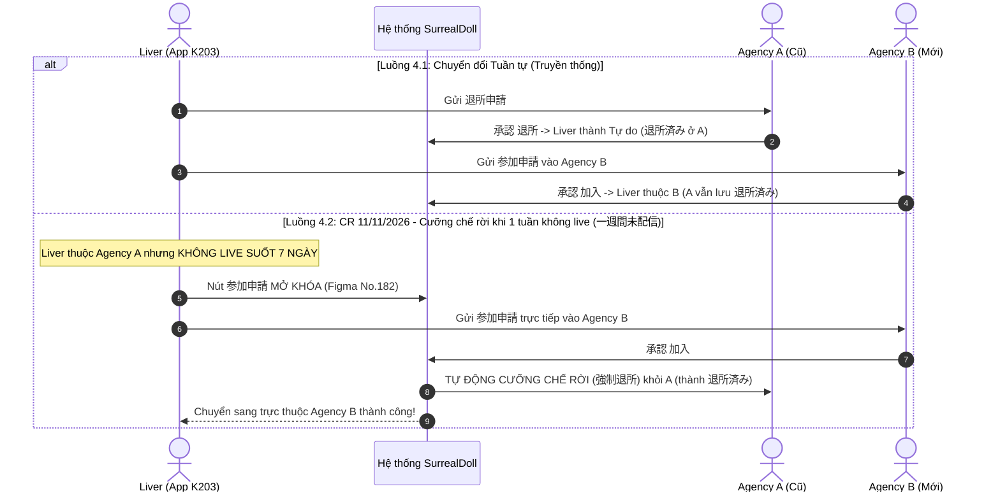

# KỊCH BẢN KIỂM THỬ TÍCH HỢP TỔNG THỂ (END-TO-END TEST SCENARIOS)
## Task: [SURREALDOLLS-14230](https://issoh.backlog.com/view/SURREALDOLLS-14230) - `[TEST] K203 + BC100 + BC200 - Test tích hợp luồng liver và agency`
### Phân hệ kiểm thử: App Mobile (K203) ⟷ Agency Web (BC100 / BC200) ⟷ Master Admin (AD302 / AE200)
### Áp dụng quy chuẩn: Trụ Cột 2 & Trụ Cột 4 (`Universal_Rules/02_manual_ui_test_case_rule.md` & `04_manual_test_execution_rule.md`)

---

## I. TỔNG QUAN KIẾN TRÚC KỊCH BẢN (TEST SCENARIO ARCHITECTURE)

Hệ thống kiểm thử tích hợp luồng Liver và Agency quản lý chu kỳ sống (Lifecycle) của Liver thông qua 4 trạng thái nghiệp vụ và các sự kiện đồng bộ 2 chiều:

```mermaid
flowchart TD
    subgraph S1["Kịch bản 1: SCN-01 - Happy Path Vòng Đời Toàn Vẹn"]
        A1["Liver Tự do (State 1)<br>App K203"] -->|"1. Gửi 参加申請"| A2["Liver Chờ duyệt (State 2)<br>BC100: 申請中"]
        A2 -->|"2. Agency BC200: 承認"| A3["Liver Trực thuộc (State 3)<br>BC100: 所属済み"]
        A3 -->|"3. Gửi 退所申請"| A4["Liver Chờ rời (State 4)<br>BC100: 退所申請中"]
        A4 -->|"4. Agency BC200: 承認"| A5["Liver Trở về Tự do (State 1)<br>BC100: 退所済み"]
    end

    subgraph S2["Kịch bản 2: SCN-02 - Rejection Flow (Xử Lý Từ Chối)"]
        B1["Đơn xin vào (State 2)"] -->|"Agency 却下"| B2["Về State 1, biến khỏi BC100 (được xin lại)"]
        B3["Đơn xin rời (State 4)"] -->|"Agency 却下"| B4["Về State 3 所属済み (giữ nguyên quyền)"]
    end

    subgraph S3["Kịch bản 3: SCN-03 - Re-Join Flow (Tái Gia Nhập Cùng Agency)"]
        C1["Liver đã 退所済み"] -->|"Gửi 参加申請 lại"| C2["BC100 cập nhật dòng cũ sang 申請中"]
        C2 -->|"Nếu 却下"| C3["Khôi phục lại trạng thái 退所済み (không xóa bản ghi)"]
    end

    subgraph S4["Kịch bản 4: SCN-04 - Agency Transfer (Chuyển Đổi Agency)"]
        D1["Luồng 4.1 Tuần tự:<br>Rời A hoàn tất -> Xin vào B"]
        D2["Luồng 4.2 CR 11/11 (一週間未配信):<br>1 tuần không live -> Xin B trực tiếp -> B duyệt -> Cưỡng chế rời A"]
    end

    subgraph S5["Kịch bản 5: SCN-05 - Security & Boundary Testing"]
        E1["Bypass API trái phép khi sai trạng thái"]
        E2["Bảo mật phân quyền URL IDOR (MSG254)"]
        E3["Validate mã Agency ID & Chặn Agency Deactive (CMMSG56)"]
    end

    subgraph S6["Kịch bản 6: SCN-06 - Concurrency & Resiliency"]
        F1["2 Admin cùng duyệt/từ chối 1 đơn (Race Condition MSG255)"]
        F2["Debounce chống click lặp (Double Submit)"]
        F3["Ngoại lệ mất mạng khi gửi đơn"]
    end
```

---

## II. MA TRẬN KỊCH BẢN KIỂM THỬ (TEST SCENARIO MATRIX)

| Scenario ID | Tên Kịch Bản Kiểm Thử | Mục Tiêu & Trọng Tâm Xác Minh | Tác Tử & Môi Trường | Độ Ưu Tiên |
| :---: | :--- | :--- | :--- | :---: |
| **`SCN-01`** | **Happy Path: Vòng đời toàn vẹn Gia nhập & Rút khỏi Agency** | Kiểm tra thông luồng khép kín từ lúc Liver nộp đơn, Agency duyệt vào, mở khóa tính năng, Liver xin rời và Agency duyệt cho rời. | App Mobile (LV-E1), Agency A (TB1), Master Admin (TB2) | **Critical** |
| **`SCN-02`** | **Rejection Flow: Xử lý từ chối đơn Gia nhập & Rút lui** | Kiểm tra khi Agency từ chối (`却下`): đơn vào bị hủy và biến khỏi danh sách BC100; đơn rời bị từ chối thì Liver quay lại trạng thái `所属済み`. | App Mobile (LV-E2, LV-E3), Agency A | **High** |
| **`SCN-03`** | **Re-Join Flow: Tái gia nhập cùng Agency cũ sau khi đã rời** | Kiểm tra Liver đã `退所済み` xin vào lại cùng Agency: ghi nhận trên cùng 1 record cũ (Single Record Rule), kiểm tra khi duyệt và khi từ chối. | App Mobile (LV-E4, LV-E5), Agency A | **High** |
| **`SCN-04`** | **Agency Transfer: Chuyển đổi Agency & Change Request 11/11/2026** | • Case 4.1: Rời Agency A hoàn tất $\rightarrow$ Gia nhập Agency B. • Case 4.2: Áp dụng **CR 11/11/2026** (1 tuần không live $\rightarrow$ Xin B trực tiếp $\rightarrow$ B duyệt $\rightarrow$ Cưỡng chế rời A). • Case 4.3: Có live trong 7 ngày $\rightarrow$ Nút xin gia nhập bị khóa. | App Mobile (LV-E6, LV-CR1, LV-CR2), Agency A, Agency B | **Critical** |
| **`SCN-05`** | **Security & Boundaries: Chặn bypass API & Phân quyền URL** | Chặn bypass gọi API Join/Leave sai trạng thái; kiểm tra API Cancel đã xóa (404/405); bảo mật URL IDOR giữa 2 Agency (`MSG254`); validate Agency Deactive (`CMMSG56`). | Postman / Curl, Agency A, Agency B | **High** |
| **`SCN-06`** | **Concurrency & Resiliency: Tranh chấp đồng thời & Ngoại lệ mạng** | 2 Admin cùng mở 1 đơn và duyệt/từ chối ngược nhau (báo `MSG255`); cơ chế Debounce chống double-click; xử lý mất kết nối mạng bất ngờ khi submit. | App Mobile, 2 Trình duyệt riêng biệt (AG-A1, AG-A2) | **Medium** |

---

## III. CHI TIẾT CÁC KỊCH BẢN KIỂM THỬ TỪNG BƯỚC (STEP-BY-STEP EXECUTION)

### KỊCH BẢN 1: `SCN-01` - HAPPY PATH (VÒNG ĐỜI TOÀN VẸN GIA NHẬP & RÚT KHỎI AGENCY)

* **Mục tiêu:** Xác minh tính đồng bộ dữ liệu thời gian thực giữa App K203, Web Agency BC100/BC200 và Web Master AD302 trong toàn bộ chu kỳ sống của Liver.
* **Tiền điều kiện (Preconditions):**
  - Tài khoản Liver `LV-E1` đang ở trạng thái Tự do (State 1 - chưa thuộc Agency nào).
  - Agency A (`AG-A`) đang ở trạng thái hoạt động (`利用中`), ghi lại mã `agency_code` (Ví dụ: `AGA001`).
  - Trình duyệt 1 (TB1) đăng nhập Agency A (`agency01`); Trình duyệt 2 (TB2) đăng nhập Master Admin (`admin@admin.com`).

#### Bảng các bước thực hiện chi tiết:

| Bước | Tác tử & Màn hình | Thao tác thực hiện (Action Steps) | Kết quả kỳ vọng trên UI | Kết quả kỳ vọng Hệ thống / API |
| :---: | :--- | :--- | :--- | :--- |
| **1.1** | **Liver (App K203)** | 1. Đăng nhập App với tài khoản `LV-E1`. 2. Mở `Mypage › 設定 › アカウント設定`. 3. Cuộn đến khối `事務所`. 4. Bấm nút màu cam `参加申請`. 5. Tại modal `事務所申込`, nhập `agency_code` của Agency A vào ô `事務所ID`. 6. Bấm `申請する` (Ghi lại thời điểm $T_1$). | • Tại màn K203: Ô `事務所ID` để trống, nút `参加申請` màu cam có thể bấm. • Khi bấm nút: Hiển thị Modal tiêu đề `事務所申込` kèm nút `✕` và nút `申請する`. • Khi bấm Submit: Hiển thị Toast `MSG50` (`申請が完了しました。`), modal tự động đóng. • Khối `事務所` chuyển sang **State 2**: Ô `事務所ID` hiển thị mã Agency A, xuất hiện text `参加申請（承認待ち）`, toàn bộ nút bấm biến mất. | • Gửi request: `POST /users/join-agency/{agency_code}`. • Phản hồi: `200 OK`. • Database tạo bản ghi liên kết mới với trạng thái `PENDING (3)`. |
| **1.2** | **Agency A (Web BC100)** | 1. Mở TB1, truy cập `ライバー管理 › ライバー一覧` (BC100). 2. Chọn bộ lọc `事務所ステータス` = `申請中`, bấm `検索`. | • Danh sách hiển thị chính xác bản ghi của Liver `LV-E1`. • Badge cột `事務所ステータス` [31] hiển thị màu cam `申請中`. • Cột `加入日時` [33] hiển thị chính xác thời điểm nộp đơn $T_1$ theo định dạng `yyyy/mm/dd hh:mm`. | • Gọi API: `GET /my-agency/users?agency_member_status=3`. • Dữ liệu trả về đúng `user_id` của `LV-E1`. |
| **1.3** | **Agency A (Web BC200)** | 1. Click vào dòng của `LV-E1` trên BC100 để điều hướng sang `BC200`. 2. Quan sát trạng thái khóa của form chi tiết. 3. Bấm nút `承認` tại khối thông báo tiếp nhận. 4. Tại modal xác nhận `24.1`, bấm `承認する`. | • **Trước khi duyệt:** Badge [10] hiển thị `申請中`. Hiển thị khối thông báo đơn xin gia nhập kèm 2 nút `承認` và `却下`. Toàn bộ các trường `ステータス` [8], `配信権限` [9], `カテゴリー` [28], nút `保存` [27] và nhóm Quick Navigation [23] đều bị **Disabled** (chế độ chỉ xem). • **Khi bấm 承認:** Hiển thị modal `24.1` tiêu đề: `加入申請を承認しますか？`. • **Khi xác nhận:** Hiển thị Toast `MSG256` (`加入申請を承認しました`), khối duyệt ẩn đi, badge [10] đổi sang `所属済み`. Toàn bộ form và Quick Navigation được **mở khóa**. | • Gửi request: `PATCH /agency/{agency_id}/user/{user_id}` với `is_approve: true`. • Phản hồi: `200 OK`. • Database cập nhật trạng thái Liver thành `ACTIVE (1)`. |
| **1.4** | **Liver (App K203)** | 1. Trên App, thoát khỏi màn `アカウント設定` rồi vào lại (Tải lại dữ liệu). 2. Quan sát khối `事務所`. | • Giao diện khối `事務所` chuyển sang **State 3**. • Nhãn `事務所ID` hiển thị đúng mã Agency A. • Không còn text chờ duyệt, xuất hiện nút màu cam **`退所申請`** (không có nút `参加申請`). | • Gọi API: `GET /users/me`. • Phản hồi trả về thông tin `agency.agency_code = AGA001`, `agency.status = 1`. |
| **1.5** | **Master (Web AD302)** | 1. Mở TB2, truy cập `AD302` (`事務所詳細 › ライバー一覧`) của Agency A. 2. Tìm kiếm Liver `LV-E1`. | • Bản ghi `LV-E1` hiển thị trạng thái `所属済み` đồng nhất với Web Agency. | • Dữ liệu nhất quán toàn hệ thống. |
| **1.6** | **Liver (App K203)** | 1. Tại màn `アカウント設定` (State 3), bấm nút `退所申請`. 2. Quan sát popup xác nhận (chuẩn CMR03). 3. Bấm nút `退所申請する`. | • Hiển thị popup xác nhận: `退所申請してもよろしいですか？` kèm 2 nút `退所申請する` (Submit) và `キャンセル` (Hủy). • Khi xác nhận: Hiển thị Toast `MSG42` (`退所申請が完了しました。`), popup tự đóng. • Giao diện chuyển sang **State 4**: Hiển thị ID Agency A kèm text `退所申請（承認待ち）`, không có nút bấm nào. | • Gửi request: `POST /users/request-leave-agency/{agency_code}`. • Phản hồi: `200 OK`. • Database chuyển trạng thái Liver sang `PENDING_LEAVE (5)`. |
| **1.7** | **Agency A (Web BC100/200)** | 1. Trên TB1, tải lại BC100: Lọc `事務所ステータス` = `退所申請中` $\rightarrow$ Thấy `LV-E1`. 2. Click mở `BC200` của `LV-E1`. 3. Quan sát giao diện và bấm nút `承認` tại khối xin rời. 4. Tại modal xác nhận `24.2`, bấm `承認する`. | • **Tại BC200:** Badge [10] hiển thị `退所申請中`. Hiển thị khối duyệt xin rời kèm 2 nút `承認` và `却下`. Form chi tiết vẫn cho phép chỉnh sửa thông tin. • **Khi bấm 承認:** Hiển thị modal `24.2` (`退所申請を承認しますか？ 承認すると、{liver_name}さんの事務所ステータスが「退所済み」になります。この操作は取り消せません。`). • **Khi xác nhận:** Hiển thị Toast `MSG258` (`退所申請を承認しました`). Khối duyệt ẩn đi, badge [10] đổi sang `退所済み`. Toàn bộ form chuyển sang chế độ **Chỉ xem (View-only)**, nút `保存` bị Disabled. | • Gửi request: `PATCH /agency/{agency_id}/user/{user_id}` với `is_approve: true`. • Phản hồi: `200 OK`. • Database chuyển trạng thái Liver sang `LEAVE (6)`. |
| **1.8** | **Đồng bộ cuối cùng** | 1. Phía App: Liver thoát ra vào lại `アカウント設定`. 2. Phía Web Agency: Tải lại danh sách BC100. | • **Phía App:** Khối `事務所` trở về **State 1** (Tự do): Ô `事務所ID` để trống, xuất hiện lại nút màu cam `参加申請`. • **Phía Agency:** Bản ghi `LV-E1` **vẫn tồn tại** trong danh sách BC100 với badge xám `退所済み`. | • Hoàn tất chu kỳ sống khép kín. |

---

### KỊCH BẢN 2: `SCN-02` - REJECTION FLOW (XỬ LÝ TỪ CHỐI GIA NHẬP VÀ RÚT LUI)

* **Mục tiêu:** Xác minh hệ thống xử lý chính xác khi Agency Quản trị từ chối đơn của Liver.
* **Tiền điều kiện:** 
  - Sub-case 2.1: Liver `LV-E2` đang ở State 2 (có đơn `申請中` gửi vào Agency A).
  - Sub-case 2.2: Liver `LV-E3` đang ở State 4 (đang thuộc Agency A và có đơn `退所申請中`).

#### Bảng các bước thực hiện chi tiết:

| Bước | Nhánh Thao Tác | Thao tác thực hiện (Action Steps) | Kết quả kỳ vọng trên UI | Kết quả kỳ vọng Hệ thống / API |
| :---: | :--- | :--- | :--- | :--- |
| **2.1.1** | **Từ chối Gia nhập** *(Join Rejection - Agency Web)* | 1. Agency A mở `BC200` của Liver `LV-E2` (`申請中`). 2. Bấm nút `却下` tại khối tiếp nhận đơn. 3. Tại modal xác nhận `25.1`, bấm `却下する`. | • Hiển thị modal `25.1` tiêu đề: `加入申請を却下しますか？`. • Khi xác nhận: Hiển thị Toast thông báo `MSG257` (`加入申請を却下しました`). • Hệ thống tự động điều hướng quay về màn hình danh sách `BC100`. | • Gửi request: `PATCH /agency/{agency_id}/user/{user_id}` với `is_approve: false`. • Phản hồi: `200 OK`. • Database xóa liên kết chờ duyệt của `LV-E2` với Agency A. |
| **2.1.2** | **Từ chối Gia nhập** *(Kiểm tra Danh sách BC100)* | 1. Trên màn hình BC100, tìm kiếm theo tên hoặc ID của `LV-E2`. | • Bản ghi của `LV-E2` **biến mất hoàn toàn** khỏi danh sách BC100 của Agency A (kể cả khi chọn filter `全ての所属状態`). | • Query DB không còn record liên kết giữa `LV-E2` và Agency A. |
| **2.1.3** | **Từ chối Gia nhập** *(Bảo mật URL BC200)* | 1. Trên thanh địa chỉ trình duyệt của Agency A, dán trực tiếp link chi tiết: `.../agencies/liver/detail/{LV-E2_user_id}`. | • Không hiển thị thông tin Liver. • Hiển thị thông báo lỗi bảo mật **`MSG254`** (`このライバーを閲覧する権限がありません。`) hoặc tự động redirect về BC100. | • API trả về `403 Forbidden` hoặc `404 Not Found`. |
| **2.1.4** | **Từ chối Gia nhập** *(Đồng bộ App Liver)* | 1. Mở App Liver `LV-E2`, thoát màn `アカウント設定` rồi vào lại. | • Khối `事務所` trở về **State 1** (Tự do): Ô `事務所ID` trống, nút `参加申請` màu cam hiển thị lại. • Liver `LV-E2` có thể nộp lại đơn vào Agency A hoặc Agency khác bình thường. | • API `GET /users/me` trả về thông tin user tự do (`agency = null`). |
| **2.2.1** | **Từ chối Cho rời** *(Leave Rejection - Agency Web)* | 1. Agency A mở `BC200` của Liver `LV-E3` (`退所申請中`). 2. Bấm nút `却下` tại khối xin rời. 3. Tại modal xác nhận `25.2`, bấm `却下する`. | • Hiển thị modal `25.2`: `退所申請を却下しますか？ 却下すると、事務所ステータスが「所属済み」に戻ります。`. • Khi xác nhận: Hiển thị Toast `MSG259` (`退所申請を却下しました`). • Badge [10] tự động đổi từ `退所申請中` về lại **`所属済み`**. • Khối duyệt xin rời ẩn đi, các trường thông tin giữ nguyên quyền chỉnh sửa. | • Gửi request: `PATCH /agency/{agency_id}/user/{user_id}` với `is_approve: false`. • Phản hồi: `200 OK`. • Database khôi phục trạng thái Liver về `ACTIVE (1)`. |
| **2.2.2** | **Từ chối Cho rời** *(Đồng bộ App Liver)* | 1. Mở App Liver `LV-E3`, vào lại `アカウント設定`. | • Giao diện chuyển từ State 4 trở về lại **State 3** (`所属済み`). • Ô `事務所ID` vẫn hiển thị mã Agency A. • Nút màu cam `退所申請` hiển thị trở lại. Liver vẫn thuộc quyền quản lý của Agency A. | • API `GET /users/me` trả về trạng thái `agency.status = 1`. |

---

### KỊCH BẢN 3: `SCN-03` - RE-JOIN FLOW (TÁI GIA NHẬP CÙNG AGENCY CŨ)

* **Mục tiêu:** Xác minh cơ chế **Single Record Rule** (không nhân bản dòng dữ liệu) khi một Liver từng rút khỏi Agency muốn nộp đơn xin gia nhập lại chính Agency đó.
* **Tiền điều kiện:** 
  - Liver `LV-E4` đã từng thuộc Agency A và hiện có trạng thái `退所済み` (có sẵn 1 bản ghi trên BC100 của Agency A).
  - Liver `LV-E5` có trạng thái `退所済み` tại Agency A (dùng cho nhánh kiểm thử Từ chối).

#### Bảng các bước thực hiện chi tiết:

| Bước | Nhánh Thao Tác | Thao tác thực hiện (Action Steps) | Kết quả kỳ vọng trên UI | Kết quả kỳ vọng Hệ thống / API |
| :---: | :--- | :--- | :--- | :--- |
| **3.1** | **Liver nộp lại đơn** | 1. Trên App Liver `LV-E4`, mở `アカウント設定` (đang ở State 1). 2. Bấm `参加申請`, nhập lại đúng mã `agency_code` của Agency A. 3. Bấm `申請する` (Ghi lại thời điểm $T_2$). | • App hiển thị Toast `MSG50` (`申請が完了しました。`). • Khối `事務所` chuyển sang State 2 (`参加申請（承認待ち）`). | • Gửi `POST /users/join-agency/{agency_code}`. • Phản hồi: `200 OK`. |
| **3.2** | **Kiểm tra BC100 (Single Record Rule)** | 1. Trên Web Agency A, mở BC100 và tìm kiếm Liver `LV-E4`. | • **Hệ thống KHÔNG tạo ra dòng dữ liệu thứ 2.** • Bản ghi cũ của `LV-E4` tự động cập nhật badge từ `退所済み` sang **`申請中`**. • Cột `加入日時` [33] được cập nhật thành thời điểm nộp đơn mới nhất $T_2$. | • API trả về danh sách chỉ có duy nhất 1 object đại diện cho `LV-E4`. |
| **3.3A** | **Nhánh A: Agency Duyệt lại (`承認`)** | 1. Mở `BC200` của `LV-E4`. 2. Bấm `承認` $\rightarrow$ Xác nhận modal `24.1`. | • Hiển thị Toast `MSG256` (`加入申請を承認しました`). • Badge [10] chuyển thành `所属済み`. • Mở khóa form cấu hình. • Toàn bộ lịch sử bán hàng, livestream và tin nhắn trước đây của Liver được bảo lưu nguyên vẹn và tiếp tục cộng dồn. | • Cập nhật trạng thái bản ghi hiện có thành `ACTIVE (1)`. |
| **3.3B** | **Nhánh B: Agency Từ chối lại (`却下`)** | 1. Thực hiện các bước 3.1 & 3.2 với Liver `LV-E5`. 2. Agency A mở `BC200` của `LV-E5` và bấm `却下` $\rightarrow$ Xác nhận modal `25.1`. | • Hiển thị Toast `MSG257` (`加入申請を却下しました`). • **Quy tắc đặc thù khi tái gia nhập:** Bản ghi **KHÔNG BỊ XÓA** khỏi BC100 (khác với xin lần đầu) mà tự động khôi phục về trạng thái **`退所済み`**. • Form BC200 chuyển về lại chế độ Chỉ xem (View-only). • Phía App Liver: Trở về State 1 (Tự do). | • Database cập nhật trạng thái Liver quay trở lại `LEAVE (6)`, không xóa dòng dữ liệu. |

---

### KỊCH BẢN 4: `SCN-04` - AGENCY TRANSFER (LUỒNG CHUYỂN ĐỔI AGENCY & CR 11/11/2026)

* **Mục tiêu:** Xác minh việc chuyển đổi từ Agency A sang Agency B theo cả luồng chuẩn truyền thống và luồng đặc thù Change Request ngày 11/11/2026.

#### Bảng các bước thực hiện chi tiết:

| Bước | Nhánh Thao Tác | Thao tác thực hiện (Action Steps) | Kết quả kỳ vọng trên UI | Kết quả kỳ vọng Hệ thống / API |
| :---: | :--- | :--- | :--- | :--- |
| **4.1.1** | **Chuyển đổi Tuần tự** *(Rời Agency A)* | 1. Liver `LV-E6` đang thuộc Agency A gửi `退所申請`. 2. Agency A phê duyệt `承認` đơn rút lui. | • Phía App K203: Chuyển về State 1 (Tự do). • Phía Agency A: Lưu 1 bản ghi `退所済み`. | • Liver trở thành tài khoản tự do trên hệ thống. |
| **4.1.2** | **Chuyển đổi Tuần tự** *(Gia nhập Agency B)* | 1. Trên App Liver `LV-E6`, bấm `参加申請`, nhập mã Agency B (`AG-B`). 2. Agency B mở BC100 thấy đơn `申請中`, mở BC200 và bấm `承認`. | • Phía App: Khối `事務所` chuyển sang State 3 với mã Agency B. • Phía Agency B: Hiển thị 1 bản ghi `所属済み`. • Phía Agency A: Vẫn giữ nguyên 1 bản ghi `退所済み` (dữ liệu lịch sử độc lập). | • Dữ liệu giữa 2 Agency hoàn toàn phân lập, không bị đè chéo. |
| **4.2.1** | **CR 11/11: Kiểm tra Điều kiện Tiên quyết** | 1. Chuẩn bị Liver `LV-CR1` đang thuộc Agency A (`所属済み`). 2. Kiểm tra Database/Log đảm bảo Liver này **không có phiên livestream nào trong vòng 7 ngày qua**. | • Liver thỏa mãn điều kiện `一週間未配信`. | • DB: Thời điểm kết thúc phiên live gần nhất $> 7$ ngày (hoặc chưa từng live). |
| **4.2.2** | **CR 11/11: Mở khóa nút trên App K203** | 1. Mở App Liver `LV-CR1`, truy cập `Mypage › 設定 › アカウント設定 › 事務所`. | • Giao diện hiển thị **CÙNG LÚC** cả 2 nút bấm (theo Figma K202 No.182): &nbsp;&nbsp;+ Nút `退所申請` (Màu cam, xin rời Agency A). &nbsp;&nbsp;+ Nút `参加申請` (**Ở trạng thái Enable**, cho phép xin gia nhập Agency mới). | • Hệ thống kiểm tra điều kiện live và kích hoạt nút `参加申請`. |
| **4.2.3** | **CR 11/11: Gửi đơn sang Agency B** | 1. Bấm nút `参加申請`, nhập mã của Agency B. 2. Bấm `申請する`. | • Hiển thị Toast `MSG50` (`申請が完了しました。`). • Khối `事務所` chuyển sang hiển thị đơn chờ duyệt của Agency B. | • Gửi request `POST /users/join-agency/{agency_code_B}` thành công. |
| **4.2.4** | **CR 11/11: Agency B Duyệt & Cưỡng chế rời Agency A** | 1. Đăng nhập Web của Agency B: Mở BC100 thấy đơn `LV-CR1`, mở BC200 và bấm `承認`. 2. Đăng nhập Web của Agency A: Mở BC100 kiểm tra trạng thái của `LV-CR1`. 3. Mở App Liver `LV-CR1` tải lại màn hình. | • **Phía Agency B:** Duyệt thành công (Toast `MSG256`), Liver chuyển thành `所属済み`. • **Phía Agency A (Cưỡng chế rời):** Trạng thái của `LV-CR1` **tự động chuyển thành `退所済み`** mà Agency A không cần thao tác duyệt. • **Phía App Liver:** Khối `事務所` cập nhật `事務所ID` hiển thị mã Agency B. | • Hệ thống tự động thực hiện tiến trình `強制退所` khỏi Agency A và gán trực thuộc Agency B. |
| **4.3.1** | **CR 11/11: Nhánh Chặn (Có live trong 7 ngày)** | 1. Chuẩn bị Liver `LV-CR2` đang thuộc Agency A và **có livestream trong vòng 7 ngày qua**. 2. Mở App K203 kiểm tra khối `事務所`. | • Nút `参加申請` bị **Disable (xám mờ)** hoặc bị ẩn hoàn toàn. • Liver bắt buộc phải dùng nút `退所申請` để xin rời Agency A trước theo luồng truyền thống. | • Chặn không cho gửi đơn sang Agency khác khi đang hoạt động tích cực tại Agency cũ. |

---

### KỊCH BẢN 5: `SCN-05` - SECURITY & BOUNDARIES (BẢO MẬT API & GIỚI HẠN)

* **Mục tiêu:** Ngăn chặn các hành vi cố tình gian lận dữ liệu, bypass giao diện Client gọi trực tiếp API Backend, và kiểm tra tính toàn vẹn phân quyền giữa các Agency.

#### Bảng các bước thực hiện chi tiết:

| Test ID | Kịch Bản Kiểm Tra | Thao Tác Thực Hiện Qua API Tool / Browser | Kết Quả Kỳ Vọng Hệ Thống |
| :---: | :--- | :--- | :--- |
| **5.1** | **Bypass Join khi đang State 2** | Dùng Token của Liver đang `申請中` Agency A, gửi request: `POST /users/join-agency/{agency_code_B}`. | HTTP **400 Bad Request** hoặc **422 Unprocessable**. Agency B không nhận được đơn, App giữ nguyên State 2 với Agency A. |
| **5.2** | **Bypass Join khi đang State 3 (Có live)** | Dùng Token của Liver đang `所属済み` Agency A (có live gần đây), gửi request: `POST /users/join-agency/{agency_code_B}`. | HTTP **400 / 422**. Bị từ chối do vi phạm quy tắc 1 User chỉ thuộc 1 Agency khi đang active. |
| **5.3** | **Bypass Leave khi chưa gia nhập** | Dùng Token của Liver tự do (State 1), gửi request: `POST /users/request-leave-agency/{agency_code}`. | HTTP **400 / 404**. Từ chối thao tác rút khỏi Agency khi tài khoản chưa từng trực thuộc. |
| **5.4** | **Kiểm tra API Hủy đơn đã bị gỡ bỏ** | Gửi request `POST /users/cancel-request-agency/{agency_code}` với đơn đang chờ duyệt. | HTTP **404 Not Found** hoặc **405 Method Not Allowed** (Xác nhận BE đã gỡ bỏ API theo chốt 08/09). |
| **5.5** | **Bảo mật phân quyền URL (IDOR)** | Đăng nhập tài khoản Agency B, dán trực tiếp link `BC200` của Liver đang thuộc Agency A: `.../agencies/liver/detail/{AgencyA_Liver_ID}`. | Không tải dữ liệu; hiển thị thông báo lỗi bảo mật **`MSG254`** (`このライバーを閲覧する権限がありません。`) hoặc redirect về BC100. |
| **5.6** | **Validate Agency Deactivate** | Nhập mã của Agency đã bị Master Admin chuyển sang trạng thái ngưng hoạt động (`Deactivate`). | Không cho nộp đơn; hiển thị thông báo lỗi **`CMMSG56`** (`該当するデータが見つかりませんでした。`). |
| **5.7** | **Validate Agency Đã Bị Xóa** | Nhập mã của Agency đã bị Master Admin xóa hoàn toàn khỏi DB. | Hiển thị thông báo lỗi **`CMMSG56`** (`該当するデータが見つかりませんでした。`). |
| **5.8** | **Injection & Ký tự đặc biệt** | Nhập chuỗi SQL Injection (`' OR 1=1 --`), mã XSS (``), emoji, hoặc chuỗi dài $\ge 256$ ký tự vào ô `事務所ID`. | Hệ thống không bị crash; validate an toàn và hiển thị thông báo **`CMMSG56`**. |

---

### KỊCH BẢN 6: `SCN-06` - CONCURRENCY & RESILIENCY (TRANH CHẤP ĐỒNG THỜI & NGOẠI LỆ MẠNG)

* **Mục tiêu:** Đảm bảo hệ thống vận hành ổn định, không bị sai lệch dữ liệu khi có nhiều quản trị viên cùng thao tác hoặc gặp sự cố đường truyền mạng.

#### Bảng các bước thực hiện chi tiết:

| Test ID | Kịch Bản Kiểm Tra | Thao Tác Thực Hiện (Action Steps) | Kết Quả Kỳ Vọng UI & Hệ Thống |
| :---: | :--- | :--- | :--- |
| **6.1** | **Race Condition: 2 Admin cùng duyệt 1 đơn** | 1. Mở cùng màn hình `BC200` của Liver `LV-E11` trên 2 trình duyệt riêng biệt của Agency A (Admin 1 và Admin 2). 2. Admin 1 bấm `承認` $\rightarrow$ Xác nhận duyệt gia nhập. 3. Admin 2 (không F5 lại trang) bấm `却下` $\rightarrow$ Xác nhận từ chối. | • **Admin 1:** Thao tác thành công, nhận Toast `MSG256`. • **Admin 2:** Thao tác bị chặn lại; hệ thống hiển thị Toast cảnh báo: **`MSG255`** (`この申請はすでに処理されています。`). • Trang BC200 của Admin 2 tự động tải lại và hiển thị trạng thái `所属済み`. Không sinh lỗi Conflict 500. |
| **6.2** | **Debounce Chống Double Click Submit** | 1. Trên App K203, nhập mã Agency hợp lệ. 2. Dùng ngón tay nhấp liên tục 3 lần thật nhanh vào nút `申請する`. | • Nút submit bị Disable hoặc hiển thị hiệu ứng Loading ngay sau lần nhấp đầu tiên. • Hệ thống **chỉ gửi duy nhất 1 HTTP request** lên máy chủ (Debounce chuẩn CMR15). Không sinh trùng lặp bản ghi. |
| **6.3** | **Ngoại lệ Mất Kết Nối Mạng Khi Gửi Đơn** | 1. Trên App K203, bấm `申請する` và ngay lập tức bật Chế độ máy bay (Airplane mode). | • App hiển thị Dialog báo mất kết nối mạng chuẩn của hệ thống (`CMMSG8`). • Không chuyển màn hình sang State 2; dữ liệu trên máy chủ không bị tạo dở dang. |
| **6.4** | **Làm Tươi Dữ Liệu Khi Đang Mở Màn Hình** | 1. Liver đang mở màn hình `アカウント設定` (State 2 - chờ duyệt). 2. Agency Web thực hiện `承認`. 3. Liver thoát ra menu trước rồi quay lại màn `アカウント設定`. | • Giao diện khối `事務所` được làm tươi dữ liệu chính xác, cập nhật sang State 3 (`所属済み`) kèm nút `退所申請`. |

---

## IV. BẢNG CHECKLIST NGHIỆM THU ĐẦU RA (QA ACCEPTANCE GATES)

Trước khi bàn giao kết quả chạy kịch bản cho Đội ngũ Dự án (PM / BA / Dev), QA bắt buộc phải tích đủ các tiêu chí sau:
- [ ] **1. Hoàn thành thông suốt Happy Path (`SCN-01`):** Toàn bộ 4 giai đoạn chuyển trạng thái đều hoạt động chính xác trên cả App Mobile, Web Agency và Master Admin.
- [ ] **2. Kiểm tra Rejection (`SCN-02`):** Đơn từ chối gia nhập biến mất khỏi danh sách BC100; đơn từ chối rút bảo lưu nguyên vẹn quyền lợi của Liver.
- [ ] **3. Kiểm tra Re-Join (`SCN-03`):** Tái gia nhập cập nhật trên record cũ (Single Record Rule), không sinh thêm dòng rác.
- [ ] **4. Kiểm tra CR 11/11/2026 (`SCN-04`):** Cưỡng chế rời khỏi Agency cũ (`強制退所`) thành công khi Liver không livestream suốt 7 ngày.
- [ ] **5. Kiểm tra Phân quyền Chéo (`SCN-05`):** Agency B tuyệt đối không xem hoặc can thiệp được vào Liver của Agency A (`MSG254`).
- [ ] **6. Kiểm tra Tranh chấp Đồng thời (`SCN-06`):** Xử lý xung đột đồng thời mượt mà với mã lỗi `MSG255`.
- [ ] **7. Bằng chứng kiểm thử (Evidence):** Đầy đủ ảnh chụp Atomic Screenshot cho từng bước quan trọng và HTTP Request log theo chuẩn Rule 04/Rule 06.
