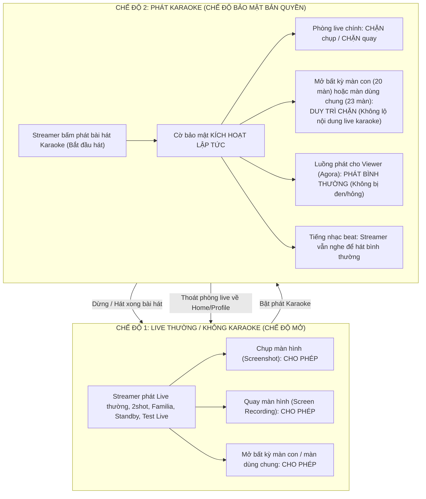

# BẢNG TEST CASE KIỂM THỬ GIAO DIỆN THỦ CÔNG (MANUAL UI TEST SUITE)
## Tính năng: [SURREALDOLLS-15259] Chống quay/chụp màn hình (録画・スクショ防止) phía Streamer khi phát Karaoke (iOS/Android)
### Áp dụng: Quy chuẩn Trụ cột 2 (`Universal_Rules/02_manual_ui_test_case_rule.md`) & Chuẩn bảo mật Livestream Mobile (`SURREALDOLLS-14261`)

---

## BẢNG ĐIỀU KHIỂN TIẾN ĐỘ & THỐNG KÊ (DASHBOARD HEADER)

| Thuộc tính | Giá trị | Thuộc tính | Giá trị | Round 1 Metric (iOS) | Kết quả | Round 2 Metric (Android) | Kết quả |
| :--- | :--- | :--- | :--- | :--- | :--- | :--- | :--- |
| **Module Code** | `SURREALDOLLS-15259` | **Environment** | `Mobile (iOS & Android)` | **Pass** | 0 | **Pass** | 0 |
| **Total Testcases** | **82** | **% Executed** | 0% | **Fail** | 0 | **Fail** | 0 |
| **Plan to Execute** | **82** | **Creator** | `NgaDTP` | **Impact** | 0 | **Impact** | 0 |
| **Spec Source** | `画面一覧_ユーザー_変更管理 (dòng 202–246)` | **Backlog Ticket** | `SURREALDOLLS-15259` (Related: 14253, 14237, 13268) | **Not Run** | 82 | **Not Run** | 82 |
| **Target Build** | `feature/SURREALDOLLS-13268-capture-poc` | **Device Scope** | `iOS 15.6 - 18.x / Android 10 - 15` | **Total** | 82 | **Total** | 82 |

---

## NGUYÊN LÝ HOẠT ĐỘNG CỐT LÕI (STREAMER SECURITY MODEL)

Khác với phía **Viewer** (bị cấm chụp/quay ở 100% các buổi live), phía **Streamer** vận hành theo **nguyên lý 2 trạng thái phân định rõ ràng**:

---

## CHI TIẾT BẢNG TEST CASES (8 CỘT CHUẨN)

| ID | Title | Big item | Steps | Pre-condition | Expected | Priority | Automation Feasibility |
| :---: | :--- | :--- | :--- | :--- | :--- | :---: | :--- |
| | **[1] Chế độ Live & Chuyển đổi trạng thái** | | | | | | |
| `[SURREALDOLLS-15259-1]` | Chế độ Live thường (Không Karaoke) | Live thường - Chụp màn hình OS | 1. Streamer phát phòng Live thường (chế độ bình thường, không bật tính năng Karaoke). 2. Thực hiện chụp ảnh màn hình bằng phím cứng của điện thoại. 3. Mở Thư viện ảnh (Photos / Gallery) kiểm tra ảnh vừa chụp. | Streamer đang trong phòng Live thường (không có bài hát karaoke nào đang phát). | 1. Chụp ảnh thành công 100%. 2. Ảnh trong thư viện hiển thị đầy đủ avatar Live2D, khung chat và giao diện live (không bị đen). | **Critical** | `Auto-UI` |
| `[SURREALDOLLS-15259-2]` | Chế độ Live thường (Không Karaoke) | Live thường - Quay màn hình OS | 1. Streamer đang trong phòng Live thường (không phát karaoke). 2. Bật tính năng Quay màn hình (Screen Recording) của hệ điều hành. 3. Để quay 10-15 giây rồi dừng và lưu video. 4. Mở video vừa quay trong Thư viện để kiểm tra. | Streamer đang trong phòng Live thường. | 1. Video quay màn hình ghi lại đầy đủ hình ảnh phiên live mượt mà, không bị đen màn hình. 2. Âm thanh giọng nói của streamer được thu âm bình thường. | **Critical** | `Auto-UI` |
| `[SURREALDOLLS-15259-3]` | Chế độ Live thường (Không Karaoke) | Live 2-Shot thường - Chụp & Quay OS | 1. Streamer mở phòng Live 2-Shot (giao lưu riêng 1-1 với viewer, không phát karaoke). 2. Thực hiện chụp màn hình và bật quay video màn hình của OS. 3. Kiểm tra file ảnh và video đã lưu. | Streamer đang trong phòng Live 2-Shot không phát karaoke. | 1. Cho phép chụp và quay màn hình bình thường 100%. 2. Không bị chặn hay xuất hiện màn hình đen. | **High** | `Auto-UI` |
| `[SURREALDOLLS-15259-4]` | Vòng đời & Chuyển đổi trạng thái (Lifecycle) | Bật Karaoke - Kích hoạt chặn tức thời | 1. Streamer đang ở phòng Live thường (chụp/quay được bình thường). 2. Mở danh sách bài hát và bấm Bắt đầu phát bài hát Karaoke. 3. Ngay khi nhạc beat vang lên và lời bài hát xuất hiện, thực hiện chụp màn hình và bật quay màn hình OS. | Streamer đang trong phòng Live. | 1. Cờ bảo mật kích hoạt ngay lập tức khi bài hát bắt đầu phát. 2. Android: Ảnh chụp bị chặn hoàn toàn (Toast thông báo / file ảnh đen). 3. iOS: Ảnh chụp ra màn đen hoàn toàn (hoặc cảnh báo tạm dừng). | **Critical** | `Auto-UI` |
| `[SURREALDOLLS-15259-5]` | Vòng đời & Chuyển đổi trạng thái (Lifecycle) | Tắt/Hết bài Karaoke - Tự động gỡ chặn | 1. Streamer đang phát bài hát Karaoke (đang bị chặn chụp/quay). 2. Streamer bấm nút Dừng phát bài hát (Stop) hoặc chờ bài hát kết thúc tự nhiên. 3. Ngay sau khi kết thúc karaoke, thực hiện chụp màn hình và quay video OS. | Streamer đang phát karaoke và dừng bài hát. | 1. Cờ bảo mật tự động được gỡ bỏ ngay khi karaoke kết thúc. 2. Streamer quay trở lại trạng thái Live thường: Chụp và quay màn hình OS thành công 100%, ảnh hiển thị rõ ràng. | **Critical** | `Auto-UI` |
| `[SURREALDOLLS-15259-6]` | Vòng đời & Chuyển đổi trạng thái (Lifecycle) | Chuyển bài hát (Next) - Duy trì liên tục cờ chặn | 1. Streamer đang phát bài hát Karaoke A. 2. Bấm chuyển sang bài hát Karaoke B (Next track). 3. Trong khoảnh khắc chuyển giao giữa 2 bài hát, liên tục thao tác chụp màn hình OS. | Streamer đang phát karaoke có danh sách chờ. | 1. Cờ bảo mật duy trì liên tục xuyên suốt quá trình đổi bài, không có bất kỳ khoảng trống rò rỉ (leak window) nào cho phép chụp được ảnh rõ nét. | **High** | `Auto-UI` |
| `[SURREALDOLLS-15259-7]` | Vòng đời & Chuyển đổi trạng thái (Lifecycle) | Tạm dừng (Pause) Karaoke - Duy trì cờ chặn | 1. Streamer đang phát Karaoke -> Bấm nút Tạm dừng (Pause). 2. Thao tác chụp ảnh và quay màn hình OS. | Bài hát karaoke đang ở trạng thái Tạm dừng trong phòng live. | 1. Vẫn duy trì chặn chụp và quay màn hình (ảnh/video vẫn bị đen) do nội dung bản quyền nhạc/lời vẫn đang tải trong phòng live. | **High** | `Auto-UI` |
| `[SURREALDOLLS-15259-8]` | Vòng đời & Chuyển đổi trạng thái (Lifecycle) | Thoát phòng Live - Gỡ bỏ hoàn toàn cờ chặn | 1. Streamer đang phát bài hát Karaoke trong phòng live. 2. Bấm kết thúc live hoặc thoát hẳn ra ngoài màn hình Home / Profile. 3. Thao tác chụp màn hình tại màn Home / Profile. | Streamer thoát phòng live khi đang phát dở bài hát. | 1. Cờ bảo mật được giải phóng triệt để ngay khi hủy phiên live. 2. Màn hình ngoài của app chụp ảnh bình thường 100%, không bị ảnh đen. | **Critical** | `Auto-UI` |
| `[SURREALDOLLS-15259-9]` | Vòng đời & Chuyển đổi trạng thái (Lifecycle) | Background app rồi mở lại - Không rớt cờ bảo mật | 1. Streamer đang phát Karaoke. 2. Vuốt app xuống thanh điều hướng (Background app) hoặc khóa màn hình trong 3 giây. 3. Mở lại app (Foreground) và chụp màn hình ngay lập tức. | Streamer đang phát karaoke. | 1. App khôi phục hoạt động bình thường, cờ bảo mật vẫn giữ nguyên. 2. Chụp màn hình vẫn bị chặn (ảnh đen/không cho chụp). | **High** | `Auto-UI` |
| | **[2] Chống chụp & quay màn hình đa phương thức** | | | | | | |
| `[SURREALDOLLS-15259-10]` | Chống chụp màn hình (Screenshot Controls) | Chụp bằng tổ hợp phím cứng OS | 1. Streamer đang phát Karaoke trong phòng live. 2. Bấm đồng thời nút Nguồn + Giảm âm lượng (Android) hoặc Nguồn + Tăng âm lượng (iOS). 3. Kiểm tra phản hồi trên màn hình và ảnh trong Thư viện. | Streamer đang phát bài hát karaoke. | 1. Android: Không thể chụp (hiện thông báo 'Chính sách bảo mật chặn chụp' hoặc ảnh lưu đen sì). 2. iOS: Ảnh lưu trong Photos là màn hình đen hoàn toàn. | **Critical** | `Auto-UI` |
| `[SURREALDOLLS-15259-11]` | Chống chụp màn hình (Screenshot Controls) | Chụp bằng cử chỉ OS (Vuốt 3 ngón / Gõ lưng) | 1. Streamer đang phát Karaoke. 2. Thực hiện vuốt 3 ngón tay xuống (Xiaomi/Oppo) hoặc vuốt lòng bàn tay (Samsung) hoặc gõ 2 lần mặt lưng Back Tap (iOS). 3. Kiểm tra kết quả. | Thiết bị bật sẵn tính năng chụp ảnh màn hình bằng cử chỉ. | 1. Cử chỉ chụp bị vô hiệu hóa hoặc ảnh lưu vào Thư viện là màn hình đen hoàn toàn. | **High** | `Auto-UI` |
| `[SURREALDOLLS-15259-12]` | Chống chụp màn hình (Screenshot Controls) | Chụp bằng công cụ trợ năng (AssistiveTouch / Quick Ball) | 1. Streamer đang phát Karaoke. 2. Mở menu phím ảo trợ năng (AssistiveTouch trên iOS hoặc Phím ảo Quick Ball trên Android). 3. Bấm vào nút Chụp ảnh màn hình (Screenshot). | Bật nút trợ năng hệ điều hành. | 1. Android: Báo lỗi bảo mật không cho chụp. 2. iOS: Ảnh chụp xuất ra thư viện là màn hình đen hoàn toàn. | **High** | `Auto-UI` |
| `[SURREALDOLLS-15259-13]` | Chống chụp màn hình (Screenshot Controls) | Chụp bằng trợ lý ảo (Siri / Google Assistant) | 1. Streamer đang phát Karaoke. 2. Kích hoạt Siri ('Hey Siri, take a screenshot') hoặc Google Assistant ('Chụp màn hình'). 3. Trợ lý ảo thực hiện chụp màn hình. | Streamer đang phát karaoke. | 1. Trợ lý ảo thông báo không thể chụp do hạn chế bảo mật ứng dụng hoặc xuất ra file ảnh đen. | **Medium** | `Auto-UI` |
| `[SURREALDOLLS-15259-14]` | Chống chụp màn hình (Screenshot Controls) | Chụp qua phần mềm điều khiển từ xa (scrcpy, Vysor) | 1. Cắm cáp kết nối điện thoại Android/iOS với máy tính qua công cụ scrcpy hoặc QuickTime Player. 2. Mở phòng live và phát Karaoke. 3. Quan sát khung hình hiển thị trên màn hình máy tính. | Thiết bị kết nối máy tính qua ADB / QuickTime. | 1. Android (FLAG_SECURE): Màn hình trên máy tính đen hoàn toàn (scrcpy không lấy được frame). 2. Không thể chụp màn hình từ máy tính. | **High** | `Auto-UI` |
| `[SURREALDOLLS-15259-15]` | Chống chụp màn hình (Screenshot Controls) | Giao diện đa nhiệm (App Switcher / Recent Apps) | 1. Streamer đang phát Karaoke. 2. Vuốt nhẹ từ dưới lên giữ để mở giao diện chuyển đổi ứng dụng đa nhiệm (Recent Apps / App Switcher). 3. Quan sát thumbnail thu nhỏ của app SurrealDolls. | Streamer đang phát karaoke. | 1. Thumbnail của app trong màn hình đa nhiệm hiển thị màn hình đen hoặc làm mờ (blur), không hiển thị rõ nội dung và lời bài hát karaoke. | **Medium** | `Auto-UI` |
| `[SURREALDOLLS-15259-16]` | Chống chụp màn hình (Screenshot Controls) | Chụp khi có thanh thông báo hệ thống kéo xuống | 1. Streamer đang phát Karaoke. 2. Kéo thanh thông báo (Notification Center) hoặc Trung tâm điều khiển xuống đè lên 1 phần màn hình. 3. Thực hiện chụp màn hình OS. | Streamer đang phát karaoke. | 1. Toàn bộ khu vực app SurrealDolls bên dưới thanh thông báo vẫn bị che đen, không làm lộ khung live karaoke. | **Medium** | `Auto-UI` |
| `[SURREALDOLLS-15259-17]` | Chống quay màn hình (Screen Recording Controls) | Bật quay màn hình OS TRƯỚC KHI phát Karaoke | 1. Streamer ở phòng Live thường -> Bật chức năng Quay màn hình OS (Screen Recording). 2. Quay bình thường được 5 giây -> Streamer bấm phát bài hát Karaoke. 3. Hát karaoke khoảng 10 giây -> Dừng quay màn hình và kiểm tra video. | Bật quay màn hình khi đang ở Live thường. | 1. Đoạn live thường trước khi bật karaoke: Video hiển thị hình ảnh rõ ràng. 2. Ngay từ giây bài hát karaoke bắt đầu phát: Video lập tức chuyển sang MÀN HÌNH ĐEN HOÀN TOÀN (Android/iOS Cách A) hoặc xuất hiện popup cảnh báo và nhạc tạm dừng (iOS Cách B). | **Critical** | `Auto-UI` |
| | **[2] Chống quay màn hình đa phương thức** | | | | | | |
| `[SURREALDOLLS-15259-18]` | Chống quay màn hình (Screen Recording Controls) | Bật quay màn hình OS TRONG KHI đang phát Karaoke | 1. Streamer đang phát bài hát Karaoke trong phòng live. 2. Mở Control Center (iOS) hoặc Quick Settings (Android) và bấm Quay màn hình. 3. Quay 10 giây rồi dừng quay -> Mở video trong Photos/Gallery kiểm tra. | Streamer đang phát karaoke. | 1. Toàn bộ video quay được là màn hình đen hoàn toàn 100% từ đầu đến cuối. 2. Không có bất kỳ khung hình karaoke nào bị lộ. | **Critical** | `Auto-UI` |
| `[SURREALDOLLS-15259-19]` | Chống quay màn hình (Screen Recording Controls) | Quay bằng ứng dụng thứ 3 (AZ Recorder / XRecorder) | 1. Cài đặt app quay màn hình bên thứ ba (AZ Screen Recorder, XRecorder) trên Android. 2. Bật ghi màn hình bằng app thứ ba trong khi phát Karaoke. 3. Kiểm tra file video xuất ra. | Đang phát karaoke trên thiết bị Android. | 1. Video xuất ra từ app thứ ba là màn hình đen hoàn toàn do cờ FLAG_SECURE của Android áp dụng ở cấp độ Window Manager. | **High** | `Auto-UI` |
| `[SURREALDOLLS-15259-20]` | Chống quay màn hình (Screen Recording Controls) | Phản chiếu màn hình không dây (AirPlay / Smart View) | 1. Kết nối điện thoại với TV hoặc màn hình ngoài qua AirPlay (iOS) hoặc Smart View / Cast (Android). 2. Bật phát bài hát Karaoke trong phòng live. 3. Quan sát màn hình TV và màn hình điện thoại. | Thiết bị kết nối không dây tới màn hình thứ hai. | 1. Màn hình TV/màn hình ngoài hiển thị màu đen hoặc nội dung bảo vệ bị chặn, không làm lộ màn hình karaoke của streamer. | **High** | `Auto-UI` |
| `[SURREALDOLLS-15259-21]` | Chống quay màn hình (Screen Recording Controls) | Xuất màn hình có dây (HDMI / Type-C) | 1. Cắm cáp chuyển Type-C / Lightning sang HDMI kết nối điện thoại với màn hình rời. 2. Bật phát Karaoke trên app SurrealDolls. 3. Kiểm tra hiển thị trên màn hình rời. | Điện thoại cắm cáp HDMI xuất màn hình ngoài. | 1. Tín hiệu xuất ra màn hình ngoài bị chặn (hiển thị đen) đối với khung hình karaoke. | **Medium** | `Auto-UI` |
| `[SURREALDOLLS-15259-22]` | Chống quay màn hình (Screen Recording Controls) | Cơ chế cảnh báo & tạm dừng khi quay (iOS Cách B) | 1. Trên iOS áp dụng giải pháp Cách B: Streamer đang phát Karaoke. 2. Bật Quay màn hình OS (hệ thống kích hoạt sự kiện `UIScreen.capturedDidChangeNotification`). 3. Quan sát ứng dụng và video. | Bản build iOS triển khai cơ chế Cách B. | 1. Ứng dụng lập tức hiển thị Popup cảnh báo cấm quay màn hình khi hát karaoke. 2. Nhạc bài hát và tiến trình karaoke lập tức tạm dừng (Pause), ngăn chặn việc thu âm và ghi hình lậu. | **High** | `Auto-UI` |
| `[SURREALDOLLS-15259-23]` | Chống quay màn hình (Screen Recording Controls) | Tắt quay màn hình -> Khôi phục phát Karaoke | 1. Đang ở trạng thái tạm dừng cảnh báo do bật quay màn hình. 2. Tắt trình quay màn hình của hệ điều hành. 3. Bấm xác nhận trên popup hoặc bấm Play tiếp tục bài hát. | Đã dừng tính năng quay màn hình OS. | 1. Bài hát tiếp tục phát bình thường, streamer có thể tiếp tục hát mà không bị lỗi app. | **High** | `Auto-UI` |
| | **[3] Luồng Agora & Âm thanh** | | | | | | |
| `[SURREALDOLLS-15259-24]` | Luồng phát Agora (Viewer Stream) | Toàn vẹn luồng Viewer khi Android bật FLAG_SECURE | 1. Streamer dùng máy Android phát Karaoke (hệ thống áp dụng FLAG_SECURE). 2. Dùng 1 máy khác đóng vai trò Viewer vào xem phòng live đó. 3. Quan sát màn hình xem của Viewer. | Streamer (Android) và Viewer cùng trong phòng live karaoke. | 1. Viewer vẫn nhìn thấy hình ảnh Live2D của Streamer cử động mượt mà, lời bài hát hiển thị sắc nét. 2. Cơ chế PixelCopy chụp frame gửi sang Agora hoạt động ổn định, KHÔNG BỊ ĐEN hay giật lag trên màn hình Viewer. | **Critical** | `Auto-UI` |
| `[SURREALDOLLS-15259-25]` | Luồng phát Agora (Viewer Stream) | Toàn vẹn luồng Viewer khi iOS kích hoạt bảo mật | 1. Streamer dùng máy iOS phát Karaoke (áp dụng giải pháp chặn quay/chụp). 2. Máy Viewer theo dõi phòng live. 3. Kiểm tra chất lượng hình ảnh và độ trễ trên máy Viewer. | Streamer (iOS) và Viewer cùng trong phòng live. | 1. Khung hình gửi qua Agora tới Viewer ổn định 100%, không bị ảnh hưởng bởi cơ chế bảo vệ phía Streamer. | **Critical** | `Auto-UI` |
| `[SURREALDOLLS-15259-26]` | Bảo mật Âm thanh (Audio Security) | Check tiếng nhạc beat khi Streamer quay màn hình | 1. Streamer đang phát Karaoke có nhạc nền và đang hát. 2. Bật Screen Recording của OS (kèm tùy chọn thu âm thanh thiết bị). 3. Mở lại video vừa quay và nghe phần âm thanh. | Streamer đang phát karaoke. | 1. Kiểm tra thực tế âm thanh trong file quay: Tiếng nhạc beat có bị thu vào không. 2. Nếu áp dụng cơ chế tạm dừng khi quay (Cách B): Tiếng nhạc beat lập tức dừng, không bị thu trộm vào video. | **High** | `Manual-Only (Visual)` |
| `[SURREALDOLLS-15259-27]` | Bảo mật Âm thanh (Audio Security) | Streamer vẫn nghe rõ nhạc beat để hát | 1. Streamer bấm phát bài hát Karaoke. 2. Kiểm tra âm thanh phát ra loa ngoài hoặc tai nghe của Streamer. | Streamer đang phát karaoke. | 1. Streamer vẫn nghe rõ ràng, đầy đủ tiếng nhạc beat và hiệu ứng echo để hát bình thường (không bị mute nhầm như phía Viewer). | **High** | `Manual-Only (Visual)` |
| `[SURREALDOLLS-15259-28]` | Bảo mật Âm thanh (Audio Security) | Âm thanh phát tới máy Viewer trong buổi Karaoke | 1. Streamer đang hát karaoke. 2. Lắng nghe âm thanh trên thiết bị của Viewer. | Viewer đang theo dõi phòng live. | 1. Viewer nghe rõ tiếng nhạc nền và giọng hát của streamer hòa quyện mượt mà qua Agora Audio, không bị méo tiếng hay mất tiếng. | **High** | `Manual-Only (Visual)` |
| | **[4] In-App Feature & Test Live** | | | | | | |
| `[SURREALDOLLS-15259-29]` | Nút chụp trong App (撮影・録画) | Chặn nút chụp trong app khi phát Karaoke | 1. Streamer đang phát bài hát Karaoke trong phòng live. 2. Bấm vào nút chụp ảnh của app (captureAndSaveStreamImage()). 3. Kiểm tra phản hồi của app. | Streamer đang phát karaoke. | 1. Chức năng chụp ảnh trong app bị vô hiệu hóa hoặc hiện thông báo không thể chụp khi đang phát karaoke. 2. Không xuất file ảnh nào vào thư viện máy. | **High** | `Auto-UI` |
| `[SURREALDOLLS-15259-30]` | Nút chụp trong App (撮影・録画) | Cho phép nút chụp trong app khi Live thường | 1. Streamer đang ở phòng Live thường (không phát karaoke). 2. Bấm vào nút chụp ảnh của app. 3. Kiểm tra ảnh trong thư viện máy. | Streamer đang live thường. | 1. Cho phép chụp ảnh trong app bình thường. 2. Ảnh lưu lại hiển thị rõ avatar Live2D và thông tin live. | **High** | `Auto-UI` |
| `[SURREALDOLLS-15259-31]` | Màn Test Live (配信中_テスト配信) | Màn Test Live khi KHÔNG phát Karaoke | 1. Mở màn hình Live thử (配信中_テスト配信 - Chế độ live thử nghiệm riêng của Streamer). 2. Không bật tính năng phát Karaoke. 3. Thử chụp màn hình và quay video của hệ điều hành. | Đang ở màn 配信中_テスト配信. | 1. Cho phép chụp và quay màn hình OS bình thường. | **High** | `Auto-UI` |
| `[SURREALDOLLS-15259-32]` | Màn Test Live (配信中_テスト配信) | Màn Test Live khi CÓ phát Karaoke | 1. Mở màn hình Live thử (配信中_テスト配信 - Chế độ live thử nghiệm riêng). 2. Chọn bài hát và phát Karaoke trong màn Test Live. 3. Thử chụp màn hình và quay video OS. | Đang phát karaoke trong màn Test Live. | 1. Hệ thống kích hoạt cờ bảo mật: Chặn chụp và quay màn hình OS (ra màn đen). 2. Tránh lộ nội dung bản quyền bài hát karaoke kể cả trong chế độ test. | **Critical** | `Auto-UI` |
| `[SURREALDOLLS-15259-33]` | Màn Test Live (配信中_テスト配信) | Nút 撮影・録画 avatar trong màn Test Live | 1. Đang ở màn hình Live thử (配信中_テスト配信). 2. Bấm nút 撮影・録画 (Nút chụp ảnh / quay video avatar nội bộ do app cung cấp). 3. Kiểm tra tính năng lưu ảnh/video avatar vào thư viện máy. | Đang ở màn Test Live (kiểm tra cả khi tắt và bật karaoke). | 1. Tính năng 撮影・録画 avatar trong app vẫn hoạt động bình thường theo đúng thiết kế giữ nguyên. 2. Không bị cản trở bởi cơ chế chặn quay/chụp của OS. | **Medium** | `Auto-UI` |
| | **[5] Màn con Streamer (項番 199〜218)** | | | | | | |
| `[SURREALDOLLS-15259-34]` | Màn con Streamer (199) | 配信中_2ショット承認リスト_子画面 (Màn con danh sách duyệt 2-Shot) | 1. Streamer đang phát bài hát Karaoke trong phòng live. 2. Mở màn hình con: `配信中_2ショット承認リスト_子画面` (項番 199 - Màn con danh sách duyệt 2-Shot: Danh sách viewer đang chờ streamer duyệt vào phòng giao lưu riêng 1-1.). 3. Thao tác chụp màn hình (bằng phím cứng OS) và bật quay video màn hình của hệ điều hành. 4. Mở Thư viện kiểm tra file ảnh và video. | Streamer đang trong buổi live và đang phát bài hát Karaoke. | 1. Duy trì trạng thái CHẶN chụp và quay màn hình của hệ điều hành (ảnh lưu đen hoàn toàn / quay video màn đen hoặc cảnh báo tạm dừng). 2. Không để lộ bất kỳ hình ảnh nào của màn hình con hoặc phòng live karaoke bên dưới. | **High** | `Auto-UI` |
| `[SURREALDOLLS-15259-35]` | Màn con Streamer (200) | 配信中_BGM子画面 (Màn con nhạc nền (BGM)) | 1. Streamer đang phát bài hát Karaoke trong phòng live. 2. Mở màn hình con: `配信中_BGM子画面` (項番 200 - Màn con nhạc nền (BGM): Chọn bài nhạc nền phát du dương trong lúc streamer trò chuyện.). 3. Thao tác chụp màn hình (bằng phím cứng OS) và bật quay video màn hình của hệ điều hành. 4. Mở Thư viện kiểm tra file ảnh và video. | Streamer đang trong buổi live và đang phát bài hát Karaoke. | 1. Duy trì trạng thái CHẶN chụp và quay màn hình của hệ điều hành (ảnh lưu đen hoàn toàn / quay video màn đen hoặc cảnh báo tạm dừng). 2. Không để lộ bất kỳ hình ảnh nào của màn hình con hoặc phòng live karaoke bên dưới. | **High** | `Auto-UI` |
| `[SURREALDOLLS-15259-36]` | Màn con Streamer (201) | 配信中_ウィスパー返信送信_子画面 (Màn con gửi trả lời Whisper) | 1. Streamer đang phát bài hát Karaoke trong phòng live. 2. Mở màn hình con: `配信中_ウィスパー返信送信_子画面` (項番 201 - Màn con gửi trả lời Whisper: Khung soạn và gửi phản hồi tin nhắn thì thầm riêng tư cho người xem.). 3. Thao tác chụp màn hình (bằng phím cứng OS) và bật quay video màn hình của hệ điều hành. 4. Mở Thư viện kiểm tra file ảnh và video. | Streamer đang trong buổi live và đang phát bài hát Karaoke. | 1. Duy trì trạng thái CHẶN chụp và quay màn hình của hệ điều hành (ảnh lưu đen hoàn toàn / quay video màn đen hoặc cảnh báo tạm dừng). 2. Không để lộ bất kỳ hình ảnh nào của màn hình con hoặc phòng live karaoke bên dưới. | **High** | `Auto-UI` |
| `[SURREALDOLLS-15259-37]` | Màn con Streamer (202) | 配信中_ウィスパー履歴子画面 (Màn con lịch sử Whisper) | 1. Streamer đang phát bài hát Karaoke trong phòng live. 2. Mở màn hình con: `配信中_ウィスパー履歴子画面` (項番 202 - Màn con lịch sử Whisper: Xem lại toàn bộ lịch sử các tin nhắn thì thầm đã trao đổi.). 3. Thao tác chụp màn hình (bằng phím cứng OS) và bật quay video màn hình của hệ điều hành. 4. Mở Thư viện kiểm tra file ảnh và video. | Streamer đang trong buổi live và đang phát bài hát Karaoke. | 1. Duy trì trạng thái CHẶN chụp và quay màn hình của hệ điều hành (ảnh lưu đen hoàn toàn / quay video màn đen hoặc cảnh báo tạm dừng). 2. Không để lộ bất kỳ hình ảnh nào của màn hình con hoặc phòng live karaoke bên dưới. | **High** | `Auto-UI` |
| `[SURREALDOLLS-15259-38]` | Màn con Streamer (203) | 配信中_ガチャ一覧_子画面 (Màn con danh sách Gacha) | 1. Streamer đang phát bài hát Karaoke trong phòng live. 2. Mở màn hình con: `配信中_ガチャ一覧_子画面` (項番 203 - Màn con danh sách Gacha: Xem danh mục các vòng quay may mắn Gacha đang mở trong phòng.). 3. Thao tác chụp màn hình (bằng phím cứng OS) và bật quay video màn hình của hệ điều hành. 4. Mở Thư viện kiểm tra file ảnh và video. | Streamer đang trong buổi live và đang phát bài hát Karaoke. | 1. Duy trì trạng thái CHẶN chụp và quay màn hình của hệ điều hành (ảnh lưu đen hoàn toàn / quay video màn đen hoặc cảnh báo tạm dừng). 2. Không để lộ bất kỳ hình ảnh nào của màn hình con hoặc phòng live karaoke bên dưới. | **High** | `Auto-UI` |
| `[SURREALDOLLS-15259-39]` | Màn con Streamer (204) | 配信中_ガチャ詳細_子画面 (Màn con chi tiết Gacha) | 1. Streamer đang phát bài hát Karaoke trong phòng live. 2. Mở màn hình con: `配信中_ガチャ詳細_子画面` (項番 204 - Màn con chi tiết Gacha: Xem chi tiết tỷ lệ rơi đồ, danh sách quà tặng trong gói Gacha.). 3. Thao tác chụp màn hình (bằng phím cứng OS) và bật quay video màn hình của hệ điều hành. 4. Mở Thư viện kiểm tra file ảnh và video. | Streamer đang trong buổi live và đang phát bài hát Karaoke. | 1. Duy trì trạng thái CHẶN chụp và quay màn hình của hệ điều hành (ảnh lưu đen hoàn toàn / quay video màn đen hoặc cảnh báo tạm dừng). 2. Không để lộ bất kỳ hình ảnh nào của màn hình con hoặc phòng live karaoke bên dưới. | **High** | `Auto-UI` |
| `[SURREALDOLLS-15259-40]` | Màn con Streamer (205) | 配信中_カラオケ設定_子画面 (Màn con cài đặt Karaoke) | 1. Streamer đang phát bài hát Karaoke trong phòng live. 2. Mở màn hình con: `配信中_カラオケ設定_子画面` (項番 205 - Màn con cài đặt Karaoke: Cài đặt thông số bài hát, tone giọng, tốc độ chạy lời karaoke.). 3. Thao tác chụp màn hình (bằng phím cứng OS) và bật quay video màn hình của hệ điều hành. 4. Mở Thư viện kiểm tra file ảnh và video. | Streamer đang trong buổi live và đang phát bài hát Karaoke. | 1. Duy trì trạng thái CHẶN chụp và quay màn hình của hệ điều hành (ảnh lưu đen hoàn toàn / quay video màn đen hoặc cảnh báo tạm dừng). 2. Không để lộ bất kỳ hình ảnh nào của màn hình con hoặc phòng live karaoke bên dưới. | **High** | `Auto-UI` |
| `[SURREALDOLLS-15259-41]` | Màn con Streamer (206) | 配信中_コーデ設定 (Cài đặt trang phục (Coordinate)) | 1. Streamer đang phát bài hát Karaoke trong phòng live. 2. Mở màn hình con: `配信中_コーデ設定` (項番 206 - Cài đặt trang phục (Coordinate): Thay đổi quần áo, trang sức, phụ kiện cho avatar Live2D.). 3. Thao tác chụp màn hình (bằng phím cứng OS) và bật quay video màn hình của hệ điều hành. 4. Mở Thư viện kiểm tra file ảnh và video. | Streamer đang trong buổi live và đang phát bài hát Karaoke. | 1. Duy trì trạng thái CHẶN chụp và quay màn hình của hệ điều hành (ảnh lưu đen hoàn toàn / quay video màn đen hoặc cảnh báo tạm dừng). 2. Không để lộ bất kỳ hình ảnh nào của màn hình con hoặc phòng live karaoke bên dưới. | **High** | `Auto-UI` |
| `[SURREALDOLLS-15259-42]` | Màn con Streamer (207) | 配信中_ブロードキャスト確認子画面 (Màn con xác nhận Broadcast) | 1. Streamer đang phát bài hát Karaoke trong phòng live. 2. Mở màn hình con: `配信中_ブロードキャスト確認子画面` (項番 207 - Màn con xác nhận Broadcast: Hộp thoại xác nhận gửi thông báo đẩy tới toàn bộ fan theo dõi.). 3. Thao tác chụp màn hình (bằng phím cứng OS) và bật quay video màn hình của hệ điều hành. 4. Mở Thư viện kiểm tra file ảnh và video. | Streamer đang trong buổi live và đang phát bài hát Karaoke. | 1. Duy trì trạng thái CHẶN chụp và quay màn hình của hệ điều hành (ảnh lưu đen hoàn toàn / quay video màn đen hoặc cảnh báo tạm dừng). 2. Không để lộ bất kỳ hình ảnh nào của màn hình con hoặc phòng live karaoke bên dưới. | **High** | `Auto-UI` |
| `[SURREALDOLLS-15259-43]` | Màn con Streamer (208) | 配信中_ボイスチェンジャー子画面 (Màn con bộ đổi giọng nói (Voice Changer)) | 1. Streamer đang phát bài hát Karaoke trong phòng live. 2. Mở màn hình con: `配信中_ボイスチェンジャー子画面` (項番 208 - Màn con bộ đổi giọng nói (Voice Changer): Bật/tắt và chọn hiệu ứng biến đổi giọng nói.). 3. Thao tác chụp màn hình (bằng phím cứng OS) và bật quay video màn hình của hệ điều hành. 4. Mở Thư viện kiểm tra file ảnh và video. | Streamer đang trong buổi live và đang phát bài hát Karaoke. | 1. Duy trì trạng thái CHẶN chụp và quay màn hình của hệ điều hành (ảnh lưu đen hoàn toàn / quay video màn đen hoặc cảnh báo tạm dừng). 2. Không để lộ bất kỳ hình ảnh nào của màn hình con hoặc phòng live karaoke bên dưới. | **High** | `Auto-UI` |
| `[SURREALDOLLS-15259-44]` | Màn con Streamer (209) | 配信中_マイクのエコー子画面 (Màn con độ vang Mic (Echo)) | 1. Streamer đang phát bài hát Karaoke trong phòng live. 2. Mở màn hình con: `配信中_マイクのエコー子画面` (項番 209 - Màn con độ vang Mic (Echo): Điều chỉnh mức độ vang vọng âm thanh của mic khi nói/hát.). 3. Thao tác chụp màn hình (bằng phím cứng OS) và bật quay video màn hình của hệ điều hành. 4. Mở Thư viện kiểm tra file ảnh và video. | Streamer đang trong buổi live và đang phát bài hát Karaoke. | 1. Duy trì trạng thái CHẶN chụp và quay màn hình của hệ điều hành (ảnh lưu đen hoàn toàn / quay video màn đen hoặc cảnh báo tạm dừng). 2. Không để lộ bất kỳ hình ảnh nào của màn hình con hoặc phòng live karaoke bên dưới. | **High** | `Auto-UI` |
| `[SURREALDOLLS-15259-45]` | Màn con Streamer (210) | 配信中_モデル設定_外観 (Cài đặt model avatar (ngoại hình)) | 1. Streamer đang phát bài hát Karaoke trong phòng live. 2. Mở màn hình con: `配信中_モデル設定_外観` (項番 210 - Cài đặt model avatar (ngoại hình): Tùy chỉnh màu mắt, kiểu tóc, kích thước hình thể model Live2D.). 3. Thao tác chụp màn hình (bằng phím cứng OS) và bật quay video màn hình của hệ điều hành. 4. Mở Thư viện kiểm tra file ảnh và video. | Streamer đang trong buổi live và đang phát bài hát Karaoke. | 1. Duy trì trạng thái CHẶN chụp và quay màn hình của hệ điều hành (ảnh lưu đen hoàn toàn / quay video màn đen hoặc cảnh báo tạm dừng). 2. Không để lộ bất kỳ hình ảnh nào của màn hình con hoặc phòng live karaoke bên dưới. | **High** | `Auto-UI` |
| `[SURREALDOLLS-15259-46]` | Màn con Streamer (211) | 配信中_リスナー一覧_子画面 (Màn con danh sách người xem (Listener)) | 1. Streamer đang phát bài hát Karaoke trong phòng live. 2. Mở màn hình con: `配信中_リスナー一覧_子画面` (項番 211 - Màn con danh sách người xem (Listener): Xem danh sách các viewer đang có mặt trong phòng live.). 3. Thao tác chụp màn hình (bằng phím cứng OS) và bật quay video màn hình của hệ điều hành. 4. Mở Thư viện kiểm tra file ảnh và video. | Streamer đang trong buổi live và đang phát bài hát Karaoke. | 1. Duy trì trạng thái CHẶN chụp và quay màn hình của hệ điều hành (ảnh lưu đen hoàn toàn / quay video màn đen hoặc cảnh báo tạm dừng). 2. Không để lộ bất kỳ hình ảnh nào của màn hình con hoặc phòng live karaoke bên dưới. | **High** | `Auto-UI` |
| `[SURREALDOLLS-15259-47]` | Màn con Streamer (212) | 配信中_顔表情_子画面 (Màn con biểu cảm khuôn mặt (Face Expression)) | 1. Streamer đang phát bài hát Karaoke trong phòng live. 2. Mở màn hình con: `配信中_顔表情_子画面` (項番 212 - Màn con biểu cảm khuôn mặt (Face Expression): Chạm nhanh để avatar đổi biểu cảm: cười, khóc, giận dữ, bất ngờ.). 3. Thao tác chụp màn hình (bằng phím cứng OS) và bật quay video màn hình của hệ điều hành. 4. Mở Thư viện kiểm tra file ảnh và video. | Streamer đang trong buổi live và đang phát bài hát Karaoke. | 1. Duy trì trạng thái CHẶN chụp và quay màn hình của hệ điều hành (ảnh lưu đen hoàn toàn / quay video màn đen hoặc cảnh báo tạm dừng). 2. Không để lộ bất kỳ hình ảnh nào của màn hình con hoặc phòng live karaoke bên dưới. | **High** | `Auto-UI` |
| `[SURREALDOLLS-15259-48]` | Màn con Streamer (213) | 配信中_限定エモート_子画面 (Màn con Emote giới hạn) | 1. Streamer đang phát bài hát Karaoke trong phòng live. 2. Mở màn hình con: `配信中_限定エモート_子画面` (項番 213 - Màn con Emote giới hạn: Kích hoạt các động tác múa/vẫy tay độc quyền dành riêng cho streamer.). 3. Thao tác chụp màn hình (bằng phím cứng OS) và bật quay video màn hình của hệ điều hành. 4. Mở Thư viện kiểm tra file ảnh và video. | Streamer đang trong buổi live và đang phát bài hát Karaoke. | 1. Duy trì trạng thái CHẶN chụp và quay màn hình của hệ điều hành (ảnh lưu đen hoàn toàn / quay video màn đen hoặc cảnh báo tạm dừng). 2. Không để lộ bất kỳ hình ảnh nào của màn hình con hoặc phòng live karaoke bên dưới. | **High** | `Auto-UI` |
| `[SURREALDOLLS-15259-49]` | Màn con Streamer (214) | 配信中_設定まとめ一覧_子画面 (Màn con cài đặt tổng hợp) | 1. Streamer đang phát bài hát Karaoke trong phòng live. 2. Mở màn hình con: `配信中_設定まとめ一覧_子画面` (項番 214 - Màn con cài đặt tổng hợp: Menu tổng hợp lối tắt tới toàn bộ các tính năng cài đặt phòng.). 3. Thao tác chụp màn hình (bằng phím cứng OS) và bật quay video màn hình của hệ điều hành. 4. Mở Thư viện kiểm tra file ảnh và video. | Streamer đang trong buổi live và đang phát bài hát Karaoke. | 1. Duy trì trạng thái CHẶN chụp và quay màn hình của hệ điều hành (ảnh lưu đen hoàn toàn / quay video màn đen hoặc cảnh báo tạm dừng). 2. Không để lộ bất kỳ hình ảnh nào của màn hình con hoặc phòng live karaoke bên dưới. | **High** | `Auto-UI` |
| `[SURREALDOLLS-15259-50]` | Màn con Streamer (215) | 配信中_背景設定 (Cài đặt hình nền phòng live (Background)) | 1. Streamer đang phát bài hát Karaoke trong phòng live. 2. Mở màn hình con: `配信中_背景設定` (項番 215 - Cài đặt hình nền phòng live (Background): Chọn hình nền phòng (phòng ngủ, sân khấu, ngoài trời, v.v.).). 3. Thao tác chụp màn hình (bằng phím cứng OS) và bật quay video màn hình của hệ điều hành. 4. Mở Thư viện kiểm tra file ảnh và video. | Streamer đang trong buổi live và đang phát bài hát Karaoke. | 1. Duy trì trạng thái CHẶN chụp và quay màn hình của hệ điều hành (ảnh lưu đen hoàn toàn / quay video màn đen hoặc cảnh báo tạm dừng). 2. Không để lộ bất kỳ hình ảnh nào của màn hình con hoặc phòng live karaoke bên dưới. | **High** | `Auto-UI` |
| `[SURREALDOLLS-15259-51]` | Màn con Streamer (216) | 配信中_配信シェア_子画面 (Màn con chia sẻ buổi live (Share)) | 1. Streamer đang phát bài hát Karaoke trong phòng live. 2. Mở màn hình con: `配信中_配信シェア_子画面` (項番 216 - Màn con chia sẻ buổi live (Share): Xuất link và chia sẻ phòng live sang X (Twitter), Line, Facebook.). 3. Thao tác chụp màn hình (bằng phím cứng OS) và bật quay video màn hình của hệ điều hành. 4. Mở Thư viện kiểm tra file ảnh và video. | Streamer đang trong buổi live và đang phát bài hát Karaoke. | 1. Duy trì trạng thái CHẶN chụp và quay màn hình của hệ điều hành (ảnh lưu đen hoàn toàn / quay video màn đen hoặc cảnh báo tạm dừng). 2. Không để lộ bất kỳ hình ảnh nào của màn hình con hoặc phòng live karaoke bên dưới. | **High** | `Auto-UI` |
| `[SURREALDOLLS-15259-52]` | Màn con Streamer (217) | 配信中_配信タイトルの設定_子画面 (Màn con đặt tiêu đề live (Title Setting)) | 1. Streamer đang phát bài hát Karaoke trong phòng live. 2. Mở màn hình con: `配信中_配信タイトルの設定_子画面` (項番 217 - Màn con đặt tiêu đề live (Title Setting): Sửa lại tên/tiêu đề của buổi live trong khi đang phát trực tiếp.). 3. Thao tác chụp màn hình (bằng phím cứng OS) và bật quay video màn hình của hệ điều hành. 4. Mở Thư viện kiểm tra file ảnh và video. | Streamer đang trong buổi live và đang phát bài hát Karaoke. | 1. Duy trì trạng thái CHẶN chụp và quay màn hình của hệ điều hành (ảnh lưu đen hoàn toàn / quay video màn đen hoặc cảnh báo tạm dừng). 2. Không để lộ bất kỳ hình ảnh nào của màn hình con hoặc phòng live karaoke bên dưới. | **High** | `Auto-UI` |
| `[SURREALDOLLS-15259-53]` | Màn con Streamer (218) | 配信中_配信ボード_子画面 (Màn con bảng tin Live Board) | 1. Streamer đang phát bài hát Karaoke trong phòng live. 2. Mở màn hình con: `配信中_配信ボード_子画面` (項番 218 - Màn con bảng tin Live Board: Bảng thông báo/ghi chú của streamer ghim trên màn hình live.). 3. Thao tác chụp màn hình (bằng phím cứng OS) và bật quay video màn hình của hệ điều hành. 4. Mở Thư viện kiểm tra file ảnh và video. | Streamer đang trong buổi live và đang phát bài hát Karaoke. | 1. Duy trì trạng thái CHẶN chụp và quay màn hình của hệ điều hành (ảnh lưu đen hoàn toàn / quay video màn đen hoặc cảnh báo tạm dừng). 2. Không để lộ bất kỳ hình ảnh nào của màn hình con hoặc phòng live karaoke bên dưới. | **High** | `Auto-UI` |
| `[SURREALDOLLS-15259-54]` | Đối chứng Live thường (Màn con) | ĐỐI CHỨNG: Mở 20 màn con Streamer khi LIVE THƯỜNG | 1. Streamer đang ở phòng Live thường (KHÔNG bật Karaoke). 2. Mở các màn hình con của Streamer (VD: `配信中_BGM子画面`, `配信中_背景設定`, `配信中_配信ボード_子画面`...). 3. Thao tác chụp màn hình và quay video của hệ điều hành. | Streamer đang live thường (không phát karaoke). | 1. Cho phép chụp và quay màn hình bình thường 100% (ảnh/video hiển thị đầy đủ, không bị đen). 2. Streamer không bị cấm chụp/quay ở chế độ live thường như phía Viewer. | **Critical** | `Auto-UI` |
| | **[6] Màn dùng chung (項番 220〜242)** | | | | | | |
| `[SURREALDOLLS-15259-55]` | Màn dùng chung (220) | 配信共通_アーティスト曲一覧 (Danh sách bài hát theo nghệ sĩ) | 1. Streamer đang phát bài hát Karaoke trong phòng live. 2. Mở màn hình dùng chung: `配信共通_アーティスト曲一覧` (項番 220 - Danh sách bài hát theo nghệ sĩ: Hiển thị tất cả các bài hát thuộc về ca sĩ/nghệ sĩ đang chọn.). 3. Thao tác chụp màn hình (phím cứng OS) và bật quay màn hình OS. 4. Mở Thư viện ảnh/video kiểm tra kết quả. | Streamer đang trong buổi live và đang phát bài hát Karaoke. | 1. Duy trì trạng thái CHẶN chụp và quay màn hình của hệ điều hành (ảnh chụp ra màn đen hoàn toàn / video quay màn đen hoặc cảnh báo tạm dừng). 2. Đảm bảo toàn bộ 23 màn dùng chung khi mở trong luồng karaoke đều được bảo vệ. | **High** | `Auto-UI` |
| `[SURREALDOLLS-15259-56]` | Màn dùng chung (221) | 配信共通_アーティスト検索 (Tìm kiếm nghệ sĩ) | 1. Streamer đang phát bài hát Karaoke trong phòng live. 2. Mở màn hình dùng chung: `配信共通_アーティスト検索` (項番 221 - Tìm kiếm nghệ sĩ: Ô tìm kiếm tên ca sĩ / nhóm nhạc để chọn bài.). 3. Thao tác chụp màn hình (phím cứng OS) và bật quay màn hình OS. 4. Mở Thư viện ảnh/video kiểm tra kết quả. | Streamer đang trong buổi live và đang phát bài hát Karaoke. | 1. Duy trì trạng thái CHẶN chụp và quay màn hình của hệ điều hành (ảnh chụp ra màn đen hoàn toàn / video quay màn đen hoặc cảnh báo tạm dừng). 2. Đảm bảo toàn bộ 23 màn dùng chung khi mở trong luồng karaoke đều được bảo vệ. | **High** | `Auto-UI` |
| `[SURREALDOLLS-15259-57]` | Màn dùng chung (222) | 配信共通_お気に入りアーティスト一覧 (Danh sách nghệ sĩ yêu thích) | 1. Streamer đang phát bài hát Karaoke trong phòng live. 2. Mở màn hình dùng chung: `配信共通_お気に入りアーティスト一覧` (項番 222 - Danh sách nghệ sĩ yêu thích: Danh sách các nghệ sĩ được người dùng đánh dấu sao yêu thích.). 3. Thao tác chụp màn hình (phím cứng OS) và bật quay màn hình OS. 4. Mở Thư viện ảnh/video kiểm tra kết quả. | Streamer đang trong buổi live và đang phát bài hát Karaoke. | 1. Duy trì trạng thái CHẶN chụp và quay màn hình của hệ điều hành (ảnh chụp ra màn đen hoàn toàn / video quay màn đen hoặc cảnh báo tạm dừng). 2. Đảm bảo toàn bộ 23 màn dùng chung khi mở trong luồng karaoke đều được bảo vệ. | **High** | `Auto-UI` |
| `[SURREALDOLLS-15259-58]` | Màn dùng chung (223) | 配信共通_お気に入り曲一覧 (Danh sách bài hát yêu thích) | 1. Streamer đang phát bài hát Karaoke trong phòng live. 2. Mở màn hình dùng chung: `配信共通_お気に入り曲一覧` (項番 223 - Danh sách bài hát yêu thích: Danh mục các bài hát karaoke yêu thích đã lưu sẵn để hát nhanh.). 3. Thao tác chụp màn hình (phím cứng OS) và bật quay màn hình OS. 4. Mở Thư viện ảnh/video kiểm tra kết quả. | Streamer đang trong buổi live và đang phát bài hát Karaoke. | 1. Duy trì trạng thái CHẶN chụp và quay màn hình của hệ điều hành (ảnh chụp ra màn đen hoàn toàn / video quay màn đen hoặc cảnh báo tạm dừng). 2. Đảm bảo toàn bộ 23 màn dùng chung khi mở trong luồng karaoke đều được bảo vệ. | **High** | `Auto-UI` |
| `[SURREALDOLLS-15259-59]` | Màn dùng chung (224) | 配信共通_お知らせ子画面 (Màn con danh sách thông báo) | 1. Streamer đang phát bài hát Karaoke trong phòng live. 2. Mở màn hình dùng chung: `配信共通_お知らせ子画面` (項番 224 - Màn con danh sách thông báo: Danh sách thông báo chung của hệ thống / sự kiện gửi trong live.). 3. Thao tác chụp màn hình (phím cứng OS) và bật quay màn hình OS. 4. Mở Thư viện ảnh/video kiểm tra kết quả. | Streamer đang trong buổi live và đang phát bài hát Karaoke. | 1. Duy trì trạng thái CHẶN chụp và quay màn hình của hệ điều hành (ảnh chụp ra màn đen hoàn toàn / video quay màn đen hoặc cảnh báo tạm dừng). 2. Đảm bảo toàn bộ 23 màn dùng chung khi mở trong luồng karaoke đều được bảo vệ. | **High** | `Auto-UI` |
| `[SURREALDOLLS-15259-60]` | Màn dùng chung (225) | 配信共通_お知らせ詳細子画面 (Màn con chi tiết thông báo (Webview)) | 1. Streamer đang phát bài hát Karaoke trong phòng live. 2. Mở màn hình dùng chung: `配信共通_お知らせ詳細子画面` (項番 225 - Màn con chi tiết thông báo (Webview): Webview hiển thị chi tiết nội dung văn bản/hình ảnh thông báo.). 3. Thao tác chụp màn hình (phím cứng OS) và bật quay màn hình OS. 4. Mở Thư viện ảnh/video kiểm tra kết quả. | Streamer đang trong buổi live và đang phát bài hát Karaoke. | 1. Duy trì trạng thái CHẶN chụp và quay màn hình của hệ điều hành (ảnh chụp ra màn đen hoàn toàn / video quay màn đen hoặc cảnh báo tạm dừng). 2. Đảm bảo toàn bộ 23 màn dùng chung khi mở trong luồng karaoke đều được bảo vệ. | **High** | `Auto-UI` |
| `[SURREALDOLLS-15259-61]` | Màn dùng chung (226) | 配信共通_ガチャ結果子画面 (Màn con kết quả Gacha) | 1. Streamer đang phát bài hát Karaoke trong phòng live. 2. Mở màn hình dùng chung: `配信共通_ガチャ結果子画面` (項番 226 - Màn con kết quả Gacha: Bảng hiển thị danh sách các món quà nhận được sau khi quay Gacha.). 3. Thao tác chụp màn hình (phím cứng OS) và bật quay màn hình OS. 4. Mở Thư viện ảnh/video kiểm tra kết quả. | Streamer đang trong buổi live và đang phát bài hát Karaoke. | 1. Duy trì trạng thái CHẶN chụp và quay màn hình của hệ điều hành (ảnh chụp ra màn đen hoàn toàn / video quay màn đen hoặc cảnh báo tạm dừng). 2. Đảm bảo toàn bộ 23 màn dùng chung khi mở trong luồng karaoke đều được bảo vệ. | **High** | `Auto-UI` |
| `[SURREALDOLLS-15259-62]` | Màn dùng chung (227) | 配信共通_ガチャ結果待ち子画面 (Màn con chờ kết quả Gacha) | 1. Streamer đang phát bài hát Karaoke trong phòng live. 2. Mở màn hình dùng chung: `配信共通_ガチャ結果待ち子画面` (項番 227 - Màn con chờ kết quả Gacha: Màn hình hiệu ứng quay số trong lúc chờ máy chủ trả kết quả.). 3. Thao tác chụp màn hình (phím cứng OS) và bật quay màn hình OS. 4. Mở Thư viện ảnh/video kiểm tra kết quả. | Streamer đang trong buổi live và đang phát bài hát Karaoke. | 1. Duy trì trạng thái CHẶN chụp và quay màn hình của hệ điều hành (ảnh chụp ra màn đen hoàn toàn / video quay màn đen hoặc cảnh báo tạm dừng). 2. Đảm bảo toàn bộ 23 màn dùng chung khi mở trong luồng karaoke đều được bảo vệ. | **High** | `Auto-UI` |
| `[SURREALDOLLS-15259-63]` | Màn dùng chung (228) | 配信共通_グラフィック子画面 (Màn con cài đặt đồ họa (FPS)) | 1. Streamer đang phát bài hát Karaoke trong phòng live. 2. Mở màn hình dùng chung: `配信共通_グラフィック子画面` (項番 228 - Màn con cài đặt đồ họa (FPS): Điều chỉnh chất lượng đồ họa Live2D (FPS, độ nét, khử răng cưa).). 3. Thao tác chụp màn hình (phím cứng OS) và bật quay màn hình OS. 4. Mở Thư viện ảnh/video kiểm tra kết quả. | Streamer đang trong buổi live và đang phát bài hát Karaoke. | 1. Duy trì trạng thái CHẶN chụp và quay màn hình của hệ điều hành (ảnh chụp ra màn đen hoàn toàn / video quay màn đen hoặc cảnh báo tạm dừng). 2. Đảm bảo toàn bộ 23 màn dùng chung khi mở trong luồng karaoke đều được bảo vệ. | **High** | `Auto-UI` |
| `[SURREALDOLLS-15259-64]` | Màn dùng chung (229) | 配信共通_コメントオプション子画面 (Màn con tùy chọn bình luận) | 1. Streamer đang phát bài hát Karaoke trong phòng live. 2. Mở màn hình dùng chung: `配信共通_コメントオプション子画面` (項番 229 - Màn con tùy chọn bình luận: Bộ lọc ẩn/hiện comment, đổi cỡ chữ, chặn bình luận tiêu cực.). 3. Thao tác chụp màn hình (phím cứng OS) và bật quay màn hình OS. 4. Mở Thư viện ảnh/video kiểm tra kết quả. | Streamer đang trong buổi live và đang phát bài hát Karaoke. | 1. Duy trì trạng thái CHẶN chụp và quay màn hình của hệ điều hành (ảnh chụp ra màn đen hoàn toàn / video quay màn đen hoặc cảnh báo tạm dừng). 2. Đảm bảo toàn bộ 23 màn dùng chung khi mở trong luồng karaoke đều được bảo vệ. | **High** | `Auto-UI` |
| `[SURREALDOLLS-15259-65]` | Màn dùng chung (230) | 配信共通_マイク音量子画面 (Màn con chỉnh âm lượng micro) | 1. Streamer đang phát bài hát Karaoke trong phòng live. 2. Mở màn hình dùng chung: `配信共通_マイク音量子画面` (項番 230 - Màn con chỉnh âm lượng micro: Thanh trượt tăng/giảm âm lượng thu âm của micro.). 3. Thao tác chụp màn hình (phím cứng OS) và bật quay màn hình OS. 4. Mở Thư viện ảnh/video kiểm tra kết quả. | Streamer đang trong buổi live và đang phát bài hát Karaoke. | 1. Duy trì trạng thái CHẶN chụp và quay màn hình của hệ điều hành (ảnh chụp ra màn đen hoàn toàn / video quay màn đen hoặc cảnh báo tạm dừng). 2. Đảm bảo toàn bộ 23 màn dùng chung khi mở trong luồng karaoke đều được bảo vệ. | **High** | `Auto-UI` |
| `[SURREALDOLLS-15259-66]` | Màn dùng chung (231) | 配信共通_歌リク_子画面 (Màn con yêu cầu bài hát (Sing Request)) | 1. Streamer đang phát bài hát Karaoke trong phòng live. 2. Mở màn hình dùng chung: `配信共通_歌リク_子画面` (項番 231 - Màn con yêu cầu bài hát (Sing Request): Danh sách các bài hát do khán giả yêu cầu streamer hát tặng.). 3. Thao tác chụp màn hình (phím cứng OS) và bật quay màn hình OS. 4. Mở Thư viện ảnh/video kiểm tra kết quả. | Streamer đang trong buổi live và đang phát bài hát Karaoke. | 1. Duy trì trạng thái CHẶN chụp và quay màn hình của hệ điều hành (ảnh chụp ra màn đen hoàn toàn / video quay màn đen hoặc cảnh báo tạm dừng). 2. Đảm bảo toàn bộ 23 màn dùng chung khi mở trong luồng karaoke đều được bảo vệ. | **High** | `Auto-UI` |
| `[SURREALDOLLS-15259-67]` | Màn dùng chung (232) | 配信共通_歌唱履歴 (Lịch sử hát Karaoke) | 1. Streamer đang phát bài hát Karaoke trong phòng live. 2. Mở màn hình dùng chung: `配信共通_歌唱履歴` (項番 232 - Lịch sử hát Karaoke: Danh sách các bài hát karaoke đã được trình bày trong buổi live.). 3. Thao tác chụp màn hình (phím cứng OS) và bật quay màn hình OS. 4. Mở Thư viện ảnh/video kiểm tra kết quả. | Streamer đang trong buổi live và đang phát bài hát Karaoke. | 1. Duy trì trạng thái CHẶN chụp và quay màn hình của hệ điều hành (ảnh chụp ra màn đen hoàn toàn / video quay màn đen hoặc cảnh báo tạm dừng). 2. Đảm bảo toàn bộ 23 màn dùng chung khi mở trong luồng karaoke đều được bảo vệ. | **High** | `Auto-UI` |
| `[SURREALDOLLS-15259-68]` | Màn dùng chung (233) | 配信共通_画面オプション子画面 (Màn con tùy chọn màn hình) | 1. Streamer đang phát bài hát Karaoke trong phòng live. 2. Mở màn hình dùng chung: `配信共通_画面オプション子画面` (項番 233 - Màn con tùy chọn màn hình: Tùy chọn ẩn giao diện nút bấm (chế độ xem sạch / toàn màn hình).). 3. Thao tác chụp màn hình (phím cứng OS) và bật quay màn hình OS. 4. Mở Thư viện ảnh/video kiểm tra kết quả. | Streamer đang trong buổi live và đang phát bài hát Karaoke. | 1. Duy trì trạng thái CHẶN chụp và quay màn hình của hệ điều hành (ảnh chụp ra màn đen hoàn toàn / video quay màn đen hoặc cảnh báo tạm dừng). 2. Đảm bảo toàn bộ 23 màn dùng chung khi mở trong luồng karaoke đều được bảo vệ. | **High** | `Auto-UI` |
| `[SURREALDOLLS-15259-69]` | Màn dùng chung (234) | 配信共通_曲検索_キーワード (Tìm bài hát theo từ khóa) | 1. Streamer đang phát bài hát Karaoke trong phòng live. 2. Mở màn hình dùng chung: `配信共通_曲検索_キーワード` (項番 234 - Tìm bài hát theo từ khóa: Ô nhập chữ tự do để tìm kiếm bài hát karaoke theo tên bài.). 3. Thao tác chụp màn hình (phím cứng OS) và bật quay màn hình OS. 4. Mở Thư viện ảnh/video kiểm tra kết quả. | Streamer đang trong buổi live và đang phát bài hát Karaoke. | 1. Duy trì trạng thái CHẶN chụp và quay màn hình của hệ điều hành (ảnh chụp ra màn đen hoàn toàn / video quay màn đen hoặc cảnh báo tạm dừng). 2. Đảm bảo toàn bộ 23 màn dùng chung khi mở trong luồng karaoke đều được bảo vệ. | **High** | `Auto-UI` |
| `[SURREALDOLLS-15259-70]` | Màn dùng chung (235) | 配信共通_曲検索_人気 (Bài hát karaoke phổ biến) | 1. Streamer đang phát bài hát Karaoke trong phòng live. 2. Mở màn hình dùng chung: `配信共通_曲検索_人気` (項番 235 - Bài hát karaoke phổ biến: Danh sách bảng xếp hạng bài hát karaoke được hát nhiều nhất.). 3. Thao tác chụp màn hình (phím cứng OS) và bật quay màn hình OS. 4. Mở Thư viện ảnh/video kiểm tra kết quả. | Streamer đang trong buổi live và đang phát bài hát Karaoke. | 1. Duy trì trạng thái CHẶN chụp và quay màn hình của hệ điều hành (ảnh chụp ra màn đen hoàn toàn / video quay màn đen hoặc cảnh báo tạm dừng). 2. Đảm bảo toàn bộ 23 màn dùng chung khi mở trong luồng karaoke đều được bảo vệ. | **High** | `Auto-UI` |
| `[SURREALDOLLS-15259-71]` | Màn dùng chung (236) | 配信共通_曲検索_年代 (Bài hát theo thập niên) | 1. Streamer đang phát bài hát Karaoke trong phòng live. 2. Mở màn hình dùng chung: `配信共通_曲検索_年代` (項番 236 - Bài hát theo thập niên: Danh mục phân loại bài hát theo năm/thời kỳ (80s, 90s, 2000s, anime...).). 3. Thao tác chụp màn hình (phím cứng OS) và bật quay màn hình OS. 4. Mở Thư viện ảnh/video kiểm tra kết quả. | Streamer đang trong buổi live và đang phát bài hát Karaoke. | 1. Duy trì trạng thái CHẶN chụp và quay màn hình của hệ điều hành (ảnh chụp ra màn đen hoàn toàn / video quay màn đen hoặc cảnh báo tạm dừng). 2. Đảm bảo toàn bộ 23 màn dùng chung khi mở trong luồng karaoke đều được bảo vệ. | **High** | `Auto-UI` |
| `[SURREALDOLLS-15259-72]` | Màn dùng chung (237) | 配信共通_曲詳細_子画面 (Màn con chi tiết bài hát) | 1. Streamer đang phát bài hát Karaoke trong phòng live. 2. Mở màn hình dùng chung: `配信共通_曲詳細_子画面` (項番 237 - Màn con chi tiết bài hát: Xem thông tin chi tiết bài hát: ca sĩ, nhạc sĩ, tone, tempo, thời lượng.). 3. Thao tác chụp màn hình (phím cứng OS) và bật quay màn hình OS. 4. Mở Thư viện ảnh/video kiểm tra kết quả. | Streamer đang trong buổi live và đang phát bài hát Karaoke. | 1. Duy trì trạng thái CHẶN chụp và quay màn hình của hệ điều hành (ảnh chụp ra màn đen hoàn toàn / video quay màn đen hoặc cảnh báo tạm dừng). 2. Đảm bảo toàn bộ 23 màn dùng chung khi mở trong luồng karaoke đều được bảo vệ. | **High** | `Auto-UI` |
| `[SURREALDOLLS-15259-73]` | Màn dùng chung (238) | 配信共通_高額ギフト演出モード (Chế độ hiệu ứng quà tặng giá trị cao) | 1. Streamer đang phát bài hát Karaoke trong phòng live. 2. Mở màn hình dùng chung: `配信共通_高額ギフト演出モード` (項番 238 - Chế độ hiệu ứng quà tặng giá trị cao: Bật/tắt hiệu ứng đồ họa toàn màn hình khi nhận được Super Gift.). 3. Thao tác chụp màn hình (phím cứng OS) và bật quay màn hình OS. 4. Mở Thư viện ảnh/video kiểm tra kết quả. | Streamer đang trong buổi live và đang phát bài hát Karaoke. | 1. Duy trì trạng thái CHẶN chụp và quay màn hình của hệ điều hành (ảnh chụp ra màn đen hoàn toàn / video quay màn đen hoặc cảnh báo tạm dừng). 2. Đảm bảo toàn bộ 23 màn dùng chung khi mở trong luồng karaoke đều được bảo vệ. | **High** | `Auto-UI` |
| `[SURREALDOLLS-15259-74]` | Màn dùng chung (239) | 配信共通_採点_子画面 (Màn con chấm điểm Karaoke) | 1. Streamer đang phát bài hát Karaoke trong phòng live. 2. Mở màn hình dùng chung: `配信共通_採点_子画面` (項番 239 - Màn con chấm điểm Karaoke: Bảng kết quả chấm điểm giọng hát xuất hiện khi kết thúc bài hát.). 3. Thao tác chụp màn hình (phím cứng OS) và bật quay màn hình OS. 4. Mở Thư viện ảnh/video kiểm tra kết quả. | Streamer đang trong buổi live và đang phát bài hát Karaoke. | 1. Duy trì trạng thái CHẶN chụp và quay màn hình của hệ điều hành (ảnh chụp ra màn đen hoàn toàn / video quay màn đen hoặc cảnh báo tạm dừng). 2. Đảm bảo toàn bộ 23 màn dùng chung khi mở trong luồng karaoke đều được bảo vệ. | **High** | `Auto-UI` |
| `[SURREALDOLLS-15259-75]` | Màn dùng chung (240) | 配信共通_相手の音量子画面 (Màn con âm lượng đối phương (2shot)) | 1. Streamer đang phát bài hát Karaoke trong phòng live. 2. Mở màn hình dùng chung: `配信共通_相手の音量子画面` (項番 240 - Màn con âm lượng đối phương (2shot): Thanh trượt chỉnh to/nhỏ tiếng của người cùng trò chuyện trong 2shot.). 3. Thao tác chụp màn hình (phím cứng OS) và bật quay màn hình OS. 4. Mở Thư viện ảnh/video kiểm tra kết quả. | Streamer đang trong buổi live và đang phát bài hát Karaoke. | 1. Duy trì trạng thái CHẶN chụp và quay màn hình của hệ điều hành (ảnh chụp ra màn đen hoàn toàn / video quay màn đen hoặc cảnh báo tạm dừng). 2. Đảm bảo toàn bộ 23 màn dùng chung khi mở trong luồng karaoke đều được bảo vệ. | **High** | `Auto-UI` |
| `[SURREALDOLLS-15259-76]` | Màn dùng chung (241) | 配信共通_未登録曲の追加申請 (Danh sách đơn xin thêm bài hát) | 1. Streamer đang phát bài hát Karaoke trong phòng live. 2. Mở màn hình dùng chung: `配信共通_未登録曲の追加申請` (項番 241 - Danh sách đơn xin thêm bài hát: Quản lý danh sách các bài hát người dùng đã nộp đơn yêu cầu thêm.). 3. Thao tác chụp màn hình (phím cứng OS) và bật quay màn hình OS. 4. Mở Thư viện ảnh/video kiểm tra kết quả. | Streamer đang trong buổi live và đang phát bài hát Karaoke. | 1. Duy trì trạng thái CHẶN chụp và quay màn hình của hệ điều hành (ảnh chụp ra màn đen hoàn toàn / video quay màn đen hoặc cảnh báo tạm dừng). 2. Đảm bảo toàn bộ 23 màn dùng chung khi mở trong luồng karaoke đều được bảo vệ. | **High** | `Auto-UI` |
| `[SURREALDOLLS-15259-77]` | Màn dùng chung (242) | 配信共通_未登録曲の追加申請新規 (Tạo mới đơn xin thêm bài hát) | 1. Streamer đang phát bài hát Karaoke trong phòng live. 2. Mở màn hình dùng chung: `配信共通_未登録曲の追加申請新規` (項番 242 - Tạo mới đơn xin thêm bài hát: Form nhập tên bài hát, ca sĩ để yêu cầu ban quản trị mua bản quyền.). 3. Thao tác chụp màn hình (phím cứng OS) và bật quay màn hình OS. 4. Mở Thư viện ảnh/video kiểm tra kết quả. | Streamer đang trong buổi live và đang phát bài hát Karaoke. | 1. Duy trì trạng thái CHẶN chụp và quay màn hình của hệ điều hành (ảnh chụp ra màn đen hoàn toàn / video quay màn đen hoặc cảnh báo tạm dừng). 2. Đảm bảo toàn bộ 23 màn dùng chung khi mở trong luồng karaoke đều được bảo vệ. | **High** | `Auto-UI` |
| `[SURREALDOLLS-15259-78]` | Đối chứng Live thường (Màn dùng chung) | ĐỐI CHỨNG: Mở 23 màn dùng chung khi LIVE THƯỜNG | 1. Streamer đang ở phòng Live thường (KHÔNG bật Karaoke). 2. Mở các màn hình dùng chung (VD: `配信共通_お知らせ子画面`, `配信共通_曲検索_キーワード`, `配信共通_マイク音量子画面`...). 3. Thao tác chụp màn hình và quay video của hệ điều hành. | Streamer đang live thường (không phát karaoke). | 1. Cho phép chụp và quay màn hình bình thường 100% (ảnh/video hiển thị đầy đủ, không bị đen). 2. Khẳng định sự khác biệt cốt lõi: Streamer chỉ bị chặn khi phát karaoke, còn lại được mở hoàn toàn. | **Critical** | `Auto-UI` |
| | **[7] Nghiệm thu Evidence & Thiết bị** | | | | | | |
| `[SURREALDOLLS-15259-79]` | Nghiệm thu Evidence & Thiết bị | Thu thập Evidence trên máy iOS (iPhone 8/X đến 15/16 Pro) | 1. Thực hiện kịch bản trên máy iOS 15.6 (tối thiểu) và iOS mới nhất (17.x/18.x). 2. Lưu toàn bộ ảnh chụp (đen) và video quay (đen/cảnh báo) vào thư mục evidence chuẩn theo quy định. | Thiết bị iOS thật kết nối môi trường test. | 1. Có đủ bằng chứng ảnh/video chứng minh hành vi chặn khi karaoke và cho phép khi live thường trên iOS. | **High** | `Manual-Only (Visual)` |
| `[SURREALDOLLS-15259-80]` | Nghiệm thu Evidence & Thiết bị | Thu thập Evidence trên máy Android (Samsung One UI & Xiaomi/Oppo) | 1. Thực hiện kịch bản trên máy Samsung (Android 13/14) và Xiaomi (HyperOS/MIUI). 2. Lưu ảnh Toast chặn chụp và video màn hình đen không tiếng vào thư mục evidence chuẩn. | Thiết bị Android thật kết nối môi trường test. | 1. Bằng chứng rõ ràng: FLAG_SECURE hoạt động hoàn hảo, video quay ra đen 100% trên các hãng Android. | **High** | `Manual-Only (Visual)` |
| `[SURREALDOLLS-15259-81]` | Nghiệm thu Evidence & Thiết bị | Kiểm tra báo cáo công số & giải pháp kỹ thuật iOS bàn giao BA/PM | 1. Đối chiếu kết quả thực tế giữa Cách A (lấy frame Unity) và Cách B (cảnh báo tạm dừng trên UIScreen.isCaptured). 2. Ghi nhận đề xuất xử lý âm thanh tiếng nhạc beat khi quay. | Tài liệu bàn giao nghiệm thu POC ticket SURREALDOLLS-15259. | 1. Có đầy đủ số liệu công số, phân tích ưu/nhược điểm rủi ro và video/ảnh bằng chứng máy thật theo đúng yêu cầu bàn giao của ticket. | **Critical** | `Manual-Only (UX)` |
| `[SURREALDOLLS-15259-82]` | Nghiệm thu Evidence & Thiết bị | Verify giải phóng hoàn toàn cờ bảo mật sau khi rời phòng live | 1. Sau khi kết thúc live, vào màn hình Nạp tiền Point (L100 qua GMO-PG) chụp ảnh giao dịch. 2. Vào Profile chụp ảnh QR code cá nhân. | Streamer đã kết thúc phiên live hoàn toàn. | 1. Chụp ảnh màn hình các trang ngoài hoạt động bình thường 100%, không bị ảnh đen. | **Critical** | `Auto-UI` |

---

## BẢNG MA TRẬN THIẾT BỊ KIỂM THỬ (TEST DEVICE MATRIX)

| Nền tảng | Dòng máy đại diện | Phiên bản OS | Trình ghi hình / Phương thức kiểm tra | Người thực hiện |
| :--- | :--- | :--- | :--- | :--- |
| **iOS (Min Scope)** | iPhone 8 / iPhone X | `iOS 15.6` | Trình ghi Control Center + Cáp Mac QuickTime | `NgaDTP` |
| **iOS (Latest Scope)**| iPhone 14 Pro / 15 Pro | `iOS 17.x / 18.x` | Control Center + Chụp phím cứng | `NgaDTP` |
| **Android (Brand 1)** | Samsung Galaxy S21 / S22 | `Android 13 / 14 (One UI)` | Trình ghi màn hình tích hợp Samsung + Smart View | `NgaDTP` |
| **Android (Brand 2)** | Xiaomi Redmi Note / Mi Series | `Android 12 / 13 (HyperOS)` | Trình ghi màn hình Xiaomi + Vuốt 3 ngón | `NgaDTP` |
| **Android (3rd-party)**| Google Pixel / Máy test bất kỳ | `Android 11 - 14` | App thứ 3: AZ Screen Recorder / scrcpy máy tính | `NgaDTP` |

---

## BẢNG TRA CỨU THUẬT NGỮ & MÀN HÌNH TIẾNG NHẬT (SPEC GLOSSARY)

### 1. Quy ước cấu trúc định danh Spec
| Tiền tố / Hậu tố | Phiên âm Romaji | Ý nghĩa tiếng Việt | Phạm vi hiển thị |
| :--- | :--- | :--- | :--- |
| **`配信中_`** | *Hai-shin chū* | **Đang phát Live** | Màn hình riêng biệt xuất hiện trong phiên live từ góc nhìn Streamer. |
| **`配信共通_`** | *Hai-shin kyō-tsū* | **Dùng chung trong Live** | Màn hình dùng chung, cả Streamer và Viewer đều mở được trong phòng live. |
| **`_子画面`** | *Ko-ga-men* | **Màn hình con / Sub-screen** | Modal popup, Bottom sheet hoặc Drawer đè lên trên màn hình live chính. |

---

### 2. Danh mục 20 Màn hình Con Streamer (項番 199〜218)
| 項番 (No.) | Tên Màn Hình Tiếng Nhật | Ý Nghĩa Chức Năng Tiếng Việt | Mô Tả Nghiệp Vụ Thực Tế |
| :---: | :--- | :--- | :--- |
| **199** | `配信中_2ショット承認リスト_子画面` | Màn con danh sách duyệt 2-Shot | Danh sách viewer đang chờ streamer duyệt vào phòng giao lưu riêng 1-1. |
| **200** | `配信中_BGM子画面` | Màn con nhạc nền (BGM) | Chọn bài nhạc nền phát du dương trong lúc streamer trò chuyện. |
| **201** | `配信中_ウィスパー返信送信_子画面` | Màn con gửi trả lời Whisper | Khung soạn và gửi phản hồi tin nhắn thì thầm riêng tư cho người xem. |
| **202** | `配信中_ウィスパー履歴子画面` | Màn con lịch sử Whisper | Xem lại toàn bộ lịch sử các tin nhắn thì thầm đã trao đổi. |
| **203** | `配信中_ガチャ一覧_子画面` | Màn con danh sách Gacha | Xem danh mục các vòng quay may mắn Gacha đang mở trong phòng. |
| **204** | `配信中_ガチャ詳細_子画面` | Màn con chi tiết Gacha | Xem chi tiết tỷ lệ rơi đồ, danh sách quà tặng trong gói Gacha. |
| **205** | `配信中_カラオケ設定_子画面` | Màn con cài đặt Karaoke | Cài đặt thông số bài hát, tone giọng, tốc độ chạy lời karaoke. |
| **206** | `配信中_コーデ設定` | Cài đặt trang phục (Coordinate) | Thay đổi quần áo, trang sức, phụ kiện cho avatar Live2D. |
| **207** | `配信中_ブロードキャスト確認子画面` | Màn con xác nhận Broadcast | Hộp thoại xác nhận gửi thông báo đẩy tới toàn bộ fan theo dõi. |
| **208** | `配信中_ボイスチェンジャー子画面` | Màn con bộ đổi giọng nói | Bật/tắt và chọn hiệu ứng biến đổi giọng nói (Voice Changer). |
| **209** | `配信中_マイクのエコー子画面` | Màn con độ vang Mic (Echo) | Điều chỉnh mức độ vang vọng âm thanh của mic khi nói/hát. |
| **210** | `配信中_モデル設定_外観` | Cài đặt model avatar (ngoại hình) | Tùy chỉnh màu mắt, kiểu tóc, kích thước hình thể model Live2D. |
| **211** | `配信中_リスナー一覧_子画面` | Màn con danh sách người xem | Xem danh sách các viewer (listeners) đang có mặt trong phòng live. |
| **212** | `配信中_顔表情_子画面` | Màn con biểu cảm khuôn mặt | Chạm nhanh để avatar đổi biểu cảm: cười, khóc, giận dữ, bất ngờ. |
| **213** | `配信中_限定エモート_子画面` | Màn con Emote giới hạn | Kích hoạt các động tác múa/vẫy tay độc quyền dành riêng cho streamer. |
| **214** | `配信中_設定まとめ一覧_子画面` | Màn con cài đặt tổng hợp | Menu tổng hợp lối tắt tới toàn bộ các tính năng cài đặt phòng. |
| **215** | `配信中_背景設定` | Cài đặt hình nền phòng live | Chọn hình nền phòng (phòng ngủ, sân khấu, ngoài trời, v.v.). |
| **216** | `配信中_配信シェア_子画面` | Màn con chia sẻ buổi live | Xuất link và chia sẻ phòng live sang X (Twitter), Line, Facebook. |
| **217** | `配信中_配信タイトルの設定_子画面` | Màn con đặt tiêu đề live | Sửa lại tên/tiêu đề của buổi live trong khi đang phát trực tiếp. |
| **218** | `配信中_配信ボード_子画面` | Màn con bảng tin Live Board | Bảng thông báo/ghi chú của streamer ghim trên màn hình live. |

---

### 3. Danh mục 23 Màn hình Dùng Chung (配信共通 項番 220〜242)
| 項番 (No.) | Tên Màn Hình Tiếng Nhật | Ý Nghĩa Chức Năng Tiếng Việt | Mô Tả Nghiệp Vụ Thực Tế |
| :---: | :--- | :--- | :--- |
| **220** | `配信共通_アーティスト曲一覧` | Danh sách bài hát theo nghệ sĩ | Hiển thị tất cả các bài hát thuộc về ca sĩ/nghệ sĩ đang chọn. |
| **221** | `配信共通_アーティスト検索` | Tìm kiếm nghệ sĩ | Ô tìm kiếm tên ca sĩ / nhóm nhạc để chọn bài. |
| **222** | `配信共通_お気に入りアーティスト一覧` | Danh sách nghệ sĩ yêu thích | Danh sách các nghệ sĩ được người dùng đánh dấu sao yêu thích. |
| **223** | `配信共通_お気に入り曲一覧` | Danh sách bài hát yêu thích | Danh mục các bài hát karaoke yêu thích đã lưu sẵn để hát nhanh. |
| **224** | `配信共通_お知らせ子画面` | Màn con danh sách thông báo | Danh sách thông báo chung của hệ thống / sự kiện gửi trong live. |
| **225** | `配信共通_お知らせ詳細子画面` | Màn con chi tiết thông báo | Webview hiển thị chi tiết nội dung văn bản/hình ảnh thông báo. |
| **226** | `配信共通_ガチャ結果子画面` | Màn con kết quả Gacha | Bảng hiển thị danh sách các món quà nhận được sau khi quay Gacha. |
| **227** | `配信共通_ガチャ結果待ち子画面` | Màn con chờ kết quả Gacha | Màn hình hiệu ứng quay số trong lúc chờ máy chủ trả kết quả. |
| **228** | `配信共通_グラフィック子画面` | Màn con cài đặt đồ họa | Điều chỉnh chất lượng đồ họa Live2D (FPS, độ nét, khử răng cưa). |
| **229** | `配信共通_コメントオプション子画面` | Màn con tùy chọn bình luận | Bộ lọc ẩn/hiện comment, đổi cỡ chữ, chặn bình luận tiêu cực. |
| **230** | `配信共通_マイク音量子画面` | Màn con chỉnh âm lượng micro | Thanh trượt tăng/giảm âm lượng thu âm của micro. |
| **231** | `配信共通_歌リク_子画面` | Màn con yêu cầu bài hát (Sing Request)| Danh sách các bài hát do khán giả yêu cầu streamer hát tặng. |
| **232** | `配信共通_歌唱履歴` | Lịch sử hát Karaoke | Danh sách các bài hát karaoke đã được trình bày trong buổi live. |
| **233** | `配信共通_画面オプション子画面` | Màn con tùy chọn màn hình | Tùy chọn ẩn giao diện nút bấm (chế độ xem sạch / toàn màn hình). |
| **234** | `配信共通_曲検索_キーワード` | Tìm bài hát theo từ khóa | Ô nhập chữ tự do để tìm kiếm bài hát karaoke theo tên bài. |
| **235** | `配信共通_曲検索_人気` | Bài hát karaoke phổ biến | Danh sách bảng xếp hạng bài hát karaoke được hát nhiều nhất. |
| **236** | `配信共通_曲検索_年代` | Bài hát theo thập niên | Danh mục phân loại bài hát theo năm/thời kỳ (80s, 90s, 2000s, anime...). |
| **237** | `配信共通_曲詳細_子画面` | Màn con chi tiết bài hát | Xem thông tin chi tiết bài hát: ca sĩ, nhạc sĩ, tone, tempo, thời lượng. |
| **238** | `配信共通_高額ギフト演出モード` | Chế độ hiệu ứng quà tặng giá trị cao | Bật/tắt hiệu ứng đồ họa toàn màn hình khi nhận được Super Gift. |
| **239** | `配信共通_採点_子画面` | Màn con chấm điểm Karaoke | Bảng kết quả chấm điểm giọng hát xuất hiện khi kết thúc bài hát. |
| **240** | `配信共通_相手の音量子画面` | Màn con âm lượng đối phương | Thanh trượt chỉnh to/nhỏ tiếng của người cùng trò chuyện trong 2shot. |
| **241** | `配信共通_未登録曲の追加申請` | Danh sách đơn xin thêm bài hát | Quản lý danh sách các bài hát người dùng đã nộp đơn yêu cầu thêm. |
| **242** | `配信共通_未登録曲の追加申請新規` | Tạo mới đơn xin thêm bài hát | Form nhập tên bài hát, ca sĩ để yêu cầu ban quản trị mua bản quyền. |

---

### 4. Thuật ngữ tính năng & Nút thao tác nội bộ
* **`撮影・録画` (Satsu-ei / Roku-ga):** Nút icon chụp ảnh / quay clip avatar trong ứng dụng (tính năng nội bộ của SurrealDolls).
* **`2ショット` (2-Shot):** Tính năng livestream riêng tư 1-1 giữa Streamer và 1 khán giả duy nhất.
* **`ウィスパー` (Whisper):** Tính năng gửi tin nhắn trò chuyện thì thầm riêng tư trong lúc đang live.
* **`歌リク` (Uta-riku / Uta Request):** Khán giả gửi yêu cầu bài hát kèm tặng coin/gift cho streamer.
* **`採点` (Sai-ten):** Tính năng chấm điểm giọng hát tự động theo cao độ và nhịp điệu của bài hát.
